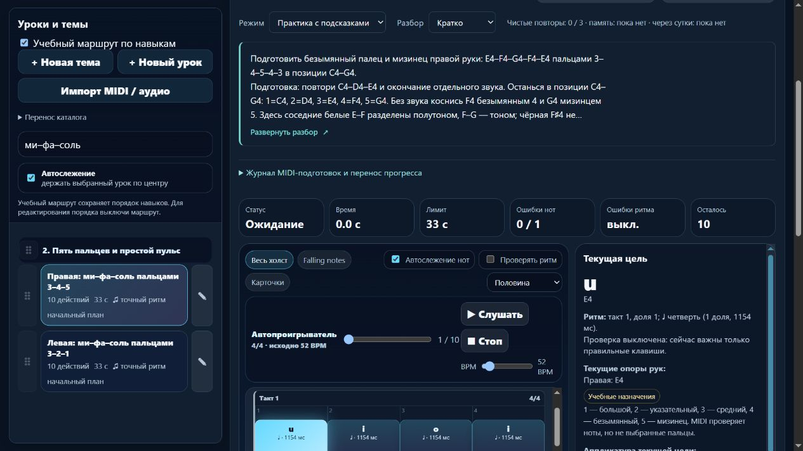

# Первый изменённый выпуск через постоянный updater: 23.5.34

7 ноября 2026 года, **22:02:02 UTC 6 ноября / 03:02:02 Екатеринбург 7 ноября**. **Выложено и проверено:** [melodiajest.ru](https://melodiajest.ru/) обслуживает **23.5.34**, включая [учебную партию 34](piano-curriculum-2026-11-07-34.md). Транзакция **`aecff2556dfe4ecebfad47b827e98dfd`** завершена в фазе **`committed`**. Машинные доказательства — соседний JSON; браузерные — `docs/qa/melodiajest-2026-11-07-04-live.json`.

## Подготовка и архив

- **644/644 npm-тестов**, применимые `audit:lessons`, `audit:fingering`, `audit:curriculum`, `audit:piano-coverage`, `audit:reading-bank` и `build:web` завершены до публикации. 571 старая музыкальная версия сохранена, добавлен один урок. Это не независимая преподавательская проверка.
- Архив **`dist/melodiajest-23.5.34-20261107-34.tar.gz`**, **1701154 байта**, SHA256 **`07067fba67a4a590be7b1c8da95d090d65c7db955902e22128d8423aac36e6f9`**.
- Внутри: **28** публичных файлов, **3** собственных конфига, **335** выбранных файлов фактического checkout и манифест архива. **367 файлов** прочитаны и восстановлены на компьютере и на VPS в изолированных новых каталогах. Это доказательство файлового восстановления, не расшифрования S3.
- Снимок исходников сделан на checkpoint «локально проверено, публикация ожидается». Итоговые квитанции этой выкладки и последующие изменения документации появились позже и не объявляются частью исходного архива. Пользовательский `trainer-content.json`, секреты, Git, браузерные экспорты и медиа в архив не включены.
- До изменения, **22:00:33 UTC**, все четыре HTTPS-сайта ответили 200 после штатных редиректов; текущим был 23.5.33. Свободно **8996663296 байт** на диске, MemAvailable **2021888 kB**. Текущий SHA манифеста совпал с ожидаемым, контейнер был healthy.

## Что выполнено на VPS

Использован уже проверенный постоянный **`/opt/melodiajest/ops/tooling/updater-151e5261f43253a8/release_update.py`**, после сверки SHA трёх файлов с квитанцией размещения. Доступ — существующий SSH-помощник Libreta со строгой проверкой хоста; ключи не выводились и не копировались. Транспортный checkpoint — `tmp/publish-melodiajest-23-5-34.py`; транзакцией управляет постоянный CLI, не этот транспортный скрипт.

Архив помещён в собственный приватный `ops/release-23.5.34-07067fba67a4` (каталог 0700, архив 0600). Восстановление и `plan` проверили версию, хеши, состав и точное совпадение собственных конфигов. Затем `install` самостоятельно захватил **`/run/lock/libre-deploy.lock`** и собственный `ops/operation.lock`; внешняя блокировка поверх CLI не удерживалась, чужие операции не прерывались.

| Результат | Проверенное значение |
| --- | --- |
| `current` | `releases/23.5.34-7defa41db5b6` |
| `previous` | `releases/23.5.33` |
| Новый публичный манифест SHA256 | `7defa41db5b6eb5e56f4556460720fd7cea9813d72f51ec68d6291030fd4d417` |
| Прежний манифест SHA256 | `15c94a486b7d18f65dddadb1999849b651355f850c5f93faa30e07ec30e531cd` |
| Сервис / контейнер | `melodiajest-static` / `melodiajest-web-1` |
| Архив текущего выпуска на VPS | `/opt/melodiajest/ops/artifacts/07067fba67a4a590be7b1c8da95d090d65c7db955902e22128d8423aac36e6f9.tar.gz` |
| Журнал транзакции | `/opt/melodiajest/ops/updates/aecff2556dfe4ecebfad47b827e98dfd.json` |

Пересоздан только собственный сервис с `--no-deps --no-build --pull never --force-recreate --wait`. Это действительно обновило bind mount после смены symlink. Образ **`sha256:985220252f3863977e468f611ef118ebd01421289dd86ee1ae99cb068c3bce2b`**, лимиты, user 101:101, read-only, уникальные aliases в `libre_public` и отсутствие публичного порта сохранены. Общий Caddy не перезапускался и не редактировался: SHA **`7f0e235d16f9dcaf2ac0649d5fb9c2b99af845ffe95684584ed0386cfbaf2813`**, inode **131363**, собственные конфиги совпали до/после.

## Копия и откат

Перед переключением создан **`/opt/melodiajest/ops/backups/before-update-aecff2556dfe4ecebfad47b827e98dfd.tar.gz`**, **292549 байт**, SHA256 **`da1496a24ba41142fbc6807f61c842fe116b0e2616203ce5e0cc14878b830529`**, восстановление файлов подтверждено до изменения `current`. Это копия прежнего выпуска 23.5.33 и трёх конфигов, **без исходников**. Её байты совпали с ранее скачанной/восстановленной копией, поэтому тот же архив повторно не скачивался.

Новый архив 23.5.34 отдельно содержит 335 выбранных исходных файлов, восстановленных на двух машинах. Локальная копия архива и серверная сохранены. Исходники предыдущего checkpoint 325 файлов также остаются в собственной копии партии 03. Ни одна из этих копий не покрывает личный прогресс в браузере.

Путь отката на **23.5.33** сохранён. Явный откат, отказ новой проверки с автоматическим возвратом и восстановление уже проверены на изолированном Linux/Nginx в партии 02. **На рабочем сайте намеренный откат в этой партии не выполнялся**: выпуск прошёл проверки, ненужное дополнительное переключение не создавалось. При реальной регрессии CLI умеет возвратить прежнюю версию и повторить проверки; журнал не позволяет молча продолжать незавершённую операцию.

## После выпуска

- Сравнены байты/SHA **всех 28** публичных файлов и главной страницы с новым артефактом, HTTPS прошёл штатную проверку сертификатов.
- HTTP → HTTPS **308**, HTTPS-www → канонический домен **301**; путь и query сохранены. Приватные `/server.cjs`, `/trainer-content.json`, `/.env`, `/api/content`, Windows launch и MIDI bridge вернули **404**, POST главной — **405**.
- Контейнер healthy; **Libreta / Praicer / Grigorova — 200** после их штатных редиректов, общий Caddy и конфиги не изменились.
- В настоящем браузере по **https://melodiajest.ru/** видны **424 упражнения**. Доступный поиск нашёл новый правый мостик, полный разбор раскрылся Enter и свернулся пробелом. Компактное превью — **5 строк**. В памяти нет блока и кнопки подсказок; поиск произведений имеет отдельное доступное имя. Ошибок/предупреждений консоли в проверенной вкладке не найдено.
- Настоящие MIDI и звук не включались. После проверки возвращены исходный первый урок, пустой поиск и практика с компактным видом. Собственная вкладка 85 закрыта, preview 56611 остановлен; пользовательская вкладка **127.0.0.1:4173** сохранена.

## Оставшиеся ограничения и следующий шаг

Собственный изменённый выпуск через постоянный updater теперь **подтверждён на production**. Ручные копии и файловое восстановление подтверждены; автоматическое ежедневное резервирование, независимая зашифрованная S3-копия, её чтение/расшифрование, периодический restore-check и ротация **пока не настроены**. Серверный архив не сохраняет приватный браузерный каталог и прогресс; им нужен отдельный экспорт.

Следующая эксплуатационная партия: оформить собственную ежедневную копию current/previous, конфигов и сохранённого исходного артефакта, проверку свежести и изолированный restore-check в идемпотентных серверных службах/таймерах MelodiaJest, используя уже проверенный контракт архивов. После локального резервирования подтвердить собственный S3 namespace/доступ и шифрование внешних копий; чужие бакеты, ключи и таймеры Libreta не менять. Музыкальный курсор — `course02-04`; следующий малый учебный этап — `course02-05/06`.

Квота проверена штатно перед выпуском и при сохранении результата: расход **68%**, остаток **32%** недельного окна Codex, ordinary usage разрешён, spend control не достигнут; резерв 0%. Новые платные услуги, DNS, чужие сервисы, массовая очистка, commit/push и `guitarjest` не затрагивались.
