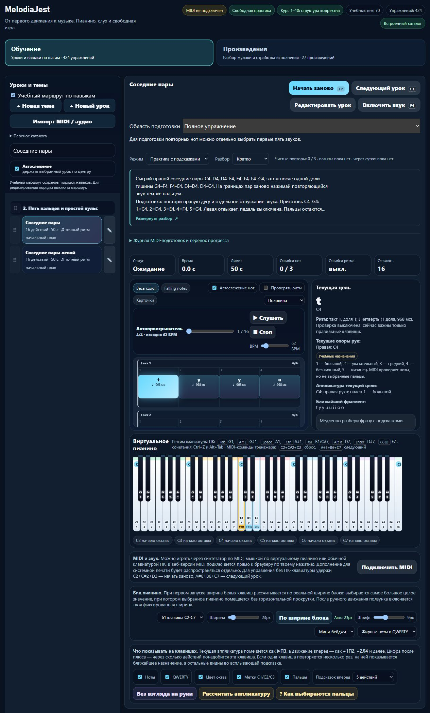

# Выпуск 23.5.35 и проверка копий новой версии

7 ноября 2026 года. **Выложено и проверено:** [melodiajest.ru](https://melodiajest.ru/) обслуживает **23.5.35**, [учебная партия 35](piano-curriculum-2026-11-07-35.md): две исправленные инструкции, новых уроков 0. Транзакция **`5c6a755fc7a74d059a1d6c19d317f193`**, фаза **committed**, завершена **06.11 22:58:33 UTC / 07.11 03:58:33 Екатеринбург**. Машинные доказательства — соседний JSON, включая публикацию, последующее восстановление, браузер и первую плановую health-проверку.

## До переключения

**653/653 npm-тестов**, целевые 8/8, применимые музыкальные аудиты и сборка прошли. Источники, ноты, пальцы и исходные редакции проверены в учебном отчёте. Все 572 старые музыкальные версии сохранены; новые попытки/проверки не добавляют уроков.

Лёгкий preflight в **22:57:19 UTC**: текущий 23.5.34, четыре HTTPS-сайта — 200 после штатных редиректов, контейнер healthy, свободно **5548019712 байт**, MemAvailable **2114496 kB**. Последние собственные backup/restore-attempt успешны, health свежий без problems. Неизменные старые каталоги и архивы повторно через интернет не скачивались.

- Артефакт **`dist/melodiajest-23.5.35-20261107-35.tar.gz`**, **1772013 байт**.
- SHA256 **`770542f171b700e0e1f379b1ad6665d89fc6bc29906a7f90d7016ba0dff99a0d`**.
- **28** публичных файлов, **3** собственных конфига, **349** выбранных файлов фактического checkout, манифест архива. Все **381** файл восстановлен на компьютере и VPS в новых изолированных каталогах.
- Снимок исходников снят до публикации. Итоговые квитанции и изменения документации появились позже; они не объявлены содержимым исходного архива. Секреты, приватный browser export, пользовательский trainer-content и Git не включены.

## Штатный updater

Использован постоянный **`/opt/melodiajest/ops/tooling/updater-151e5261f43253a8/release_update.py`** после сверки трёх файлов по сохранённым SHA. Приватный транспортный checkpoint — `tmp/publish-melodiajest-23-5-35.py`. Реальная общая **`/run/lock/libre-deploy.lock`** и собственная защита MelodiaJest соблюдены; чужие операции не прерывались.

| Проверенный результат | Значение |
| --- | --- |
| current | `releases/23.5.35-ff83e6174fa6` |
| previous | `releases/23.5.34-7defa41db5b6` |
| Новый SHA публичного манифеста | `ff83e6174fa68d342cfa0ddfca33cb7129cba92d5f6d71f54e7c3cdf5f11d2fa` |
| Прежний SHA манифеста | `7defa41db5b6eb5e56f4556460720fd7cea9813d72f51ec68d6291030fd4d417` |
| Сохранённый исходный артефакт | `/opt/melodiajest/ops/artifacts/770542f171b700e0e1f379b1ad6665d89fc6bc29906a7f90d7016ba0dff99a0d.tar.gz` |
| История операции | `/opt/melodiajest/ops/updates/5c6a755fc7a74d059a1d6c19d317f193.json` |

До переключения создана и восстановлена копия **23.5.34**: `ops/backups/before-update-5c6a755fc7a74d059a1d6c19d317f193.tar.gz`, **295514 байт**, SHA **`57a3450178751ccbd2e9c876c66ab310fec4fb02cc0496fa173888c265d5f1f0`**. Это web/config, без исходников; исходные комплекты хранятся отдельно.

Пересоздан только **melodiajest-static / melodiajest-web-1** с проверенными `--no-deps --no-build --pull never --force-recreate --wait`. Образ не менялся, user 101:101, read-only, уникальные aliases и лимиты сохранены. Caddy не менялся: SHA **`7f0e235d16f9dcaf2ac0649d5fb9c2b99af845ffe95684584ed0386cfbaf2813`**, inode 131363; три собственных конфига совпали. Старые версии/архивы не удалялись.

Публичные байты всех **28** файлов и главной страницы совпали с артефактом. HTTPS прошёл штатную проверку, HTTP→HTTPS 308 и www→корень 301 сохранили URI/query. Приватные пути вернули 404, POST статической главной — 405. Libreta/Praicer/Grigorova — 200 после их редиректов. Оснований для production-отката не возникло; previous сохранён и затем отдельно восстановлен в изоляции.

## Копия и восстановление после выпуска

Уже установленные `melodiajest-backup`, `melodiajest-restore-check`, `melodiajest-backup-health` запущены **без переустановки units или policy**. Все три завершились Result=success / ExecMainStatus=0. Backup worker автоматически обнаружил новый исходный артефакт в committed-журнале updater; ручная подмена source-index не потребовалась.

- Snapshot **`3b16d1311a3c4724a661d00856c4b1e6`**, SHA метаданных **`d826097c03d410401f769c9acde9090053bf5d6cf4e28f98ef355c91542605d6`**.
- Копия подтверждена **23:00:26 UTC**, восстановление **23:00:36**, health **23:00:37**, problems=[] — текущие версия и previous покрыты.
- Current 23.5.35: **32** файла web/config, **381** файл исходного комплекта, включая **349** выбранных исходных файлов.
- Previous 23.5.34: **32** файла web/config, **375** файлов исходного комплекта, включая **343** выбранных файла.
- **12** управляющих файлов восстановлены; каждый веб-комплект отдал **28/28 файлов** в своём Nginx с network=none, без портов и production-томов. Временных restore-контейнеров осталось **0**, рабочая временная область пуста.
- Хеши пяти backup-файлов и шести units повторно совпали с партией 05. Есть только три собственных service и три enabled timer. Собственное дедуплицированное хранилище теперь занимает **6110163 байт**; это не все ops-артефакты и не счёт провайдера.

### Первое фактическое срабатывание таймера

**Плановый `melodiajest-backup-health.timer` сработал 23:00:06 UTC.** Журнал его отдельного invocation показывает **23:00:07 success=false**, exit 1, три причины: current-release-not-backed-up, current-release-not-runtime-restored, previous-release-not-backed-up. Веб-релиз уже был переключён, а post-release-копия ещё не завершилась. Это наблюдавшийся результат таймера; он не подменяется последующим ручным success.

Затем явная последовательность backup **23:00:24–26**, restore **23:00:26–36**, health **23:00:36–37** подтвердила новую версию и устранила причины. HTTP-сайты оставались доступны. Из этого следует операционное требование: после нового выпуска выполнять эти три задания сразу одной последовательностью, прежде чем считать эксплуатационную фазу завершённой. Старый зелёный last-success недостаточен. Логи первой проверки сохранены отдельно в машинном отчёте; ошибку не скрывали и не исправляли ослаблением health.

Плановые ежедневный backup и недельный restore **ещё не срабатывали по календарю**. В последнем чтении systemd их следующие даты: **07.11 01:38:29 UTC** и **08.11 04:22:42 UTC**, следующий health **07.11 00:00:17 UTC**. Это наблюдаемые значения со случайной задержкой, не обещание запуска до секунды. Ручные восстановления выше подтверждены независимо от календаря.

## Публичный браузер и финальное чтение

В настоящем браузере по домену открыта исправленная карточка правых пар: новая цель и Czerny видны, Enter/пробел работают; в памяти нет блока, раскрытия и repeat-подсказки. MIDI/звук не включались. Доказательства — `docs/qa/melodiajest-2026-11-07-06-live.json` и снимок. Собственная вкладка **86** закрыта, preview **63797** остановлен штатной собственной командой; пользовательская **4173** сохранена.

Повторное лёгкое чтение **23:05:51 UTC**: сайт **23.5.35**, все четыре HTTPS-страницы — 200, контейнер healthy, Caddy SHA прежний; свежие успешные backup/restore-attempt и health без problems. Свободно **5437394944 байта**, MemAvailable **1918072 kB**. Весь каталог и старые архивы для этого чтения не перекачивались.

## Ограничения и следующий этап

Проверены публикация, файлы/исходники/собственные конфиги и работа двух восстановленных сайтов; это не полное автоматическое восстановление VPS. Копии на этом VPS и компьютере не означают независимый шифрованный S3-бэкап. Собственные S3-доступы, шифрование, чтение/расшифрование внешней копии и ограниченная ротация остаются отдельным этапом; личный browser progress требует экспорта. Полный биллинг не измерен, неизвестная стоимость не названа нулевой.

Следующий операционный шаг — подготовить собственную внешнюю копию/шифрование и ограниченную ротацию, проверить следующие реальные плановые срабатывания без повторной установки. Музыкальный курсор — `course02-06`, далее `course02-07/08`. Квота перед выпуском: расход 70%, остаток 30%, ordinary usage разрешён, spend control не достигнут, резерв 0%. DNS, новые платные услуги, чужие сервисы/бакеты/таймеры, глобальная очистка, `guitarjest` и commit/push не затрагивались.
