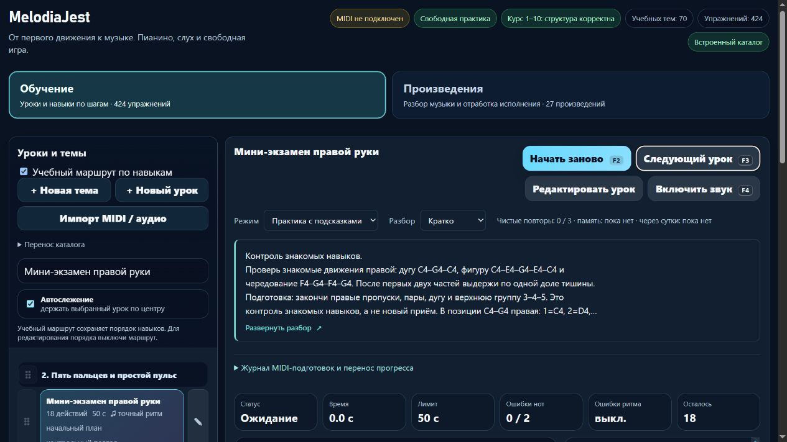

# Выпуск MelodiaJest 23.5.36 и подтверждённое восстановление

7 ноября 2026, эксплуатационная партия 08, отдельная фаза после [учебной партии 36](piano-curriculum-2026-11-07-36.md). **Выложено и проверено:** два исправленных правых микроурока, явный статус составного контроля, паузная подсказка и измеренное увеличение кнопок подготовки до 44 px. Новых учебных записей — 0. [Машинные доказательства](melodiajest-operations-2026-11-07-08.json).

## Артефакт и обновление

- Локально: 662/662 полных теста; после заключительных CSS/текстовой правок 23/23 целевых, музыкальные аудиты без структурных ошибок, browser QA отдельного origin и итоговый build:web. Все 572 старые музыкальные payload/оценочные подписи сохранены.
- `dist/melodiajest-23.5.36-20261107-36.tar.gz`: **1841584 байта**, SHA256 **`c8df28357b517bf60acd3b12adc550dd458a12b878da88a1fa9aaf70bfa2a31b`**. Содержит **363 выбранных исходных файла**, 28 публичных файлов, собственные конфиги и манифест. По **395 файловых элементов** восстановлены локально и в закрытой серверной папке.
- SHA256 публичного `web-release.json`: **`690997551ce98e2ace71b3eb962597e3c1f488eac713c9f2d6d2fc569c6537f1`**. Источники сняты до финальных квитанций/записей состояния; последующие квитанции не объявлены частью архива, который они описывают. Личные каталоги, экспорты и ключи исключены.
- Постоянный проверенный CLI `/opt/melodiajest/ops/tooling/updater-151e5261f43253a8` выполнил plan/install с обязательным старым manifest SHA. В **00:13:19 UTC** операция **`b3920be6fcf8481b84adfdfbf14431ef`** завершена `committed`.
- `current` → **`releases/23.5.36-690997551ce9`**, `previous` → **`releases/23.5.35-ff83e6174fa6`**. До переключения создана и восстановлена файловым способом копия 23.5.35, SHA `afabcd7aab46c7d94debad6ea0239910465b86144425ffdb9d7d76c355e8198f`. Старые каталоги не удалялись.
- Пересоздан только `melodiajest-static` / `melodiajest-web-1`, что обновило bind mount. Проверены существующие общий/собственный locks, неизменные образ и конфиги. Caddy SHA **`7f0e235d16f9dcaf2ac0649d5fb9c2b99af845ffe95684584ed0386cfbaf2813`**, inode **131363** прежние; его reload не понадобился. Libreta/Praicer/Grigorova вернули 200.

Закрытые артефакт и квитанция: `ops/artifacts/<archive-SHA>.tar.gz`, `ops/release-23.5.36-c8df28357b51/receipt.json`. Это обычное обновление уже работающего сервиса, без нового инфраструктурного доступа, DNS и платных услуг. Откат не потребовался; previous сохранён для проверенного CLI rollback.

## Резервирование после выпуска

Существующие собственные задания выполнены последовательно после освобождения updater locks: backup **00:14:19–21 UTC**, restore-check **00:14:21–31**, health **00:14:31**. Каждый systemd Result=success / ExecMainStatus=0. Политика/units не переписывались; новый retained source найден штатно.

Снимок **`60b3fbe7fd654501ae5855be55c5138f`**, SHA256 metadata **`a81a7c272fc7ce6bda7f440a3e05e149d1581fce7370b39da2cfd9ec959d7384`**, связан с действующими current/previous. Восстановлены:

| Роль | Выпуск | Web/config | Исходный архив, элементов | Изолированный Nginx |
| --- | --- | --- | --- | --- |
| current | 23.5.36 | 32 | 395, включая 363 исходника | healthy, 28 публичных файлов побайтно |
| previous | 23.5.35 | 32 | 381, включая 349 исходников | healthy, 28 публичных файлов побайтно |

Восстановлены **12 собственных controls**. Контейнеры работали без сети, портов и production-томов, временных restore-контейнеров осталось **0**, временная рабочая область пуста. Пять установленых backup-файлов и шесть units совпадают с проверенными хешами; существуют только три своих service и три enabled timer. Собственное дедуплицированное хранилище — **8253967 байт** (не все ops и не счёт провайдера).

### Плановый health отдельно от ручных заданий

Перед ручными post-release jobs зафиксированы `LastTriggerUSec=07.11 00:00:17 UTC`, start service в ту же секунду, exit **00:00:18**, Result=success, status=0; health **00:00:18.257845 UTC**, success=true, problems=[]. Это первый подтверждённый **успешный календарный health** после прежнего неуспешного старта в 23:00. Он проверял предшествующий выпуск 23.5.35. Ручной успешный restore 23.5.36 выше — другое доказательство.

Ежедневный backup и еженедельный restore по календарю ещё **не наблюдались**. В последнем чтении их next — 07.11 около 01:39 UTC и 08.11 около 04:23 UTC; это наблюдения со случайной задержкой, не обещание точности. Расписание и чужие таймеры не изменялись.

## Публичная и браузерная проверки

В **00:14:20 UTC** проверены HTTPS/200, хеши/размеры **27** ресурсов, доменный манифест 23.5.36, HTTP→HTTPS **308**, www→корень **301** с сохранением пути/query. `server.cjs`, общий каталог, `.env`, native/MIDI API дали 404, encoded traversal 400, POST к корню 405, к API 404. Непубличные файлы не отдаются.

На настоящем домене открыта новая контрольная карточка: новое объяснение пауз, четыре источника, роль контроля и **44 px** у четырёх подготовок подтверждены. В памяти нет карточки/body/кнопки раскрытия и нотных подсказок. MIDI и звук не включались. Исходные выбранный урок/вид/режим публичного origin возвращены, собственная вкладка **87** закрыта, пользовательская **28 / localhost:4173** сохранена. [Браузерная квитанция](../qa/melodiajest-2026-11-07-08-live.json).

Собственный preview **54868 / PID 33376** завершён. Его stdin был закрыт; вместо заявления об успешной команде проверены точный CommandLine и принадлежность порта, затем отсутствие процесса и listener. Пользовательский 4173 не останавливался.

Финальное лёгкое чтение **00:17:11 UTC**: версия **23.5.36**, healthy, четыре HTTPS/200, свежие успешные последние backup/restore-attempt и health без problems; свободно **5152538624 байта**, MemAvailable **1934752 kB**. Каталоги и архивы повторно не скачивались.

## Ограничения и продолжение

Копии на VPS/компьютере и два изолированных Nginx не равны полному автоматическому восстановлению VPS, независимому S3-бэкапу или резервированию браузерного прогресса. S3/encryptionConfigured и автоматическая ротация остаются false. [Offline-комплект партии 07](melodiajest-operations-2026-11-07-07.md) относится к 23.5.35/34; при подтверждении собственного S3-доступа сначала нужен свежий комплект current/previous. Старый эксперимент не выдаётся за внешнюю копию нового выпуска. Новых вопросов о ключах не добавлено.

Дальше — учебная партия **course04-01/05** (четверти и полная доля тишины), параллельно остаётся ожидаемым собственный S3-конфиг; будущие календарные backup/restore проверять лёгким чтением без переустановки. Квота в конце: 73% расход / 27% остаток, ordinary разрешён, резерв 0%. `guitarjest`, чужие данные/бакеты, DNS, новые услуги, массовые удаления и commit/push не затрагивались.
