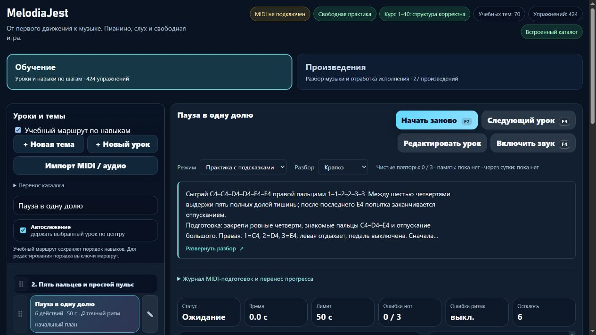

# MelodiaJest — выпуск 23.5.37 и подтверждённое восстановление

07.11.2026. **23.5.37 выложена и проверена на https://melodiajest.ru/**. Содержательный результат — [учебная партия 37](piano-curriculum-2026-11-07-37.md): две полные редакции четвертей/внутренних пауз и одно ограниченное исправление конечной тишины. Новых уроков нет; все 572 прежние музыкальные версии сохранены.

## Выпуск

- Локально: **672/672** полного npm-прогона; после двух заключительных текстовых улучшений **22/22** целевых, итоговая сборка и изолированный браузер. Музыкальные аудиты без структурных ошибок. Проверены пять строк, Enter/пробел, сохранение скрытого вида, отсутствие подсказок в DOM памяти и 390 px.
- `dist/melodiajest-23.5.37-20261107-37.tar.gz`: **1902803 байта**, SHA256 **`239c49db8ab95096db2a6507357317b5167d5df080fb6e0bc1beefd13aa8abbb`**. Разрешённые **371 исходник**, 28 публичных файлов, собственные конфиги и bundle-манифест; **403 элемента** восстановлены локально и в закрытой серверной папке.
- SHA256 публичного `web-release.json`: **`6be3c99922b40d702e3504c2f55d6850704606b2564f5e4c0f89665ca98ebef7`**. Архив снят после локальной учебной квитанции и до финальных публикационных записей. Эти последующие записи не выдаются за часть описываемого ими архива. Личные браузерные данные, ключи и общий trainer-content.json не включены.
- До изменения в **00:45:59 UTC**: четыре HTTPS/200, healthy, свежие успешные backup/restore/attempt/health; свободно **5152071680 байт**, MemAvailable **1884396 kB**.
- Постоянный CLI `/opt/melodiajest/ops/tooling/updater-151e5261f43253a8` проверен по прежним хешам; plan/install привязаны к текущему manifest 23.5.36. В **00:46:31 UTC** квитанция подтвердила операцию **`afff8f62e4714adeb177a15af7c62859`**, `committed`.
- `current` → **`releases/23.5.37-6be3c99922b4`**, `previous` → **`releases/23.5.36-690997551ce9`**. Перед переключением создана и файловым способом восстановлена копия 23.5.36 SHA **`5c1615e7e8f830e0ac350244c6688cf65d747f4504e48fb8f0a1a0d03b229ea4`**. Прежние релизы не удалялись.
- CLI согласовал действующий `/run/lock/libre-deploy.lock` и собственную защиту; пересоздан только melodiajest-static / melodiajest-web-1. Образ, три конфига, уникальные aliases и Caddy сохранены. Caddy SHA **`7f0e235d16f9dcaf2ac0649d5fb9c2b99af845ffe95684584ed0386cfbaf2813`**, inode **131363**, reload не требовался. Libreta/Praicer/Grigorova вернули 200.

Закрытые артефакт и квитанция: `ops/artifacts/<archive-SHA>.tar.gz`, `ops/release-23.5.37-239c49db8ab9/receipt.json`. Откат не потребовался; previous и проверенный CLI rollback сохранены. Новых услуг, DNS, чужих данных, перезапуска соседних сервисов и commit/push не было.

## Backup и restore

После освобождения updater locks существующие собственные systemd jobs выполнены последовательно: backup **00:46:56–57 UTC**, restore-check **00:46:57–00:47:08**, health **00:47:08**. У всех Result=success / ExecMainStatus=0. Политика, worker и units не переписывались; новый сохранённый source-архив найден штатно.

Снимок **`35a4e2e02351447d9efd9fcaffcae06a`**, SHA256 metadata **`045002b91725a25ef470b49ee10f5b27955eab138f959a89635fa1f247a97be4`**:

| Роль | Выпуск | Web/config | Исходный архив, элементов | Изолированный Nginx |
| --- | --- | --- | --- | --- |
| current | 23.5.37 | 32 | 403, в том числе 371 исходник | healthy, 28 публичных файлов побайтно |
| previous | 23.5.36 | 32 | 395, в том числе 363 исходника | healthy, 28 публичных файлов побайтно |

Восстановлены **12 собственных controls**. Два временных Nginx работали с network=none, без портов и production-томов. После проверки restore-контейнеров **0**, рабочая временная папка пуста. В **00:48:44 UTC** подтверждены хеши установленных пяти backup-файлов и шести units, только три собственных service и три enabled timer; хранилище собственных дедуплицированных копий **10462226 байт**. Это не размер всех ops и не биллинг провайдера.

Нового календарного запуска этим проходом не доказано. Успешный native hourly health **00:00:17–18 UTC** для прежнего выпуска сохранён как отдельное доказательство [партии 08](melodiajest-operations-2026-11-07-08.md). В нынешнем предварительном чтении service/health уже содержали результат ручных jobs 00:14, поэтому смешивать их с LastTrigger таймера нельзя. Ежедневный/еженедельный календарные запуски ещё не наблюдались. Последние next — backup около **01:35:42 UTC** 7 ноября, restore около **04:24:03 UTC** 8 ноября, health около **01:00:03 UTC**; случайная задержка не обещает точность запуска.

## Публичный и браузерный результат

В **00:46:56 UTC** проверены HTTPS/200, размеры/SHA256 **27** ресурсов и манифест 23.5.37; HTTP→HTTPS **308**, www→корень **301** с сохранением пути/query. Локальные content/MIDI/Windows API, server.cjs, trainer-content.json и .env дали 404; encoded traversal — 400; POST к корню — 405, к API — 404.

На настоящем домене подтверждены обе полные редакции, ограниченное исправление третьей, три подготовки **44 px**, Enter и отсутствие карточки/body/кнопки раскрытия/нотных ответов в памяти. Итоговое пояснение последнего отпускания видно, технический ID в тексте ученику отсутствует. Настоящее MIDI и звук не включались. Исходные урок, вид, режим и строка поиска публичного origin возвращены; своя вкладка **88** закрыта. [Браузерная квитанция](../qa/melodiajest-2026-11-07-09-live.json).

Собственный preview **58162 / PID 43920** штатно завершён через stdin; отдельно подтверждены отсутствие процесса и закрытый listener. Пользовательский localhost:4173 и его вкладка не затронуты. Временный мобильный viewport сброшен.

Заключительное лёгкое чтение **00:48:44 UTC**: current 23.5.37, healthy, четыре HTTPS/200, последние backup/restore-attempt success и health без problems, возраст копии/restore **107/96 секунд**. Свободно **5124411392 байта**, MemAvailable **1861124 kB**. Полный каталог/архивы повторно не скачивались.

## Учёт и точный следующий шаг

Активные указатели состояния обновлены по нынешней квитанции. При сверке также исправлены оставшиеся от 23.5.35 поля `webManifestSha256`, `updateId`, `retainedArchive` внутри serverDeployment; они теперь согласованы с основным manifest и действующим current. Исторические отчёты не переписаны.

424 учебные записи / 160 MIDI-маршрутных / 98 подробных редакций; независимая преподавательская проверка и работа настоящей руки не заявлены. Следующая учебная партия — **course04-06/07**, пары восьмых и счёт 3/4.

Локальная/VPS-копии и два восстановленных Nginx не равны независимому S3-бэкапу, полному восстановлению VPS или резервированию личного браузерного прогресса. S3/encryptionConfigured и автоматическая ротация остаются false. Offline kit 35/34 исторический и не является копией current 37/36; при подтверждении собственного S3-конфига нужен свежий комплект, upload/read/decrypt/cold restore. Вопрос о доступе не повторялся, чужие ключи не использовались. Квота в конце: **73% расход / 27% остаток**, обычное использование разрешено, резерв 0%.
