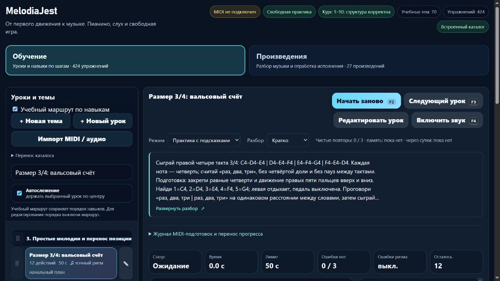

# MelodiaJest — 23.5.38 выложена и восстановление подтверждено

07.11.2026. **23.5.38 работает и проверена на https://melodiajest.ru/**. Завершена отложенная [учебная партия 38](piano-curriculum-2026-11-07-38.md): две редакции ритма и исправленный мобильный каталог. Предыдущая 23.5.37 сохранена; новых уроков эта эксплуатационная фаза не добавляет.

## Возобновление и выпуск

В [первой части фазы](melodiajest-operations-2026-11-07-10-deferred.md) постоянный plan корректно остановился на занятом общем lock. Исходные [квитанции отсрочки](melodiajest-operations-2026-11-07-10-deferred.json) сохранены, не переписаны успешным результатом. В **01:27:36 UTC** чтение lslocks уже не показывало владельца `/run/lock/libre-deploy.lock`; свой current оставался 23.5.37. Чужие операции не прерывались и блокировки не удалялись.

Повторно сверены неизменные браузерные bytes/манифест подготовленного артефакта, четыре HTTPS/200 и ресурсы VPS. Успешные 681/681 npm-тестов, музыкальные аудиты и заключительные 24/24 после CSS/рекомендаций переиспользованы: новых браузерных правок не было, тяжёлый прогон и сборку не повторяли.

- Архив **1965278 байт**, SHA256 **`12596a1443bc252ad17d2233a24155f5c2467dcebc8d982831021463a00b8e95`**, локально `dist/melodiajest-23.5.38-20261107-38.tar.gz`.
- **379 выбранных исходников**, 28 публичных файлов, собственные конфиги и bundle-манифест; **411 элементов** восстановлены локально и в закрытой серверной папке.
- Manifest SHA256 **`6a4a36d988c0ca9d716fe03b859d7a2363427562cc5ba76422ed86dfc78cd9cd`**. Копия снята до финальных записей об отсрочке/публикации; эти позднейшие записи не объявлены частью описываемого ими архива. Секреты, личный trainer-content.json и браузерные экспорты исключены.
- В **01:28:24 UTC** квитанция постоянного updater подтвердила **`04a5a33b20f24907803c14fcc4c40451`**, phase=committed. `current` → **`releases/23.5.38-6a4a36d988c0`**, `previous` → **`releases/23.5.37-6be3c99922b4`**.
- До переключения 23.5.37 скопирована и файловым способом восстановлена; затем пересоздан только melodiajest-static / melodiajest-web-1. Смена bind mount выполнена штатным CLI. Проверенные общая/собственная блокировки, образ и три конфига сохранены.
- Caddy неизменен: SHA **`7f0e235d16f9dcaf2ac0649d5fb9c2b99af845ffe95684584ed0386cfbaf2813`**, inode **131363**; reload не потребовался. Libreta, Praicer и Grigorova после выпуска вернули 200. Откат не понадобился, previous и проверенный CLI rollback сохранены.

Артефакт теперь штатно сохранён в **`/opt/melodiajest/ops/artifacts/12596a1443bc252ad17d2233a24155f5c2467dcebc8d982831021463a00b8e95.tar.gz`**; закрытая квитанция — `ops/release-23.5.38-12596a1443bc/receipt.json`. Локальная сводная квитанция — [10.json](melodiajest-operations-2026-11-07-10.json). Первая установка, инструменты/units, DNS и соседние сервисы не переустанавливались. Commit/push нет.

## Копия и изолированное восстановление

После освобождения updater locks существующие собственные задания выполнены последовательно: backup **01:29:16–18 UTC**, restore-check **01:29:18–28**, health **01:29:29**. Все Result=success / ExecMainStatus=0. Новый retained source обнаружен автоматически, policy/worker/units не менялись.

Снимок **`8b79f2b80a6a4d6892470651c6abb869`**, SHA metadata **`ad019f6452a53d7c33250429861a7897f8e75c13bb308629a7b1eefef4758215`**:

| Роль | Выпуск | Web/config | Исходный архив | Изолированный Nginx |
| --- | --- | --- | --- | --- |
| current | 23.5.38 | 32 файла | 411 элементов, 379 исходников | healthy; 28 публичных файлов побайтно |
| previous | 23.5.37 | 32 файла | 403 элемента, 371 исходник | healthy; 28 публичных файлов побайтно |

Восстановлены **12 собственных controls**. Контейнеры работали с network=none, без портов и production-томов. После проверки временных restore-контейнеров **0**, рабочая область пуста. Хеши пяти установленных backup-файлов и шести units совпадают, существуют только три собственных service и три enabled timer. Собственное хранилище копий — **12736297 байт**, не все ops и не биллинг провайдера.

Ручной post-release restore 23.5.38 отделён от ранее подтверждённого календарного health **01:00:13–14 UTC** для 23.5.37. Ежедневный/еженедельный календарные backup/restore ещё не наблюдались. Последние next: backup **01:39:25 UTC** 7 ноября, restore **04:22:56 UTC** 8 ноября, health **02:01:10 UTC**; это показания со случайной задержкой, не обещание точности.

## Публичные и браузерные проверки

В **01:29:17 UTC** HTTPS/200, manifest 23.5.38 и SHA256/размеры **27 ресурсов** совпали. HTTP→HTTPS 308, www→корень 301 сохраняют путь/query. Локальные content/MIDI/Windows API, server.cjs, trainer-content.json, .env — 404; encoded traversal — 400; POST к корню 405, к API 404.

В собственной вкладке **90** на домене подтверждены:

- новая пауза восьмых/вступление на «два», пояснение допуска MIDI, четыре трёхдольных такта и отдельная оценка акцента на слух;
- при 390×844 список каталога **161,56 px / clientHeight 162**, строка доступна, выбор урока и возврат после подготовки срабатывают первым нажатием;
- Enter переводит фокус на H2, подготовки 44 px, превью 112/22,4 = пять строк;
- во всех трёх видах в памяти отсутствуют карточка/body/раскрытие и нотные ответы, селектор заблокирован.

MIDI/звук не включались. Исходные урок, вид, режим и поиск публичного origin возвращены. Своя вкладка закрыта, временный viewport сброшен; прежние preview 63297 / PID 36728 уже завершены, пользовательские 4173 и вкладка 28 сохранены. [Браузерная квитанция](../qa/melodiajest-2026-11-07-10-live.json), [мобильный вид](../qa/melodiajest-2026-11-07-10-mobile.png).

Итоговое лёгкое чтение **01:32:02 UTC**: current 23.5.38, healthy, четыре HTTPS/200, последние backup/restore-attempt success и health без problems; возраст копии/restore **165/154 секунд**. Свободно **5104738304 байт**, MemAvailable **1797676 kB**. Старые каталоги и архивы заново не скачивались.

## Продолжение и ограничения

Очередь отложенного выпуска очищена только после всех проверок; локальные и опубликованные показатели согласованы: **424 учебные записи / 160 MIDI-маршрутных / 100 подробных редакций**. Независимо проверенных преподавателем 0; верхняя граница 415 разных целей не является подтверждённым числом, минимум 1000 ещё не достигнут. Курсор первых пар пальцев сохранён.

Следующий продуктовый этап — измерить актуальную загрузку/сжатие каталога и запросы до выбора версионированных частей или S3/CDN; следующий музыкальный — course01-03/04 и course03-01 с проверкой самостоятельности двух левых вариантов. Свежий комплект current/previous 38/37 понадобится при подтверждении собственного S3-доступа: исторический offline kit 35/34 не объявляется внешней копией нового выпуска.

Копии на компьютере/VPS и два Nginx не равны полному восстановлению VPS, независимой зашифрованной S3-копии или резервированию личного браузерного прогресса. S3/encryptionConfigured и автоматическая ротация остаются false, новый вопрос о доступе не задавался. Квота в конце: **74% расход / 26% остаток**, ordinary разрешён, резерв 0%. Чужие данные, бакеты, DNS, новые услуги, массовые удаления и guitarjest не затрагивались.
