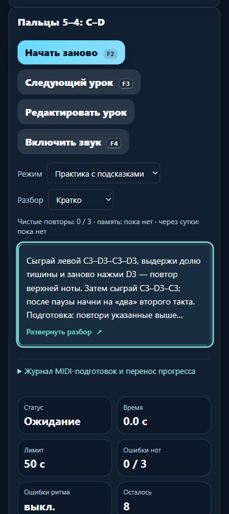

# MelodiaJest 23.5.39: выпуск и восстановление

7 ноября 2026. **23.5.39 выложена и проверена на https://melodiajest.ru/**. Опубликованы три редакции первых пар пальцев из [учебной партии 39](piano-curriculum-2026-11-07-39.md). Current/previous — **39/38**. Новых уроков в операционной фазе нет.

Полные транзакция, манифесты, квитанции и проверки — [12.json](melodiajest-operations-2026-11-07-12.json).

## Подготовка и переключение

Перед серверными изменениями повторно проверены четыре сайта по HTTPS, текущая 23.5.38, действующие успешные backup/restore/health и ресурсы: свободно 5 103 865 856 байт, MemAvailable 1 824 028 kB. Выпуск использовал **690/690 npm-тестов**, музыкальные аудиты, актуальный build:web и настоящий изолированный браузерный путь партии 39. После этих проверок исполняемый код не менялся, тяжёлые тесты и одинаковая сборка не повторялись.

- Архив `dist/melodiajest-23.5.39-20261107-39.tar.gz`, **2 040 847 байт**, SHA256 **`eb8f49852ad17a7be03ea4884bc25ac8c3e4c968dca4be362ebc05d8616c9c05`**.
- **392 выбранных исходника**, 28 публичных файлов, собственные конфиги и bundle-манифест. **424 элемента** восстановлены локально в новой проверенной tmp-папке и на VPS в закрытом namespace.
- SHA256 `web-release.json` — **`e8e1815f46f3f13e43dd191249decce1f7e8bd74920fd3342993c59ecf71443d`**.
- Постоянный updater завершил transaction **`d45fa2d2720249579df8132ad7be730d`**, phase=committed, **02:45:58 UTC**. `current` → `releases/23.5.39-e8e1815f46f3`, `previous` → `releases/23.5.38-6a4a36d988c0`.

Сохранённая 23.5.38 скопирована и восстановлена до переключения. Постоянный CLI использовал настоящий `/run/lock/libre-deploy.lock` и собственную защиту; чужие блокировки не снимались. Пересоздан только `melodiajest-static` / `melodiajest-web-1`, bind mount обновлён. Alias/имена сохраняют уникальный префикс.

Caddy не менялся, SHA **`7f0e235d16f9dcaf2ac0649d5fb9c2b99af845ffe95684584ed0386cfbaf2813`**, inode **131363**; три собственных конфига и образ сохранены. Libreta, Praicer и Grigorova после выпуска вернули 200. Регрессия своего выпуска не обнаружена; проверенный rollback и previous сохранены, откат не потребовался.

Артефакт закреплён в `/opt/melodiajest/ops/artifacts/eb8f49852ad17a7be03ea4884bc25ac8c3e4c968dca4be362ebc05d8616c9c05.tar.gz`, закрытая квитанция — `ops/release-23.5.39-eb8f49852ad1/receipt.json`. Копия исходников относится к проверенному checkpoint **до** публикации: последующие публичные/restore-квитанции не объявляются частью того же архива. Личный trainer-content.json, секреты и браузерные экспорты исключены. Первая установка, инструменты, DNS и чужие сервисы не переустанавливались; commit/push нет.

## Резервирование и реальное восстановление

После завершения updater последовательно выполнены существующие собственные службы: backup **02:46:38–40**, restore-check **02:46:40–51**, health **02:46:51 UTC**. Все Result=success / ExecMainStatus=0; policy, worker и units не менялись.

Snapshot **`ae5c29789e544ca19a09f10049e3744a`**, SHA метаданных **`8f66c5ae410b81dfc836f2946826b0b423be83a74025b311a74d0c07969d3889`**:

| Роль | Выпуск | Web/config | Исходный архив | Изолированный runtime |
| --- | --- | --- | --- | --- |
| current | 23.5.39 | 32 файла | 424 элемента / 392 исходника | healthy, 28 точных публичных файлов |
| previous | 23.5.38 | 32 файла | 411 элементов / 379 исходников | healthy, 28 точных публичных файлов |

Восстановлены **12 собственных controls**. Оба Nginx работали с **network=none**, без публичных портов и production-томов. По завершении временных restore-контейнеров **0**. Новый retained source обнаружен штатно; не создавались дубли timers и не применялась ротация/глобальная очистка Docker.

Первый календарный daily backup **01:39:35–36 UTC** относился к 38/37 и подтверждён отдельно в [партии 11](melodiajest-operations-2026-11-07-11.md). Он не подменяет ручную проверку новой 39/38. Последний календарный health — 02:01:10; последующий ручной health относится к новому выпуску. Еженедельный календарный restore ещё не наблюдался. Текущие next systemd со случайной задержкой сохранены в JSON, они не обещаются как точные сроки.

Копия на VPS и локальный исходный архив не являются независимым внешним S3-резервом. Собственный защищённый доступ и независимое восстановление внешней копии ещё ожидаются; личный браузерный прогресс серверным резервом не покрывается.

## Публичный результат

Проверены ожидаемый SHA манифеста и **все 27 публичных хешей**, HTTPS, HTTP→HTTPS 308 / www→root 301 с сохранением пути и query. Локальные content/MIDI/Windows endpoints, server.cjs, trainer-content.json и .env вернули 404, traversal — 400, POST root — 405, POST API — 404. Корень имеет text/html, no-cache, nosniff. Это проверка служебных путей без личных данных.

На домене в своей вкладке 91 проверены все три новых текста, полное объяснение паузы 4–5/повтора D3 и ссылки подготовки. Во всех трёх настройках памяти card/body/toggle отсутствуют в DOM. На 390×844 компактный разбор **112 / 22,4 = пять строк**, общего горизонтального переполнения нет. Enter и пробел с промежуточным чтением состояния раскрывают/сворачивают блок.

При первом возврате вид оказался «Развёрнуто»; затем через доступный селектор явно возвращено исходное **«Кратко»**. Итоговая проверка подтверждает точное исходное состояние: C4, практика, компактный вид, пустой поиск. Временный viewport сброшен, своя вкладка закрыта, preview 63339 остановлен с проверкой команды своего процесса. Пользовательский localhost:4173 не затронут; MIDI/звук не включались.

[Браузерная квитанция](../qa/melodiajest-2026-11-07-12-live.json), [публичная мобильная карточка](../qa/melodiajest-2026-11-07-12-live.png).

В **02:50:31 UTC** current и SHA совпали, контейнер healthy, все четыре сайта отвечают HTTPS 200; свежие успешные backup/restore/health подтверждены, свободно **5 080 059 904 байта**. Действует общий проверенный updater/backup toolkit; нового алгоритма, навыка, зависимости или сервиса эта фаза не вводит.

Обновлены продуктовый/музыкальный статусы и указатели current/previous/архивов. Учебных записей **424**, подробных редакций **103**, новых уроков **0**. Курсор — первые одиночные опоры course01-01/02. Сигнал 02:31:37 UTC сохранён для последовательного следующего этапа: **локальный версионированный контракт темы/манифеста**, затем сравнение на одной исходной версии перед решением о S3/CDN. Измерения партии 11 закреплены за 23.5.38 и не переименованы в результаты 23.5.39.
