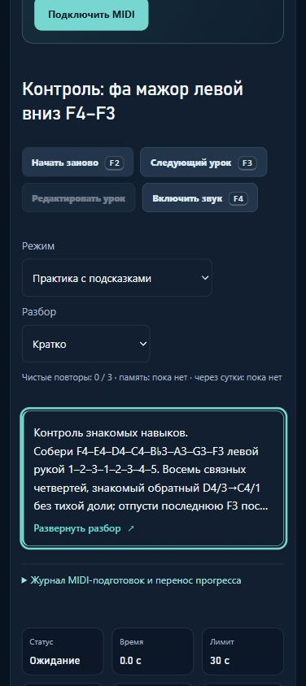

# MelodiaJest:23.5.78 опубликована и проверена

**Сайт/API23.5.78 /previous77 опубликованы, публичная карточка и независимые PG/static-восстановления подтверждены.** Фаза56 выпустила тот же кандидат партии14 из55;новых учебных записей в56 **0**, самостоятельных моторных целей **0**. Подготовка/Python/таймеры не считаются уроками. [Музыкальный отчёт14](piano-curriculum-2026-11-09-14.md).

Партия14 добавила1контроль `detail-p-f-major-descent-checkpoint-left-01`:F4–E4–D4–C4–B♭3–A3–G3–F3/LH1–2–3–1–2–3–4–5,44BPM,8связныхчетвертей/2такта4/4/offF3у8,безвнутреннихпауз иоценкиконечнойтишины. Прямые подготовки — своя F-позиция и белая связная гамма04;обратныйcross04 уже транзитивен. Верхняя123/нижняя12345/D4/3→C4/1 проверяются вручную внеMIDI;автоготовности нет,при путанице/напряжении нужно вернуться к группам. Правые4→1/1→4 и левыйподъём13 не обязательны;две руки/чтение/реальныепальцы/комфорт не доказаны.

450учебных записей/186MIDI/153объяснения/13контролей/10вариантов однойцели,427лишьверхняя граница групп,teacher0/verifiedDistinctnull. Минимум1000самостоятельных содержательных уроков сохраняется;BPM/длина/регистр/повтор сами не цели. Все597прежних полных и449серверных редакций,музыкальныеверсии,ID/порядок/107тем/schema2/baseline сохранены. Личные ноты/guide/learning/классификация/порядок/progress/XPonce/repeat0 защищены;SSO/общийledger отдельно,второйLVL не вводился.

Тот же артефакт **03d90e7c049532ed3f8e42324783d2a2d8fafc3ea451c23993cfd550e6af254e**, **6893408байт**, manifest **dd979b0daa63bc5b64cde4fee898dec1dea11ea04e9bfc797532a451df1e0e35**, API/source **2c0af582e1055d802262f248d3a88a7d7a2dc11ed9453d3212116ef8dbc944aa**, course **334e7971ea614a6dd155e94cd9deb074ebd0d15b13befaaed4351319e09d94ee**.1003source/40public/1047локальновосстановленныхфайлов — файлы,не уроки.456runtime/test-файлов совпали с точным архивом после публикации. Принятые1238npm/27целевых/43Windows service+7PG environment skips/4аудита принадлежат55 и не повторялись. **39Linux-проверок выполнены впервые для этогоSHA в56**,в nonroot/network-none/read-only контейнере безproduction-томов;последующие старты этих тестов не делались. Старыеfixtures/baseline не регенерированы,аудиты/валидаторы не ослаблены. Исторический первый26/27 и его исправленная fixture порядка сохранены в55.

Браузерный отказ55 снят свежей проверкой56. Изолированный synthetic loopback дал1карточку/2свои подготовки/H2-focus/Enter/Space/мышь/390px=5строк/3memory безDOM/authenticated hiddenreload послеDOMserverack/0console. Подтверждение сохранения находится в скрытой старой панели;его видимость не заявляется. Public78 отдельно подтвердил1карточку/2подготовки/фокус/клавиатуру/мышь/390px=5строк/0console и неизменность показанной ноты/44BPM после переходов. Guestgrading/memory выключены,«Войти для испытания» доступна;guesthiddenreload вернулся кcompact,сохранение гостю не заявляется. Реальные MIDI/звук/исполнение/педагог не проверялись. [Браузерное доказательство](../qa/melodiajest-2026-11-09-56-browser.json). Preview26536/63406 ивременнаявкладка93 закрыты,viewport сброшен,public78tab78 оставлена.

До серверных изменений четыре HTTPS200 и строгий ресурсный gate прошли:16:11:37UTCfree1 110 601 728B. ActualTWO-start **16:11:38.206935UTC allowed=true**,worker повторно перечитал окно перед обычной precompare. Предварительное сравнение77 **2026-11-09T16:13:16.437912+00:00** подтвердило старыйPGa02a…:newSnapshotCreated=false,restoredAt13:30:50.895910 прежний,dataComparedAt свежий. Затем candidate-reader78 восстановился из текущих данных в изоляции с sourceSHA иdataDigestMatched/prodVolumesfalse. После повторногоONE-gate перед switch выполнен один обычный post-readerPGbackup. Данные не мигрировали,откат не потребовался;StartLimit4/2h не повышался/не сбрасывался,worker не обходился. Allowancejournal неreservation и не внутреннийsystemdcounter.

НовыйPG **07222f7c6eb47590074f71635bf157fc84ffade8612f71e4096e3bf4ddd167dd**:23файла/**202181413байт**, restoredAt **2026-11-09T16:15:21.593234+00:00**. Static **c0d958ed4ca9517278243d141bbdfd49957597cd97cd8ed7bf519dc499e33e8a**, independently restored **2026-11-09T16:16:44.335406+00:00**. Обе копии независимо прочитаны/расшифрованы,SHA/размеры сверены,восстановлены изолированно;current78/previous77 защищены. NativePG **2026-11-09T16:14:33.328635+00:00–2026-11-09T16:15:22.582586+00:00**,InvocationID **a3e4384b4cfe40a789a2678434605f94**:unit/journal/все опубликованные поля короткой квитанции совпали с полной сохранённой. Это ручной post-reader запуск,не calendarPGdaily. [Нативное доказательство](../qa/melodiajest-2026-11-09-56-native-postreader.json).

Перед выпуском nativehourly77 **2026-11-09T16:00:44.347587+00:00–2026-11-09T16:00:44.859260+00:00**,InvocationID **8f185f9865a44c06911897daf8f76da2**,совпал по timer/journal/двум полным точным квитанциям. Base16:00:44.564449/external16:00:44.835068,PGa02a…/sourceff248…/restored13:30 прежние,S3requests0/restorefalse. Это freshness,не новыйbackup/restore/PGdaily. [Calendar77](../qa/melodiajest-2026-11-09-56-calendar77.json). Ручнойhealth78 **2026-11-09T16:16:44.460107+00:00–2026-11-09T16:16:44.982397+00:00**,InvocationID **b22b73ab7ca140a3ae5898675eeee87d**,точная квитанция **2026-11-09T16:16:44.956231+00:00** отдельно совпала с журналом;обе полныеbase/external квитанции сверены. Первыйcalendarhourly78 ожидается **Mon 2026-11-09 17:00:39 UTC**,daily **Tue 2026-11-10 02:11:55 UTC**. Прогноз не actualtrigger;manual78 календарю не приписывается. История отказавшего directdaily68/15minretry сохранена,naturalproductionlockrefusal новогоworker ещё не наблюдался.

Публичные40файлов и39assetSHA проверены штатнымupdater,HTTPS/сертификаты/308HTTP→HTTPS/301www→root приняты. server.cjs/trainer-content.json/.git/.env/service/APIcontent/Windowslaunch закрыты404. API/source/course/schema2 совпали. Compose aliases толькоmelodiajest-web-1/melodiajest-static/melodiajest-web. Caddyбайты/inode131363/сертификатныеvolumes,таймерbytes/active-state,14operations.local*/полныйF7pin,PGworkerbce/updatercb60/старый64/kit567730/Workers25 сохранены. Прогноз jitter изменился после штатногоdaemon-reload,новыхтаймеров0. Соседи проверены до/после собственнымupdater;чужих данных/бакетов/DNS/IAM/платныхуслуг не меняли. [Полная квитанция выпуска](../qa/melodiajest-2026-11-09-56-release.json).

**Ресурсная граница следующего выпуска:**16:18:08UTCfree **945995776B**.PGrecovery>838 860 800 проходит,prepare>1 048 576 000 не проходит. Это измерение после выпуска,не новыйrestore. Локальная UX/исследовательская работа допустима;до будущего staging нужна свежая ограниченная ресурсная подготовка. Пороги не снижать;runtime03be54/restored43и4150 уже удалены,любые ихplan/apply/удаления не повторять. Остальныеruntime/архивы/canonicalNode/stage27budget/stages56/49/47/currentprevious/PG/static/kit защищены;batch-delete/globalprune/старые64MiBcaps не используются. Нового удаления в56нет. Счётчики S3 не полный биллинг,неизвестнаястоимость не ноль.

Прочитанные проектные навыки web-design-guidelines/frontend-design применены к существующей карточке;[официальные Vercel guidelines](https://raw.githubusercontent.com/vercel-labs/web-interface-guidelines/main/command.md) получены свежо. ComputerUse подтвердилlocal+public;новогоCSS/React/Next/зависимостей/плагинов нет. Find-skills не потребовал установки. Новыхworktree/commit/push/автоматизаций0.

Следующий малый продуктовый этап — видимое сообщение политики аккаунта и подтверждения сохранения в новомplayer,с сохранением текущей guest/owner политики. Музыкальная очередь — собственная готовность двух рук Fmajor или другой подтверждённый пробел после поиска598/450 и первоисточника;готовность не выводить из раздельных контролей. Матрица/coverage.nextAction/nextWork.action/общая очередь синхронизированы. Ничего изprepare/publish56/npm/аудитов/39Linux/backup/restore/архивов того жеSHA не повторять без нового изменения или риска. Финальныйsource56 — отдельная локальная копия документов,не независимыйpublicbackup всегоcheckout.

Та же ACTIVE20min автоматизация `automation` обновлена и нативно сверена 2026-11-09T16:27:42.196261+00:00;canonicalSHA e23f678eaf87af04ccf8a9877387471e9c39e9de751b6dd30d22c39f69c91bc0 /nativePromptSHA 03b6922bb630fbffe1016e5e1940bdb09d65a2bb53a029743567329272387e49. Дубликатов/новых таймеров нет. Точные временные адаптеры56 сохранены с SHA в QA56-operations-source;этап уже завершён,повторять их не нужно.

Финальный **локальный** source56 **c3d078aa65fcdca4dce67733ff33f967b67ca8483512dd45039138d897eba1f6**, 6974148байт /1013исходников /1057восстановленных файлов. Включены итоговые отчёты/QA/источники/точные временные адаптеры/проверка той же автоматизации до этой квитанции;указатели на саму квитанцию обновлены отдельно после упаковки. Файлы не равны урокам. Опубликованный точный артефакт78,его независимыеPG/static иkit подтверждены отдельно;весьfinalcheckout независимо внешне восстановленным не объявляется. Новых серверных архивов/backup/restore при этом локальномcheckpoint не создавали.
