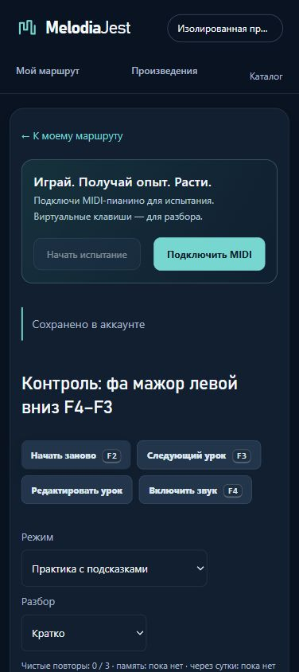

# MelodiaJest: сообщения аккаунта видны в новом player

Фаза57 завершена локально. Кандидат **23.5.79** исправляет видимость сообщения о сохранении и объяснение гостевой политики. На сайте остаются **23.5.78 / previous77**; новых уроков, самостоятельных целей и серверных изменений в этой фазе0.

В публичной78 существующий `service-account-status` находился внутри скрытой старой панели:элемент был вDOM, но не имел видимых прямоугольников. Теперь тот же элемент перемещается после серверной панели в `main`. ЕгоID, `role=status`, `aria-live=polite` и связи `aria-describedby` сохранены;добавлено `aria-atomic=true`. При повторном render сохраняется один и тот же узел. Сообщения записываются через `textContent`.

Отображаются действительные состояния ожидания, ошибки и подтверждения сохранения. Гостю явно объясняется необходимость входа для сохранения настроек, личных правок и результатов. Права владельца, политика гостя, вход, экспорт, сохранение и начислениеXP не менялись. Гостевой выбор «Скрыто» послеreload по-прежнему возвращается к «Кратко»;сохранение гостю не заявляется. БудущиеSSO и общийLVL портала остаются отдельным этапом.

До исправления новый набор воспроизводил проблему:1/8pass,7fail;после —8/8pass. Приняты **1246/1246 npm** и **35/35 целевых**. Первый полный прогон1232/1246 не принят:после повышения package-версии в служебном каталоге оставался `sourceVersion78`. Штатный builder дал те же450редакций и учебныйхеш;изменилось только это поле на79. После исправления полный прогон повторён и принят. Старыеfixtures/baseline/аудиты/валидатор не регенерировались и не ослаблялись.

В изолированном браузере подтверждены видимые pending/error/ack, гостевая политика, одинliveузел, отсутствие скрытого предка, `main` и сохранённыеARIAсвязи. Для ошибки использован один явный синтетическийHTTP503;последующее подтверждение и чтение сохранённого вида прошли. Authenticated «Скрыто» пережилоreload послеack. В трёх режимах памяти нет материала, toggle и источников вDOM. Enter/пробел раскрывают и сворачивают краткий разбор. В гостевом и авторизованном виде на390px сообщение помещается по ширине, preview занимает5строк. Captured warn/error console пусты.

Первое дополнительное измерение auth390 было1280px и не принято;nativeAXпроба сбросилаJSkernel. Основные ранее возвращённые наблюдения восстановлены из toolresults, сохранённые изображения остались. Свежая повторная390проба отдельно записала реальные390px, прямоугольник,5строк и screenshot;она принята. Временные вкладки94/95/96 и собственные preview закрыты, viewport сброшен, public78tab78 оставлена. Только syntheticloopback;производственные аккаунты/прогресс не использовались. РеальныеMIDI,звук,физическое исполнение,педагог иscreenreader не проверялись.

Точный локальный артефакт79: **a4209ac8f841ae6f770f9e3da9bf94f8163d11c02182b43400f871a18ad9dd15**, 6986732байт;manifest **6a715c7f447a22944fab153ddb518eacb415f33569ce5295d16440ce3c6c5f93**, source **d424a2538bcbad419c6501103fa2316b13eda572e514afb646e0da5538b236a9**. 1018исходников/40публичных/1062локально восстановленных файлов. Все457runtime/test файлов совпали с точным артефактом. Из прежних456 измененыCSS,player,package и только метаданные service/course-registry;добавлен один файл8регрессий. Файлы не равны урокам. Это локальная проверенная копия,не независимый внешнийbackup и неproductionReady.

Все598полных/450серверных учебныхредакций,ноты,длительности,пальцы,ID/порядок/107тем/schema2/baseline прежние;courseSHA **334e7971ea614a6dd155e94cd9deb074ebd0d15b13befaaed4351319e09d94ee**. По452неизменным прежним файлам и отдельно проверенному sourceVersion-only полю переиспользованы4музыкальныхаудита и43Windows servicepass+7PG environment skips55. Linux39 для78 не приписываются79;проверкиLinux79/reader/публикации ещё не выполнены.450учебных/186MIDI/153объяснения/13контролей/10вариантов;427лишьверхняя граница,teacher0/verifiedDistinctnull. Новых записей/целей57=0;минимум1000 самостоятельных содержательных уроков сохраняется.

Первый calendarhourly78: **2026-11-09T17:01:28.348872+00:00–2026-11-09T17:01:29.215366+00:00**, InvocationID **3017efcb97a647d28c6b1c86805f8e2f**. Таймер,журнал и обе полные квитанции точно совпали;S3requests0,новыхbackup/restore0. PG07222f7c…/restored16:15:21.593234/dataCompared16:15:21.593240 и source2c0af582… прежние. Это контрольсвежести,неPGdaily. Прогноз18:00:56UTC иdaily10ноября02:11:55UTC остаются прогнозами. РучныеPG78/a3e438… иhealth78/b22b73… календарю не приписываются;история отказавшегоdaily68 и15minretry сохранена. Naturalproductionlockrefusal новогоworker не наблюдался.

READ-ONLY место **2026-11-09T17:06:22.542323+00:00**: **945324032байт**. Строгий PGrecovery>838860800 пройден,следующийprepare>1048576000 не пройден. Устаревший успешный storagegate54 сохранён как история и заменён актуальным отрицательнымpreparegate. Перед будущимstaging нужна свежая ограниченная ресурсная подготовка;нового готового плана удаления нет. Уже удалённые runtime03be54/restored43и4150 не повторять,остальныеruntime/защищённыеstage/архивы/backup/currentprevious не чистить. Пороги/caps не снижать,массовыхудалений/globalprune нет. PG/static78 иkit не повторялись;серверные данные,таймеры,workers,Caddy исоседи не менялись.

Применены ранее прочитанные find-skills/frontend-design/web-design-guidelines и ComputerUse,без новых зависимостей/плагинов/React/Next. Свежо прочитаны [официальные Vercel Web Interface Guidelines](https://raw.githubusercontent.com/vercel-labs/web-interface-guidelines/main/command.md) и [W3C:Understanding Status Messages](https://www.w3.org/WAI/WCAG22/Understanding/status-messages.html):статус доступен без смены фокуса,живойузел сохраняется,полное сообщение связано с ARIA. W3Cстраница пояснительная;сертификацияWCAG иscreenreaderпроверка не заявляются.

Доказательства:[localQA](../qa/melodiajest-2026-11-09-57-local.json),[browserQA](../qa/melodiajest-2026-11-09-57-browser.json),[calendar78](../qa/melodiajest-2026-11-09-57-calendar78.json),точные вспомогательные исходники в `docs/qa/melodiajest-2026-11-09-57-source`. Полныйfinalsource57 сохраняется отдельнойлокальнойквитанцией;весьfinalcheckout независимо внешне восстановленным не объявляется.

Следующий шаг:ограниченнаяread-only ресурснаяподготовка для79,затем отдельныепроверки/выпуск. После выпуска — собственная готовность двух рук вFmajor либо иной подтверждённый учебныйпробел,с первоисточником и проверкойдублей всего корпуса. Темп,регистр,длина и повтор сами не новыецели.

Та же ACTIVE20min автоматизация `automation` нативно сверена 2026-11-09T17:21:32.490748+00:00. Тот же thread/schedule,дубликатов нет. Canonical LF-normalizedSHA efeae7d3aac9fe462e820d512522801383626331c5c586150b5a83be9b32205c,raw-fileSHA 20b0f220fca31c0b80de93aa495d7952bc4df627cf1a5bf2671a069becab3291,native trimmed promptSHA 5387a599dba312049dfca305e7f73fe420bd0218eeae1984534ca2e83b7dafd5. Стабильное указание пользователя после маркера7ноября сохранено. Перед финальным checkpoint обычная квота разрешена:used66%/remaining34%,окно10080min,резерв0%;это общая квота,не индивидуальный бюджет.

Финальный **локальный** source57: **763077fea9d5d02d654e998183523e4a09bcdaa9e8f3dfff8dcca3c9eb0bd490**, 7012549байт/1019source/40public/1063восстановленных файлов;457runtime/test совпали. Содержит итоговые документы/QA/точные адаптеры/верификацию этой автоматизации до самой квитанции. Указатели на квитанцию обновлены отдельно после упаковки. Это не опубликованный79 и не независимый внешнийbackup всегоcheckout. Публичные78/previous77 и независимо восстановленныеPG/static/kit прежние.

Уточнение полноты source57: первая финальная копия763077fe… локально восстановила приложение,но docs-allowlist исключил сырые.py/.cjs вспомогательные файлы. В ней оставались только ихSHA. Это не полныйbackup тел адаптеров. Allowlist не расширялся:теперь точные исходные байты/SHA/размеры каждого адаптера сохранены в разрешённом QA JSON(base64). Для изменившегося доказательства создаётся отдельная final-verified копия;первая сохранена как история,тот же кандидат79 не перепаковывается.

Текущий финальный **локальный source57 final-verified**: **156dfbfd6d3f5a4e23efd53795be90f1bd93d2a59b2cebd739ca0f5787299674**, 7052688байт/1019source/40public/1063восстановленных файлов. Все457runtime/test и12тел адаптеров,декодированных именно из изолированно восстановленного JSON,побайтно/SHA/размером совпали. Этот checkpoint заменяет неполное утверждение о телах адаптеров в763077fe…;обе локальные копии сохранены,кандидат79/публичные78/previous77 не перепаковывались и не менялись. Указатели на эту квитанцию обновлены после упаковки. Внешняя независимость всемуfinalcheckout не приписывается.
