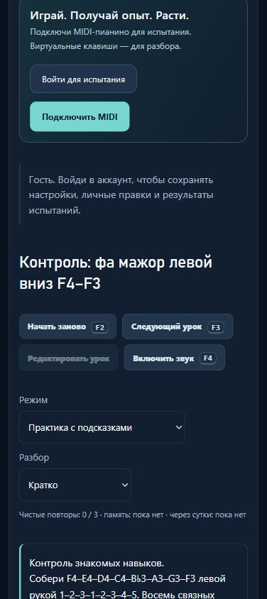

# MelodiaJest — опубликована23.5.79, этап102

Новое прямое указание пользователя «все локальные версии ставь на хост. там уже есть свободное место» выполнено. Единственный неопубликованный runtime-кандидат79 установлен поверх78;78сохранён для отката. Прежний hold79 отменён;обычные будущие проверенные выпуски разрешены без повторного общего вопроса. Исследовательские документы60–101 не выдаются за новые уроки.

Точный архив79 **a4209ac8f841ae6f770f9e3da9bf94f8163d11c02182b43400f871a18ad9dd15**,6986732B,manifest **6a715c7f447a22944fab153ddb518eacb415f33569ce5295d16440ce3c6c5f93** не перепакован. API/source **d424a2538bcbad419c6501103fa2316b13eda572e514afb646e0da5538b236a9**,course334e7971…/schema2. Все457runtime/test файлов совпали. Переиспользованы принятые1246npm/35targeted/8status и localbrowser57 для того жеSHA. Впервые для79 прошли47Linux-тестов и7budget-проверок;актуальная штатная precompare78 и изолированный reader79 совпали поdataDigest без production-томов. TWO/ONE-gates соблюдены,лимиты4/2h не менялись.

[Квитанция публикации](../qa/melodiajest-2026-11-10-102-release.json),[reader](../qa/melodiajest-2026-11-10-102-reader.json),[preflight](../qa/melodiajest-2026-11-10-102-preflight.json):до7072751616B,после6905909248B свободно;без очистки/resize/новых платных услуг. Штатные API/static updaters переключили толькоMelodiaJest;Caddybytes/inode131363/сертификаты/таймеры/aliases и соседи сохранены. Data migration/откат0.

Новая PGкопия **165de03bad13625c608c2089b262b10facdea8bf934e79a1e1fded882fb89e5c**,23файла/202653287B,независимо прочитана/расшифрована/восстановлена **2026-11-10T18:17:07.232678+00:00**;dataCompared **2026-11-10T18:17:07.232684+00:00**. Static **f1aa0592a262dcf0cfbc9ec58ec2437ee11507b91b9c57034e74e083d1b435ba** также независимо восстановлен сcurrent79/previous78. [Нативное сопоставление](../qa/melodiajest-2026-11-10-102-native-postreader.json):manualPG18:16:19–18:17:08/invff0a4292…/8summaryfields точно совпали;manualhealth18:18:29–30/inv83d35206…/обе полные квитанции совпали. Это неcalendar/daily;первыйcalendar79 ещё ожидается19:01:06UTC,nextdaily11ноября02:14:29UTC — прогнозы. Старыеactual17/actualdaily78 сохранены. S3requests программы не полный биллинг,unknowncostне0.

[Публичная проверка](../qa/melodiajest-2026-11-10-102-public.json):40публичных файлов/39assetSHA,HTTPS/сертификаты/308HTTP→HTTPS/301www→root/API/source/course/schema2 приняты.8служебных путей закрыты404. Namespaced aliases и3соседаHTTPS200 до/после.

[Браузер](../qa/melodiajest-2026-11-10-102-browser.json):gueststatus79 виден вmain,один role=status/aria-livepolite/atomictrue;Enter раскрывает,Space сворачивает,две свои подготовки сохранены. На390px статус помещается,preview5строк,consolewarn/error0;viewport сброшен,publictab97 оставлена. Первый queryметрик сparseFloat внутри read-onlysandbox отклонён как ошибка инструмента;корректное измерение выполнено со строкойline-height и вычислением внеpage scope. Authpending/error/ack/3memory/hiddenreload — только прежняя local57проверка того жеSHA,не новые production-записи. РеальныеMIDI/звук/пальцы/педагог не проверялись.

450учебных/186MIDI/153происхождения/13контролей/10вариантов/427верхняя граница,verifiedDistinctnull/teacher0;новыхуроков/целей0. Ноты,ID,редакции,порядок,grade/XP/прогресс,14operations.local*,полныйF7pin,workers/updater/kit,source59 и guitarjest сохранены.4F/6future/2C не внедрены. Опубликованные selectedsource79 защищены новыми независимыми копиями;новые документы60–102 не покрыты старымsource59,весьcheckout независимо восстановленным не объявляется.

[Финальная сверка](../qa/melodiajest-2026-11-10-102-consistency.json),[та же автоматизация](../qa/melodiajest-2026-11-10-102-automation.json). Computer-use skill применён через браузер;UI/React-код не менялся,новых зависимостей/автоматизаций/worktree/commit/push0. Новое разрешение сохранено;последующие обычные релизы публикуются по штатным проверкам. Далее source-onlycourse07-03.
