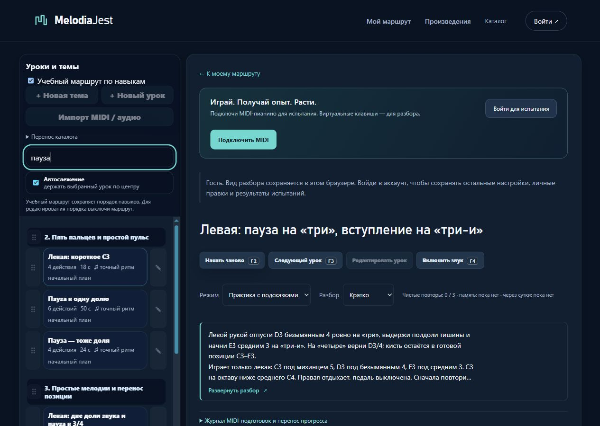

# MelodiaJest — поиск с сохранением фокуса, этап113 завершён

Этап113 завершён: 23.5.82 опубликован и проверен, previous81 сохранён. Читать docs/reports/melodiajest-operations-2026-11-11-113.md, QA113 release/public/reader/browser/search-performance/linux/native-postreader/consistency и tmp/melodiajest-113-checkpoint.json. Прежнее ожидание кандидата82 завершено.

Исправлена реальная потеря фокуса при вводе в поиск: обновляются только результаты бокового списка и его подсказка. Поле, курсор и выбранный тренажёр сохраняются; общий фильтр и гостевые права прежние. Локальный и публичный браузер самостоятельно проверили непрерывный ввод, Tab, мышь/Enter/Space, пустой результат/очистку, учебный и отдельный поиск произведений на desktop/390px. Звук и MIDI не включались. Приватные данные не использовались. Preview остановлены, временные вкладки закрыты, viewport сброшен; публичная вкладка сохранена.

1277 полных / 6 целевых / 43 Windows service теста прошли; 7 Windows-пропусков требуют Linux. Четыре музыкальных аудита прошли. 87 выбранных Linux-тестов без пропусков заняли 219.621 с при лимите300 с и прежних 384MiB/0.65CPU/network-none/read-only; 7 budget-тестов прошли. До исправления новые проверки контракта списка: 2pass/4fail, после: 6pass. Не повторять эти тяжёлые проверки при неизменном runtime и отсутствии нового риска.

По три серии четырёх запросов на 1280×900 и 390×844: все 24 набора ID/порядок/DOM совпали; до фокус BODY, после INPUT. Для «пауза» медиана dispatch32.4→20.3 мс desktop и34.2→18 мс mobile. CUA fill имел isTrusted=false: это локальный dispatch и pre-paint rAF, не человеческий INP/полевая статистика. Ранние desktop-серии с высотой720/параллельными тестами исключены, исходники сохранены. Полный список всё ещё453 строки/5247DOM с QA, очистка долгая; ускорение открытия карточки не доказано.

| Экран | Запрос | Строки / DOM с QA | Dispatch до → после, медиана мс | Второй rAF до → после, медиана мс |
| --- | --- | --- | --- | --- |
| desktop | пауза | 8 / 751 | 32.4 → 20.3 | 58.7 → 28.9 |
| desktop | левая | 70 / 1407 | 27.9 → 18.3 | 71.7 → 46.2 |
| desktop | zz-not-found-113 | 0 / 654 | 18.6 → 4.5 | 44.8 → 29.8 |
| desktop | очистить | 453 / 5247 | 88.6 → 86.3 | 265.2 → 238.7 |
| mobile | пауза | 8 / 751 | 34.2 → 18 | 58.6 → 31.1 |
| mobile | левая | 70 / 1407 | 29.7 → 12.6 | 73.7 → 40.4 |
| mobile | zz-not-found-113 | 0 / 654 | 18.9 → 4.4 | 40.6 → 19.3 |
| mobile | очистить | 453 / 5247 | 106.4 → 74.4 | 274.5 → 231.4 |

Новых уроков/целей в113 — 0. Все601 прежние полные записи и453 серверные редакции, ноты/пальцы/ритм/версии/классификация/порядок сохранены. Всего601 каталог /453 учебных /189 MIDI /156 происхождения /13 контролей /10 вариантов /430 только верхняя граница; verifiedDistinct=null, teacher0, 74 источника и100 учебных партий. Последняя музыкальная партия2026-11-11-02 опубликована81; урок левой паузы112 и исправление гостевого вида80 не дублировать. Реальные MIDI/физические пальцы/звук/навык/педагог не наблюдались.

Архив dist/melodiajest-23.5.82-20261111-113.tar.gz: 8296422 B, SHA f7918e913d8f31e7a77663c2b7c3a01dc1abe822ccefa2aa836fd2ca52306566. Manifest dd2c38830edfd7a75de915e8134564e21a2426ac29c1d114afe7584c6e4bb8f6; API/source fc78168b87714790685bce0a5a3ecc96206cc257df23d33a2e015fa7c0293955; course 7fad6740b5a3c982b287c2b2f96308e1a22baa1ef95e6006aa962362105b81e9; schema2. Все 463 runtime/test-файла совпали. Локально и выбранным срезом независимо восстановлены 1431 source / 40 public / 1475 files. Поздние финальные документы113 и весь checkout этим sourcecut не покрыты. Не перепаковывать тот же SHA.

PG snapshot 60d11b550a5f5fa830b9d2d1b7585316862e8af7f5d22763c925dee338d7960f независимо восстановлен 2026-11-11T06:24:43.310774+00:00; static snapshot 85ac2fcaf4c78eaca9fce7bb09237fcdd6d9303ed60279c573b1795e74503216 прочитан, расшифрован и восстановлен с current82 / previous81 без production-томов. TWO/ONE проверены после штатного ожидания. PG StartLimit4/2h и health8/2h не менялись. Postreader PG/health — ручные проверки: 8 полей PG-summary и две полные health-квитанции точно совпали с журналом; это не calendar82/daily82. Следующие календарные даты — прогнозы до наблюдения invocation. Защищённые 14local/F7/workers/kit, Caddy, таймеры и соседи сохранены. Личные браузерные данные требуют приватного экспорта; полный биллинг S3 неизвестен.

Проверки памяти и смены аккаунта выполнены реальным shipped renderer в регрессиях; гостевой браузер не является проверкой входа или memory-исполнения. Генерируемый savedAt исключён из сравнения каталогов в новом тесте; исходный lesson-review-baseline не пересоздавался. Новых зависимостей, TypeScript/React/Next-переноса и визуального редизайна нет.

Применены ранее установленные web-design-guidelines и computer-use. Первичные источники измерения: [Vercel guidelines](https://raw.githubusercontent.com/vercel-labs/web-interface-guidelines/main/command.md), [MDN LongTask](https://developer.mozilla.org/en-US/docs/Web/API/PerformanceLongTaskTiming), [EventTiming](https://developer.mozilla.org/en-US/docs/Web/API/PerformanceEventTiming), [requestAnimationFrame](https://developer.mozilla.org/en-US/docs/Web/API/Window/requestAnimationFrame). Журнал музыкальных источников не менялся.

Доказательства: [release](../qa/melodiajest-2026-11-11-113-release.json), [public](../qa/melodiajest-2026-11-11-113-public.json), [reader](../qa/melodiajest-2026-11-11-113-reader.json), [browser](../qa/melodiajest-2026-11-11-113-browser.json), [замеры](../qa/melodiajest-2026-11-11-113-search-performance.json), [Linux](../qa/melodiajest-2026-11-11-113-linux.json), [native](../qa/melodiajest-2026-11-11-113-native-postreader.json), [consistency](../qa/melodiajest-2026-11-11-113-consistency.json).

Следующий содержательный этап: проверить покрытие удержания левой руки со слабой восьмой через долю и необходимую подготовку. По первоисточнику реализовать 1–2 поддерживаемых микроурока с отдельной ритмической или двигательной целью; существующие задания не дублировать. Проверить ноты, пальцы, счёт, перенос и оценщики, затем тесты, изолированный браузер и отдельный штатный выпуск. Сохранить standard/beat-boundary-v2; новые модели педали/голосов требуют отдельных тестов. Поиск113 уже внедрён и не является новым уроком.
