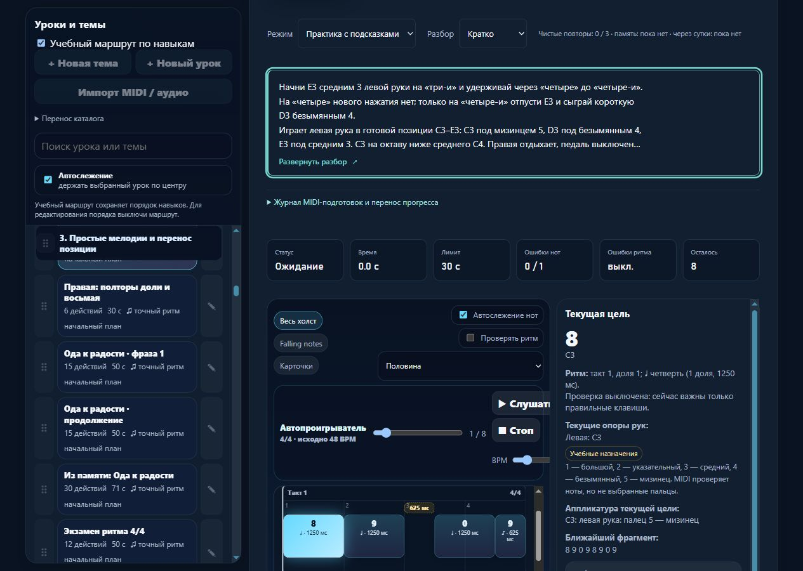

# MelodiaJest — этап115 завершён,исправляющая85 опубликована

Версия 23.5.85 опубликована и проверена, previous83 сохранён. Ускорено обновление полного каталога с сохранением всех454 строк в DOM. Выбранная и сфокусированная строки имеют точный layout и полную рамку фокуса; неподдерживающие нужное сочетание CSS-свойств браузеры используют прежнюю отрисовку. Подгонка клавиатуры обновляет только собственную область и значения ширины, сохраняя поиск/список/player. Новых уроков и самостоятельных целей — 0.

Промежуточный84 не объявлен публично проверенным. Реальный desktop→390 сценарий в Произведениях выявил выбранный последний фрагмент ниже видимой области; точный83 прошёл. Постоянный updater вернул браузерную83/previous82, совместимый API84 и текущие данные оставлены на месте без дополнительного PG-start. Независимое восстановление rollback-копии и публичный повтор проверены. Доказательства84 сохранены отдельно. Двух кадров уточнения оказалось недостаточно: дополнительная причина — полный render() при отложенном fit клавиатуры. В85 он заменён scoped обновлением; повтор desktop→mobile→desktop и ввод с кареткой при resize прошли локально и публично.

Финальные1295 полных и15 целевых(9новых) проверок прошли. До исправления late-layout:7pass/1fail;keyboard-fit:1fail/8filteredskip. Новые тесты исполняют реальные функции приложения и проверяют позднюю геометрию, отсутствие лишней прокрутки, отмену старого sidebar/row/filter/follow/memory/account callback, сохранение поиска/player при fit и запись фактической ширины. Свежие105 выбранных Linux-тестов и7 budget-тестов без пропусков: прежние300s/384MiB/0.65CPU/network-none/read-only/pids96.43Windows service с7Windows-пропусками и4музыкальных аудита переиспользованы114 по точному совпадению сервисного кода/музыкальных записей;не названы новыми прогонами. Неполный ранний прогон84 и промежуточные локальные проверки сохранены отдельно.

Свежие3 серии4 запросов на1280×900 и390×844: одинаковые document scroll0 и высота списка532/360,все24 набораID/порядок совпали. Полный список454 строки:5246→5247DOM сQA,один новый output ширины;сокращения DOM не заявляется. Очистка dispatch98.5→29.3мс desktop и77.6→27.3мс mobile;forced layout при восстановлении scroll75.3→6мс и57.3→6.4мс. LoAF для этих трёх очисток до: blocking51.7–74.2мс/43.1–50.6мс;после desktop два кадра ниже порога50мс и один53.9мс сblocking3.3мс,все3 mobile ниже порога. CUA fill isTrusted=false,rAF перед paint,LoAF без presentation. Это локальная выборка,не человеческий INP/полевая статистика/реальный телефон/ускорение открытия карточки;фоновая системная нагрузка не контролировалась. Измерения сняты до проектных тестов без их параллельного запуска.

| Размер | Запрос | Строки / DOM до → после с QA | Dispatch до → после, медиана мс | Второй rAF до → после, медиана мс |
| --- | --- | --- | --- | --- |
| desktop | пауза | 8 / 740 → 741 | 21.7 → 7.4 | 31.3 → 23.3 |
| desktop | левая | 71 / 1406 → 1407 | 17.8 → 8.6 | 49.5 → 29.1 |
| desktop | zz-not-found-115 | 0 / 643 → 644 | 5.8 → 3.6 | 27.7 → 22.2 |
| desktop | очистить | 454 / 5246 → 5247 | 98.5 → 29.3 | 122.6 → 64.1 |
| mobile | пауза | 8 / 740 → 741 | 19 → 5.9 | 28.7 → 20.4 |
| mobile | левая | 71 / 1406 → 1407 | 12.8 → 7.3 | 45.4 → 30.4 |
| mobile | zz-not-found-115 | 0 / 643 → 644 | 3.9 → 4.4 | 20.6 → 25.6 |
| mobile | очистить | 454 / 5246 → 5247 | 77.6 → 27.3 | 247.4 → 53 |

Точные40 файлов локальной сборки и публичный браузер проверили непрерывный ввод/курсор,Tab,Enter/Space/мышь,начало/конец списка,автослежение,desktop→390→desktop,пустой результат/очистку,свободный порядок,гостевые ограничения,отдельный поиск148фрагментов и5строк описания на390px. Три гостевых вида сохраняются послеreload. Фокус/каретка запроса сохраняются при fit;число в output и range совпадает. В опубликованных файлах нет QA-вставки. Собственные preview остановлены,временные вкладки закрыты,viewport сброшен,публичная вкладка сохранена. MIDI/звук не включались;личные данные,реальное MIDI/исполнение/качество звука/screen reader/педагог не наблюдались. Memory/account guards проверены действительным renderer,не гостевой попыткой входа.

Архив melodiajest-23.5.85-20261111-115.tar.gz: acaf023e2d9ff9a2644e6a4aab14708715693b3a8ae455abf6eee597c99e13ae, 8481009B. Manifest c173c9acea73c1c44179e2dc23c45ab0b536f09f1c5612c2d1963398064577c0;API/source bf6e9c5a2e987a432d54e28e19a93581583769224dd1ed90e62c9a21be7b89c4;course 0840d427f89d1cba2c5c25c1b0f2ff4da7bead04d14bb04278737a6b62ba2413;схема2. 1472 source/40 public/1516 files восстановлены локально и выбранным срезом независимо. Все466runtime/test-файлов точные.602полные JSON-записи/454серверные редакции,ноты/пальцы/ритм/музыкальные версии/классификация/порядок/grade/XP-контракты/гитарный маршрут/исходныйbaseline сохранены. Помимо CSS изменены только две UI-функции,output ширины и тестовые hooks/9регрессий;музыкальные данные не менялись.

PG snapshot 0f93f46988a9b4ae48c6ad7b545d37791aee343fa6e41e6cd222169753ba4a60 независимо восстановлен 2026-11-11T10:09:15.330104+00:00;static snapshot f54470b58740ffeb86f45f884af6f52d7a2f6a5bf3eb4d0f5da6abc74f465d10 прочитан/расшифрован/восстановлен сcurrent85/previous83 без production-томов. APIprevious84 совместим и сохранён;финальные browser/API метаданные85 согласованы. TWO/ONE,блокировки и ресурсы проверены заново,PG4/2h/health8/2h не reset/повышались;allowance не reservation. Ручные postreader PG/health85 не объявляются calendar85/daily85. Отдельный calendar83 2026-11-11T08:00:07.900977+00:00 подтверждён двумя полными health-receipt и журналом,не новым restore/dailyPG. Поздние финальные документы115 и весь checkout не входят в выбранный sourcecut;личные браузерные данные требуют приватного экспорта;полный биллингS3 неизвестен. Защищённые14local/F7/workers/kit, Caddy,таймеры и соседи сохранены.

Применены существующие find-skills-каталог,web-design-guidelines и computer-use без установки зависимостей. Первичные источники: [Vercel guidelines](https://raw.githubusercontent.com/vercel-labs/web-interface-guidelines/main/command.md),[Chrome LoAF](https://developer.chrome.com/docs/web-platform/long-animation-frames),[web.dev content-visibility](https://web.dev/articles/content-visibility),[CSSWG paint containment](https://drafts.csswg.org/css-contain-2/#paint-containment). React/Next-перенос не требовался.76музыкальных источников/101учебная партия/454учебных/190MIDI/157происхождения/13контролей/10вариантов/431верхняя граница сохранены;verifiedDistinct=null,teacher0. Последняя музыкальная партия2026-11-11-03 опубликована83;её не считать повторно.4F/6future/2C/voicegap/4manualcards/history20 невнедрённые;новыхpaid/resize/mount/защищённых удалений/guitar/commit/push/worktree0.

[Release85](../qa/melodiajest-2026-11-11-115-release.json),[public85](../qa/melodiajest-2026-11-11-115-public.json),[reader85](../qa/melodiajest-2026-11-11-115-reader.json),[Linux105](../qa/melodiajest-2026-11-11-115-linux.json),[browser85](../qa/melodiajest-2026-11-11-115-browser.json),[измерения85](../qa/melodiajest-2026-11-11-115-search-performance.json),[native85](../qa/melodiajest-2026-11-11-115-native-postreader.json),[откат83](../qa/melodiajest-2026-11-11-115-rollback83.json),[отклонённый84](../qa/melodiajest-2026-11-11-115-rejected84-browser-regression.json),[consistency](../qa/melodiajest-2026-11-11-115-consistency.json).

Следующий шаг: Реализовать1–2 содержательных коротких урока по подтверждённому пробелу удержания одного звука через тактовую черту после существующих ритмических подготовок. Сначала проверить покрытие и первоисточник,затем собственные ноты/пальцы/счёт/контраст с повторной атакой/перенос,оценщики и отображение. Если требуемая модель не поддержана,выделить изменение с тестами,не добавлять сомнительный урок ради числа. Сохранить standard/beat-boundary-v2;не дублировать синкопу83/114. Поиск85 уже оптимизирован,повтор здоровых замеров новым результатом не считать.
