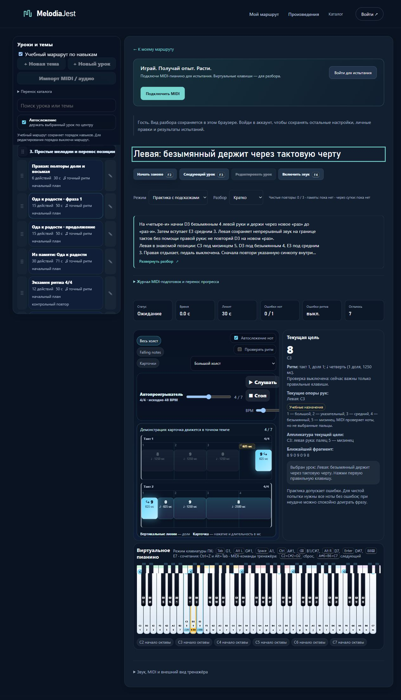

# MelodiaJest — этап117 завершён,23.5.87 опубликована

Опубликована и проверена23.5.87,previous86 сохранён. Один новый урок detail-p-barline-hold-left-01:левая D3/4 с «четыре-и» держится через новое «раз» до «раз-и» одним звуком;затем E3/3. C3–D3–E3–D3–E3–D3–C3,пальцы5–4–3–4–3–4–5,48BPM,два такта4/4,семь атак. Это отдельная двигательная работа левого безымянного со средним на границе тактов,не BPM-вариант и не зачёт правой руки.

1313 полных/27 целевых(8новых)/43 Windows service passed;7 Windows-пропусков требуют отдельной PostgreSQL-платформы. Четыре музыкальных аудита прошли.123 выбранных Linux-тестов за360.203s/7budget прошли без пропусков;этот набор не является семью PostgreSQL-интеграционными тестами. Для123 Linux задан420s по измеренным318.3035s у115 предыдущих;384MiB/.65CPU/network-none/read-only/pids96 прежние. До реализации проверка отсутствующего урока1fail/7filteredskip;первый target26pass/1fail из-за фиксированного исторического cohort116,исправлен только cohort теста с сохранением всех прежних хешей/исходногоbaseline. Финальные27/1313 прошли после правки.

Вступления0/1/2/3.5/4.5/5/6,длительности1/1/1/1/.5/1/2,пауза3–3.5,конец8. Подготовки:detail-p-syncopation-hold-left-01 иdetail-p-left-half-01. Клиентский и серверный оценщики отвергают повторную атаку/отпускание на черте,раннюю следующую ноту,заполненную паузу,неверную высоту/пропуск/короткий финал/keyboard. MIDI-обработчики удерживают D3 и ждут финальное отпускание. Открытый перенос удерживает E3/3 в другой собственной фразе;не новый урок и не независимый слуховой тест. Standard/beat-boundary-v2,схема2,renderer и модели педали/голосов не менялись.

Использован проверенный116 renderer без изменения index.html:продолжение D3 ссылается на исходный шаг и явно подписано «без нового нажатия». Локальный и публичный браузер проверили собственные ноты/счёт/пальцы/происхождение/источники/обе подготовки с Enter/Space/фокусом,мышь/раскрытие,3гостевых вида послеreload,5строк112px/22.4px и376px без горизонтального переполнения на390px. Непрерывный «черту» сохраняет фокус/каретку5 и показывает оба урока разных рук;очистка возвращает456 записей. Путь148 Произведений в117 заново не проверялся;index.html точно совпал с116. Preview57054/PID3696 остановлен,временная вкладка закрыта,viewport сброшен,публичная вкладка сохранена. MIDI/звук не включались;личные данные/физические пальцы/исполнение/качество звука/screen reader/педагог не наблюдались;memory проверен реальным renderer в регрессиях.

Архив melodiajest-23.5.87-20261111-117.tar.gz: 94afc7c4c8dd3d9a9069e665cf57c876336d95c801b4d4cda47801558d001152, 8696162 B;manifest ff7c56ee9dd7529dd1c6617459a9b205bc6a478a65d108e35ec4aa0de70ce7c7;API/source 738b9ee1efe0c39079ba6440b27f3680bfcae80b8a2a11249231f81ce5ba6c2c;course b349cb288db5bd46a6dbf12098da303d80863265d94610ce035e6b2acd0633d5. 1498 source/40 public/1542 files восстановлены локально и выбранным срезом независимо.470runtime/test файлов точные;603 прежние полные записи и455 серверные редакции,темы/порядок/ноты/пальцы/ритм/версии/классификация/grade/XP-контракты/гитарный маршрут/исходныйbaseline сохранены. Поздние финальные документы117 и весь checkout не входят в этот sourcecut;тот же SHA не перепаковывался.

PG snapshot 77a9f98f2439db53167cb68f07ecf25462640e5750906cb71413f7b22ab93fee независимо восстановлен 2026-11-11T12:12:10.272976+00:00;static snapshot 49dbebebd41dec70cef89d487a6f3f50bb5685d210bfe75e31a6888377329aa4 прочитан/расшифрован/восстановлен сcurrent87/previous86 без production-томов. TWO/ONE и неизменные StartLimit4/2h/health8/2h соблюдены;allowance не reservation. Ручные postreader PG/health не объявляются calendar87/daily87. Caddy,таймеры,соседи,14local/F7/workers/kit сохранены. Браузерные личные данные требуют приватного экспорта;полный биллингS3 неизвестен.

Заново прочитаны первичные [The Open University,§3.5,перед примерами20–21 и абзац об одной высоте](https://www.open.edu/openlearn/history-the-arts/music/an-introduction-music-theory/content-section-3.5),[Open Music Theory,Rhythmic values,Dots and ties](https://open-musictheory.github.io/docs/fundamentals/rhythmic-values/) и[Jerry Kovarsky/Yamaha,нумерация/выбор пальцев](https://hub.yamaha.com/keyboards/k-how-to/the-basics-of-piano-keyboard-fingering/).76источников,0новых записей/3application. Собственные ноты/пальцы/48BPM/перенос/допуски — решения проекта,одобрение авторов не заявляется;чужие изображения и фрагменты не копируются. Недоступные страницы не повторялись. Применены существующие find-skills-каталог,свежие Vercel web-design-guidelines и computer-use,без зависимостей/React-переноса.

604каталожных/456учебных/192MIDI/159происхождения/13контролей/10вариантов/433только верхняя граница;verifiedDistinct=null,teacher0. Новых уроков/целей1,контролей/вариантов0;103учебные партии,прежние102 сохранены. Пробел проверен по всем455 прежним серверным учебнымID с фактической классификацией. Поздняя копия старого116теста восстановлена из проверенного86архива с точным SHA116freeze;не названа копией до изменения.4F/6future/2C/voicegap/4manualcards/history20 невнедрённые. Новыхpaid/resize/mount/защищённых удалений/guitar/commit/push/worktree0.

[Release](../qa/melodiajest-2026-11-11-117-release.json),[public](../qa/melodiajest-2026-11-11-117-public.json),[reader](../qa/melodiajest-2026-11-11-117-reader.json),[browser](../qa/melodiajest-2026-11-11-117-browser.json),[native](../qa/melodiajest-2026-11-11-117-native-postreader.json),[consistency](../qa/melodiajest-2026-11-11-117-consistency.json).

Следующий шаг: Измерить открытие карточки на каталоге456:отдельно синхронный выбор,создание краткого/полного разбора и layout до первого кадра на desktop/390px. Проверить сохранение фокуса,выбранной строки и позиции при переходе между коротким и длинным материалом. По подтверждённой причине сделать одну небольшую правку и сравнить тот же сценарий;если узкого места нет,вернуться к1–2 содержательным урокам. Не повторять здоровые замеры поиска85 или тяжёлые проверки87 без изменений/риска. Новых зависимостей и обязательного React-переноса не вводить;личные данные/MIDI/звук не использовать. В начальной лёгкой проверке отличать фактическую calendar87-квитанцию от прогноза,не запускать службы ради отчёта.
