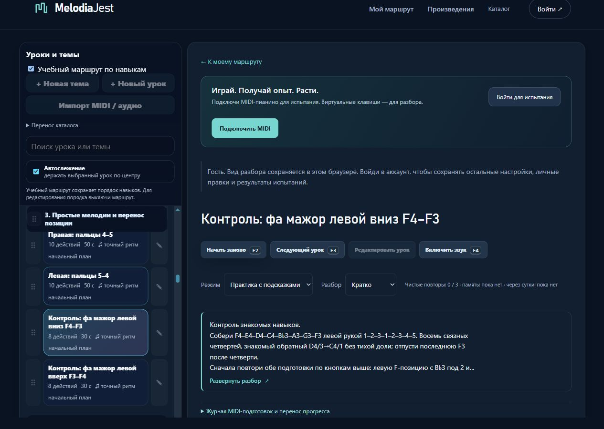

# MelodiaJest — этап118 завершён,23.5.88 опубликована

Опубликована и проверена23.5.88,previous87 сохранён. Смена «Кратко / Развёрнуто / Скрыто» обновляет только блок разбора и его кнопки,сохраняя каталог,поиск/каретку,player,клавиатуру и состояние попытки. Memory,отменённая сессия,другой раздел и отсутствующий slot используют полный защищённый renderer;stale callback отменённой сессии не сохраняет предпочтение. Новых уроков/целей0. Проверка относится к изменённому пути разбора;прежний cold-resize списка произведений87/88 остаётся отдельным известным ограничением.

1321 полный/31целевой(8новых)прошли;131выбранный Linux за387.671s/7budget без пропусков при480s/прежних384MiB/.65CPU/network-none/read-only/pids96.43Windows service/7Windows skips и4музыкальных аудита переиспользованы117 по точным хешам музыкального и сервисного кода;не свежие прогоны и не семь PostgreSQL-интеграций. До правки1pass/7fail,одна memory-проверка уточнена от общей C3 подписи диапазона к реальным D3/источникам и отдельно прошла до реализации. Промежуточный30pass/1fail — исходная scroll-позиция фикстуры после bind;исправлена только тестовая подготовка. Финальные31/1321 прошли после неё.

Точные40файлов88 безQA-вставки и публичный браузер проверили короткий course06-04/длинный Fmajor-разбор,3гостевых вида послеreload,мышь/Enter/Space/Tab/фокус,источники иобе подготовки левого barline урока,поиск/каретку,сохранённый demo-position3 и4/7,5строк112px/22.4px и376px безпереполнения на390px.148Произведений имеют отдельный поиск,learning-slot отсутствует. Тёплый локальный desktop→390→desktop прошёл;публичный холодный проход оставил последний chopin-midi-final ниже списка:row370.24–450.8px,список31.7–391.7px,scroll13800.96/max13874. Точные87 воспроизвели те же шесть геометрических значений,код follower иCSS не менялся. Это прежний сбой,не устранённый88;общий site-wide browserpass не заявляется. Откат87 не исправил бы этот случай,поэтому88сохранена с проверенным изменённым путём иотдельной следующей задачей. Начальный publicfill опередилboot и потерял input;после свежего загруженногоDOM путь прошёл,код не менялся. MIDI/звук/личные данные/физическоеисполнение/пальцы/screenreader/педагог не наблюдались;memory/account проверены реальным renderer в регрессиях. Все собственные preview остановлены,временные вкладки закрыты,viewport сброшен,публичная вкладка сохранена.

Три серии8действий на1280×900/390×844 до и после:все48пар выбранногоID/режима/длины текста/456строк совпали. Медиана смены вида dispatch54.75→0.95ms desktop и56.1→0.95ms mobile;создание самого текста0.1–0.15ms. Root.innerHTML при смене вида12→0 на каждой ширине;сдвиг sidebar прежде до200.32/183.68px,после0 во всех12сменах. Все456строк сохранены;DOM стал на один пустой контейнер больше. Выбор другого урока всё ещё использует полную отрисовку,его ускорение не заявляется. CUA selectOption isTrusted=false,clicktrue;первый/второй/четвёртый rAF до paint,LoAF безpresentation. Это локальная выборка,не человеческий INP/полевая статистика/реальный телефон. До таймера выполнялся DOM-снимок,locator мог прокрутить кнопку до клика;тесты проекта не шли параллельно,прочая нагрузка не контролировалась.

Архив melodiajest-23.5.88-20261111-118.tar.gz: d4add77cb32cc36c554e716d929d100e3c276353b3b386bfe7de009c5b4088fe, 8737575 B;manifest 555ab72c0e9774335b5b17633b8be90c1f36a1a18a41af9713681c3a80775a4c;API/source 36c450d5ce8136afc73c6e11ce9355b71a3921329da862978980134abbd25992;course b349cb288db5bd46a6dbf12098da303d80863265d94610ce035e6b2acd0633d5. 1511 source/40 public/1555 files восстановлены локально и выбранным срезом независимо.471runtime/test файлов точные;604 прежние полные записи и456 серверные редакции,темы/порядок/ноты/пальцы/ритм/версии/классификация/grade/XP-контракты/гитарный маршрут/исходныйbaseline сохранены. Поздние финальные документы118 и весь checkout не входят в этот sourcecut;тот же SHA не перепаковывался.

PG snapshot 0ccfba79513d6db2aacea15b73bedf6e65536f329c0d9c38113c799fe4b461eb независимо восстановлен 2026-11-11T13:03:41.744355+00:00;static snapshot ec90c92e2a9a69156470499b8be811b6967a931f56b161383011d8df1ff473b7 прочитан/расшифрован/восстановлен сcurrent88/previous87 без production-томов. TWO/ONE и неизменные StartLimit4/2h/health8/2h соблюдены;allowance не reservation. Ручные postreader PG/health не объявляются calendar88/daily88. Caddy,таймеры,соседи,14local/F7/workers/kit сохранены. Браузерные личные данные требуют приватного экспорта;полный биллингS3 неизвестен.

Для UI применены существующие find-skills-каталог,свежие [Vercel Web Interface Guidelines](https://raw.githubusercontent.com/vercel-labs/web-interface-guidelines/main/command.md) и computer-use. Новых зависимостей/React-переноса0.76музыкальных источников и103учебные партии точные;новых источников/application/уроков0. Последняя музыкальная партия2026-11-11-05 опубликована87,её не считать повторно. Подробные сырые измерения остаются вtmp/card-performance-118,публичная сборка не содержитпробы.

604каталожных/456учебных/192MIDI/159происхождения/13контролей/10вариантов/433верхняя граница,verifiedDistinct=null/teacher0 прежние. Все604полные записи и456серверных редакций,порядок/темы/музыкальные версии/grade/XP-контракты/гитарный маршрут/исходныйbaseline сохранены. Старый VM собран из доизменённого index и неизменных музыкальных модулей с SHA117:защищённая восстановленная папка дала EPERM,её права не менялись.4F/6future/2C/voicegap/4manualcards/history20 остаютсяневнедрёнными. Нет guitar/commit/push/worktree/paid/resize/mount/защищённых удалений.

[Release](../qa/melodiajest-2026-11-11-118-release.json),[public](../qa/melodiajest-2026-11-11-118-public.json),[reader](../qa/melodiajest-2026-11-11-118-reader.json),[browser](../qa/melodiajest-2026-11-11-118-browser.json),[native](../qa/melodiajest-2026-11-11-118-native-postreader.json),[consistency](../qa/melodiajest-2026-11-11-118-consistency.json).

Следующий шаг: Исправить подтверждённый холодный desktop→390 resize списка148Произведений:последний chopin-midi-final остаётся частично ниже списка. Сбой с абсолютно теми же координатами воспроизведён на точных40файлах87 иpublic88;новая scoped-смена разбора88 его не исправляет. Читать QA118-baseline-resize иpublic-pieces-resize-pending. Follower/styles87→88 точные;проверить позднюю геометрию после двухrAF,внести одну ограниченную правку со stale/memory/account/filter/follow guards и регрессиями,затем реальный cold/warm desktop→390→desktop иобычный выпуск. Не объявлять suite целиком зелёным из-за успешного тёплого повтора. После исправления вернуться к1–2 содержательным поддерживаемым урокам;счётчики604/456/192/159/103партий/76источников не менять ради UX. Не повторять здоровые1321/31/131/архив88 без новых изменений/риска.

[Парные измерения](../qa/melodiajest-2026-11-11-118-card-performance.json),[Linux131](../qa/melodiajest-2026-11-11-118-linux.json),[сравнение старого resize-сбоя87/88](../qa/melodiajest-2026-11-11-118-baseline-resize.json). Проверенный scope — изменённый разбор;полный site-wide browserpass не заявляется.
