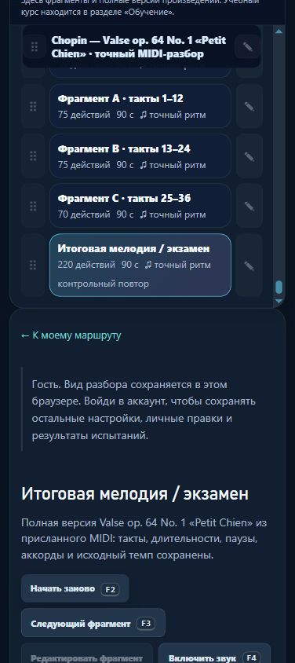

# MelodiaJest — этап119:23.5.89 опубликована

Опубликована и проверена 23.5.89, previous88 сохранён. Исправлен подтверждённый холодный desktop→390 resize списка148 Произведений: последний chopin-midi-final теперь целиком виден. Обработчик resize прежде обновлял side-card/клавиатуру, но не вызывал follower. Добавлен один coalesced RAF scheduler, переиспользующий прежнюю ограниченную коррекцию. Новых уроков и самостоятельных целей0.

1329 полных /39 целевых (8 новых) прошли. 139 выбранных Linux-тестов за 426.694s и7budget прошли без пропусков при прежних480s/384MiB/.65CPU/network-none/read-only/pids96. 43Windows service/7Windows skips и4музыкальных аудита переиспользованы117 по точным хешам музыкального/сервисного кода и тестов; это не свежие прогоны и не семь PostgreSQL-интеграций. До реализации новые8 дали6pass/2fail: проверка требовала вызова follower, rapid-case не имел callback. Тесты после первого красного запуска не ослаблялись; исторические9follow-тестов точные.

Точные40 файлов89 без QA-вставки и публичный браузер проверили по3 холодных загрузки и по2 тёплых desktop→390→desktop цикла. В публичных3 холодных случаях строка была целиком внутри списка; в2 она сразу видна в viewport, в1 список оказался выше экрана после выбора/прокрутки страницы. В этом случае обычный wheel вернул страницу к каталогу: scrollTop списка не менялся, относительная коррекция уже была верной. Автопозиция всей страницы не объявляется исправленной. Один ранний снимок с отрицательными координатами исключён и сохранён отдельно: inside-list без видимости на экране недостаточен. Первый публичный прямой случай имеет прежние границы31.7–391.7 и новую строку297.28–377.84. Оба тёплых цикла прошли без дополнительного wheel. Возврат desktop, follow-off, фильтр Chopin с11 ID, фокус/каретка и148 строк после очистки проверены. Обучение: поиск «левая»/каретка5, player position3/4из7, Enter/Space/фокус,3 гостевых вида после reload,5 строк112px/22.4px и376px без переполнения на390px. Старые снимки87/88 сохранены как доказательства ошибки, не объявлены успешными. MIDI/звук/личные данные/физические пальцы/исполнение/screen reader/педагог не наблюдались. Все собственные preview остановлены, временные вкладки закрыты, viewport сброшен; публичная вкладка сохранена. Это проверка затронутых путей, не всего сайта.

Scheduler объединяет быстрые resize по ticket; устаревший callback, память, отменённая сессия, отключённое follow, изменённый урок/фильтр и заменённые sidebar/row отменяют действие до чтения геометрии. Полная отрисовка и polling не добавлены. CSS, keyboard-fit и scoped-смена разбора88 не менялись. Покадровая QA-копия:88 не вызвал follower и был обрезан во всех12frames;89 вызвал один раз и был внутри со2-го по12-й кадр. rAF до paint и чтения геометрии могли повлиять на layout; это не INP, не полевая статистика и не реальный телефон.

Архив melodiajest-23.5.89-20261111-119.tar.gz: 7251436a86bab92c29b67f2dcfc655fa162bfdffb1911159e1132afe01bee252, 8777219 B;manifest d8f95f2e99a2272c498127c98758c0b72a89069d2cd9ffe739fa8a9951003e32;API/source 00f3787e9847d075a69b8dad08f1727314cb98f8ac56617c098c48e2c988b867;course b349cb288db5bd46a6dbf12098da303d80863265d94610ce035e6b2acd0633d5. 1525 source/40 public/1569 files восстановлены локально и выбранным срезом независимо.472 runtime/test файлов точные;604 прежние полные записи и456 серверные редакции,темы/порядок/ноты/пальцы/ритм/версии/классификация/grade/XP-контракты/гитарный маршрут/исходныйbaseline сохранены. Поздние финальные документы119 и весь checkout не входят в этот sourcecut;тот же SHA не перепаковывался.

PG snapshot c222af359b9ecd8f148e3c0c905bcd79a524e5a8cdcca8174315a6c50b9ce632 независимо восстановлен 2026-11-11T14:15:00.287752+00:00;static snapshot b6356c1b6222d9e60d00d361024a18075aed8f1511b0129cbf00b6e10b6a6a52 прочитан/расшифрован/восстановлен сcurrent89/previous88 без production-томов. TWO/ONE и неизменные StartLimit4/2h/health8/2h соблюдены;allowance не reservation. Ручные postreader PG/health не объявляются calendar89/daily89. Caddy,таймеры,соседи,14local/F7/workers/kit сохранены. Браузерные личные данные требуют приватного экспорта;полный биллингS3 неизвестен.

Применены существующий find-skills-каталог, свежие [Vercel Web Interface Guidelines](https://raw.githubusercontent.com/vercel-labs/web-interface-guidelines/main/command.md) и computer-use. Прочитан [web.dev content-visibility](https://web.dev/articles/content-visibility) об отложенном layout: конкретную причину подтвердили код и собственная QA, числовые решения автору не приписываются. Новых зависимостей и React-переноса0. 76 музыкальных источников /103 учебные партии точные; новых записей/application/уроков0. Последняя музыкальная партия2026-11-11-05 опубликована87, её не считать повторно.

604 каталожных /456 учебных /192MIDI /159 происхождения /13 контролей /10 вариантов /433 только верхняя граница; verifiedDistinct=null, teacher0. Все604 полные записи и456 серверных редакций, порядок/темы/музыкальные версии/grade/XP-контракты/гитарный маршрут/исходный baseline сохранены. 4F/6future/2C/voicegap/4manualcards/history20 остаются невнедрёнными. Нет guitar/commit/push/worktree/paid/resize тарифа/mount/защищённых удалений.

[Release](../qa/melodiajest-2026-11-11-119-release.json),[public](../qa/melodiajest-2026-11-11-119-public.json),[reader](../qa/melodiajest-2026-11-11-119-reader.json),[browser](../qa/melodiajest-2026-11-11-119-browser.json),[native](../qa/melodiajest-2026-11-11-119-native-postreader.json),[consistency](../qa/melodiajest-2026-11-11-119-consistency.json).

Следующий шаг: Проверить покрытие повторного нажатия одной высоты после восьмой паузы отдельно по рукам. По первоисточнику реализовать 1–2 поддерживаемых микроурока с отпусканием, полудолей тишины и новым нажатием той же клавиши, контрастом с удержанием и открытым переносом. Не дублировать существующие повторы и BPM-варианты; если цель уже покрыта, выбрать следующий подтверждённый двигательный пробел. Сохранить standard/beat-boundary-v2, ID, ноты, пальцы, версии, порядок и прогресс. UX119 не считается новым уроком. Nativequota в начале и перед тяжёлыми этапами; PG4/2h и health8/2h не обходить. Не повторять здоровые проверки и архив89 без изменения или нового риска.
