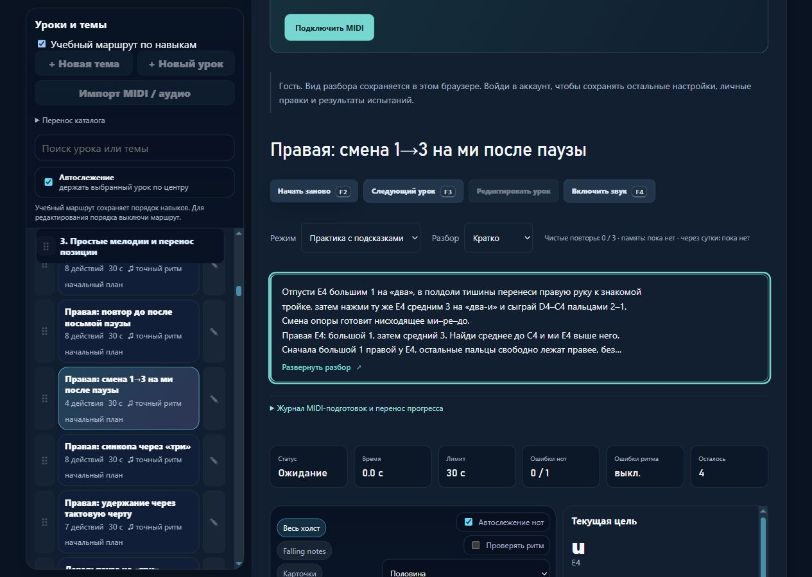

# MelodiaJest — этап124:23.5.93 опубликована

Дополнено2026-11-12T03:06:55.477580+00:00: первый фактический directcalendar93 2026-11-12T03:00:35.268475+00:00–2026-11-12T03:00:36.418638+00:00 успешен. Timer/service/journal и обе полные health-квитанции exact;QA124-calendar93. Ручные postreaderPG93/health93 сохранены отдельно. Новыхdump/restore/S3/сервисныхстартов от чтения0;это неdailyPG93 и не новыйурок/артефакт.

Завершено:2026-11-12T02:56:05.491787+00:00.

Опубликована и проверена23.5.93,previous92 сохранён. Выбранная строка обучения после холодной загрузки больше не остаётся над списком/под липким заголовком в проверенных случаях. Причина:asyncroute менялsidebar после потребленияpending;старыйcallback корректноотменялся,финальныйboot не запрашивалновыйfollow. Добавлены только capturefilter и guard перед уже существующимфинальнымrender. Старыеfollower/resize119 точные,новыхrender/polling/CSS0. Новыхуроков/целей/источников/application0.

1362full прошли за435.630s. Новые8 до правки5pass/3fail,после8pass;39историческихUI прошли отдельно,47local=8+39/дваTAP. Четыре музыкальныхаудита свежие. Один Linux47TAP 276.647s/0fail/skip с480s/384MiB/.65CPU/networknone/readonly/pids96,7budgettests одинраз;кешSHA/TAP использованпередreader безrerun. Windowsservice43+7PGplatformskips переиспользованы123 по точнымservicecode/testSHA,неfresh/не7PGинтеграций. Linuxops12214 переиспользованыточнымиSHA;portable12wrapper входитвfullroot.

До исправления exact92 RH3+LH3 иexact91 общийLH3:9обрезанныхcoldслучаев,ошибкабылаив91. После:6локальныхdesktop+1cold390,а public6cold1280×900+1cold390×844 — всеinside-list/нижеsticky/вviewport,pageY0/no-wheel. Public2warmcycles безwheel,followoff сохраняетscroll черезguide/player2из4,поисклеваяcaret5/focus/74→460,3видаreload/EnterSpacefocus,112px/22.4px/376px. Старыйpiece148/Chopin11/relative-resize сохранены;его исходныйrow895.42–975.98частичнозаэкраном,обычныйpagewheel дал793.42–873.98при прежнемlistscroll. Автопозициявсейстраницы НЕисправлена. PublicfocusJPEG послеEnter/Space/pageY252.16;доказательствоcoldpage0 отдельно. СохранённыеJPEG независимо прочитаны/просмотрены,байтыпубличногофайла точныnativecapture;старыйfailureснимоксохранён. Разнаявысотаснимков712/900 неpixelA/B. Всеownpreview остановлены,tabs7–10закрыты,viewportreset,publictab2сохранён. MIDI/audio/физическиепальцы/исполнение/screenreader/педагог/весьсайт не наблюдались.

Применены существующийfind-skills-каталог,свежие [Vercel Web Interface Guidelines](https://raw.githubusercontent.com/vercel-labs/web-interface-guidelines/main/command.md) иcomputer-use. Прочитан [web.dev content-visibility](https://web.dev/articles/content-visibility) об отложенномlayout;причину подтвердили нашкод/QA,числовые решения авторам не приписываются. Измерениягеометрии могут влиятьнаlayout,это неINP/полеваястатистика/реальныйтелефон. Зависимостей/Reactпереноса0. Новыхмузыкальныхисточников/application0;последняямузыкальнаяпартия2026-11-12-01 опубликована92,еёне считатьснова.

Неизменныйmelodiajest-23.5.93-20261112-124.tar.gz:SHA343b89dc91ea6d00a2efd1d57af6fc760182c19b782d60f1d377e2a820391d48,9247296B;manifest7cb274f97f1dddb93d46e6c58862c81fa3db1febd0642b3e58a25f66d8685789;API/source139621f5110e4de26e2ccc74fc37db19fc6c9bb65879ab43f6e39769cca11afa;courseb17f56df2ed988553eac5d747417419486c0486400a3d9acfe96a0aadc6b9050.1614source/40public/1658files восстановлены локально и выбраннымсрезом независимо;481runtime/test exact. Все608полныхзаписей/460серверныхредакций/77источниковсapplications/106учебныхпартий/музыкальныекурсоры/ноты/пальцы/ритм/версии/темы/порядок/gradeXP/guitarroute/baseline/schema2/standard-beat-boundary-v2 сохранены. Поздниефинальныедокументы124/весьcheckout внеsourcecut,тотжеSHA не перепаковывался.

PGc69463b5112ab5b6c65f005e46e0ddf4d57137fb093506db879ebad7fef9b5b4 независимо восстановлен2026-11-12T02:32:29.592924+00:00;static4c8d5e66dd5ed0151c4525fdaa2e8ab6f2e29dded9e4f4f76770dd5f2c4d2ab2 прочитан/расшифрован/восстановленcurrent93/previous92 безproduction-томов. Фактическаяdaily92 2026-11-12T02:14:17+00:00–2026-11-12T02:14:24+00:00 свериладанные 2026-11-12T02:14:24.226021+00:00,переиспользуя snapshot9be5141dde5dca3978730f71bf8eeb1f4a175ee49315663d36a41fe8f98dd89c;новогоsnapshot/restoreтогда0,restoreостался2026-11-12T01:22:34.784187+00:00. Timer/service/journal8summary/fullattempt-success/source/свежестьподтверждены. ПриTWOfalse распознано0ручныхprestarts/ONEremaining;свежийONEвнутриpublisher перед однимpostreaderPG93. ЛимитыPG4/2h/health8/2h/15minbackoff не менялись,allowanceнеreservation. ManualpostreaderPG93/health93 неcalendar/daily93. Actualcalendar92 02:00:51 до93,истории91deferred/manual/success сохраненыраздельно. Caddy/таймеры/соседи/14local/F7/workers/kit/source59/learningUi точны. Личныебраузерныеданные требуютприватногоэкспорта,полныйS3биллингнеизвестен.

608каталожных/460учебных/196MIDI/163происхождения/13контролей/10вариантов/437тольковерхняяграница;verifiedDistinct=null,teacher0.4F/6future/2C/voicegap/4manualcards/history20 невнедрены. Нетguitar/commit/push/worktree/paid/DNS/тарифа/глобальнойсети/защищённыхудалений.

Доказательства:[release](../qa/melodiajest-2026-11-12-124-release.json),[public](../qa/melodiajest-2026-11-12-124-public.json),[reader](../qa/melodiajest-2026-11-12-124-reader.json),[browser](../qa/melodiajest-2026-11-12-124-browser.json),[linux](../qa/melodiajest-2026-11-12-124-linux.json),[native-postreader](../qa/melodiajest-2026-11-12-124-native-postreader.json),[calendar92](../qa/melodiajest-2026-11-12-124-calendar92.json),[image-proof](../qa/melodiajest-2026-11-12-124-image-proof.json),[consistency](../qa/melodiajest-2026-11-12-124-consistency.json).

Следующийшаг:Сопоставить все460 canonical-ID,старые detail-p-transfer-03/04 и detail-p-cross-01/02 с парой освобождённых опор1→3:проверить, нужен ли отдельный возврат в исходную позицию после смены опоры и какая подготовленная музыкальная задача его отличает. Если цель уже покрыта, не добавлять дубль; выбрать следующий подтверждённый двигательный пробел. Только по первоисточнику реализовать1–2поддерживаемых микроурока с открытым переносом;не считать инойBPM/переименование/зеркальность самостоятельной целью. Сохранить608полных/460редакций,standard/beat-boundary-v2/ID/ноты/пальцы/ритм/версии/порядок/прогресс. Nativequota;не повторять здоровые1362/8+39/47Linux/4аудита/архив93. PG4/2h/health8/2h/backoff безобхода,allowanceнеreservation.

## Сохранённая подготовка и ограничения

# MelodiaJest — этап124:диагностика холодного списка

Начало:2026-11-12T01:39:32.364726+00:00. Public92/previous91 сохранены. Новых уроков/целей/источников/application0.

Доказательство123:после cold reload правой новой строки row385.29–483.13,список457.98–989.84;строка частично выше списка/под sticky topic. Обычный wheel показал строку655.52–753.36,scrollY0. Это не исправление и не доказанная причина/регрессия123.

Проверяем точные40файлов92,общийID левойопоры в91/92 и отдельно event-onlyQA92. Trace копия меняет2файла,неизменный опубликованный архив не перепаковывается. Свежие web-design-guidelines и web.dev content-visibility прочитаны. Числа/причину установим собственными измерениями. Рабочий runtime пока не менялся.

## Воспроизведение и минимальная правка

Event-onlyQA92 подтвердил:selectionfollow наsidebar3,затем async route заменяетDOM4–8,pending ужеfalse;старыйcallback корректно отменяется,финальныйboot restore-entry(side8,follow=false). Это собственная трасса,не вывод из web.dev. Точные40file92:3coldRH+3coldLH;точные40file91:3coldобщегоLH,все9обрезаны. Ошибка была и в91,не приписана новой музыкальной партии123.

Новые8 исполняют настоящийasync boot/render/follower с подменой только DOM-геометрии и гостевого сервиса,без фальшивого аудита/личныхданных/сети. До правки5pass/3fail(финальныйDOM,новыйвыбранныйурок,отказroute). После8pass;новыйtestSHAc53f86f9e08ffbf821bed15346356d738fd100667e423c6a64cc678db0b5ac07 не менялся после красного запуска. Исторические39 прошли отдельно за88.144s;47это8+39,не единыйTAP.

В boot сохранён фильтр перед async route;перед уже существующим финальным render выставляется запрос follower,еслиfollow включён,не память/неотменённаясессия/фильтрнеизменён. Новый выбранныйурок используется текущий. Старый follower/resize scheduler119 точные,новыхrender/polling/CSS0. Index целиком равен прежнему после удаления этих4добавленныхстрок;все608каталожных/460серверныхредакций/курсSHA/музыка exact. Толькоregistry.sourceVersion92→93.

Кандидат93 собран;шесть точных локальных coldRH/LH теперь inside-list/нижеstickyheader/вviewport. RH585.41–683.25 при list457.98–809.36. Public93/архив93/серверныепрогоны93 пока pending.
