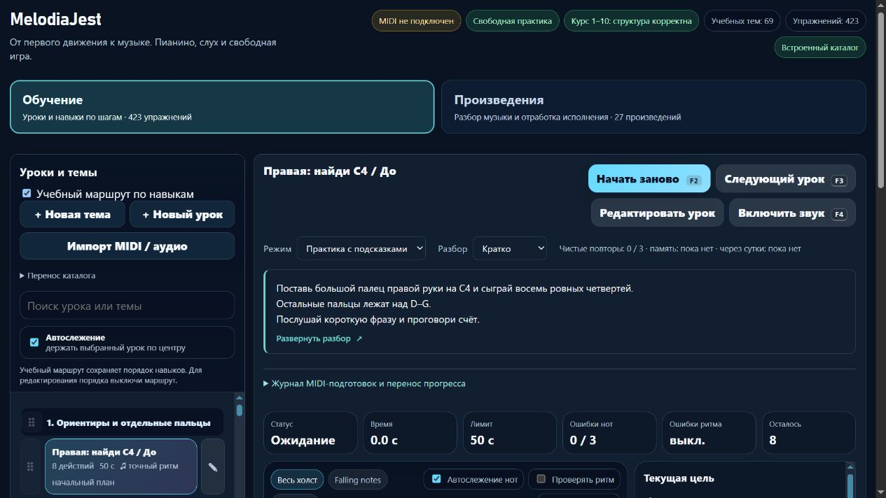

# MelodiaJest: первый серверный выпуск и подключение домена

7 ноября 2026 года, Asia/Yekaterinburg; серверные журналы датированы 6 ноября UTC. Выпуск **23.5.33** установлен на общем VPS **135.106.217.27**. Пользователь подтвердил покупку домена и отдельно разрешил изменение общего Caddy. **Сайт работает: https://melodiajest.ru/**. Публичное делегирование, доверенный HTTPS обоих имён и каталоги проверены.

## Проверка шага 2

Записи в присланном скриншоте правильные. Они также проверены прямым запросом к **a.ns.selectel.ru / 188.68.203.1**:

| Запись | Проверенное значение |
| --- | --- |
| melodiajest.ru A | 135.106.217.27 |
| www.melodiajest.ru CNAME | melodiajest.ru |
| NS зоны | a.ns.selectel.ru, b.ns.selectel.ru, c.ns.selectel.ru, d.ns.selectel.ru |

В начале прохода публичный резолвер Google вернул **Status 3 / NXDOMAIN** для NS/A корня и A имени www. Это согласовывалось со статусом «Не делегирована» на скриншоте. К финальной проверке **19:31 UTC / 00:31 7 ноября** делегирование распространилось: NS/A возвращают Status 0, A корня и www ведёт на нужный VPS. Покупка, DNS-записи, серверы имён и настройки аккаунта в этом проходе не менялись. По [документации Selectel](https://docs.selectel.ru/domains/register-domain/) зарегистрированный в Selectel домен делегируется в их DNS автоматически; [распространение](https://docs.selectel.ru/dns-hosting/quickstart/) может занимать до 72 часов. Точное время готовности не обещано.

## Что перенесено и запущено

Изучены Libreta `scripts/package-vps.py`, `scripts/install-vps-release.py`, `deploy/vps/manage.py` и рабочий помощник Praicer `deploy/production/ssh_client.py`. Использован тот же существующий SSH-ключ Libreta, выбор исходного IPv4 Ethernet, BatchMode/IdentitiesOnly и строгая проверка ключа хоста. Приватный ключ не копировался и не выводился. Новый GitHub Actions/CI или серверная автоматизация не создавались.

- На сервер переданы **только 27 разрешённых браузерных ресурсов**, `web-release.json` и отдельные конфиги nginx/Compose/Caddy. `server.cjs`, личный `trainer-content.json`, настройки MIDI, `.env`, Git и Windows-программы не передавались.
- Архив: `melodiajest-web-23.5.33-first-host.tar.gz`; SHA256 **059c063f8064041a6eb8f8ebc753b992db90581dd14ff467ba6652441c900f59**. На сервере проверены состав, типы файлов, размеры и SHA256 каждого ресурса до установки.
- Каталог: **/opt/melodiajest/releases/23.5.33**; **/opt/melodiajest/current → releases/23.5.33**. Конфиги — `/opt/melodiajest/deploy`.
- Итоговый сервис Compose — **melodiajest-static**, контейнер — **melodiajest-web-1**, alias — **melodiajest-web**. Он работает во внутренней `libre_public`, без опубликованного порта приложения.
- Использован уже установленный официальный nginx: **nginx@sha256:985220252f3863977e468f611ef118ebd01421289dd86ee1ae99cb068c3bce2b**. Новый образ не скачивался. UID/GID 101, файловая система только для чтения, ограниченные tmpfs/логи, 64 МБ и 0,25 CPU. Healthcheck прошёл.
- Ответ `/web-release.json` и хеш HTML проверены через Caddy во внутренней сети. `/api/content`, запуск Windows-программы, MIDI bridge, `/server.cjs`, `/trainer-content.json`, `/.env` возвращают **404**.

Личные правки и прогресс остаются в браузере. Перенос с localhost выполняется отдельным экспортом каталога и прогресса, как описано в инструкции; общий серверный JSON-каталог и облачный аккаунт не вводились. S3 не изменялся.

## Общий Caddy

После явного согласия пользователя добавлены **melodiajest.ru → melodiajest-web:8080** и **www → основной HTTPS-домен**. Три прежних маршрута сохранены; адаптированная конфигурация и синтаксис проверены перед применением. Исходный файл Libreta `deploy/vps/Caddyfile` также дополнен, чтобы следующая выкладка сохранила новые домены. Commit/push не выполнялись.

Обнаружена старая привязка отдельного файла: Caddy видел inode **2471011**, файл хоста имел inode **131363**. Активные правила по смыслу совпадали с актуальным файлом хоста; дополнительный элемент `hide ./-` возникал при адаптации через stdin. Привязка обновлена пересозданием **только Caddy** с тем же образом и постоянными томами конфигурации/сертификатов. После устранения описанного ниже конфликта обычный reload по `/etc/caddy/Caddyfile` завершился успешно; смонтированные байты и файл хоста совпадают.

- Резервная копия перед успешным включением: **/opt/melodiajest/ops/Caddyfile.before-20261106T191930Z**.
- SHA256 до: **9b14fac4211d6b30a0d09afff0195a653419c95d0853826fa91b7e72ac3a8065**.
- SHA256 после: **7f0e235d16f9dcaf2ac0649d5fb9c2b99af845ffe95684584ed0386cfbaf2813**.
- Сохранены **3** прежних маршрута, добавлены **2**. Финальная запись выполнена в существующий inode.
- HTTP с заданным Host для обоих новых имён возвращает **308**, сохраняя путь и query. На первой проверке TLS ещё ожидал DNS; на финальной доверенная цепочка и имя проверены для обоих доменов. Сертификаты действуют до **4 февраля 2027 UTC**. Проверка сертификата не отключалась.

По [документации Caddy](https://caddyserver.com/docs/automatic-https) получение сертификатов выполняется в фоне с повторными попытками при ошибках. Готовность дополнительно подтверждена настоящими публичными HTTPS-запросами: главная **200**, все **27** SHA256 совпадают. HTTP → HTTPS даёт **308**, HTTPS-www → основной домен — **301 permanent**, путь и query сохраняются. Служебные пути — **404**, некорректный encoded traversal — **400**, POST главной — **405**.

## Найденный и исправленный конфликт DNS Docker

Первый шаблон MelodiaJest использовал имя сервиса `web`. Compose автоматически добавил этот alias в общую сеть, несмотря на дополнительный явный alias `melodiajest-web`. Praicer стал получать для `web` адрес MelodiaJest **172.18.0.6** и обращался к нему на своём порту **3200**; возник **502**, nginx Praicer был помечен unhealthy. Первое включение Caddy автоматически откатилось после отказа проверки соседнего сайта.

Причина подтверждена `nslookup web` из gateway Praicer и адресами отказавшего upstream. Удалён общий alias у собственного контейнера MelodiaJest, после чего Praicer восстановился. Затем исправление закреплено в шаблоне и на сервере: сервис переименован в **melodiajest-static**, контейнер заменён, старый контейнер этого же проекта удалён после успешной проверки нового. Итоговые aliases: `melodiajest-web-1`, `melodiajest-static`, `melodiajest-web`. Из gateway Praicer имя `web` снова разрешается в его backend **172.20.0.7**. Конфигурация Praicer не переписывалась.

Добавлена регрессия, проверяющая глобально уникальные имена сервисов в реальном шаблоне Compose и отсутствие общих aliases `web/app/gateway/db`. Финальные проверки **Libreta, Praicer и Grigorova — HTTP 200** после переходов и после успешного reload Caddy. Ошибка в шаблоне MelodiaJest и её временное влияние на Praicer не скрыты.

## Проверки приложения

- Целевой набор `tests/web-release.test.cjs` — **5/5**: разрешённые файлы, отказ небезопасных путей/операций, браузерное сохранение без серверного API, видимая ошибка сохранения и регрессия DNS-имён Compose.
- Полный `npm test`: **636/636, 0 отказов, 289370 мс**. Предыдущий полный результат курса — 635/635; музыкальная партия и ноты в этом этапе не изменялись.
- Настоящий браузер получил сайт **с VPS** через временный SSH-туннель на 127.0.0.1:4220. Загружены 423 упражнения; раздел «Произведения» показал 27 произведений / 148 фрагментов. Переход между разделами и новая контрольная карточка работают, ошибок консоли нет. MIDI и звук не включались.
- Временная вкладка закрыта, пользовательская вкладка 4173 сохранена. Туннель закрыт; порт 4220 вернул ECONNREFUSED.

Финальная вкладка открыла **https://www.melodiajest.ru/** и перешла на **https://melodiajest.ru/**. Оба каталога проверены на публичном домене, ошибок консоли нет. Временная вкладка закрыта.

Машинные доказательства: [снимок проверок](melodiajest-server-2026-11-07.json).

## Дальнейшие выпуски и ограничения

Первый выпуск завершён. Для следующего изменения приложения собрать отдельный разрешённый веб-артефакт, сохранить предыдущую версию, проверить namespace Compose, SHA256, HTTPS, редиректы и соседние сайты. Общий Caddy и DNS менять только по необходимости отдельного этапа. Автоматического выкладывания по git push не добавлено; Caddy управляет сертификатами самостоятельно.

Это безопасный браузерный выпуск, не завершённая миграция оболочки на React/Next.js и не облачное хранилище личного прогресса. Настоящее MIDI-устройство в серверной проверке не подключалось. Локальный запуск и музыкальная точка продолжения партии 33 сохранены.
