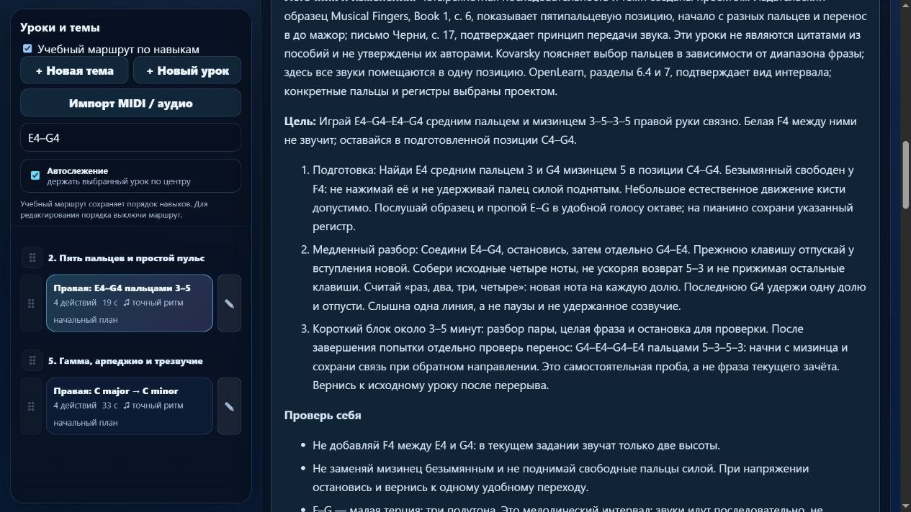

# Партия 08: средняя и верхняя пары мелодических терций

Дата: 5 ноября 2026 года. Версия приложения: **23.4.8**. Область — только пианино.

Добавлены два самостоятельных задания на конкретные пальцевые сочетания после их подготовки. Это технические упражнения проекта, не цитаты из произведений и не упражнения, утверждённые авторами источников. Исторические сведения не добавлялись.

| ID | Ноты и пальцы | Учебная задача | Подготовка |
| --- | --- | --- | --- |
| `detail-p-position-skips-02` | E4–G4–E4–G4, правая 3–5–3–5 | Передача между средним и мизинцем через неиграемую F4; ровный возврат 5–3 | `position-skips-01`, `legato-pairs-02` с префиксом `detail-p-` |
| `detail-p-position-skips-04` | D3–F3–D3–F3, левая 4–2–4–2 | Связать безымянный и указательный через неиграемую E3 без лишнего созвучия | `position-skips-03`, `legato-pairs-03` с префиксом `detail-p-` |

В обоих заданиях: четыре вступления по одной доле, 52 BPM, legato без педали. Звуки последовательные, малая терция содержит три полутона. Все требования подготовки находятся раньше урока в маршруте. Уроки не меняют старые ID и пользовательский порядок.

Разбор содержит начальную позицию, обе стороны перехода, счёт, последнее отпускание G4/F3, типичные ошибки и слуховое представление. Свободный промежуточный палец не требуется поднимать силой. После попытки предлагаются обратное начало и отдельная новая фраза: E4–G4–F4–E4 (3–5–4–3) или D3–F3–E3–D3 (4–2–3–4). Эти самостоятельные пробы не входят в машинный зачёт исходных четырёх нот. Повтор после перерыва учитывается отдельно.

## Проверка источников

- Вновь прочитаны [OpenLearn, раздел 7, абзац после примера 63](https://www.open.edu/openlearn/history-the-arts/music/an-introduction-music-theory/content-section-7): E–G и D–F прямо названы малыми терциями. [Раздел 6.4, пример 60 и соседние абзацы](https://www.open.edu/openlearn/history-the-arts/music/an-introduction-music-theory/content-section-6.4) различает последовательный мелодический и одновременный гармонический интервалы.
- Вновь проверены [Jerry Kovarsky, Yamaha, 28.11.2023, The Basics и Scenario One](https://hub.yamaha.com/keyboards/k-how-to/the-basics-of-piano-keyboard-fingering/): нумерация пальцев и планирование одной удобной позиции. Широкие растяжения и обобщённый запрет большого пальца на чёрных клавишах не переносились в эти задания.
- Вновь прочитано [Карл Черни, письмо 2, печатная с. 17, пункт 3](https://www.koelnklavier.de/quellen/czer-brf/brief-02.html): момент окончания прежней ноты при вступлении новой. Использована цифровая транскрипция KölnKlavier из недатированного издания Wien: A. Diabelli und Comp.; новой сверки с факсимиле не было.
- Для пятипальцевой позиции переиспользована проверенная ранее в этот день [издательская выборка Musical Fingers, Book 1, Alfred, 00-1009X, печатная с. 6 / PDF с. 2](https://content.alfred.com/catpages/00-1009X.pdf). Личное авторство книги по выборке не установлено. Принципы удобного запястья Dumlavwalla и короткой целевой практики Duke/Simmons переиспользованы из журнала источников.

Конкретные регистры, пары пальцев, последовательность, 52 BPM и числовые допуски выбраны проектом. Журнал источников обновлён для обоих ID; наличие источника не означает одобрения урока его автором.

## Проверки и сохранность

**172 теста прошли, ошибок нет.** Пройдены `npm test`, `audit:lessons`, `audit:curriculum`, `audit:fingering`; матрица `audit:piano-coverage` пересобрана исполняемым модулем. В целевой группе — 11 успешных проверок. Проверены независимые ожидаемые MIDI-высоты и пальцы, длительности, отсутствие средней ноты, разрыв legato и сохранение личной редакции при экспорте и загрузке. Реальный MIDI-обработчик приложения ждёт последнее отпускание и отклоняет лишнюю промежуточную клавишу. Преподаватель и настоящее MIDI-устройство не участвовали.

Изолированный браузер: карточки правой и левой руки показывают нужные ноты, пальцы и объяснения; в режиме памяти материалы и подсказки пальцев на клавишах скрыты. Обучение и 27 произведений остаются отдельными разделами. Ошибок браузера не обнаружено; звук, MIDI и нативная печать не включались. Предпросмотр работал с каталогом в памяти, затем закрыт и остановлен.

Сравнение до/после подтвердило сохранность музыкальных данных и инструкций всех прежних **558 элементов**, их относительного порядка, настроек MIDI и неизменяемого baseline. `trainer-content.json` отсутствовал и не создавался. Контрольные суммы гитарных файлов не изменились. Доказательства — [JSON проверки](piano-curriculum-2026-11-05-08-verification.json).

Сейчас реализовано **412 упражнений**, из них **148** с текущим контрактом MIDI-челленджа; подробное происхождение и цель описаны в **24**. В очереди остаётся **1** конкретный будущий урок. Предварительный бюджет 1310 учебных мест не является планом 1310 отдельных уроков; 388 старых упражнений ещё требуют подробной редакции. Независимо отредактированных преподавателем — 0.

Прежние ограничения не устранены: 83 неподдерживаемых действия в 10 фрагментах произведений, включая удержанные голоса. Структурных ошибок и жёстких ошибок маршрута нет. MIDI не доказывает выбранные пальцы, удобство руки или художественное качество; знакомый образец не является независимым слуховым тестом.

Следующий шаг: левая E3–G3 (3–1) после подготовленных `position-skips-04` и `legato-pairs-04`; затем редакция `detail-p-hearing-01`, чтобы не выдавать известную C4–E4 за независимый тест слуха и не дублировать её ради количества. Состояние и матрица обновлены. Последняя проверка общего недельного окна: расход 23%, остаток 77%; резерв 25% сохранён. Commit, публикация и развёртывание не выполнялись.
