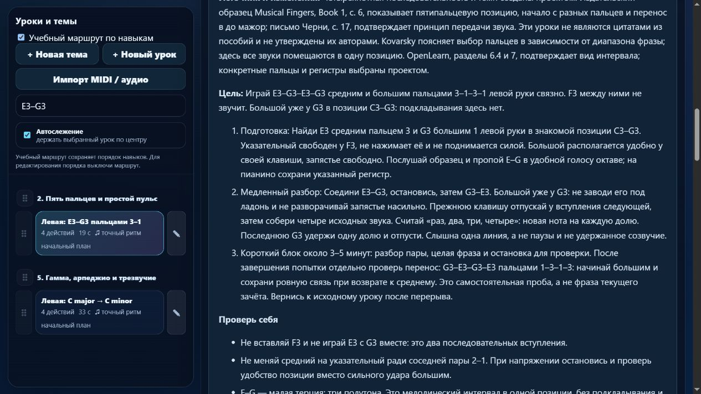
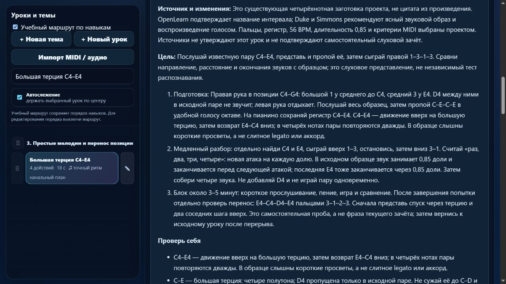

# Партия 09: левая 3–1 и слуховое представление известной терции

Дата: 5 ноября 2026 года. Версия: **23.4.9**. Область — только пианино.

## Новое упражнение

`detail-p-position-skips-05`: **E3–G3–E3–G3, левая 3–1–3–1**. Конкретная задача — передавать звук между средним и большим в готовой позиции C3–G3, пропуская F3. Большой уже расположен у G3; подкладывание под ладонь не требуется. Это другая пальцевая пара, а не новый BPM существующего задания.

Подготовка: `detail-p-position-skips-04` и `detail-p-legato-pairs-04`; обе находятся раньше в маршруте. Четыре четверти, 52 BPM, legato без педали. Разбор охватывает оба направления, свободный промежуточный палец, отпускание прежней клавиши у новой атаки и последнюю G3 длиной в долю. После попытки — другое начало и отдельная фраза E3–G3–F3–E3 (3–1–2–3), затем повтор после перерыва. Эти пробы не включены в машинный зачёт исходной пары.

## Редакция существующего урока

`detail-p-hearing-01`, **C4–E4–C4–E4, правая 1–3–1–3**, уже содержал оговорку об отсутствии автоматического слухового теста. Подтверждённый недостаток — общий разбор без конкретного слухового ориентира, счёта и окончаний этой фразы. Ложного слухового зачёта движок не выдавал; он не изменялся в этой партии.

Теперь описаны прослушивание, пропевание C–E–C–E, представление без воспроизведения и сравнение со своей игрой. Названная заранее пара служит слуховому представлению и памяти; независимое распознавание неизвестного интервала здесь не измеряется. MIDI подтверждает ноты и время, но не пение и внутренний звуковой образ.

Сохранены 56 BPM, четыре вступления по доле и длительность каждого звука **0,85 доли** с коротким просветом. Это прежняя настройка `standard` проекта, не legato и не универсальная артикуляционная пропорция. Сохранены ноты, пальцы, подготовка, ID и музыкальная версия прогресса **`f4ba5fc5`**. Для самостоятельного переноса предложена E4–C4–D4–E4 (3–1–2–3). Новая копия урока не создавалась.

Описание меняется только при совпадении полного отпечатка первоначальной карточки `f309d515`. Изменённые пользователем ноты, ритм, текст, пальцы, классификация или отметка редакции не перезаписываются. Миграция однократная; исходный `lesson-review-baseline.js` не пересоздавался.

## Первоисточники и границы вывода

- [The Open University, OpenLearn, раздел 7, абзац после примера 63](https://www.open.edu/openlearn/history-the-arts/music/an-introduction-music-theory/content-section-7): прямо указаны C–E как большая терция из четырёх полутонов и E–G как малая из трёх. Вновь сверено для MIDI 60/64 и 52/55. Различие мелодического и гармонического интервала переиспользовано из ранее проверенного раздела 6.4.
- [Bob Duke и Amy Simmons, Tips for Effective Practice](https://cml.music.utexas.edu/online-resources/intelligent-music-practice/10-tips-for-effective-practice), разделы *How to think about what you’re trying to play*, *How much to try and change at one time*, *How to make changes stick* и организация практики: вновь прочитаны рекомендации представлять желаемое звучание, воспроизводить его голосом, выбирать маленькую цель и менять знакомое начало. Граница между известной фразой и независимым распознаванием — вывод о возможностях задания проекта, не цитата авторов.
- [Dr. Diana Dumlavwalla, Yamaha, 29.11.2021](https://hub.yamaha.com/music-educators/instruments/piano/piano-pedagogy-fix-basic-technique/), *Fix It: Inconsistent Hand Shape*: вновь проверено описание гибкого запястья. Дополнительные силовые и ассистируемые движения из статьи не вводились.
- [Jerry Kovarsky, Yamaha, 28.11.2023](https://hub.yamaha.com/keyboards/k-how-to/the-basics-of-piano-keyboard-fingering/), *The Basics* и *Scenario One*: вновь прочитаны нумерация и планирование фразы в одной позиции. Точная пара 3–1 — выбор проекта, не упражнение автора статьи.
- Для позиции переиспользована проверенная в этот день [издательская выборка Alfred, Musical Fingers, Book 1, 00-1009X, печатная с. 6 / PDF с. 2](https://content.alfred.com/catpages/00-1009X.pdf); личное авторство книги по выборке не установлено. Для нового legato переиспользовано письмо Черни № 2, печатная с. 17, пункт 3, из цифровой транскрипции KölnKlavier, Wien: A. Diabelli und Comp., без даты. Повторной сверки с факсимиле не было.

Оба задания — **технические упражнения проекта**, не фрагменты произведения и не авторские упражнения названных педагогов. Исторические рассказы и утверждения об известных учениках не добавлялись. Ноты, пальцы, темпы, короткий блок около 3–5 минут, количество попыток и допуски не приписываются источникам. Журнал источников дополнен связями с обоими ID.

## Проверка матрицы и программы

При сверке воспроизведена ошибка учёта направлений: неизвестная метка `hearing` давала 26 в счётчике при 25 фактических участниках таблиц. Карточка привязана к существующему `ear-transfer`. Генератор теперь отклоняет неизвестное направление реализованного урока; отдельные регрессионные тесты проверяют этот отказ и соответствие счётчика всем реальным строкам. Итог — 26 из 26, без исчезнувших записей.

**178 тестов прошли, ошибок нет.** Выполнены `npm test`, `audit:lessons`, `audit:curriculum`, `audit:fingering`; матрица пересобрана исполняемым модулем `audit:piano-coverage`. Сначала общий тест потребовал сохранить явную формулировку отсутствия автоматического слухового теста; после уточнения текста проверки повторены. Проверка новых музыкальных данных и описаний включает оба направления, назначенные пальцы, отсутствие промежуточной ноты, точные длительности, последнее отпускание, ошибки высоты и разрыв legato, защиту личной редакции, экспорт и загрузку.

В изолированном браузере проверены левая 3–1, существующая правая 1–3, конкретные окончания, граница слухового задания и самостоятельный перенос. В режиме памяти материалы и подсказки пальцев на клавишах скрыты. Разделы Обучение и 27 произведений сохраняются отдельно. Ошибок в итоговом предпросмотре не обнаружено. Звук, MIDI-устройства и нативная печать не включались; сервер с каталогом только в памяти остановлен, вкладки закрыты.

## Сохранность, ограничения и продолжение

Музыкальные данные всех прежних **560 элементов** и их относительный порядок совпадают с состоянием до партии. Среди старых инструкций изменена только `detail-p-hearing-01`. Настройки MIDI, неизменяемый baseline и проверенные гитарные файлы сохранили контрольные суммы. `trainer-content.json` отсутствовал и не создавался. Доказательства: [JSON проверки](piano-curriculum-2026-11-05-09-verification.json).

Теперь **413 упражнений**, **149** уроков с текущим контрактом MIDI-челленджа, **26** подробных описаний происхождения и целей. Все конкретные будущие планы этой небольшой ветки реализованы; незавершённых новых ID в очереди — 0. Предварительный бюджет **1310 мест не является 1000 индивидуальными планами**: его ещё нужно подробно развивать. **387** старых упражнений требуют дальнейшей подробной редакции. Независимо проверенных преподавателем — 0; настоящего инструментального испытания в этой партии не было.

Прежние ограничения: 83 неподдерживаемых действия в 10 фрагментах произведений, включая удержанные голоса. Новых структурных или жёстких ошибок маршрута нет. MIDI не доказывает выбранные пальцы, удобство движения или художественное качество.

Следующий проход: существующие `detail-p-hearing-02`, `-03`, `-04` — C4–E♭4, C4–F4, C4–G4; проверить подготовку, конкретный слуховой смысл, удобство и прежние окончания, сохранив музыку при отсутствии подтверждённых ошибок. Затем уточнять отдельные планы чтения, ритма и переноса в новые фразы и последующие уровни. Состояние, матрица и источники обновлены. Последнее наблюдение общей недельной квоты: расход 24%, остаток 76%; пользовательский резерв 25% сохранён. Commit, публикация и развёртывание не выполнялись.
