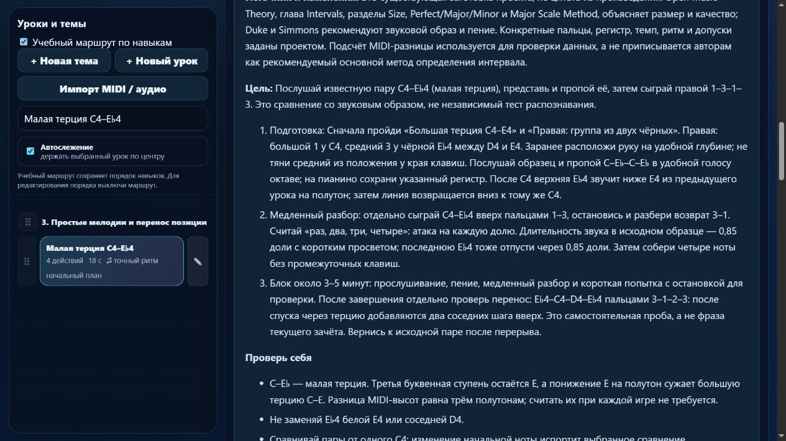

# Партия 10: известные интервалы и подготовка без обязательной пьесы

Дата: 5 ноября 2026 года. Версия: **23.4.10**. Область — только пианино. Новых уроков в этой партии нет: улучшены три существующих разбора и подготовка четвёртого.

## Найдено и исправлено

В `detail-p-hearing-02..04` верны высоты, пальцы и длительности, но прежний общий разбор не объяснял конкретное сравнение интервалов, последнее отпускание и перенос в новую фразу. Слуховой тест уже был обозначен как самостоятельный; автоматического зачёта независимого распознавания движок не выдавал.

Ветка начиналась после `course09-03` — «Twinkle · две фразы». Общий навык не должен требовать конкретной мелодии. Подготовка `detail-p-hearing-01` заменена на `course05-03` («Правая: секунды и терции»), `course02-03` («Пять пальцев вверх»), `course04-01` («Четверти: раз-и, два-и»). В маршруте ветка расположена после `detail-p-black-01`. Для малой терции явно требуется этот урок правой руки на чёрных клавишах, для квинты — подготовка пары 1–5 в `course05-04`. Все требования стоят раньше соответствующего урока. Учебный маршрут изменён; пользовательский порядок каталога сохранён.

| Урок | Ноты / правая рука | Отдельная задача | Проба после попытки |
| --- | --- | --- | --- |
| `detail-p-hearing-02` | C4–E♭4–C4–E♭4 / 1–3–1–3 | Услышать сужение C–E на полутон и подготовить переход белая–чёрная | E♭4–C4–D4–E♭4 / 3–1–2–3 |
| `detail-p-hearing-03` | C4–F4–C4–F4 / 1–4–1–4 | Представить чистую кварту и отличить её от терции | F4–C4–D4–C4 / 4–1–2–1 |
| `detail-p-hearing-04` | C4–G4–C4–G4 / 1–5–1–5 | Сравнить чистую квинту с квартой от общего C4 | G4–C4–E4–C4 / 5–1–3–1 |

Во всех трёх сохранены **56 BPM**, четыре атаки по одной доле, длительность звука **0,85 доли**, короткие просветы и профиль `standard`. Последние E♭4, F4, G4 заканчиваются через 0,85 доли. Это прежние настройки проекта, не legato и не универсальная пропорция артикуляции. Уроки содержат подготовку, медленный разбор вверх и вниз, счёт, слуховой ориентир, конкретные ошибки, применение и повтор после перерыва. Короткий блок около 3–5 минут — ориентир проекта.

Пение и сравнение с внутренним звуковым образом оцениваются самостоятельно. Названия и фразы известны заранее; независимое распознавание неизвестного образца не измеряется. Пробы переноса отделены от текущего MIDI-челленджа. Все материалы подписаны как технические упражнения проекта; музыкальные фрагменты и исторические рассказы не добавлялись.

## Источники

Новый первоисточник — [Chelsey Hamm и Bryn Hughes, Open Music Theory, Intervals](https://viva.pressbooks.pub/openmusictheory/chapter/intervals/), онлайн-издание VIVA / Pressbooks, I. Fundamentals. Проверены *Size*, *Perfect, Major, and Minor Qualities* / пример 4, шаги 1–4 *The Major Scale Method* и правило сужения мажорного интервала после примера 7. Внешнее определение размера и качества сопоставлено с C–E♭, C–F, C–G; разницы MIDI 3/5/7 полутонов независимо проверяют данные проекта. Авторы рекомендуют определять качество через мажорную гамму, а не считать полутона как основной метод; рекомендация сохранена в границах источника. Нотные примеры не копировались.

Переиспользованы проверенные в этот день источники:

- [Bob Duke и Amy Simmons, Tips for Effective Practice](https://cml.music.utexas.edu/online-resources/intelligent-music-practice/10-tips-for-effective-practice): внутренний образ, воспроизведение голосом, маленькая цель и практика с перерывами. Распознавание неизвестного интервала эти наши задания не проверяют.
- [Dr. Diana Dumlavwalla, Yamaha, 29.11.2021, Inconsistent Hand Shape](https://hub.yamaha.com/music-educators/instruments/piano/piano-pedagogy-fix-basic-technique/): гибкое запястье; силовые и ассистируемые движения не добавлялись.
- [Alfred, Musical Fingers, Book 1, 00-1009X, печатная с. 6 / PDF с. 2](https://content.alfred.com/catpages/00-1009X.pdf): пятипальцевая позиция и разные начальные пальцы. Личное авторство книги по выборке не установлено. Конкретная пара C–E♭ и пальцы этих заданий выбраны проектом.

Новая запись и связи с тремя ID добавлены в журнал источников: всего 11 записей. Источники не утверждали уроки, их темпы, допуски или весь курс. Подтверждённых исторических сведений для добавления в эти карточки не найдено; они не требовались для ясного учебного объяснения.

## Сохранение редакций и проверки

Редактура трёх исходных карточек применяется только к полным отпечаткам `077ec35b`, `de0f85da`, `09d98cbe`. Подготовка C4–E4 обновляется только у неизменённой редакции `known-third-imagery-v1` с отпечатком `e49388c7`. Новая отметка — `known-third-imagery-v2`, предыдущая запись сохранена внутри `previous`. Изменённые пользователем ноты, пальцы, ритм, инструкции, подготовка и классификация не перезаписываются. Миграции однократные.

**183 теста прошли, ошибок нет**, в том числе 9 целевых проверок. Выполнены `npm test`, `audit:lessons`, `audit:curriculum`, `audit:fingering`; матрица пересобрана исполняемым модулем `audit:piano-coverage`. Проверены независимые ожидаемые высоты и пальцы, сохранение музыкальных версий и времени, подготовка раньше урока, отсутствие обязательного Twinkle во всей цепочке требований интервалов, защита личной редакции, история и обмен каталогом.

В изолированном браузере проверены все четыре карточки, пальцы 1–3 / 1–4 / 1–5, конкретные окончания и пробы переноса. Виртуальная клавиатура отображает MIDI 63 как D♯4; в тексте интервала сохранено название E♭4. Высота не меняется. Материалы и подсказки пальцев на клавишах скрываются в режиме памяти. Обучение и 27 произведений остаются отдельными разделами. Ошибок браузера не обнаружено. Звук, MIDI-устройства и нативная печать не включались; каталог предпросмотра существовал только в памяти. Вкладка закрыта, сервер остановлен.

Музыка всех **561 прежнего элемента**, их относительный порядок и инструкции всех остальных карточек совпадают с состоянием до партии. Настройки MIDI, неизменяемый baseline и гитарные файлы сохранили контрольные суммы. `trainer-content.json` отсутствовал и не создавался. Музыкальные версии четырёх упражнений не изменились: `f4ba5fc5`, `6483fc25`, `5d97f2c5`, `4b03cb1d`; существующий прогресс не инвалидируется из-за редакции текста и подготовки. [Доказательства в JSON](piano-curriculum-2026-11-05-10-verification.json).

## Состояние и следующий шаг

В приложении по-прежнему **413 упражнений / 149 MIDI-челленджей**. Подробное происхождение и цели описаны для **29** упражнений; независимая редактура преподавателем — 0. Ещё **384** старых упражнения требуют подробной редакции. Новых будущих ID в конкретной очереди — 0; 1310 предварительных учебных мест остаются бюджетом направлений, а не готовым планом минимум 1000 уроков.

Прежние ограничения не устранены: 83 неподдерживаемых действия в 10 фрагментах произведений, включая удержанные голоса. Структурных и жёстких ошибок маршрута нет. MIDI не доказывает выбранные пальцы, удобство или художественное качество. Настоящее инструментальное испытание и проверка преподавателем не выполнялись.

Следующая партия — `detail-p-rhythm-01..04`: четыре доли, 2–1–1, полная доля тишины, пары восьмых. Значения длительностей предварительно сверены; требуется конкретный разбор счёта, повторного нажатия C4, границ слова legato на повторённой высоте и проверки паузы после последней ноты. Изменение движка — только после воспроизведения ошибки и с регрессией. После этой ветки уточнять отдельные планы чтения, ритма и переноса на новые фразы и последующие уровни, проверяя отсутствие дублей.

Состояние, матрица и журнал обновлены. Последняя общая недельная квота: расход 24%, остаток 76%; резерв пользователя — 25%. Commit, публикация и развёртывание не выполнялись.
