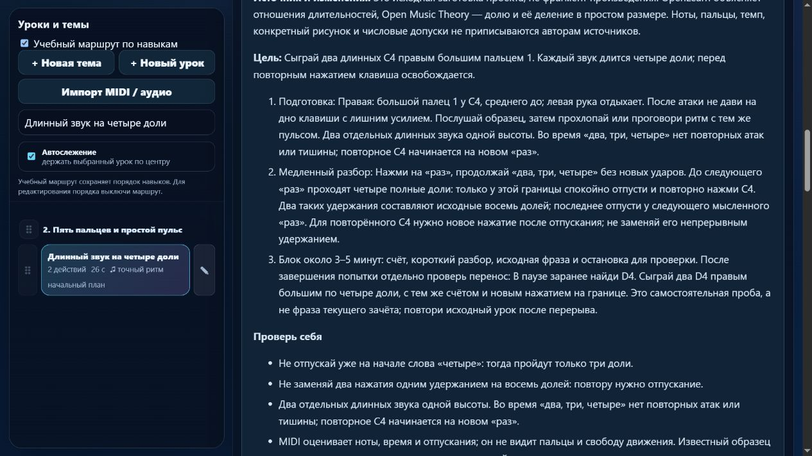

# Партия 11: длительности, повторная атака и границы пауз

Дата: 5 ноября 2026 года. Версия: **23.4.11**. Работа выполнена только в `pianosjest`; новых исполняемых уроков нет.

## Воспроизведённые проблемы

1. `detail-p-rhythm-01` требовал удерживать каждый C4 четыре доли, но прежний оценщик принимал оба звука длиной три доли: `clean: true`. Причина — допуск 30% от длительности самой ноты: для четырёх долей он превышал целую долю.
2. `detail-p-rhythm-03` обещал паузу после каждой ноты. В данных есть три паузы **между** четырьмя вступлениями; после четвёртого отпускания попытка сразу завершается. Реальный обработчик приложения завершил чистую попытку на границе 7 долей, не наблюдая конечную тишину до границы 8.
3. Общий текст legato не объяснял новое нажатие повторённой C4. Для одной клавиши отпускание необходимо; это не подмена пальца и не непрерывный восьмидольный звук.

## Исправления зачёта

Добавлен отдельный контракт `beat-boundary-v1`, включённый только для `detail-p-rhythm-01` и `-02`. Допуск длительности ограничен долей: `max(130 мс, min(30% длительности, 22% одной доли))`. Числа — настройки проекта, не требования авторов методик. Четыре доли, укороченные до трёх, теперь отклоняются; правильное удержание проходит. Для половинной также проверено отклонение длины в одну долю.

Приложение передаёт контракт в реальный `assessPiano`. Неизвестное имя профиля отклоняется. Общая версия формата результатов остаётся совместимой; имя контракта включается в отпечаток конкретного урока. Поэтому старый зачёт двух изменённых требований не наследуется, а другие версии не инвалидируются. Предыдущие попытки сохраняются и при новой попытке переходят в историю прежнего отпечатка. В карточках есть сообщение о необходимости повтора для нового зачёта. Ноты, руки, пальцы, длительности и паузы не переписаны.

Гитарные файлы не синхронизировались. Для развивающегося `practice-assessment.js` проверка обязательного равенства копий заменена проверкой результата: сопоставлены подписи **всех 713 гитарных элементов**, оценка верных/ошибочных/ручных/просроченных попыток и сохранение прогресса с нативной гитарной версией. Остальные неизменённые общие файлы по-прежнему сверяются побайтно; реальные тесты гитарного приложения сохранены.

## Четыре учебных разбора

| ID | Сохранённый материал | Уточнённая задача |
| --- | --- | --- |
| `detail-p-rhythm-01` | Два C4 правым 1, 4+4 доли, 56 BPM | Досчитать четыре полные доли; слово «четыре» обозначает начало четвёртой, а отпускание приходится на следующую границу. Для повтора нужно отдельное нажатие. |
| `detail-p-rhythm-02` | Шесть C4 правым 1, 2–1–1 два раза, 56 BPM | Атаки на «раз», «три», «четыре»; на «два» новый удар не нужен. Доля остаётся постоянной. |
| `detail-p-rhythm-03` | Четыре C4, начала 0/2/4/6, длины по доле, 56 BPM | Три полные внутренние паузы. Конечная тишина после последнего отпускания — самостоятельная проба, не автоматический зачёт. |
| `detail-p-rhythm-04` | C4–D4 четыре раза правой 1–2, по полдоли, 48 BPM | Ровный счёт «раз-и, два-и, три-и, четыре-и», связная передача разных нот и последняя D4 до следующего мысленного «раз». |

У каждого урока есть подготовка, движение, медленный разбор, счёт, слуховой ориентир, типичные ошибки, короткая самостоятельная проба переноса и повтор после перерыва. Метаданные подготовки сохранены; все требования идут раньше урока. Упражнения подписаны как технические заготовки проекта, не фрагменты произведений. Исторические рассказы не добавлялись. Ориентир 3–5 минут, темпы и количество попыток выбраны проектом.

Редактура применяется один раз только к совпавшим исходным инструкциям: `33335195`, `2ac4a5d4`, `51bb61ad`, `da5147a8`. Личные изменения, классификация и уже существующие отметки редакции не перезаписываются. Исходный `lesson-review-baseline.js` не пересоздавался.

## Первоисточники

- [The Open University, OpenLearn, 3.1 Time values](https://www.open.edu/openlearn/history-the-arts/music/an-introduction-music-theory/content-section-3.1), текст после примера 13 и перед 14: отношения целой, половинной, четверти и восьмой. Одна доля равна четверти именно в выбранном здесь размере 4/4.
- [Mark Gotham, Chelsey Hamm, Kris Shaffer, Open Music Theory, Simple Meter and Time Signatures](https://viva.pressbooks.pub/openmusictheory/chapter/simple-meter-and-time-signatures/), *Time Signatures*, пример 9, *Counting in Simple Meter*, пример 10 и пункты о длинных нотах и делении на две части: счёт продолжается внутри удержания, две восьмые делят долю. Русское «и» — адаптация счёта проекта; источник признаёт разные системы счёта.
- [The Open University, OpenLearn, 4.1 Values and dots](https://www.open.edu/openlearn/history-the-arts/music/an-introduction-music-theory/content-section-4.1), начальный абзац и пример 32: длительности тишины соответствуют длительностям нот. Этот текст не доказывает наличие измерения конечной паузы в нашем приложении.

Онлайн-редакции проверены 5 ноября 2026 года, без утверждения фиксированной печатной пагинации. Страница OMT *Notating Rhythm* вернула 403; для неё проверка содержания не заявляется, использованы доступные первоисточники выше. Ранее проверенные в этот день Duke/Simmons и Dumlavwalla переиспользованы для короткой целевой практики и свободного запястья. Авторы не утверждали эти уроки, пальцы или числовые допуски. Журнал содержит теперь 14 записей со связями с ID.

## Проверки и сохранность

**191 тест прошёл, ошибок нет**, в том числе 13 целевых проверок ритма и гитарной совместимости. Выполнены `npm test`, `audit:lessons`, `audit:curriculum`, `audit:fingering`; матрица пересобрана исполняемым модулем `audit:piano-coverage`. Проверены укороченные длинные ноты, близкое к границе корректное отпускание, отсутствие последнего отпускания, повтор без освобождения клавиши, лишняя нота в паузе, реальный MIDI-обработчик, неизвестный профиль, защита личной редакции, история и обмен каталогом.

Браузерный предпросмотр работал с каталогом только в памяти. Проверены все четыре карточки, уведомление о новом зачёте, границы внутренних пауз, 48 BPM у восьмых и пальцы 1–2. Режим памяти скрывает материалы и подсказки пальцев на клавишах. Обучение и 27 произведений остаются отдельными разделами. Ошибок браузера не обнаружено; устройства, звук и нативная печать не включались. Вкладка закрыта, сервер остановлен.

У **всех 561 прежнего элемента** совпадают ноты, ритм, пальцы, руки и артикуляция. Изменились версии зачёта только двух названных уроков; инструкции — только четырёх. Сохранены относительный порядок каталога, настройки MIDI, неизменяемый baseline и контрольные суммы гитарных файлов. `trainer-content.json` отсутствовал и не создавался. [Машинные доказательства](piano-curriculum-2026-11-05-11-verification.json) содержат старые/новые версии и точный перечень оставшихся кандидатов.

## Ограничения и продолжение

Более строгий профиль пока включён **только у двух упражнений**. Ещё **27** текущих MIDI-уроков имеют ноты длиннее доли и прежний относительный допуск; они записаны для отдельной проверки, не объявлены заново проверенными. Следующая партия — `course04-02`, `course04-03`, `course04-04`: воспроизведение ранних/поздних отпусканий, сверка контекста и безопасное обновление контракта совпавшей редакции.

Отдельно спланирован `detail-p-rhythm-final-rest-01`: закончить долю тишины после последней ноты без нового вступления. Для реализации нужны явная конечная граница, окно наблюдения за тишиной, звуковой образец с завершением, сохранение и версия контракта. Сейчас это **план**, не урок в приложении и не поддержанная машинная функция. Текущий `rhythm-03` честно ограничен тремя внутренними паузами.

Сейчас **413 упражнений / 149 MIDI-челленджей**, **33** подробных описания, **1** конкретный будущий план; ещё **380** старых упражнений требуют подробной редакции. 1310 мест остаются предварительным бюджетом направлений, не 1000 готовыми индивидуальными планами. Независимая редактура преподавателем — 0; реальное инструментальное испытание не выполнялось. Не устранены прежние 83 неподдерживаемых действия в 10 фрагментах произведений. Структурных и жёстких ошибок маршрута нет. MIDI не доказывает пальцы и художественное качество.

Состояние и матрица обновлены. Последняя общая недельная квота: расход 25%, остаток 75%. Пользовательский резерв — 25% полного недельного лимита; порог остановки — 30% остатка. Commit, публикация и развёртывание не выполнялись.
