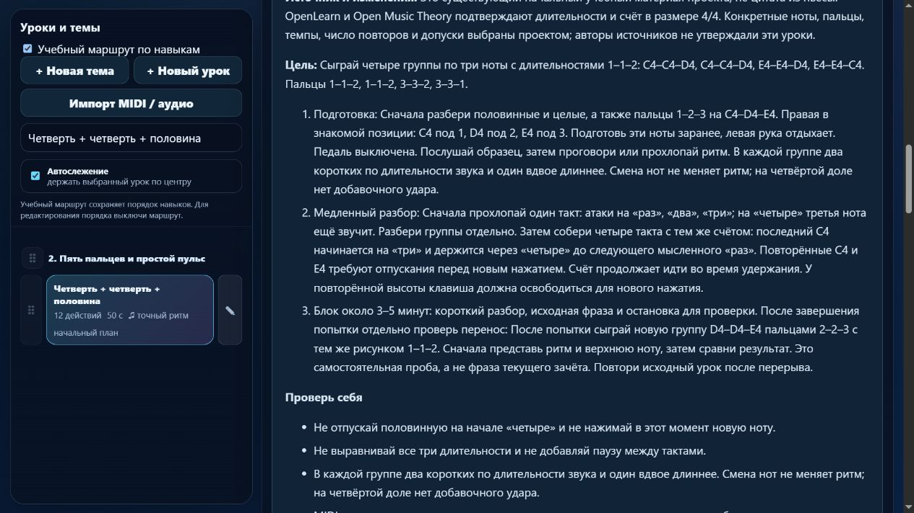

# Партия 12: половинные, целые и смешанный ритм

Дата: 5 ноября 2026 года. Версия: **23.4.12**. Область — только пианино. Новых упражнений нет: исправлены проверка и разбор трёх существующих уроков.

## Воспроизведение и исправление

Для `course04-02`, `course04-03`, `course04-04` прежний профиль принимал как чистые и ранние, и поздние отпускания. В половинных проверено сокращение 2 → 1,5 доли; в целых — 4 → 3. Позднее отпускание последней ноты проверено с прибавкой 0,5 / 1 доли. Правильная исходная попытка тоже проходила, то есть проблема была в ширине допуска, а не в нотах.

У трёх совпавших встроенных редакций включён существующий `beat-boundary-v1`. Теперь эти ранние и поздние варианты отклоняются, а правильные проходят. Оценщик и числовое правило в этой партии не менялись. Допуск проекта — `max(130 мс, min(30% длительности, 22% доли))`; это не требование музыкального автора или экзаменационной системы.

Ноты, руки, пальцы, темпы и длительности сохранены. Изменён отпечаток требований только трёх уроков: старые попытки не выдают новый зачёт, сохраняются и при новой попытке переходят в историю прежней версии. Карточки сообщают о необходимости повтора. Миграция однократная и применяется по полным отпечаткам `29aef1ed`, `392698c2`, `ab5428ef`. Пользовательские изменения текста, подготовки, музыки, пальцев, классификации и отметки редакции не перезаписываются. Неявное прежнее назначение этих встроенных материалов закреплено полем `exercise`; произведениями они не становились.

## Разборы и подготовка

| Урок | Сохранённый материал | Уточнение |
| --- | --- | --- |
| `course04-02` | Четыре C4 правым 1, по две доли, 60 BPM | Атаки на «раз» и «три». Слово «два» начинает вторую долю, отпускать на нём рано; новое нажатие требует освобождения клавиши. |
| `course04-03` | Два C4 правым 1, по четыре доли, 56 BPM | Слово «четыре» начинает четвёртую долю. Удержание заканчивается только у следующего мысленного «раз». |
| `course04-04` | Четыре группы 1–1–2, 60 BPM | C–C–D / C–C–D / E–E–D / E–E–C; пальцы 1–1–2 / 1–1–2 / 3–3–2 / 3–3–1. Последний C4 держится через четвёртую долю. |

Добавлены конкретная подготовка, посадка и положение руки, счёт, медленный разбор, слуховое представление, типичные ошибки, самостоятельная новая фраза и повтор после перерыва. Педаль не требуется; внутри длинной ноты дополнительных атак нет. Короткий блок около 3–5 минут — ориентир проекта, не обещание освоения навыка за одну попытку.

Половинные следуют за четвертями и подготовкой повторного нажатия. Целые — за половинными. Смешанный ритм расположен после подготовленных пальцев C4–D4–E4, сохраняя также требования половинных и целых. Никакая конкретная пьеса обязательной предпосылкой этих заданий не является.

## Исправление генератора маршрута

При явной подготовке старых уроков воспроизведён сбой `Unmapped lessons`: генератор повторно вставлял уже существующую базовую запись. Теперь он перемещает её в маршруте, оставляя один ID. Статическая подготовка объединяется с требованиями редакции вместо перезаписи. Для `course04-04` сохранены `course02-02`, `course04-02` и новое `course04-03`; все находятся раньше урока.

Регрессионный тест использует реальный генератор: проверены количество и уникальность записей, единственный `course04-04`, полный набор подготовки и порядок. Гитарный маршрут остался совместимым с его нативной версией; файлы в `guitarjest` не изменялись. Пользовательский порядок каталога не переписан: изменён учебный маршрут как отдельное представление.

## Первичные источники

Вновь прочитаны [The Open University, OpenLearn, 3.1 Time values](https://www.open.edu/openlearn/history-the-arts/music/an-introduction-music-theory/content-section-3.1), абзац между примерами 13 и 14: отношения половинной, четверти и целой; и [Mark Gotham, Chelsey Hamm, Kris Shaffer, Open Music Theory, Simple Meter and Time Signatures](https://viva.pressbooks.pub/openmusictheory/chapter/simple-meter-and-time-signatures/), *Time Signatures* и *Counting in Simple Meter*, пример 10: четверть как доля в 4/4 и продолжение счёта во время удержания. Онлайн-редакции проверены 5 ноября 2026 года, фиксированная печатная пагинация не заявляется.

Ранее проверенные Duke/Simmons и Dumlavwalla переиспользованы для целевой практики и свободного запястья. Ноты, пальцы, рисунки, 56/60 BPM, объём повторов и допуски — решения проекта. Материал подписан как технические упражнения проекта, не цитаты из произведений. Авторы не утверждали эти карточки. Исторические истории и свидетельства обучения знаменитостей не добавлялись. Обновлены связи с тремя ID в журнале; всего 14 источников.

## Проверки и сохранность

**198 тестов прошли, ошибок нет**, в том числе 7 целевых проверок. Выполнены `npm test`, `audit:lessons`, `audit:curriculum`, `audit:fingering`; матрица пересобрана исполняемым модулем `audit:piano-coverage`. Проверены независимые ожидаемые высоты и пальцы, сохранение временных данных, ранние/поздние отпускания, реальные MIDI-обработчики для правильных и ошибочных попыток всех трёх уроков, последнее отпускание, история, защита личных редакций и обмен каталогом. Движок использовался из приложения; отдельная копия оценщика не создавалась.

В изолированном браузере проверены три карточки, счёт, назначения правой 1–2–3 и уведомление о новом зачёте. Раскрыт и сохранён разбор смешанного ритма. Режим памяти скрывает материалы и подсказки пальцев на клавишах. Обучение и 27 произведений остаются отдельными разделами. Ошибок браузера не обнаружено. Каталог предпросмотра существовал в памяти, устройства, звук и нативная печать не включались. Вкладки закрыты, сервер остановлен.

Сохранены музыкальные данные всех **561 прежнего элемента**, порядок каталога, настройки MIDI, неизменяемый baseline и контрольные суммы гитарных файлов. Версии зачёта и инструкции изменились только у трёх названных уроков. `trainer-content.json` отсутствовал и не создавался. [Доказательства в JSON](piano-curriculum-2026-11-05-12-verification.json).

## Остаток работы и подсчёт

Осталось **24** MIDI-урока с длинными звуками и прежним допуском; они ещё не прошли индивидуальную проверку. Следующие кандидаты — `course01-07` (два C двумя руками), `course04-08` (итоговый ритм), `course07-03` (пары C–D–E). Для них нужны проверки каждого отпускания и одновременного удержания. Конечная пауза остаётся отдельным планом `detail-p-rhythm-final-rest-01`, не реализованной машинной функцией.

Также зафиксировано перекрытие `course04-03` и `detail-p-rhythm-01`: одинаковые звучащие ноты, пальцы, темп, начала и длительности. Вторая самостоятельная цель пока не установлена. ID и прогресс сохранены; это не два новых урока для целевого минимума. Следует уточнить роль повторения в маршруте и продолжить проверку дублей. **413 упражнений — инвентарный счётчик записей, не подтверждённое число разных учебных задач.**

Всего 149 MIDI-челленджей, 36 записей с подробными целями и происхождением, 1 конкретный будущий план. Ещё 377 старых упражнений требуют подробной редакции. Бюджет 1310 мест не заменяет отдельный план минимум 1000 содержательных уроков. Независимая редактура преподавателем — 0; реального инструментального испытания не было. Сохраняются прежние 83 неподдерживаемых действия в 10 фрагментах произведений. Жёстких и структурных ошибок нет; MIDI не доказывает пальцы и художественное качество.

Состояние, матрица, источники и очередь обновлены. Последняя общая недельная квота: расход 25%, остаток 75%; резерв — 25% полного недельного лимита, порог остановки — 30% остатка. Commit, публикация и развёртывание не выполнялись.
