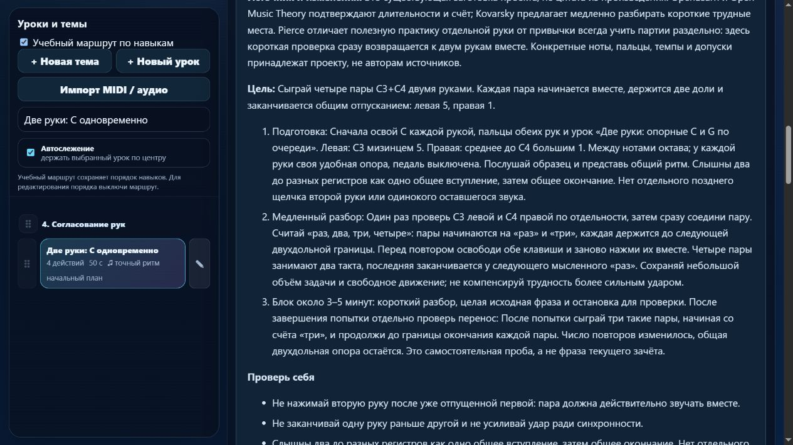

# Партия 13: общий конец двух рук и смешанный ритм

Дата: 5 ноября 2026 года. Версия: **23.4.13**. Исправлены три существующих урока; новых уроков нет. Область — только пианино.

## Подтверждённая ошибка и исправление

В `course01-07`, `course04-08`, `course07-03` прежний профиль принимал сокращение длинной ноты на половину доли и продление последней ноты на половину доли. В двух упражнениях на пары он также принимал окончания, разнесённые примерно на **346 и 333 мс**. Даже предыдущий `beat-boundary-v1` не отличал такой случай: каждый звук отдельно попадал в свой допуск, хотя заявленная задача требовала общего окончания. Правильные контрольные исполнения проходили.

Добавлен добровольно включаемый для конкретной редакции профиль `beat-boundary-v2`: помимо проверки каждой длительности он проверяет разброс отпусканий внутри пары. В этой партии он включён только у `course01-07` и `course07-03`; итоговый одноголосный ритм получает `beat-boundary-v1`. Новая отдельная причина ошибки — «Окончания звуков пары не совпали».

Допуск длительности — `max(130 мс, min(30% длительности, 22% доли))`; допустимый разброс окончаний пары — 120 мс. Это настройки проекта, а не норматив музыкального автора или экзаменационной системы. Регрессия проверяет 119/121/330 мс: первая пара принимается, две следующие отклоняются именно по общему окончанию, без ошибки отдельной длительности. Разнесённое на 200 мс вступление пары также отклоняется. Поведение прежнего профиля и `beat-boundary-v1` сохранено.

Общий конец применяется к данным упражнениям с одинаковыми длительностями. Независимые голоса, удержанный бас и педаль требуют собственной модели; подгонять их под этот критерий нельзя. MIDI не определяет пальцы, удобство движения или художественное качество.

## Содержание и постепенность

| ID и урок | Проверенные данные | Уточнённая задача и подготовка |
| --- | --- | --- |
| `course01-07` · Две руки: C одновременно | C3 слева пальцем 5 и C4 справа пальцем 1; четыре пары по две доли, 52 BPM | После `course01-06`, `course02-08`, `course03-08`: коротко проверить каждую руку и сразу соединить; услышать общий вход, удержать две доли, отпустить вместе. Четыре пары занимают два такта 4/4. |
| `course04-08` · Экзамен ритма 4/4 | C–D–E–E / F–G–F–F / E–D–C–C; правая 1–2–3–3 / 4–5–4–4 / 3–2–1–1; рисунок 1 + ½ + ½ + 2 доли, 64 BPM | Подготовка `course04-04`, `course04-06`, `course02-03`: считать «раз, два-и, три, четыре». Последняя нота группы звучит через «четыре» без нового нажатия. Повтор на «два-и → три» требует отпускания и нового нажатия; это не лига через тактовую черту. |
| `course07-03` · Пары C–D–E одновременно | C3/C4–D3/D4–E3/E4–D3/D4–C3/C4; левая 5–4–3–4–5, правая 1–2–3–2–1; по две доли, 54 BPM | После `course07-02`, `course01-07`, `course02-02`, `course03-02`: согласовать движение вверх и вниз, входы и окончания. Пять пар — **10 долей**: последняя начинается на «раз» третьего такта и заканчивается у мысленного «три», не после полного третьего такта. |

Во всех карточках добавлены конкретный медленный разбор, слуховой ориентир, типичные ошибки, проверка движения, короткая практика и повтор после перерыва. Перенос предлагается отдельно: три C-пары с другого счёта, средняя группа смешанного ритма или три нисходящие пары E–D–C. Эти задания требуют ручной проверки и не выдаются за автоматически проверенную независимую слуховую пробу.

Материалы обозначены как технические упражнения проекта. Это не фрагменты авторских произведений; исторических атрибуций или рассказов о знаменитых учениках не добавлено. «Обучение» и «Произведения» остаются раздельными.

## Прочитанные первоисточники

Jerry Kovarsky рекомендует медленную работу над небольшим трудным местом и при необходимости отдельную проверку рук с последующим соединением. Использованы разделы 5–7 авторской статьи от 24 мая 2021 года, без переноса остальных советов на начинающего. [Yamaha — Top 10 Piano and Digital Keyboard Practice Tips](https://hub.yamaha.com/keyboards/k-how-to/top-10-practice-tips/).

Stephen Pierce в разделе 7 различает полезную целевую работу над рукой или голосом и привычку всегда разучивать целые произведения раздельно: последняя может мешать восприятию целого и чтению обоих нотоносцев. Поэтому короткая проверка каждой руки здесь сразу возвращается к общей фразе. Это контекстное решение для наших упражнений, не универсальный запрет раздельной практики. [Yamaha Music Educators — 12 Practice Tips, Suggestions and Strategies, 20 февраля 2022 года](https://hub.yamaha.com/music-educators/prof-dev/teaching-tips/12-practice-tips/).

Значения длительностей и счёт опираются также на ранее проверенные разделы OpenLearn 3.1 и Open Music Theory о простых размерах. Полные записи авторов, разделов, дат проверки, границ вывода и связанных ID сохранены в [журнале источников](../piano-curriculum-sources.json). В нём теперь 16 записей. Ни один источник не утверждал конкретные ноты, пальцы, темпы или допуски проекта.

## Сохранность и редакции

Проверены все **561** элемента пианистического каталога: высоты, длительности, паузы, руки, пальцы, артикуляция и последовательность ID сохранены. Изменились инструкции и отпечатки требований ровно трёх выбранных уроков. Старые попытки сохраняются в истории своей версии; новый зачёт требует новой попытки. Регрессия проверяет однократную миграцию только совпавшей встроенной редакции и сохранение пользовательских текстов, подготовки, музыки, пальцев, классификации и меток редакции.

Маршрут пересобран: каждый ID встречается один раз, подготовка предшествует трём урокам. Пользовательский порядок каталога не переписан. SHA-256 исходного `lesson-review-baseline.js`, файла MIDI-настроек и 19 рабочих JS/HTML/CSS-файлов гитары совпадает со снимком до партии. `trainer-content.json` до и после отсутствует; тесты не создавали его. В `guitarjest` записи и синхронизации не выполнялись; совместимость реального гитарного приложения проверена тестами.

## Проверки

- `npm test`: **204/204**, ошибок нет; новая тематическая группа — **6/6**.
- `audit:lessons`, `audit:curriculum`, `audit:fingering` завершены успешно. Структурных ошибок нет; начальные 80 уроков и 1036 назначений пальцев проходят проверку данных.
- Настоящие обработчики MIDI приложения проверены программными событиями: правильные попытки проходят; ранние и поздние окончания отклоняются; завершение пары ждёт обоих отпусканий.
- Изолированный браузер показал версию 23.4.13, 413 упражнений и отдельные 27 произведений. Открыты все три карточки, проверены видимые объяснения, пальцы и десятидольный конец. Режим памяти скрывает материалы и подсказки пальцев на клавишах. Ошибок браузера не обнаружено; временные вкладки закрыты, сервер остановлен.

Подробные данные: [машинный протокол партии 13](piano-curriculum-2026-11-05-13-verification.json). Логи команд указаны в протоколе. Физический MIDI-инструмент и звучание в этой партии не проверялись; независимая редактура преподавателем не выполнялась.

## Остаток работы и точка продолжения

Каталог содержит **413** учебных записей; **149** имеют текущий контракт MIDI-маршрута; происхождение и отдельная область навыка описаны у **39**, ещё **374** требуют такой редакции. Будущих индивидуально описанных заданий — **1**, урок конечной паузы. Новых уроков в этой партии — **0**. Число записей каталога не является проверенным числом разных педагогических задач: перекрытие `course04-03` и `detail-p-rhythm-01` остаётся в очереди без удаления ID и прогресса. Каркас на 1310 мест пока не является подробным планом 1310 уроков; детализация минимума 1000 продолжается.

Остаются **21** кандидат с длинными нотами и прежним допуском; список сохранён в машинном протоколе. Также остаются известные 83 неподдерживаемых действия в 10 фрагментах произведений, ограничения удержанных голосов, педали и конечной паузы. Зелёные тесты не означают, что весь курс проверен педагогом или на настоящем инструменте.

Следующий проход: `course07-06` и `course07-07`, затем `course08-01/02`. Сначала проверить реальные границы каждого голоса и воспроизвести ошибки; новый общий конец включать только при соответствующей учебной цели. Сохранить очереди конечной паузы, перекрытия целей и детализации следующих веток курса.

Штатная проверка общей недельной квоты: использовано 26%, осталось **74%**; обычная работа разрешена. Это расход аккаунта, не этой задачи. Резерв 25% и остановка новых тяжёлых этапов при остатке 30% сохраняются. Контрольная точка обновлена в [состоянии курса](../piano-curriculum-state.json), матрица пересобрана в [карте покрытия](../PIANO_SKILL_COVERAGE.md).
