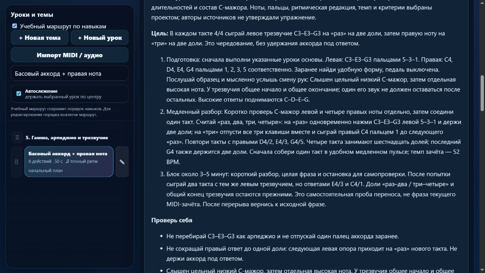

# Партия 14: передача фразы от одной руки к другой

Дата: 5 ноября 2026 года. Версия: **23.4.14**. Два существующих урока получили новую ритмическую редакцию и подробный разбор. Новых исполняемых уроков нет; добавлены два отдельных будущих задания.

## Что обнаружено

В `course07-06` бас и три правые ноты образовывали группы по **пять долей**: 1 + 1 + 1 + 2, всего 15 долей. В `course07-07` аккорд и ответ образовывали группы по **три доли**: 2 + 1, всего 12. При этом оба задания были подписаны 4/4, а объяснения не готовили к сдвигу группы относительно тактового начала. Это допустимые музыкальные сочетания, но скрытое усложнение для начального упражнения на передачу рук. Источник не запрещает такие группировки; упрощение — педагогическое решение проекта.

Также воспроизведены ошибки зачёта: оба прежних задания принимали сокращение двухдольного звука на половину доли. В левом трезвучии разнесённые примерно на 346 мс окончания тоже проходили. Правильные контрольные попытки принимались.

В описании «не снимай левую руку с позиции» не различались сохранение ориентира и удержание звучащего баса. Теперь явно сказано, когда отпустить клавишу; независимое удержание одного голоса под другим вынесено в будущую тему.

## Новая учебная редакция

| Урок | Ноты и пальцы | Ритм и новая задача |
| --- | --- | --- |
| `course07-06` · Левая опора, правая фраза | Левый C3/5; ответы правой C4–D4–E4 / D4–E4–F4 / E4–F4–G4 пальцами 1–2–3 / 2–3–4 / 3–4–5 | **12 четвертей, три такта 4/4, 58 BPM**. На «раз» бас, на «два» его отпускание и начало трёхнотного ответа. Последний G4 заканчивается у следующего «раз». |
| `course07-07` · Басовый аккорд + правая нота | Слева C3–E3–G3 / 5–3–1; справа C4/1, D4/2, E4/3, G4/5 | **Восемь двухдольных событий, четыре такта 4/4, 52 BPM**. На «раз» цельный аккорд, на «три» его общее отпускание и правый ответ до следующего «раз». Всего 16 долей. |

Высоты, последовательности, руки, пальцы и темпы сохранены. Изменены длительности, начала событий, тактовые позиции и соответствующие временные метки. Ритм обозначен как новая редакция собственной технической заготовки проекта. Это не восстановление нот известного произведения.

У первой фразы включён `beat-boundary-v1`, у трезвучия с ответом — существующий `beat-boundary-v2`. Допуски проекта: длительность `max(130 мс, min(30% длительности, 22% доли))`, разброс окончаний созвучия до 120 мс. В этой партии числовые правила оценщика не менялись. Сообщение об окончаниях сделано общим для двух и трёх звуков: «Окончания одновременных звуков не совпали».

Карточки содержат позиции, медленный счёт, слуховой образ, типичные ошибки, самостоятельный перенос, небольшой блок практики и возврат после перерыва. Для переноса первая фраза получает нисходящий правый ответ G–F–E; вторая — ответы E и C вместо прежнего ряда. Эти пробы не выдают автоматический зачёт и не названы независимым тестом слуха. Удержание баса под ответом, педаль, пальцы и художественное качество не объявлены измеряемыми текущим MIDI-контрактом.

## Подготовка и маршрут

`course07-06` расположен после `course07-02`, до одновременных пар `course07-03`. Требования: `course07-02`, `course02-08`, `course03-01`, `course04-01` — чередование, подготовленные пальцы и четвертной пульс.

`course07-07` расположен после левого C-мажора `course08-02`; также нужны `course07-06` и `course04-02`. Следующим самостоятельным шагом предлагается F major `course08-03` перед сменой аккордов. Подготовка проверена по фактическому порядку маршрута. В каталоге сохранились исходные ID и пользовательский порядок; произведения остаются отдельной функцией.

## Первоисточники и границы вывода

Прочитан Robert Hutchinson, *Music Theory for the 21st-Century Classroom*, раздел 4.4 «Meter»: определение размера, число долей, пример простого четырёхдольного 4/4. Автор подтверждён на официальной странице учебника University of Puget Sound. Использована текущая онлайн-редакция без выдуманного номера страницы или даты PDF. [Авторский раздел 4.4](https://musictheory.pugetsound.edu/mt21c/meter.html), [страница учебника](https://musictheory.pugetsound.edu/).

Раздел подтверждает устройство размера, а выбор регулярных групп для этих начальных уроков принадлежит проекту. Он не предписывает наши ноты, пальцы, длительность урока, порядок обучения или MIDI-допуски.

Переиспользованы ранее проверенные разделы OpenLearn 3.1 о длительностях и 7 о трезвучиях, материалы Duke/Simmons о небольшой цели практики, Dumlavwalla о свободе руки и Kovarsky о коротком разборе трудного места. В этой партии страница Open Music Theory о простом размере вернула 403; её прежняя запись сохранена, а свежим основанием для размера служит доступный авторский раздел Hutchinson. Доступ и ограничения записаны в [журнале источников](../piano-curriculum-sources.json), где теперь **17 записей**. Исторических атрибуций упражнениям и рассказов о знаменитых учениках не добавлено.

## Будущие удержанные голоса

В [индивидуальный план](../piano-lesson-backlog.json) добавлены два ещё не реализованных задания:

- `detail-p-held-voice-01`: левый C3/5 держится две доли, пока правая играет E4/3 и D4/2 по одной доле.
- `detail-p-held-voice-02`: правый E4/3 держится две доли, пока левая играет C3/5 и D3/4 по одной доле.

Это разные задачи распределения удержания и движения между руками. До реализации им нужны независимые границы каждой ноты, идентичность голоса, подходящая аппликатура и воспроизведение, сохранение редакций и тесты оценивания. Требуется также отдельная проверка музыкальных источников и переноса. Сейчас это **планы**, в готовый каталог и число проверенных уроков они не включены.

При добавлении планов обнаружилось, что генератор матрицы предполагал одну руку и общий массив пальцев. Он исправлен: для двух рук выводит высоту, руку и палец каждой запланированной ноты, отвергает некорректное назначение. Настоящая генерация и регрессионный тест подтверждают оба варианта; данные не маскируются под одноручную задачу.

## Сохранность и проверка

Миграция действует только при совпадении полных отпечатков исходных редакций `f3256aa3` и `741d8889`. Пользовательские изменения описания, цели, подготовки, ритма, пальцев, классификации или метки редакции не перезаписываются. Повторное применение ничего не меняет. Предыдущие ритмы и отпечатки требований сохранены в `learning.contentReview`; прежние попытки остаются в истории своей версии, новый зачёт требует повтора.

Проверены все **561** элемента каталога: высоты, последовательности, руки, пальцы и артикуляция не изменились; ритм и контракт изменены ровно у двух названных уроков. У остальных **559** сохранены музыкальные контракты. Порядок ID прежний. Хеши исходного `lesson-review-baseline.js`, MIDI-настроек и 19 рабочих JS/HTML/CSS-файлов гитары совпали со снимком до партии. `trainer-content.json` до и после отсутствует. В гитарную папку записи и синхронизации не выполнялись.

- `npm test`: **210/210**, ошибок нет. Тематические тесты передачи фразы — **5/5**, матрицы покрытия — **3/3**.
- `audit:lessons`, `audit:curriculum`, `audit:fingering` проходят; `audit:piano-coverage` успешно создаёт обе формы плана. Начальная проверка данных охватывает 80 уроков и 1036 назначений пальцев.
- Независимые ожидаемые ноты, пальцы и временные позиции проверены по обеим рукам. Прежнее исполнение с неуточнённой группировкой не выдаёт новый зачёт; ранние/поздние отпускания и удержание баса под ответом отклоняются.
- Проверены окончания трезвучия с разбросом 119/121/330 мс и перебор с разбросом начала 200 мс. Правильные варианты проходят; ошибки проверены также настоящими обработчиками MIDI приложения с программными событиями.
- Изолированный браузер показывает версию 23.4.14, 413 упражнений и отдельные 27 произведений. Обе карточки открыты; проверены четверти/половинные, пальцы левого трезвучия, отпускание баса, 12/16 долей и предупреждение о новой редакции. Режим памяти скрывает материалы и подсказки пальцев на клавишах. Ошибок браузера не найдено; вкладка закрыта и временный сервер остановлен.

Доказательства и логи: [машинный протокол партии 14](piano-curriculum-2026-11-05-14-verification.json). Физический MIDI-инструмент, реальное звучание и независимая экспертиза преподавателя в этой партии не проверялись.

## Что дальше

Сейчас **413** учебных записей, **149** с текущим MIDI-контрактом, **41** с описанным происхождением и областью навыка; **372** ещё требуют такой редакции. Будущих индивидуальных планов **3**: конечная пауза и два удержанных голоса. Новых готовых уроков в этой партии **0**, исправленных **2**, новых планов **2**. Инвентарь не является подтверждённым числом разных педагогических целей; известное перекрытие двух целых нот остаётся в очереди. Каркас на 1310 мест ещё требует детализации до минимум 1000 содержательных целей.

Следующая небольшая партия — `course08-01/02`, C major отдельно каждой рукой: общие входы и окончания, длительность, удобство формы и сохранение редакций. Затем F/G major `course08-03/04`. В протоколе перечислены оставшиеся **19** кандидатов с длинными нотами и прежним допуском; проверка общих окончаний коротких созвучий также не завершена. Известные 83 неподдерживаемых действия в 10 фрагментах произведений, конечная пауза, удержанные голоса и педаль остаются ограничениями.

На проверке общей недельной квоты использовано 26%, осталось **74%**. Резерв 25% и запрет начинать тяжёлую часть при остатке 30% и ниже сохранены. Это общий показатель аккаунта. [Точка продолжения](../piano-curriculum-state.json) и [матрица навыков](../PIANO_SKILL_COVERAGE.md) обновлены.
