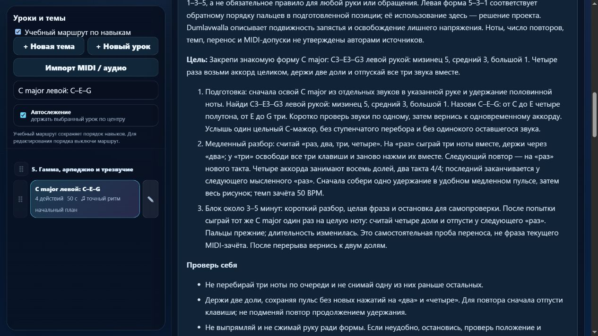

# Партия 15: устойчивое повторение C major каждой рукой

Дата: 5 ноября 2026 года. Версия: **23.4.15**. Исправлены инструкции и контракт зачёта двух существующих уроков. Новых готовых уроков и новых будущих планов в этой партии нет.

## Подтверждённые ошибки зачёта

Оба урока, `course08-01` и `course08-02`, принимали сокращение двухдольного аккорда на половину доли и продление последнего аккорда на половину доли. Также принимались окончания последнего трезвучия с разбросом **360 мс**. В последнем случае прежний `beat-boundary-v1` тоже выдавал чистую попытку: отдельные длительности попадали в допуск, хотя звуки заканчивались раздельно. Правильные контрольные попытки проходили.

В двух совпавших встроенных редакциях включён существующий `beat-boundary-v2`: он проверяет длительности и общий конец одновременных звуков. Оценщик и его числовые правила в этой партии не менялись. Допуск длительности — `max(130 мс, min(30% длительности, 22% доли))`; предел разброса окончаний — 120 мс. Это настройки проекта, не нормы автора методики или экзаменационной системы.

Проверены граничные примеры: 119 мс принимаются, 121 и 360 мс отклоняются именно по общему окончанию, без ошибки отдельной длительности. Перебор последнего аккорда с разбросом начала 200 мс и пропущенная нота также отклоняются. Прежние профили оценивания сохраняют своё поведение.

## Музыка и разбор

| Урок | Проверенные высоты и пальцы | Ритм |
| --- | --- | --- |
| `course08-01` · C major правой | C4–E4–G4, правая 1–3–5 | Четыре аккорда по две доли, начала 0/2/4/6, 50 BPM |
| `course08-02` · C major левой | C3–E3–G3, левая 5–3–1 | Тот же рисунок в другом регистре, 50 BPM |

Каждая фраза занимает **восемь долей, два такта 4/4**. Между C и E четыре полутона, между E и G три: состав мажорного трезвучия проверен по реальным высотам. Ноты, руки, пальцы, темп и все длительности сохранены.

Роль этих уроков уточнена как устойчивое повторение уже собранной формы. Для правой руки нужна подготовка `detail-p-triads-01`, `course02-08`, `course04-02`; для левой — `detail-p-triads-02`, `course03-08`, `course04-02`. Подготовка действительно предшествует заданиям в пересобранном маршруте. Собрать форму из отдельных звуков и затем повторить четыре цельных удержания — разные этапы работы; новые уроки из повторных попыток не создавались.

Карточки теперь объясняют подготовку трёх касаний у поверхности клавиш, спокойное одновременное движение, сохранение подвижности запястья и освобождение лишнего давления. Счёт: аккорды на «раз» и «три»; «два» и «четыре» продолжают удержание. Перед повтором требуется отпускание и новое нажатие. Последнее созвучие заканчивается у следующего мысленного «раз».

Добавлены слуховой ориентир цельного созвучия, типичные ошибки, самопроверка и самостоятельный перенос: сыграть ту же форму один раз на четыре доли, затем после перерыва вернуться к двум. Перенос не выдаёт MIDI-зачёт текущего урока и не назван независимым тестом слуха. При неудобстве предлагается остановиться и подобрать посильный вариант с преподавателем; автоматической замены высот нет.

Следующим шагом правой ветки указана левая форма C major; после левой — подготовленное чередование аккорда и правого ответа `course07-07`. Удержанные независимые голоса и педаль не заявлены задачей этих уроков.

## Первоисточники

Прочитана авторская статья Jerry Kovarsky, опубликованная Yamaha 25 июля 2023 года. Разделы «Where Do Chords Come From?» и «The Four Main Three-Note Chord Types» подтверждают построение мажорного трезвучия 4 + 3 полутона и описывают обычную правую форму с большим пальцем на нижней ноте, средним на средней и мизинцем на верхней. [Basic Piano Chords for Beginners, Part 1](https://hub.yamaha.com/keyboards/k-how-to/basic-piano-chords-for-beginners-part-1/).

Это контекстная рекомендация, а не единая аппликатура для любой руки, обращения или фактуры. Левая форма 5–3–1 объясняется отдельно через подготовленную обратную пятипальцевую позицию; слова автора о большом пальце на нижней ноте на левую руку не перенесены.

Повторно прочитаны разделы Diana Dumlavwalla о напряжении руки и форме кисти: автор описывает освобождение лишнего напряжения и подвижное запястье. В урок не перенесены упражнения с падением руки или внешним удерживанием; речь идёт о свободном движении непосредственно у клавиш. [Fix It: Tips for Teaching Basic Piano Technique, 29 ноября 2021 года](https://hub.yamaha.com/music-educators/instruments/piano/piano-pedagogy-fix-basic-technique/).

Также переиспользованы ранее проверенные OpenLearn 7 о трезвучиях и 3.1 о длительностях, официальный образец Alfred *Musical Fingers* с противоположным порядком пальцев в пятипальцевых позициях и материалы Duke/Simmons о небольшой цели практики. Места подтверждения, ограничения и связанные ID сохранены в [журнале источников](../piano-curriculum-sources.json); в нём **18 записей**. Новая запись — `kovarsky-basic-triads-2026-11-05`.

Оба задания подписаны как технические упражнения проекта. Это не фрагменты авторского произведения; исторические атрибуции и рассказы об учениках не добавлялись. Конкретные темпы, число повторов, перенос и допуски не приписаны авторам источников.

## Редакции и сохранность

Исправление применяется однократно только к полным отпечаткам исходных редакций `6e037383` и `ab0dbe74`. Регрессии подтверждают сохранение пользовательских текстов, подготовки, движений, музыки, пальцев, классификации и личных меток редакции. Старые результаты сохраняются в истории своей музыкальной версии; новый контракт требует новой попытки.

Проверены все **561** элемента пианистического каталога: высоты, ритм, пальцы, руки и артикуляция не изменились. Инструкции и отпечатки требований изменились ровно у двух выбранных уроков; остальные контракты прежние. Сохранены порядок ID, исходный `lesson-review-baseline.js`, MIDI-настройки и хеши 19 рабочих JS/HTML/CSS-файлов гитарного проекта. `trainer-content.json` до и после отсутствует. Гитарная папка не изменялась; совместимость проверена реальными тестами её приложения.

## Проверки

- `npm test`: **215/215**, без ошибок; тематическая группа — **5/5**.
- `audit:lessons`, `audit:curriculum`, `audit:fingering` проходят. Структурных ошибок нет; проверка начального корпуса охватывает 80 уроков и 1036 назначений пальцев.
- Проверены независимые ожидаемые высоты, пальцы обеих рук, времена, сохранение редакций и каталога. Настоящие обработчики MIDI приложения с программными событиями проверяют правильные и ошибочные попытки и ждут всех последних отпусканий.
- В изолированном браузере открыты обе карточки версии 23.4.15. Видны правые C4/E4/G4 с пальцами 1/3/5 и левые C3/E3/G3 с пальцами 5/3/1, счёт, подготовка, предупреждение о новой проверке и самостоятельный перенос. Режим памяти скрывает материалы и подсказки пальцев на клавишах. Каталоги 413 упражнений и 27 произведений раздельны. Ошибок браузера не обнаружено; вкладка закрыта и временный сервер остановлен.

Данные и логи: [машинный протокол партии 15](piano-curriculum-2026-11-05-15-verification.json). Настоящий MIDI-инструмент, звучание и независимая экспертиза преподавателем в этой партии не проверялись. MIDI-события не доказывают фактический палец, удобство и художественное качество.

## Продолжение

Реализовано **413** учебных записей, из них **149** с текущим MIDI-контрактом. Происхождение и область навыка описаны у **43**, ещё **370** требуют такой редакции. Будущих индивидуальных планов **3**, без включения в готовые упражнения. В этой партии — **2 исправления**, **0 новых уроков**. Известное перекрытие целей двух целых нот остаётся в очереди; инвентарь не объявлен проверенным числом самостоятельных педагогических целей. Каркас на 1310 мест продолжает требовать детализации минимума 1000 уроков.

Следующие задания — `course08-03/04`, отдельные формы F и G major правой рукой. Нужно сверить реальные высоты, пальцы, подготовку переноса всей позиции и окончания до смены аккордов. В протоколе перечислены оставшиеся **17** кандидатов с длинными нотами и прежним допуском. Проверка общих окончаний коротких созвучий, конечная пауза, независимые голоса и педаль остаются отдельной работой. Известные 83 неподдерживаемых действия в 10 фрагментах произведений не устранены этой партией.

Общая недельная квота на последней проверке: использовано 27%, осталось **73%**. Резерв 25% и остановка новых тяжёлых этапов при остатке 30% и ниже сохранены. [Состояние продолжения](../piano-curriculum-state.json) и [матрица навыков](../PIANO_SKILL_COVERAGE.md) обновлены.
