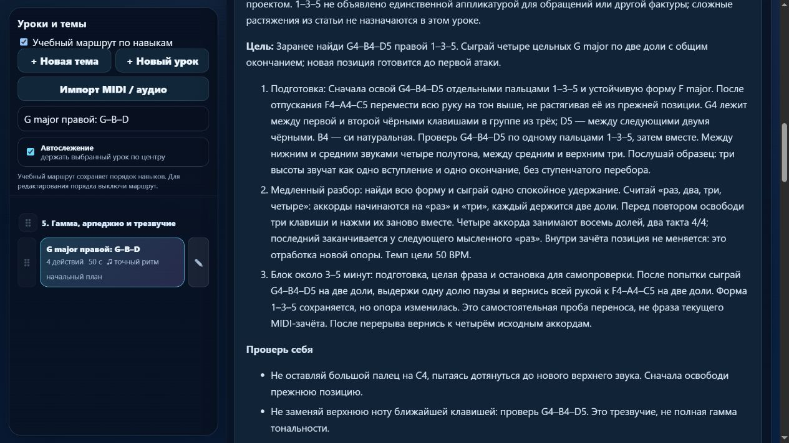

# Партия 16: отдельные позиции F major и G major

Дата: 5 ноября 2026 года. Версия: **23.4.16**. Исправлены два существующих урока правой руки; добавлены два будущих плана для левой. Новых готовых уроков нет.

## Что проверено и исправлено

В `course08-03` и `course08-04` ноты и пальцы соответствовали заданным трезвучиям. Прежний контракт принимал сокращение двухдольного удержания на половину доли, продление последнего аккорда на половину доли и разнесённые на 360 мс окончания последнего созвучия. Последний случай принимал также `beat-boundary-v1`: каждое отпускание отдельно попадало в допуск. Правильные контрольные исполнения проходили.

Для двух совпавших встроенных редакций включён существующий `beat-boundary-v2`. Он проверяет длительности и общий конец трёх звуков. Числовые правила оценщика не менялись: длительность допускает `max(130 мс, min(30% длительности, 22% доли))`, общий конец — разброс до 120 мс. Это допуски проекта, не рекомендации автора или экзаменационной системы.

В тестах разброс 119 мс принимается, 121 и 360 мс отклоняются по общему окончанию, без ошибки отдельной длительности. Перебор вместо аккорда с разнесёнными на 200 мс вступлениями и пропущенная нота также отклоняются. Прежние профили сохранили поведение.

## Высоты, пальцы и новые опоры

| Урок | Сохранённые данные | Уточнённое движение |
| --- | --- | --- |
| `course08-03` · F major правой | F4–A4–C5, 1–3–5 | После отпускания C4–E4–G4 перенести всю руку к F4. F находится перед группой из трёх чёрных клавиш; верхний C5 — перед следующими двумя. |
| `course08-04` · G major правой | G4–B4–D5, 1–3–5 | После отпускания F-формы переместить руку на тон выше. G находится между первой и второй чёрными в группе из трёх, D5 — между следующими двумя. B4 обозначает си натуральную. |

Оба трезвучия имеют интервалы 4 + 3 полутона. Проверены реальные MIDI-высоты `[65,69,72]` и `[67,71,74]`, включая верхние C5/D5. Сохранились четыре аккорда по две доли, начала 0/2/4/6, 50 BPM: восемь долей, два такта 4/4. Это отдельные трезвучия, а не полные гаммы тональностей.

Карточки объясняют подготовку всей новой позиции до первой атаки, проверку трёх нот по одной, цельное нажатие, продолжение счёта во время удержания и общее отпускание. Действие сформулировано прямо: освободить прежние клавиши, перенести руку и найти положение, в котором три ноты удобно доступны. Удержание большого пальца на C4 и растяжение к новому верхнему звуку не предлагаются.

В текущей MIDI-фразе позиция уже найдена и не меняется. Переход проверяется человеком отдельно: F → пауза в одну долю → C либо G → пауза → F, с теми же пальцами 1–3–5. Это самостоятельная проба переноса, не зачёт текущей фразы и не независимый тест слуха. В материалах есть слуховой ориентир, типичные ошибки, небольшой блок практики и возврат после перерыва.

## Подготовка и маршрут

Для F major указаны `course08-01`, `detail-p-triads-03`, `detail-p-relocate-01`, `course04-02`: знакомая форма C, сборка F из отдельных звуков, перенос отпущенной руки и двухдольное удержание. Для G major — `course08-03`, `detail-p-relocate-03`, `course04-02`: отдельная F-форма, подготовленная опора G–B–D и счёт.

Зависимости проверены в пересобранном маршруте; подготовка предшествует обоим заданиям. После G предлагается подготовленная последовательность `course08-05` C–F–G–C. Сохранены ID и пользовательский порядок каталога. «Произведения» остаются отдельной функцией.

## Прочитанный источник

Повторно прочитана авторская статья Jerry Kovarsky от 28 ноября 2023 года: вводный абзац о предварительном выборе пальцев и позиции, «Scenario One» и обсуждение альтернатив в «Scenario Three». Автор предлагает заранее продумывать расположение руки и допускает разные подходы к аппликатуре. [The Basics Of Piano Keyboard Fingering](https://hub.yamaha.com/keyboards/k-how-to/the-basics-of-piano-keyboard-fingering/).

Здесь использован принцип подготовки позиции. Конкретные F4–A4–C5 и G4–B4–D5, ориентиры по чёрным клавишам, возвращение с паузой и темп — решения проекта. Сложные растяжения из других примеров статьи и общий запрет большого пальца на чёрных клавишах не назначаются. Форма 1–3–5 не объявлена единственной для обращений или другой фактуры.

Также переиспользованы проверенные OpenLearn о трезвучиях и длительностях, статья Kovarsky о базовых аккордах, материалы Duke/Simmons и Dumlavwalla. В [журнале источников](../piano-curriculum-sources.json) сохранены **18 записей**; новая проверка разделов и применение к этой партии добавлены к существующей записи `kovarsky-fingering-context-2026-11-05`. Оба урока подписаны как технические упражнения проекта, без атрибуции произведению, вымышленных биографий или утверждения авторами источников.

## Две будущие левые формы

В [индивидуальный план](../piano-lesson-backlog.json) добавлены:

- `detail-p-left-position-triad-01`: подготовить F3–A3–C4 левой 5–3–1 и четыре цельных двухдольных удержания.
- `detail-p-left-position-triad-02`: подготовить G3–B3–D4 левой 5–3–1 и такой же тип удержания в другой опоре.

Цели различают руку, ориентиры и регистр; это не варианты только с другим BPM. Сопоставление с исполняемым учебным каталогом не нашло точной последовательности из повторяющихся F3–A3–C4 или G3–B3–D4. Это ограниченная проверка дублей по нотам, не полная педагогическая дедупликация.

Планы содержат подготовку по ID, высоты, пальцы, группы и временные цели. До внедрения нужны проверка движения и источников для левой руки, постепенный разбор и перенос. Они **не зарегистрированы в приложении** и не увеличивают число готовых уроков. Теперь будущих индивидуальных планов пять; прежние три — конечная пауза и два удержанных голоса — сохранены.

## Проверки и сохранность

- `npm test`: **220/220**, без ошибок; тематическая группа — **5/5**. Проверены независимые ожидаемые высоты, руки/пальцы, ритм, корректные и ошибочные попытки, настоящие обработчики MIDI с программными событиями и ожидание последних отпусканий.
- `audit:lessons`, `audit:curriculum`, `audit:fingering` проходят. Структурных ошибок нет; проверка начальных данных охватывает 80 уроков и 1036 назначений пальцев.
- Миграция применяется однократно только к полным отпечаткам `84a15970` и `04b62cbc`. Пользовательские тексты, подготовка, движения, музыка, пальцы, классификация и личные метки сохраняются. Прежние результаты остаются в истории своей версии; новый зачёт требует повтора.
- Все **561** элемента каталога сохранили высоты, ритм, руки, пальцы и артикуляцию. Инструкции и отпечатки требований изменились ровно у двух выбранных уроков. Порядок ID прежний. Хеши исходного `lesson-review-baseline.js`, MIDI-настроек и 19 рабочих JS/HTML/CSS-файлов гитары совпали со снимком до партии. `trainer-content.json` до и после отсутствует; гитарная папка не изменялась.
- Изолированный браузер показал версию 23.4.16, 413 упражнений и отдельные 27 произведений. Обе карточки открыты: проверены F4/A4/C5 и G4/B4/D5 с правыми 1/3/5, ориентиры, счёт и проба переноса. Режим памяти скрывает материалы и подсказки пальцев на клавишах. Ошибок браузера не найдено; вкладка закрыта, временный сервер остановлен.

Данные и логи: [машинный протокол партии 16](piano-curriculum-2026-11-05-16-verification.json). Реальное звучание, физический MIDI-инструмент и независимая экспертиза преподавателем в этой партии не проверялись. События MIDI не доказывают пальцы, подвижность руки или художественное качество.

## Продолжение

В каталоге **413** учебных записей, **149** с текущим MIDI-контрактом; происхождение и область навыка описаны у **45**, ещё **368** требуют такой редакции. Будущих планов **5**. В этой партии — **2 исправления**, **2 новых плана**, **0 новых готовых уроков**. Инвентарь не является подтверждённым числом разных педагогических целей; перекрытие двух уроков целой ноты остаётся в очереди. Каркас на 1310 мест ещё требует детализации минимума 1000 содержательных уроков.

Следующие материалы — `course08-05` и `course08-07`: последовательность C–F–G–C и левый аккорд с правой мелодией. Сначала сверить отдельные границы голосов, подготовку переноса и окончания; независимые длительности нельзя подгонять под общий конец. Затем можно внедрять небольшую проверенную партию из новых левых планов. В протоколе перечислены оставшиеся **15** кандидатов с длинными нотами и прежним допуском. Короткие созвучия, конечная пауза, удержанные голоса и педаль остаются отдельными очередями. Известные 83 неподдерживаемых действия в 10 фрагментах произведений этой партией не устранены.

Общая недельная квота на последней проверке: использовано 27%, осталось **73%**. Резерв 25% и запрет новых тяжёлых этапов при остатке 30% и ниже сохранены. [Состояние](../piano-curriculum-state.json) и [матрица](../PIANO_SKILL_COVERAGE.md) обновлены.
