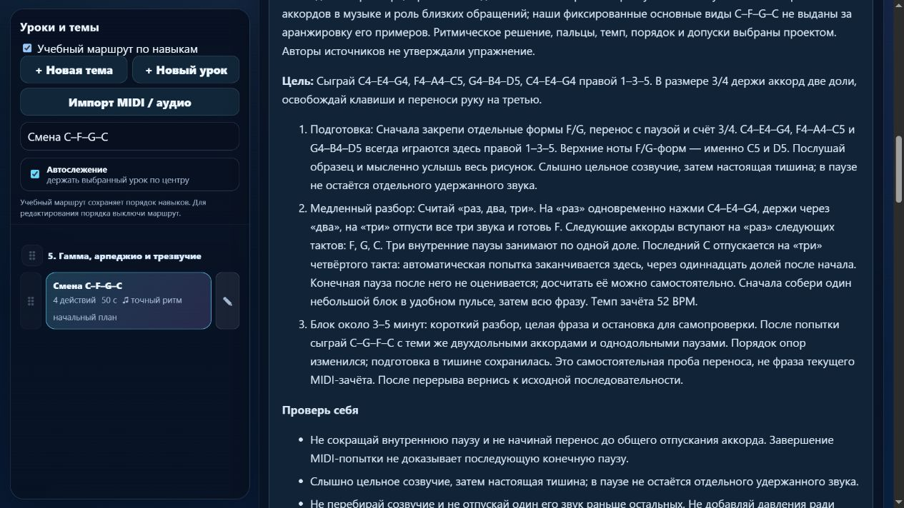

# Партия 17: смена аккордов с паузой и последовательный ответ рук

Дата: 5 ноября 2026 года. Версия: **23.4.17**. Отредактированы два существующих технических упражнения проекта; новых готовых уроков или планов нет.

## Подтверждённые ошибки и границы модели

`course08-05` и `course08-07` принимали сокращённые на половину доли длинные звуки и продлённое на половину доли последнее событие. Последнее трезвучие с окончаниями, разнесёнными на 360 мс, также проходило — в прежнем профиле и `beat-boundary-v1`. Правильные контрольные исполнения принимались.

В обоих заданиях включён существующий `beat-boundary-v2`. Проверены правильные и ошибочные варианты, окончания с разбросом 119/121/360 мс, перебор аккорда и лишний звук во внутренней паузе. Правильные исполнения и 119 мс принимаются; 121/360 мс отклоняются именно по общему окончанию, без ошибки отдельной длительности. Перебор со вступлениями на протяжении 200 мс тоже отклоняется.

Числовые правила оценщика не менялись: допуск длительности `max(130 мс, min(30% длительности, 22% доли))`, разброс окончаний до 120 мс. Это настройки проекта, не нормы музыкального автора или экзаменационной системы.

Оба задания последовательные. В них нет баса, который должен продолжать звучать под меняющейся мелодией. Такая независимость требует иной модели и остаётся в отдельных будущих планах.

## C–F–G–C: ясный счёт 3/4

Сохранены четыре правых созвучия:

- C4–E4–G4;
- F4–A4–C5;
- G4–B4–D5;
- C4–E4–G4.

Пальцы каждого — 1–3–5. Начала 0/3/6/9, двухдольные удержания, три внутренние паузы по одной доле и 52 BPM сохранены. Однако прежний размер 4/4 не объяснял, почему группы «две доли звука + одна тишины» каждый раз сдвигаются относительно такта. Выбран явный **3/4**: на «раз» аккорд, через «два» удержание, на «три» общее отпускание и перенос к следующей опоре. Исправлены размер и тактовые позиции, без изменения времени нажатий и отпусканий.

Трёхдольные группы в четырёхдольной музыке допустимы; они просто не являются целью этой начальной заготовки. Редакция задаёт посильную задачу проекта, а не исправляет «нарушение мирового правила».

Последний C отпускается на «три» четвёртого такта — через **11 долей после начала**. Здесь текущая автоматическая попытка заканчивается. Тишина до следующего мысленного «раз» **не наблюдается и не оценивается**. Это явно сказано в карточке и воспроизведено настоящими обработчиками приложения с программными MIDI-событиями. Самостоятельно досчитать конечную паузу полезно, но она не выдаётся за проверенный навык. Отдельный план конечной паузы сохранён.

Подготовка: `course08-03`, `course08-04`, `detail-p-chordmove-01/02`, `course04-07`. Все эти ID предшествуют заданию в маршруте. Перенос после попытки меняет порядок на C–G–F–C с теми же паузами; это ручная проба, не фраза текущего зачёта.

## Левый аккорд и три правые четверти

У `course08-07` прежние группы занимали шесть долей: 2 + 1 + 1 + 2 в размере 4/4, всего 18. Для начальной передачи между руками ритм упрощён до **трёх тактов 4/4**, все события по одной доле, всего 12. Темп 54 BPM сохранён.

Слева на «раз» звучит C3–E3–G3 пальцами 5–3–1. На «два» аккорд отпускается, правая играет по три четверти:

- C4–D4–E4 / 1–2–3;
- E4–F4–G4 / 3–4–5;
- G4–F4–E4 / 5–4–3.

Высоты и пальцы не изменены. Здесь изменены начала, длительности и соответствующие временные метки. Последний E4 заканчивается у следующего мысленного «раз». Удерживать левое трезвучие под правым ответом не предлагается.

Подготовка: `course07-06`, `course07-07`, `course08-02`, `course04-01`; её порядок проверен в реальном маршруте. Ручной перенос меняет ответ на E4–D4–C4. Оба урока получили конкретную подготовку, счёт, слуховой ориентир, ошибки, блок около 3–5 минут, повтор после перерыва и переход к отдельной работе над разложенными аккордами.

## Прочитанный источник

Jerry Kovarsky в авторской статье от 26 сентября 2023 года связывает узнавание аккордовых типов с музыкальным контекстом и в разделе о минорных аккордах объясняет роль обращений для близкой смены созвучий. [Basic Piano Chords for Beginners, Part 2](https://hub.yamaha.com/keyboards/k-how-to/basic-piano-chords-for-beginners-part-2/).

Это помогает разграничить нашу техническую смену основных видов с паузами и последующую отдельную тему более близких обращений. Фиксированные C–F–G–C не названы аранжировкой примеров автора. Нотные фрагменты, изображения и аудио песен не копировались; конкретное произведение не стало обязательной подготовкой навыка.

Переиспользованы проверенные разделы Robert Hutchinson 4.4 о числе долей в размере, OpenLearn о длительностях и трезвучиях, а также материалы о планировании позиции и короткой практике. Авторы не предписывают наш ритм, пальцы, темп или допуски. В [журнале источников](../piano-curriculum-sources.json) теперь **19 записей**; новая — `kovarsky-chords-in-music-2026-11-05`. Исторические сведения об обучении знаменитых исполнителей не добавлялись.

## Сохранность и проверки

Исправление применяется однократно только к полным исходным отпечаткам `66a8f6d8` и `609ecec3`. Личные изменения описаний, движений, подготовки, музыки, размера, пальцев, классификации и меток редакции сохраняются. В `learning.contentReview` записаны прежние ритмы и отпечатки требований. Старые результаты остаются в истории своей версии; новый контракт требует повторной попытки.

Все **561** элемента каталога сохранили высоты, последовательности, руки, пальцы и артикуляцию. Ритмические данные и контракт изменились ровно у двух выбранных заданий; у остальных **559** они прежние. Порядок ID сохранён. Хеши исходного `lesson-review-baseline.js`, MIDI-настроек и 19 рабочих JS/HTML/CSS-файлов гитарного проекта совпали со снимком до партии. `trainer-content.json` до и после отсутствует. В гитарную папку записи или синхронизации не выполнялись.

- `npm test`: **225/225**, без ошибок, включая пять тематических тестов.
- `audit:lessons`, `audit:curriculum`, `audit:fingering` проходят. Структурных ошибок нет; начальная проверка данных охватывает 80 уроков и 1036 назначений пальцев.
- Проверены независимые ожидаемые ноты и пальцы, метр, времена, внутренние паузы, сохранение редакций и каталога. Настоящие обработчики MIDI приложения с программными событиями ждут последнего отпускания. Прежний ритм правого ответа не выдаёт новый зачёт; у C–F–G–C временной рисунок сохранился, изменилась его метрическая разметка и точность проверки.
- Изолированный браузер показал версию 23.4.17, 413 упражнений и отдельные 27 произведений. Открыты обе карточки: счёт 3/4 и граница конечной паузы, а также четвертной ответ с левыми 5–3–1 и правыми 1–2–3. Материалы и подсказки пальцев на клавишах скрываются в режиме памяти. Ошибок браузера не обнаружено; вкладка закрыта и временный сервер остановлен.

Данные и логи: [машинный протокол партии 17](piano-curriculum-2026-11-05-17-verification.json). Физический инструмент, звучание и независимая экспертиза преподавателя не проверялись. MIDI не определяет пальцы, удобство, метрические акценты, баланс голосов и художественное качество.

## Точка продолжения

Реализовано **413** учебных записей, **149** с текущим MIDI-контрактом. Происхождение и область навыка описаны у **47**, ещё **366** требуют такой редакции. Будущих индивидуальных планов **5**, без изменения в этой партии. Исправлений **2**, новых готовых уроков **0**. Инвентарь не является подтверждённым числом разных педагогических целей; известное перекрытие двух целых нот остаётся в очереди. Каркас на 1310 мест продолжает требовать детализации минимума 1000 содержательных уроков.

Следующая партия — посильное внедрение левых F/G-форм `detail-p-left-position-triad-01/02` после проверки источников, охвата и самостоятельной задачи. Затем `course08-06`: разложенные аккорды, повторные верхние ноты, паузы и граница завершения. В протоколе перечислены оставшиеся **13** кандидатов с длинными нотами и прежним допуском. Отдельно остаются конечная пауза, независимые голоса, короткие созвучия и известные 83 неподдерживаемых действия в 10 фрагментах произведений.

Общая недельная квота: использовано 28%, осталось **72%** на последней проверке. Резерв 25% и остановка новых тяжёлых этапов при остатке 30% и ниже сохранены. [Состояние](../piano-curriculum-state.json) и [матрица](../PIANO_SKILL_COVERAGE.md) обновлены.
