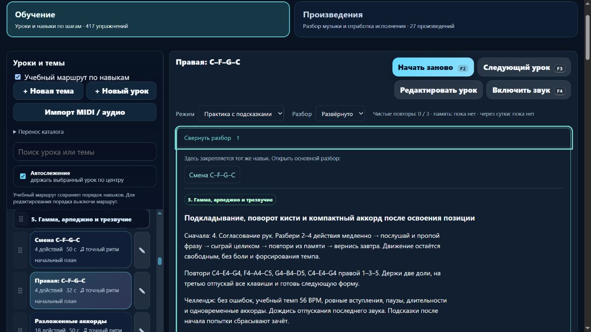
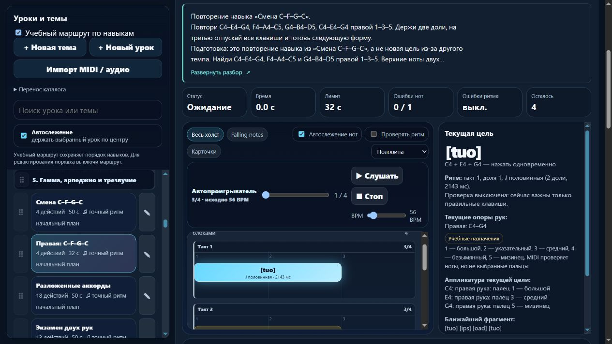

# Пианино / MelodiaJest — партия 24, 5 ноября 2026

Исправлен существующий `detail-p-chordmove-04` («Правая: C–F–G–C»). Это повторение цели `course08-05`, а не новый самостоятельный урок. Версия локальной веб-сборки — **23.5.5**. [Машинные доказательства](piano-curriculum-2026-11-05-24-verification.json).

## Что обнаружено

В обеих записях одинаковые правые созвучия C4/E4/G4 → F4/A4/C5 → G4/B4/D5 → C4/E4/G4 и пальцы 1–3–5. Цель — отпустить весь аккорд и подготовить следующую форму в тишине. Старый подробный вариант отличался темпом 56 вместо 52 BPM, длительностью 1,7 доли вместо двух и паузой 1,3 доли вместо одной. Самостоятельная вторая задача этими отличиями не подтверждена. Его прежняя прямая подготовка ссылалась на левое упражнение, хотя исполняет правая рука.

На замороженных исходных данных воспроизведён недостаток старого допуска: последний аккорд принимался при общем отпускании на 0,45 доли раньше или позже, а также при разбросе окончаний звуков 360 мс. Изолированная замена контракта на v2 отклоняет те же события даже без исправления ритма — улучшение проверки не подменено одной заменой нотных данных.

## Изменённая редакция и последовательность

- ID, высоты, руки, пальцы 1–3–5, начала 0/3/6/9, 56 BPM и физический порядок каталога сохранены.
- Для этой начальной задачи выбран понятный рисунок: **две доли звучания и одна доля паузы в 3/4**. Прежние 1,7+1,3 сами по себе не запрещены в музыке; здесь у них не было объяснённой учебной цели. Редакция подписана явно, прежний ритм и инструкция сохранены в `contentReview`.
- Подготовка и размещение — после `course08-05`, затем переход к `course08-06` с разложениями. Дальняя левая ветка больше не является непосредственным требованием правого повторения.
- `learning.sameGoalAs: "course08-05"` сохраняет смысл повторения. Это техническое упражнение проекта, без приписывания композитору или известному исполнителю. Новый BPM не добавляет цель к минимуму 1000.
- Разбор объясняет две доли удержания, общее окончание, перенос всей руки, слуховой образец, ошибки, короткую практику и возврат после перерыва. Перенос C–G–F–C проверяется самостоятельно; это не текущий MIDI-зачёт и не независимый тест слуха.

Профиль `beat-boundary-v2` действует только на исправленную запись. Удержание ограничивается долей пульса, общий разброс отпусканий аккорда — 120 мс. Проверены границы 119/121 мс, раннее/позднее окончание, перебор, пропуск звука и лишняя нота в паузе. MIDI-попытка заканчивается после последнего отпускания через **11 долей**; конечная тишина после него не наблюдается.

Музыкальная версия изменилась с `1c8c4ed0` на `e19f9d0e`. Прежний результат памяти остаётся в истории своей версии; новая требует повторной попытки. Миграция применяется только при совпадении исходного отпечатка `a11f6c8b`. Личные изменения текста, требований, ритма, пальцев и классификации не переписываются; повторное применение ничего не меняет. Проверен JSON-перенос связи и личной редакции.

## Удобство и честный учёт целей

Краткая карточка обозначает повторение. Полная карточка показывает одно именованное действие к основному разбору, без дублирования среди подготовки. Действие использует прежний путь выбора урока с остановкой текущего исполнения и фокусом на заголовке. Представление — чистая функция `PianoLearningUI.sameGoalHtml` с `.d.ts`, существующими стилями и экранированием личного текста. Новых библиотек нет.

Проверка покрытия разрешает явные цепочки одной цели и отклоняет циклы, неизвестный адресат и повтор ID. **417 записей** после одной явной связи дают **не более 416 групп целей**. Это верхняя граница, а не подтверждённое количество самостоятельных уроков. Ранее найденное совпадение `course04-03` / `detail-p-rhythm-01` пока остаётся отдельным решением роли и счёта; дальнейшая редактура может уменьшить число групп.

| Показатель | Результат |
| --- | ---: |
| Новые самостоятельные уроки в партии | 0 |
| Исправленные существующие записи | 1 |
| Реализованные учебные записи | 417 |
| MIDI-контракты маршрута | 153 |
| Подробное происхождение / сопоставление с направлением | 53 / 53 |
| Конкретные будущие планы | 3 |
| Предварительная ёмкость карты, не готовые планы | 1310 |
| Независимая редактура преподавателем | 0 |

## Первоисточники

Фактически открыты и прочитаны подходящие разделы 5 ноября. Журнал содержит автора, URL, раздел, применение, ограничения и ID урока; никакой источник не выдан за утверждение наших упражнений.

- [The Open University, §7, Example 63 и следующие абзацы](https://www.open.edu/openlearn/history-the-arts/music/an-introduction-music-theory/content-section-7): состав C/E/G, F/A/C, G/B/D и большая/малая терции. Октавы и конкретные пальцы проверены отдельно по данным проекта.
- [The Open University, §3.1, Examples 13–14](https://www.open.edu/openlearn/history-the-arts/music/an-introduction-music-theory/content-section-3.1): отношения половинной и четверти. Редакция 2+1 — решение проекта.
- [Robert Hutchinson, Music Theory for the 21st-Century Classroom, §4.4](https://musictheory.pugetsound.edu/mt21c/meter.html): три доли в такте и определение пульса/темпа.
- [Jerry Kovarsky, Yamaha, Basic Piano Chords for Beginners, Part 2, 26.09.2023](https://hub.yamaha.com/keyboards/k-how-to/basic-piano-chords-for-beginners-part-2/): применение аккордов в песнях, роль близких обращений. Наши основные виды не являются аранжировкой приведённых песен.

Для положения руки и небольшой цели практики повторно использованы уже проверенные разделы Kovarsky и Duke/Simmons из журнала. Эти два источника в этой партии заново не открывались; это отмечено в записях применения. Историческая деталь не добавлялась.

## Проверка

**278/278 автотестов**, включая семь новых: реальный MIDI-путь, независимые высоты/пальцы/ритм, отрицательные исполнения, миграция, история, JSON, интерфейс и граф повторений. Полный запуск — 120,27 с. `audit:lessons`, `audit:fingering`, `audit:curriculum`, `audit:piano-coverage` прошли; жёстких ошибок нет. Начальные 80 уроков / 1036 назначений пальцев — без структурных замечаний. Прежние ограничения всего корпуса (непроверенные ритмы, удержанные голоса, охваты и детектор полифонии) остались видимыми в JSON, не объявлены устранёнными.

Изолированная браузерная проверка `127.0.0.1:4180`: Enter и пробел раскрывают/сворачивают блок; переход к основному уроку возвращает фокус на заголовок; скрытый вид переживает перезагрузку и восстанавливается доступным выбором. Превью — 112 px при строке 22,4 px, то есть пять строк. При ширине 390 px клиент и прокрутка — 376/376 px. В памяти описание, связь, подготовка, каталог, клавиши и подписи октав отсутствуют в DOM. Ошибок консоли нет. Собственные вкладка и preview закрыты; временная ширина сброшена.

Все 18 публичных файлов совпали с манифестом по размеру и SHA-256 и с актуальными исходниками / создаваемым web-runtime. Корень проекта не публикуется. Хеши исходного `lesson-review-baseline.js`, MIDI-настроек, общего `lesson-development.js`, алгоритма аппликатуры и общей оценки не изменены. Остальные 564 записи сохранили музыкальные данные и инструкции; классификация и порядок всех 565 записей сохранены. Гитарный маршрут совпал по хешу; в `guitarjest` записи не выполнялись. `trainer-content.json` отсутствовал и не создавался.

## Ограничения и продолжение

Физическая игра на MIDI-инструменте и независимая педагогическая экспертиза не выполнены. MIDI не доказывает пальцы, комфорт, баланс и художественное качество. Модель конечной паузы, независимых удержанных голосов и педали требует отдельной работы. Полная дедупликация целей не завершена, минимум 1000 не достигнут. Подготовлены локальные браузерные файлы; перенос всего продукта в React/Next.js и облачные аккаунты ещё не реализованы. Домен не куплен, публикация/commit/push не выполнялись.

Следующая малая партия — `course09-01` и `course09-02` («Ода к радости»): найти проверенную нотную редакцию и точное место темы, сверить окончания фраз, руки/пальцы и маркировку адаптации. Не восстанавливать исходный ритм по Virtual Piano. Осталось восемь MIDI-кандидатов с прежними допусками длительности. Отдельно ожидают ранние цепочки требований между руками и совпадение целой ноты.

Последняя штатная проверка общей квоты: **66% осталось**, ordinary usage разрешён, spend control не достигнут. Это наблюдение общей недельной квоты 10080 минут, не расход этой задачи. Резерв 25% и остановка новых тяжёлых частей при остатке ≤30% сохранены; аппаратное отсечение не обещается. Плановый сигнал остаётся каждые 20 минут без срока завершения этапа.
