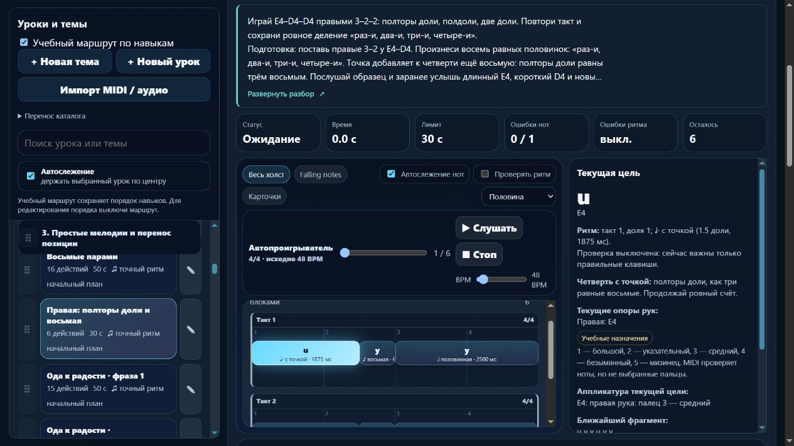
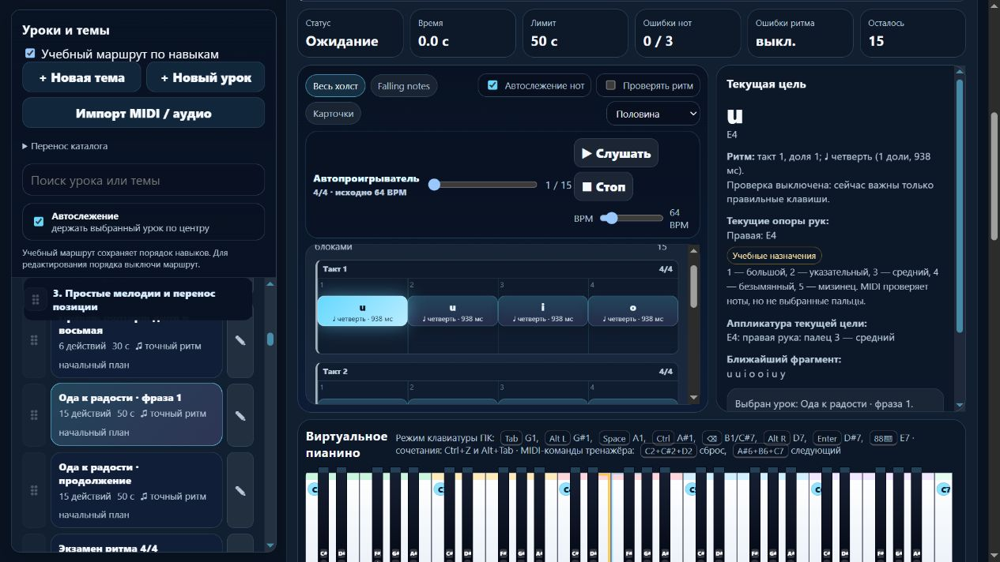

# Пианино / MelodiaJest — 6 ноября 2026, партия 01

Добавлена отдельная подготовка к четверти с точкой и исправлены **две существующие фразы** «Оды к радости». Это одна новая учебная задача и две редакции прежних записей. Локальная веб-сборка — **23.5.6**. Сигнал получен 5 ноября в 18:52 UTC; завершение — уже 6 ноября по Asia/Yekaterinburg. [Машинные доказательства](piano-curriculum-2026-11-06-01-verification.json).

## Подтверждённая проблема и источник

В `course09-01` и `course09-02` последний такт был записан как две четверти и половинная. В проверенной нотной версии — **четверть с точкой, восьмая и половинная**, то есть 1,5 + 0,5 + 2 доли. В прежнем учебном каталоге не было отдельного упражнения с точной длительностью 1,5 доли, которое готовило бы это движение.

Прочитаны сама отрисованная страница PDF и исходный блок `sop` в LilyPond: [Ode to Joy, Mutopia-2009/08/05-528, PDF](https://www.mutopiaproject.org/ftp/BeethovenLv/ode/ode-a4.pdf), [каталог издания](https://www.mutopiaproject.org/cgibin/piece-info.cgi?id=528), [исходник](https://www.mutopiaproject.org/ftp/BeethovenLv/ode/ode.ly). Место — страница 1, верхний голос soprano, такты **1–4** и **5–8**. В источнике соль мажор, 4/4, четверть = 100. Набор — Peter Chubb; PDF и каталог помечены Public Domain.

Это гимновая четырёхголосная редакция с пометой `Source: Various`, не автограф и не критическое издание симфонии. Каталожная дата `c. 1800` не использована как историческое доказательство. Мелодия приписана Бетховену, нотный набор — Chubb, учебная адаптация и пальцы — проекту. Исторические сведения об исполнителях или методике здесь не добавлялись.

Оригинальные PDF и LilyPond сохранены в `docs/sources`; SHA-256 и независимо записанные высоты/длительности восьми тактов — в [проверке источника](../sources/mutopia-528-ode-source.json). Эти файлы не входят в публичную браузерную сборку.

Правило точки проверено по [The Open University / OpenLearn, §3.5, абзац перед Example 18 и сам пример](https://www.open.edu/openlearn/history-the-arts/music/an-introduction-music-theory/content-section-3.5): точка добавляет половину исходной длительности, четверть с точкой равна трём восьмым. Автор источника не утверждал наши ноты, пальцы, BPM или допуски.

## Новый урок и исправленные редакции

| ID | Задача и данные | Подготовка |
| --- | --- | --- |
| `detail-p-dotted-quarter-01` | E4–D4–D4 правыми 3–2–2, два такта 4/4. Длительности 1,5–0,5–2, 48 BPM, конец через 8 долей. | `course04-06`, `course04-02`, `course02-02` |
| `course09-01` | Включить пунктирное окончание E4–D4–D4 / 3–2–2 в четырёхтактную мелодию с повторными нажатиями. | Новая подготовка, `course02-05` |
| `course09-02` | Сравнить окончание D4–C4–C4 / 2–1–1 с первой фразой и заранее услышать возвращение к C4. | `course09-01`, `course02-01` |

Подготовка — техническое упражнение проекта. Счёт: E4 на «раз», D4 на «два-и», новое D4 на «три» с удержанием через «четыре-и». Первая нота занимает три восьмых, вторая одну, последняя четыре. Повтор D4 требует освобождения клавиши и нового нажатия. Даны медленный разбор, слуховой ориентир, типичные ошибки, короткий блок практики, возвращение после перерыва и перенос E4–F4–F4 / 3–4–4. Следующий общий шаг — `course04-08`; конкретная пьеса не стала обязательной подготовкой общего ритмического навыка.

Две музыкальные фразы маркированы **учебной адаптацией**. Из верхнего голоса Mutopia взята одна мелодическая линия; остальные три голоса исключены. Соль мажор перенесён вниз на чистую квинту в до мажор: исходное B4 стало E4. Сохранены все 15 высот каждой прежней записи, правая рука, пальцы 1–5, 64 BPM и длина 16 долей. Пальцы и темп являются решениями проекта, а не авторской фортепианной аппликатурой Бетховена.

В последнем такте каждой фразы предыдущая нота теперь длится 1,5 доли, короткая — 0,5; её начало сдвинуто с 13 на 13,5. Последняя половинная начинается на 14 и заканчивается на 16. Внутренних пауз нет. Перенос в другое окончание проверяется самостоятельно; знакомая тема не является независимым автоматическим тестом слуха. Полное разучивание произведения остаётся отдельной функцией.

## Исполняемый код и сохранность

Три записи используют ограниченный контракт `beat-boundary-v1`, без изменения общего алгоритма оценки. На исходном ритме воспроизведено принятие последнего отпускания на 0,45 доли раньше/позже; тот же старый ритм с ограниченным контрактом отклоняет ошибку. Исправленные записи также отклоняют прежнее ровное окончание и пропущенное повторное нажатие. Последнее отпускание обязательно; последующая конечная пауза не заявлена измеренной.

Миграция двух фраз охраняется исходными отпечатками `faad0894` / `a5ad95ac`. Сохранены прежний ритм, инструкции и отпечаток музыкальной версии. Личные изменения текста, требований, ритма, пальцев и классификации не переписываются; повторное применение ничего не меняет. Проверены JSON-перенос и история: старый результат памяти не становится зачётом новой редакции.

| Запись | Предыдущая музыкальная версия | Новая |
| --- | --- | --- |
| Новая подготовка | — | `056a6598` |
| `course09-01` | `369f6696` | `1178a033` |
| `course09-02` | `5fa19fc9` | `3faeba1e` |

Остальные **563 прежние записи** не изменили музыку или инструкции. Порядок всех 565 прежних записей и классификация сохранены. Гитарный маршрут совпал по SHA-256; `guitarjest` не изменялся. Не менялись исходный `lesson-review-baseline.js`, MIDI-настройки, общий `lesson-development.js`, алгоритм аппликатуры и общий модуль оценки. `trainer-content.json` отсутствовал и не создавался.

## Удобство и проверка

Текущая четверть с точкой получила короткую подсказку «полторы доли, как три равные восьмые». Функция выделена в `PianoLearningUI` с `.d.ts`; название применяется только при четвертной единице пульса. В памяти подсказка отсутствует в DOM, включая сохранённый развёрнутый режим. Для построения точного учебного ритма выделена общая чистая граница `rhythmFromDurations`; исполнения алгоритма для тестов не дублировались. Новых зависимостей нет, запуск без установки пакетов сохранён.

**284/284 теста прошли**, включая шесть новых содержательных проверок источника/нот, подготовки, старой ошибки, настоящего MIDI-пути приложения, миграции/истории и подсказки. Итоговый запуск — 132,92 с. Первый общий запуск обнаружил несовместимость четырёх новых шагов разбора с существующим контрактом из трёх: текст объединён без удаления источника или практики, после этого общий набор пройден полностью.

`audit:lessons`, `audit:fingering`, `audit:curriculum`, `audit:piano-coverage` прошли. Жёстких ошибок нет; начальные 80 уроков / 1036 назначений — без структурных замечаний. Прежние ограничения всего корпуса не скрыты: неподдерживаемые случаи, удержанные голоса, охваты и детектор полифонии остаются в отчётах.

В изолированном браузере `127.0.0.1:4181` проверены все три карточки, точные ссылки на издание и такты, Enter/пробел, переход к подготовке с фокусом на заголовке, сохранение скрытого вида после перезагрузки и его восстановление. Пять строк — 112 px при строке 22,4 px. На ширине 390 px клиент/прокрутка — 376/376 px. В памяти отсутствуют материалы, новая подсказка, каталог, клавиши и метки октав. Ошибок приложения в консоли нет. Скриншоты пересняты и просмотрены отдельно после отрисовки. Собственные вкладки и сервер закрыты, временная ширина сброшена. Физический MIDI и звук не включались.

Все 18 разрешённых публичных файлов совпадают по размеру и SHA-256 с манифестом и актуальными исходниками / создаваемым web-runtime. Публикация, commit/push, покупка домена и DNS не выполнялись. Это локальная браузерная сборка, не завершённый перенос всего приложения в React/Next.js.

## Счёт и точное продолжение

Реализовано **418 учебных записей**, из них **154** с MIDI-контрактом; подробное происхождение и направление — у **56**. Будущих конкретных планов — **3**, предварительная ёмкость — 1310 мест. Одна явная связь повторения даёт только верхнюю границу **417 групп целей**, а не проверенное количество самостоятельных уроков. Минимум 1000 не достигнут. Независимой редакции преподавателем и физической проверки игры по-прежнему нет.

Следующая задача — **`course09-07` «Из памяти: Ода к радости»**. Во время браузерного просмотра найдена и затем проверена в данных старая объединённая запись: те же 30 нот по одной четверти, то есть 30 долей звучания. Уточнение следующей партии: на стыке есть ещё однодольная пауза, поэтому общий отрезок составляет 31 долю. По проверенным тактам 1–8 нужны два пунктирных окончания и 32 доли. Проверить её музыкальную версию и роль в счёте: режим памяти сам по себе не создаёт нового урока. Эта запись ещё не исправлена и не названа проверенной.

После неё — источник и подготовка A4 / смены позиции в `course09-03` (Twinkle). Остаются шесть кандидатов с прежними допусками длинных нот; объединённая «Ода» требует отдельной проверки даже без длинных длительностей. Ранние цепочки между руками, конечная пауза, удержанные голоса, педаль и полная дедупликация целей остаются отдельными задачами.

Последняя штатная квота: **65% остатка** общей недельной квоты, ordinary usage разрешён, spend control не достигнут. Действует новое указание пользователя `until-exhausted`: резерв и порог — 0%, прежние 25%/30% не ограничивают продолжение. Это расход аккаунта, не данной задачи; аппаратное отсечение на 0% не обещается. Период сигнала — 20 минут без ограничения длительности этапа.
