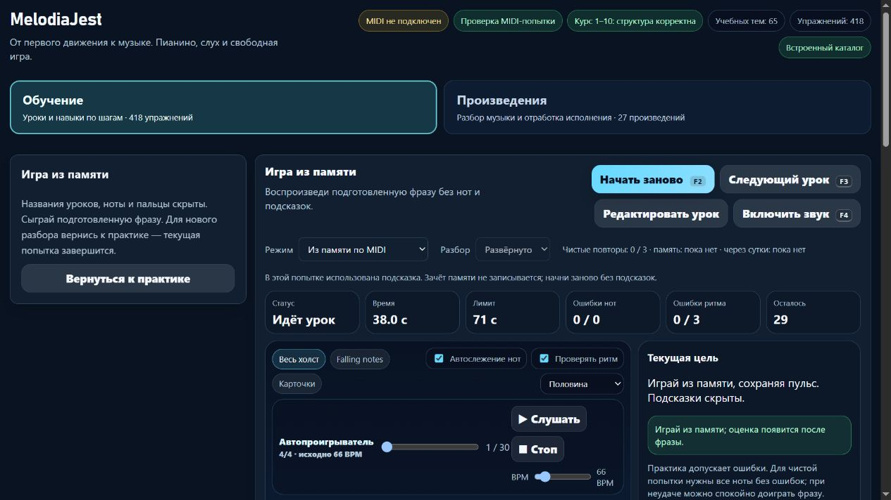
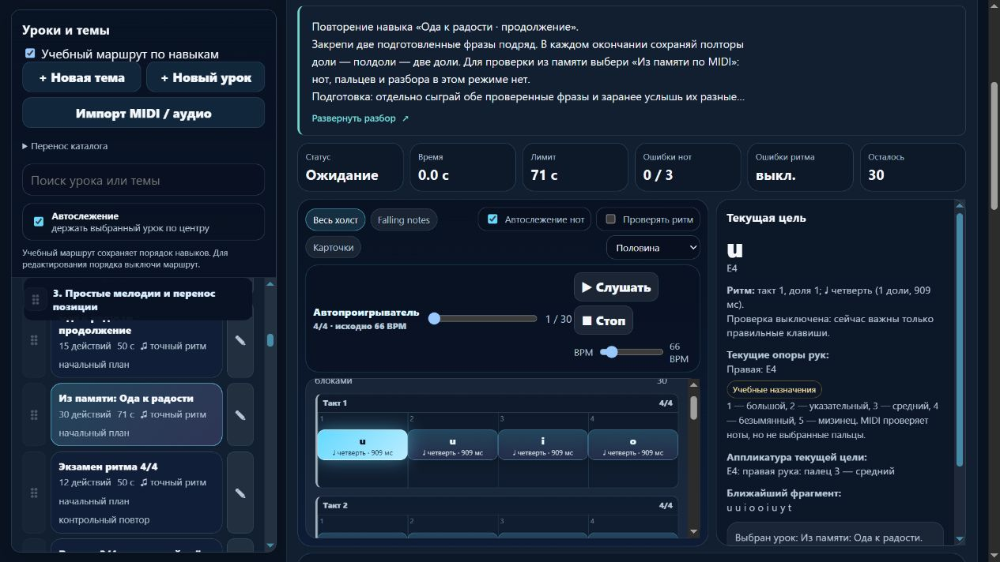

# Пианино / MelodiaJest — 6 ноября 2026, партия 02

Исправлена существующая запись `course09-07` «Из памяти: Ода к радости» и добавлен немедленный статус использованной подсказки в памяти. Локальная версия — **23.5.7**. Новых самостоятельных уроков — **0**, исправленных записей — **1**. [Машинные доказательства](piano-curriculum-2026-11-06-02-verification.json).

## Музыка и роль записи

По замороженной исходной редакции уточнено: 30 четвертей — это **30 долей звучания**, но между фразами была ещё доля паузы. Общая длина составляла **31 долю**. В отчёте предыдущей партии сумма звучания была ошибочно названа полной длиной. Текст и поля того отчёта уточнены со ссылкой на эту проверку; исходная редакция сохранена в `tests/fixtures/piano-ode-memory-v1.json`.

Теперь две подготовленные фразы занимают **32 доли, восемь полных тактов 4/4**. Окончания тактов 4 и 8 — 1,5 + 0,5 + 2 доли. Последняя D4 первой фразы длится до доли 16, где начинается E4 второй; добавленной паузы нет. Последний C4 заканчивается на доле 32, его отпускание обязательно.

Сохранены все 30 высот, назначение правой руки, пальцы 1–5, 66 BPM, ID, классификация и порядок каталога. Изменены только точный ритм и объяснения этой записи. Аппликатура проверена по данным; её удобство для конкретного исполнителя MIDI не подтверждает.

Подготовка — `course09-01` и `course09-02`, размещение после второй фразы. `learning.sameGoalAs: "course09-02"` обозначает закрепление уже разобранных окончаний. Более длинная последовательность, иной BPM или режим памяти не увеличивают количество самостоятельных целей. Сохранены отдельные ID и результаты записей.

Разбор объясняет, что играть, счёт «раз-и, два-и», оба окончания, стык фраз, новые нажатия повторных нот, слуховое представление и самопроверку. Даны короткая практика, повтор после перерыва и проба с началом сразу со второй фразы. Известная мелодия не объявлена независимым тестом слуха. Полная музыка остаётся отдельной функцией «Произведения».

## Источники и границы адаптации

Использованы уже проверенные [PDF Mutopia](https://www.mutopiaproject.org/ftp/BeethovenLv/ode/ode-a4.pdf) и [LilyPond-исходник](https://www.mutopiaproject.org/ftp/BeethovenLv/ode/ode.ly), издание **Mutopia-2009/08/05-528**, страница 1, soprano, такты **1–8**. Сохранённые локальные копии снова совпали по SHA-256. [Каталог издания](https://www.mutopiaproject.org/cgibin/piece-info.cgi?id=528) открыт заново. Проверка нотной страницы и исходного голоса выполнена в предыдущей партии; весь нотный аудит не повторялся.

Мелодия — Людвиг ван Бетховен, нотный набор — Peter Chubb. Это гимновая редакция с `Source: Various`, не автограф или критическое издание симфонии. Из неё взята одна мелодия и перенесена из G major в C major вниз на семь полутонов; остальные голоса исключены. Правые пальцы и 66 BPM вместо исходной четверти = 100 выбраны проектом. Набор помечен Public Domain. Историческая датировка `c. 1800` и рассказы об исполнителях не используются.

Снова прочитаны [Bob Duke и Amy Simmons, Tips for Effective Practice](https://cml.music.utexas.edu/online-resources/intelligent-music-practice/10-tips-for-effective-practice), разделы о закреплении изменений и распределении практики: изменение точки начала и возвращение к материалу в разных занятиях. Наши короткие блоки, точный критерий отсроченного повтора и машинный зачёт не приписаны авторам. Правило точки повторно использовано из проверенного OpenLearn §3.5. Журнал источников дополнен применением к `course09-07`.

## Память и обратная связь

Прежнее указание оставить текущий палец заменено ясным различием: режим без взгляда на руки — вспомогательная практика, а **«Из памяти по MIDI»** скрывает ноты, пальцы и учебный разбор. Прослушивание после начала или открытие редактора уже делало попытку неподдерживаемой для зачёта; этот запрет не ослаблялся.

Теперь причина сразу показана рядом с режимом: «В этой попытке использована подсказка. Зачёт памяти не записывается; начни заново без подсказок». Статус имеет `role="status"` и `aria-live="polite"`. Перезапуск очищает его, успешные прежние попытки не удаляются. Чистый просмотр образца до первой ноты не считается подсказкой внутри исполнения; первое игровое нажатие останавливает демонстрацию.

Представление текста выделено в `PianoLearningUI.memoryAssistanceText` с `.d.ts`. Обновление при воспроизведении использует настоящий `renderPlaybackOnly`. Исполняемый код оценки и алгоритм аппликатуры не менялись. В тестовом адаптере разрешены управляемые DOM-узлы и подмена внешнего аудио/отрисовки; функции старта/остановки демонстрации, MIDI-события и оценка выполняются настоящие.

## Проверки и сохранность

**290/290 автотестов**, шесть новых содержательных проверок; полный запуск — 117,77 с. Проверены независимые высоты soprano, оба пунктирных окончания, нулевая пауза на стыке и конец на 32. Старое неверное исполнение принимается старым контрактом и отвергается новым. Изолированно воспроизведены раннее/позднее последнее отпускание на 0,27 доли; ограниченный контракт отвергает те же события даже на прежнем ритме.

Проверены правильная MIDI-попытка, пропущенный повтор, сокращённое первое окончание, старая редакция и преждевременное/позднее отпускание. Прослушивание после первого MIDI-нажатия немедленно меняет статус и не даёт зачёта памяти; свежая попытка с образцом до первой ноты проходит. Аудио в этом тесте подменено, физический инструмент не использовался.

Миграция применяется только при исходном отпечатке `e23c0520`. Прежние ритм и инструкция сохранены, повторное применение ничего не меняет. Личные изменения, JSON-перенос и память старой версии защищены. Музыкальная версия `1a3225a8` → **`a124d1c9`** требует нового зачёта; прежний результат остаётся в истории.

`audit:lessons`, `audit:fingering`, `audit:curriculum`, `audit:piano-coverage` прошли; жёстких ошибок нет. Начальные 80 уроков / 1036 назначений — без структурных замечаний. Прежние неподдерживаемые охваты, удержанные голоса и ограничения детектора не объявлены исправленными.

В изолированном браузере `127.0.0.1:4182` проверены карточка закрепления, такты/источник, переход к основному разбору с фокусом, раскрытие клавиатурой, сохранение скрытого вида и его восстановление. На 390 px ширина клиента/прокрутки — 376/376 px; превью 112 px при строке 22,4 px даёт пять строк. До явного просмотра подсказки в памяти отсутствуют материалы, каталог, клавиши и метки октав. После первой ручной клавиши открытие редактора показало статус; редактор закрыт без сохранения, сброс очистил статус. Звук и физический MIDI в браузере не включались. Ошибок консоли нет; собственные вкладка и preview закрыты, ширина сброшена.

Остальные **565 записей** сохранили музыку и инструкции; классификация и порядок всех 566 записей не изменились. Хеши `lesson-review-baseline.js`, MIDI-настроек, общего `lesson-development.js`, оценки и аппликатуры совпали. Гитарный маршрут совпал по SHA-256, `guitarjest` не изменялся. `trainer-content.json` отсутствовал и не создавался. Все 18 публичных файлов совпали с манифестом и актуальными исходниками. Commit/push, покупка домена и публикация не выполнялись.

## Счёт и продолжение

В каталоге **418 учебных записей**, **154 MIDI-контракта**, **57** подробных описаний и **3** конкретных будущих плана. Два явных повторения дают верхнюю границу **416 групп целей**; это не подтверждённое количество самостоятельных уроков. Независимой педагогической экспертизы нет, минимум 1000 не достигнут.

Следующая малая партия — `course09-03` (Twinkle): проверенное издание, диапазон C4–A4, текущие пальцы 1–4–5 и переход G4→F4 одним пальцем 4. Сверить подготовку и смену позиции; при подтверждённом пробеле добавить короткую подготовку без силового растяжения. Затем шесть оставшихся кандидатов с прежними допусками длинных нот, ранние требования между руками, совпадение целей целой ноты, конечная пауза, удержанные голоса и педаль.

Последняя общая квота — **65% остатка**, ordinary usage разрешён, spend control не достигнут. Политика `until-exhausted`, резерв/порог — 0%; расход не приписывается индивидуально этой задаче, аппаратное отсечение на 0% не обещается. Расписание — каждые 20 минут без ограничения длительности этапа. Рабочий локальный запуск сохранён; перенос всего продукта в React/Next.js и облачный релиз не объявлены готовыми.
