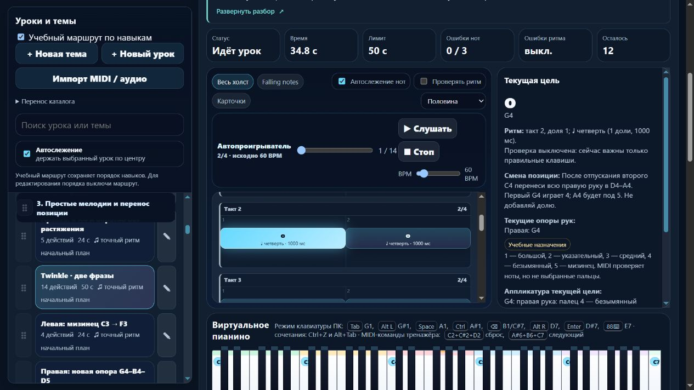

# Пианино: две позиции, подготовка Twinkle и точный источник

Партия **2026-11-06-03**, MelodiaJest **23.5.8**. Добавлен **один** короткий урок, пересмотрен **один** существующий. В текущей цели появилась короткая подсказка переноса руки. Это локальный проверенный этап; домен не куплен, публикация не выполнялась.

Пробуждение: 5 ноября, 19:46:33 UTC; дата отчёта — 6 ноября по Asia/Yekaterinburg. Длительность этапа не ограничивалась двадцатью минутами. [Машинные доказательства](piano-curriculum-2026-11-06-03-verification.json).

## Найденный пробел и нотный источник

В `course09-03` уже было указание отпустить длинный G4 перед возвратом к F4 тем же пальцем 4. Ошибку этой подсказки или самой последовательности пальцев не утверждаем. Не хватало явной подготовки и описания первого перехода C4/1 → G4/4: следующий A4/5 нельзя объяснять требованием удержать всю руку растянутой от C до A.

Прочитана отрисованная первая страница **Mozarts Werke, Serie XXI, No.6, Breitkopf & Härtel, Leipzig, 1878, plate W.A.M.265**, печатная страница **2 (36)**, **Tema, правая мелодия, такты 1–8**. [Историческая партитура](https://s9.imslp.org/files/imglnks/usimg/7/70/IMSLP24784-PMLP55775-Mozart_12_Variations_K.265.pdf), [локальный оригинал](../sources/mozart-k265-bh-1878.pdf), [независимая запись сверки](../sources/mozart-k265-theme-source.json). SHA-256 PDF: `6ac3e5e1b81106773b8bc429ce10c8a8ace1ea2983a5fdb3e082a815df38d305`.

Источник записан в **2/4**, C major, регистр **C5–A5**. В такте 4 стоят **два четвертных G5**; в такте 7 — **D5 четверть, D5 восьмая с точкой, E5 шестнадцатая**; в такте 8 — половинная C5. Эти детали прочитаны по нотам, а не восстановлены по памяти знакомой песни. Пальцев в выбранных тактах нет.

Существующий урок сохранён как **учебная адаптация**: вниз на октаву; без левой партии и репризы; в такте 4 два G заменены одной половинной, в такте 7 исключён E и вторая D продлена до четверти. Учебные 60 BPM и пальцы — решения проекта. Заголовок источника связывает вариации Моцарта с французской песенной темой; авторство самой мелодии Моцарту не приписано. Биографические выводы и рассказы о знаменитых учениках не добавлялись.

Заново прочитан [Jerry Kovarsky, The Basics Of Piano Keyboard Fingering](https://hub.yamaha.com/keyboards/k-how-to/the-basics-of-piano-keyboard-fingering/), вводный абзац, The Basics и Scenario Three: заранее планировать пальцы и смену положения при выходе за одну позицию; возможны разные решения. Сложные растяжения из других примеров статьи не превращены в требования для начинающего. Источник подтверждает принцип планирования, а не наши конкретные ноты, пальцы и урок.

## Реализованные задания

**`detail-p-position-return-01` — «Правая: к A4 и обратно без растяжения».** Техническое упражнение проекта. Самостоятельная цель — после отпускания перемещать всю руку между C4–G4 и D4–A4, затем вернуться с повторным использованием пальца 4 на другой клавише. Это отличается от прежнего переноса 1→1 и пары 4–5 в одной позиции.

| Действие | Нота / правый палец | Начало в долях | Длительность | Пауза перед ним |
| --- | --- | ---: | ---: | ---: |
| 1 | C4 / 1 | 0 | 1 | 0 |
| 2 | G4 / 4 | 2 | 1 | 1 |
| 3 | A4 / 5 | 3 | 1 | 0 |
| 4 | G4 / 4 | 4 | 1 | 0 |
| 5 | F4 / 4 | 6 | 2 | 1 |

Четыре такта 2/4, **48 BPM**, конец через восемь долей, конечной паузы нет. После C4 вся рука перемещается в D4–A4; после последнего G4 возвращается в C4–G4. В паузах не удерживаются прежние клавиши. Подготовка по ID: `detail-p-relocate-01`, `detail-p-legato-pairs-02`, `course04-02`. Следующий шаг — применение в Twinkle; конкретная мелодия не обязательна для общего навыка переноса.

**`course09-03` — «Twinkle · две фразы».** Все **14 высот**, правая рука, пальцы **1–1–4–4–5–5–4–4–4–3–3–2–2–1**, абсолютные начала, длительности, отсутствие счётных пауз и **60 BPM** сохранены. Размер уточнён как восемь тактов 2/4. Перед первым G4 готовится D4–A4, перед первым F4 — возврат C4–G4 после отпускания длинного G4. Дополнительный счёт для перемещения не добавляется; соединение G4→F4 одним удержанным пальцем не требуется.

Оба разбора объясняют движение, его применение, подготовку, счёт и слуховой образ; содержат ошибки, короткий блок около 3–5 минут, самостоятельную пробу с новым началом/рисунком и возвращение после перерыва. Допуски, проверочные варианты и темпы не приписаны авторам источников.

## Улучшение системы и проверки

`learning.positionCues` хранит явное редакторское объяснение для конкретного действия. Чистая функция `PianoLearningUI.positionChangeHtml` с `.d.ts` экранирует текст, не переносит его на соседние действия и учитывает отключённые пальцы. Она не рассчитывает и не оценивает положение руки. В памяти функция текущей цели возвращается до построения любых подсказок. Вид разбора и поясняющий текст не меняют музыкальный отпечаток.

**296/296 автотестов**, шесть новых проверок; итоговый полный запуск — **113,54 с**. Проверены источник и список адаптаций, правая рука, пальцы, обе внутренние паузы, повторные атаки и полные окончания. Исполняемый MIDI-путь принимает правильные события и отвергает пропуск повторной ноты, преждевременное вступление вместо паузы, раннее/позднее последнее отпускание. Прежний контракт допускает смещение окончания на 0,27 доли, новый ограниченный контракт — отвергает. У Twinkle применён `beat-boundary-v1`; общий код оценки и алгоритм аппликатуры не менялись.

Исходный отпечаток инструкции для защищённой миграции — `0f337016`; музыкальная версия **`129f9be4` → `5300600e`**. Прежние ритм, инструкция и результаты сохранены; новый зачёт требует новой попытки. Личные изменения заголовка, текста, подготовки, ритма, пальцев и назначения `piece` не переписываются. Проверены повторное применение миграции, JSON-перенос редакций и независимость истории старой версии. Отпечаток нового упражнения — `ab902fd5`.

`audit:lessons`, `audit:fingering`, `audit:curriculum`, `audit:piano-coverage` прошли; жёстких ошибок нет. Начальные 80 уроков / 1036 назначений — без структурных замечаний. Первый полный запуск выявил срабатывание существующей проверки на отрицательную формулировку «без неподвижного растяжения». Текст заменён прямым указанием свободно перемещать руку; аудиты и полный набор повторно прошли. Не ослаблялись ограничения ради зелёной проверки.

В изолированном браузере **127.0.0.1:4183** проверены обе подсказки, раскрытие Enter и пробелом, нотный источник и адаптации, именованный переход к подготовке с фокусом на заголовке, «Следующий урок» обратно к Twinkle, сохранение скрытого вида после перезагрузки и доступность его переключателя. В памяти отсутствуют разбор, подсказки позиции, подготовка, клавиши и подписи октав, в том числе при сохранённом полном виде.

На ширине 390 px клиент/прокрутка — **376/376 px**; высота превью **112 px**, строка **22,4 px**: пять строк. Узкий путь проверен геометрией DOM и действиями клавиатуры; снимок узкого экрана не удалось получить. Снимок настольной подсказки ниже просмотрен. Ошибок консоли нет. Собственная вкладка и preview закрыты, ширина восстановлена; пользовательские вкладки не закрывались. Звук, микрофон и физический MIDI не включались.

Остальные **565** записей сохранили музыку и инструкции; прежний относительный порядок сохранён. Назначение Twinkle явно записано как `exercise`, что совпадает с прежней неявной учебной классификацией; пользовательское `piece` защищено миграцией. Контрольные хеши исходного `lesson-review-baseline.js`, MIDI-настроек, общего `lesson-development.js`, оценки и аппликатуры совпали. Гитарный маршрут совпал по SHA-256; `guitarjest` не изменялся. `trainer-content.json` отсутствовал и не создавался.

Веб-выпуск содержит **18 разрешённых публичных файлов** и манифест. Размеры, SHA-256 и соответствие текущим исходникам проверены; локальный сервер, INI, команды Windows, приватный каталог и исследовательский PDF в выпуск не попали. Сохранены запуск без установки зависимостей, браузерный каталог и перенос JSON. Полная миграция на React/Next.js и облачные аккаунты этим не объявлены готовыми.

## Счёт и следующий шаг

Сейчас **419 учебных записей / 155 MIDI-контрактов / 59 подробных описаний / 3 конкретных будущих плана**. Два явных повторения дают верхнюю границу **417 групп целей**, а не проверенное количество самостоятельных уроков. Каркас на 1310 мест не считается 1310 планами. Новая партия добавила одну конкретную учебную задачу; повторные попытки не увеличивают счётчик. Независимой проверки преподавателем и физическим инструментом нет; минимум 1000 ещё не достигнут.

Следующая малая партия — **`course09-04`, Mary Had a Little Lamb**: проверенный нотный источник или честно обозначенный учебный этюд, 26 правых нот, повторные атаки, C4–G4, окончания и текущий отрезок 29 долей при 64 BPM. Нельзя додумывать исходный ритм по знакомому названию. После Twinkle осталось **пять** MIDI-кандидатов с прежними допусками длительностей. Также открыты ранние зависимости между руками, совпадение целей целой ноты, конечная пауза, независимые удержанные голоса, педаль и дальнейшая веб-миграция.

Последняя штатная проверка общей квоты: **64% остатка**, обычное использование разрешено, spend control не достигнут. Действует `until-exhausted`, резерв и порог — **0%**; общий расход не приписывается этой задаче, аппаратное отсечение не обещается. Commit/push, домен, DNS, размещение и публикация не выполнялись.
