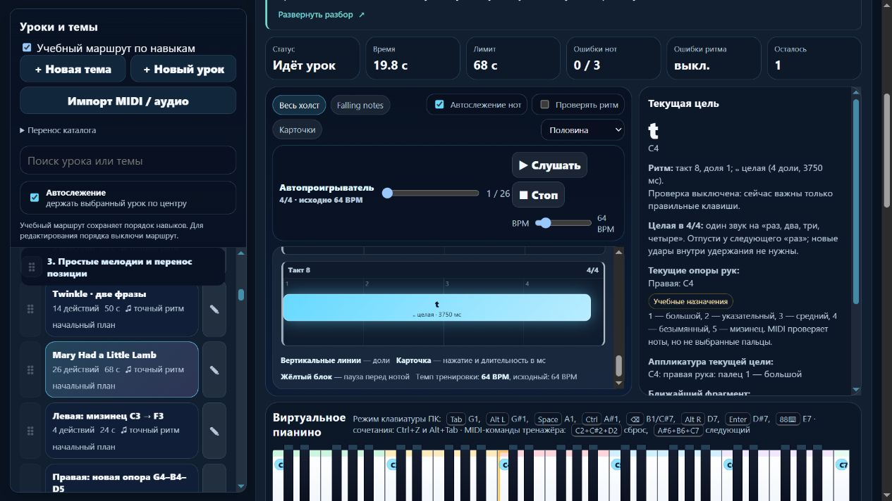

# Пианино: Mary — восемь тактов и длинные окончания

Партия **2026-11-06-04**, MelodiaJest **23.5.9**. Пересмотрен **один** существующий урок, новых уроков и новых самостоятельных целей — **0**. Добавлена короткая подсказка счёта целой ноты. [Проверки и данные](piano-curriculum-2026-11-06-04-verification.json).

Пробуждение: 5 ноября, 20:18:34 UTC; дата отчёта — 6 ноября по Asia/Yekaterinburg. Работа шла в текущем checkout; двадцать минут не использовались как срок остановки этапа.

## Источник и границы атрибуции

Для `course09-04`, **Mary Had a Little Lamb**, прочитан отрисованный одностраничный PDF: **Wikimedia Commons, загрузка Ferbr1 от 13 марта 2012, партия Soprano, страница 1, такты 1–8**. [Нотная запись](https://upload.wikimedia.org/wikipedia/commons/3/37/Mary_Had_a_Little_Lamb.pdf), [описание файла](https://commons.wikimedia.org/wiki/File:Mary_Had_a_Little_Lamb.pdf), [локальный оригинал](../sources/mary-commons-2012.pdf), [потактовая сверка](../sources/mary-commons-source.json). SHA-256: `5406835e5f39a58772eebbd21852c908780fb26f103f78059c48a2444ca5ed99`.

В источнике G major, 4/4; ниже — его мелодия, перенесённая вниз на чистую квинту в C major для проекта. Ноты проверены отдельно от исполняемого каталога. Числового темпа в источнике нет; **64 BPM**, правая рука и пальцы выбраны проектом.

| Такт | Учебные высоты | Длительности в четвертных долях |
| --- | --- | --- |
| 1 | E4 D4 C4 D4 | 1–1–1–1 |
| 2 | E4 E4 E4 | 1–1–2 |
| 3 | D4 D4 D4 | 1–1–2 |
| 4 | E4 G4 G4 | 1–1–2 |
| 5 | E4 D4 C4 D4 | 1–1–1–1 |
| 6 | E4 E4 E4 E4 | 1–1–1–1 |
| 7 | D4 D4 E4 D4 | 1–1–1–1 |
| 8 | C4 | 4 |

PDF печатает имена Lowell Mason и Sarah Josepha Hale. Это не принято как доказательство исторического авторства именно данной мелодии. Сопоставлены нотные страницы **Mary’s Lamb, Juvenile Lyre, 1831, с.61** и **Our Old Nursery Rhymes, гармонизация Alfred Moffat, Augener, 1911, с.7**; у них другое начало с повторённой высотой. Издание Moffat также сверено с MusicXML-транскрипцией Linda Cantoni и титулом, где Moffat назван гармонизатором. [Репродукция страницы 1831 года](https://commons.wikimedia.org/wiki/File:Mary%27s_Lamb_music.jpg), [сборник Moffat](https://www.gutenberg.org/files/61009/61009-h/61009-h.htm). Эти версии не использованы как нотная основа текущего упражнения.

В уроке честно указано: **исторический автор мелодии в этой проверке не установлен**. Ferbr1 назван загрузившим файл; ему не приписано создание мелодии или нотного набора. Выводов о первом издании, знаменитых учениках и рекомендациях метода нет. Материал маркирован **учебной адаптацией**, без слов и исходной гравировки в веб-выпуске. Файл и Commons заявляют PD (old) / public domain в США; универсальная правовая атрибуция не выдумывалась.

## Подтверждённое исправление

Раньше фраза занимала **29 долей**. В событиях **10 и 13** не хватало половинных окончаний; события **14 и 21** были ошибочно удлинены до двух долей. Последний C4 длился одну долю вместо четырёх. Теперь половинные находятся в событиях **7, 10, 13**, окончание — целая нота; восемь тактов занимают **32 доли**. Начало последнего C4 на доле 28 сохранено.

Все **26 высот**, исходные пальцы, правая рука, позиция **C4–G4**, ID и 64 BPM сохранены. Новых счётных пауз нет. Объяснение различает три повторённых E с длинным третьим звуком и четыре равные E в такте 6. У каждого повтора новая атака; целая нота удерживается через «раз, два, три, четыре» до следующего мысленного «раз».

Подготовка по ID: `course04-03`, `course02-02`, `detail-p-position-skips-02`, `course05-06`. Название знакомой песни не заменяет эту подготовку и не становится условием общего ритмического навыка. Урок остаётся в теме мелодий после Twinkle; следующее действие ведёт к `course09-05`, а не возвращает в цикл. Для следующей левой мелодии нужна её собственная подготовка.

Сохранены подробные инструкции: зачем движение, где применяется, слуховой образ, медленный разбор по тактам, счёт, пальцы, ошибки, блок около 3–5 минут, изменённый короткий рисунок и повтор после перерыва. Новая проба переноса и повторные попытки не увеличивают число уроков.

## Улучшение интерфейса

Чистая `PianoLearningUI.wholeNoteHtml` с `.d.ts` показывает рядом с текущей целью: **один звук на четыре доли, отпускание у следующего «раз», без новых ударов внутри удержания**. Подсказка применяется только к четырём четвертным долям в **4/4**; другие размеры, длительности и некорректные значения её не получают. Тот же текст помогает в уже существующем подготовительном уроке целой ноты.

Подсказка отсутствует в DOM памяти независимо от настройки полного разбора. Вид описания не меняет музыкальную версию или прогресс. Полный текст сохранён; обычное превью остаётся пятистрочным. Новые библиотеки и зависимости не устанавливались, общий гитарный модуль не менялся.

## Проверки и сохранность

**302/302 автотеста**, шесть новых содержательных проверок; полный запуск — **120,57 с**. Проверены потактовые высоты и длительности из независимой записи источника, конец через 32 доли, повторные атаки, раннее/позднее отпускание, пропущенный повтор, сокращённое окончание и старый 29-дольный вариант. Исполняемый MIDI-путь заканчивает чистую попытку только после полного последнего отпускания. Звуковой образец получает для последнего C4 **3750 мс**, а не прежнюю четверть.

Воспроизведено принятие смещения последнего отпускания на 0,27 доли старым контрактом и его отклонение новым. Для урока включён ограниченный `beat-boundary-v1`; общий код оценки не менялся. Миграция защищена исходным отпечатком инструкции **`6f40a2bc`**. Музыкальная версия **`ccd2659e` → `8067d11c`** требует нового зачёта; старая память остаётся в истории. Проверены идемпотентность, JSON-перенос и сохранение личных изменений текста, нотного времени, пальцев, подготовки и классификации.

`audit:lessons`, `audit:fingering`, `audit:curriculum`, `audit:piano-coverage` прошли; жёстких ошибок нет. Начальные 80 уроков / 1036 назначений — без структурных замечаний. Не объявлены устранёнными прежние ограничения охвата, удержанных голосов и детектора. Автотесты не подтверждают физические пальцы, комфорт и художественное качество; независимой редакторской проверки преподавателем нет.

В изолированном браузере **127.0.0.1:4184** проверены источник и такты, подсказка последнего C4, переход к целой ноте с фокусом на заголовке, раскрытие Enter/пробелом, сохранение скрытого вида после перезагрузки и восстановление через доступный переключатель. В памяти отсутствуют разбор, учебный счёт, подготовка, клавиши и подписи октав даже при сохранённом полном виде. На ширине 390 px клиент/прокрутка — **376/376 px**; превью **112 px** при строке **22,4 px**, пять строк. Узкая проверка выполнена геометрией DOM и действиями клавиатуры; настольный снимок просмотрен. Ошибок консоли нет. Звук и физический MIDI в браузере не включались; собственные вкладка и preview закрыты, ширина восстановлена.

Остальные **566 записей** сохранили музыку и инструкции, порядок всех 567 записей совпал. У целевого урока неявное учебное назначение записано явно как `exercise`; пользовательское `piece` защищено. Хеши `lesson-review-baseline.js`, MIDI-настроек, общего `lesson-development.js`, оценки и аппликатуры совпали; гитарный маршрут не изменился. `trainer-content.json` отсутствовал и не создавался. Все 18 разрешённых публичных файлов сверены с манифестом и текущими исходниками; сервер, личный каталог, INI, команды Windows и исследовательские источники в выпуск не вошли.

## Счёт и продолжение

**419 учебных записей / 155 MIDI-контрактов / 60 подробных описаний / 3 будущих плана**. Два явных повторения дают верхнюю границу **417 групп**, а не проверенный итог самостоятельных целей. Каркас на 1310 мест не считается готовыми уроками или отдельными планами. Минимум 1000 ещё не достигнут.

Следующая малая партия — **`course09-06`, «Мелодия с басовыми ответами»**: сверить левый C3/5, правые ответы, текущие 18 долей и отпускание баса перед ответом. Сравнить цель и роль с `course07-06`, не считать ещё одну длину или новую мелодическую последовательность отдельным навыком без обоснования. При необходимости уточнить собственный учебный ритм и явно отделить чередование от удержанного басового голоса. После этой партии остаются **четыре** MIDI-кандидата с прежними допусками: `course09-06`, `course10-04`, `course10-06`, `course10-08`.

Далее открыты ранние зависимости между руками, совпадение целей целой ноты, конечная пауза, независимые голоса, педаль и выделение общего типового музыкального документа перед React/Next.js. Текущий запуск без установки зависимостей сохранён; полная миграция и облачный релиз не объявлены готовыми. Домен не куплен, покупки, DNS, публикация, commit/push не выполнялись. Штатный остаток общей квоты — **64%**, политика `until-exhausted`, резерв/порог **0%**; индивидуальный расход этой задаче не приписывается.
