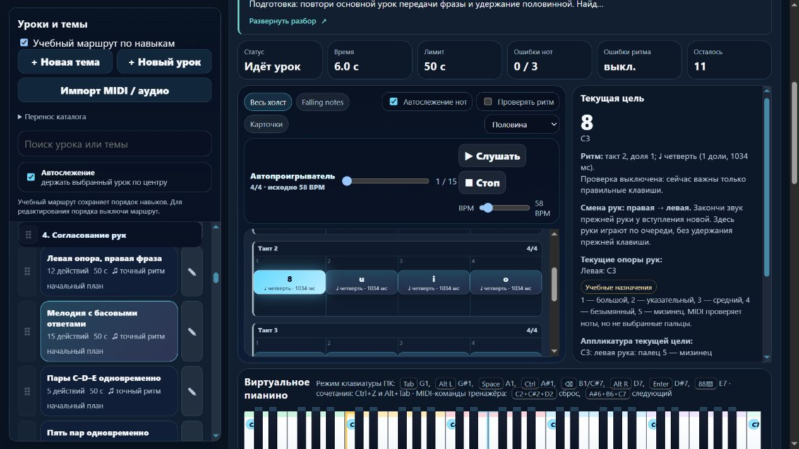

# Пианино: передача фразы с басом как закрепление

Партия **2026-11-06-05**, MelodiaJest **23.5.10**. Пересмотрен **один** существующий урок, новых уроков и новых самостоятельных целей — **0**. Добавлена короткая подсказка передачи между руками. [Машинные доказательства](piano-curriculum-2026-11-06-05-verification.json).

Пробуждение: 5 ноября, 20:40:34 UTC; дата отчёта — 6 ноября по Asia/Yekaterinburg. Текущий checkout сохранён. Интервал двадцать минут не использовался как ограничение длительности этапа.

## Цель и подтверждённый пробел

`course09-06`, **«Мелодия с басовыми ответами»**, использует тот же общий навык, что уже разобранный `course07-06`: левый C3 на одну долю передаёт пульс короткому правому ответу. У основного урока есть и отдельная проба нисходящего ответа. Другая длина и мелодическая последовательность не устанавливают самостоятельную новую цель. Запись сохранена как закрепление через `sameGoalAs: course07-06`; оба ID и их истории остаются отдельными.

В прежних данных были **18 долей**, басы на **0, 5, 10, 15**, а ответы заканчивались длинными звуками, сдвигающими следующий бас относительно 4/4. Инструкция не объясняла эту метрическую задачу. Для регулярной передачи, подготовленной в основном уроке, выбрана явная учебная редакция на **четыре такта 4/4**. Это редакция собственной заготовки проекта; исходная пьеса или авторский ритм не реконструировались. Старый вариант сохранён в метаданных и истории, личные редакции защищены.

## Что теперь играть

Все **15 высот**, назначенные руки и пальцы, **58 BPM** сохранены. Внутренних счётных пауз нет. Басы вступают на **0, 4, 8, 12**; конец — через **16 долей**. Первые 14 событий — четверти, последний C4 — половинная.

| Такт | На «раз» | Правый ответ с «два» | Длительности всего такта |
| --- | --- | --- | --- |
| 1 | C3 левой 5 | C4–D4–E4 правой 1–2–3 | 1–1–1–1 |
| 2 | C3 левой 5 | E4–F4–G4 правой 3–4–5 | 1–1–1–1 |
| 3 | C3 левой 5 | G4–F4–E4 правой 5–4–3 | 1–1–1–1 |
| 4 | C3 левой 5 | D4–C4 правой 2–1 | 1–1–2 |

Левый C3 заканчивается у вступления правой на «два». Правый ответ заканчивается у следующего «раз», когда возвращается бас. Это одна последовательная линия, меняющая руки и регистр. Удержанный бас под мелодией остаётся отдельной темой.

Подготовка: `course07-06` и `course04-02`; маршрут ставит закрепление после основного разбора в **p4**. В раскрытом материале есть именованный переход к основной цели. Он не дублируется ещё одной такой же кнопкой подготовки. Следующий шаг — `course07-03`, подготовленная одновременная игра C–D–E двумя руками.

Описание объясняет смысл передачи, две позиции, счёт и пальцы, медленный разбор каждого такта, слуховой образ, ошибки, блок около 3–5 минут и возвращение после перерыва. Отдельная проба — C3 левой 5, затем F4–E4–D4 правой 4–3–2 по четвертям. Это проверка переноса в новом ответе, а не новая запись каталога или автоматический слуховой тест.

## Прочитанные первоисточники

- **Mark Gotham, Chelsey Hamm, Kris Shaffer**, [Open Music Theory: Simple Meter and Time Signatures](https://viva.pressbooks.pub/openmusictheory/chapter/simple-meter-and-time-signatures/), **Time Signatures / Counting in Simple Meter, Examples 9–10**: четыре четвертные доли и продолжение счёта через длинную ноту.
- **The Open University**, [An introduction to music theory, §3.1 Time values](https://www.open.edu/openlearn/history-the-arts/music/an-introduction-music-theory/content-section-3.1), **Examples 13–14**: соотношение четверти и половинной.
- **Stephen Pierce**, [12 Practice Tips, Suggestions and Strategies](https://hub.yamaha.com/music-educators/prof-dev/teaching-tips/12-practice-tips/), **20 февраля 2022, §7 и §10**: различать короткую практику отдельной руки и привычку всегда учить партии раздельно; возвращать целевой фрагмент в контекст. Сложные растяжения, расширенные прыжки и неудобные транспозиции из других разделов начинающему здесь не назначаются.

Проверенные ранее рекомендации Duke/Simmons по небольшой цели и Dumlavwalla по свободной руке переиспользованы с честной отметкой, что заново в этой партии не читались. Точные ноты, пальцы, отпускание баса через долю, 58 BPM и допуски — решения проекта. Источники урок не утверждали; исторические атрибуции и рассказы об учениках не добавлялись. Журнал содержит **24 источника**, применение и повторные проверки разделов обновлены.

## Улучшение системы

`learning.handoffCueProfile: sequential-release` явно разрешает короткое пояснение на действиях, меняющих руку. Чистая `PianoLearningUI.handHandoffHtml` с `.d.ts` различает **левая → правая** и **правая → левая**. Нужны одиночные явные назначения двух соседних действий; для той же руки, неизвестных данных, другого профиля или скрытых пальцев подсказки нет. Из смены регистра отпускание не выводится: в настоящей полифонии прежний звук может продолжаться.

Пояснение отсутствует в памяти независимо от вида полного разбора. Оно не рассчитывает руки, не проверяет пальцы и само по себе не меняет музыкальный отпечаток. Длинный текст сохранён, обычное превью остаётся пятистрочным. Общий гитарный модуль и движок оценки не менялись; новых зависимостей нет.

## Проверки и сохранность

**308/308 автотестов**, шесть новых содержательных проверок; полный запуск — **137,06 с**. Проверены все высоты и руки, четыре басовых вступления, новые длительности, полное последнее отпускание и явная связь повторения. Старые 18 долей принимаются старым контрактом и отвергаются новой редакцией. Раннее/позднее окончание на 0,27 доли, пропущенный ответ, удержание левого баса под правой и правого звука под следующим басом не дают нового зачёта. Проверки выполняют настоящий MIDI-путь приложения с синтетическими событиями, без физического устройства.

Для урока включён `beat-boundary-v1`. Миграция защищена исходным отпечатком инструкции **`77894628`**; музыкальная версия **`1e8193a7` → `74650f0a`**. Проверены идемпотентность, прежний ритм и инструкция, сохранение личных изменений, JSON-перенос, старый зачёт памяти и отсутствие его наследования новой версией. Основной `course07-06` сохранил музыку **`5c83af1a`**.

`audit:lessons`, `audit:fingering`, `audit:curriculum`, `audit:piano-coverage` прошли без жёстких ошибок. Начальные 80 уроков / 1036 назначений — без структурных замечаний. Старые ограничения охвата, удержанных голосов и детектора не объявлены устранёнными. Автотесты не подтверждают физические пальцы, удобство руки, баланс и художественное качество; независимой проверки преподавателем нет.

В изолированном браузере **127.0.0.1:4185** проверены обе подсказки, ссылка на основной урок с фокусом на заголовке, отсутствие дублирующего перехода, раскрытие Enter/пробелом, скрытый вид после перезагрузки и его доступное восстановление. В памяти отсутствуют разбор, смена рук, ссылка основной цели, клавиши и октавные подписи даже при сохранённом полном виде. На 390 px клиент/прокрутка — **376/376 px**, превью **112 px** при строке **22,4 px**, пять строк. Узкий путь проверен по DOM и клавиатуре; настольный снимок просмотрен. Ошибок консоли нет; собственные вкладка и preview закрыты, ширина восстановлена. Звук и физический MIDI в браузере не включались.

Остальные **566 записей** сохранили музыку и инструкции. Порядок всех 567 записей совпал. Целевое учебное назначение теперь явно `exercise`; пользовательское `piece` защищено. Хеши исходного `lesson-review-baseline.js`, MIDI-настроек, общего `lesson-development.js`, оценки и аппликатуры совпали; гитарный маршрут не изменился. `trainer-content.json` отсутствовал и не создавался. Все 18 публичных файлов сверены с манифестом и текущими исходниками, приватные и локальные серверные файлы в выпуск не попали.

## Счёт и продолжение

**419 учебных записей / 155 MIDI-контрактов / 61 подробное описание / 3 будущих плана**. Явно отмечены **три повторения**; верхняя граница групп целей уменьшилась с 417 до **416**. Это не проверенный итог самостоятельных уроков. Минимум 1000 не достигнут; каркас на 1310 мест остаётся предварительным бюджетом тем. Совпадение целей целой ноты ещё требует отдельного решения.

Следующая малая партия — **`course10-04`, «Ритм вслепую»**: 12 событий, три рисунка **1–0,5–0,5–2** в трёх тактах 4/4, 66 BPM. Сверить руки и пальцы, подготовку, роль повторения и сохранение длинных окончаний. Различить игру без взгляда на руки и действительно скрытые подсказки памяти; известный рисунок не считать независимым слуховым тестом. Затем остаются `course10-06` и `course10-08` с прежними допусками. Также открыты ранние зависимости между руками, конечная пауза, независимые голоса, педаль и типовой музыкальный документ перед React/Next.js.

Последний штатный остаток общей квоты — **63%**, обычное использование разрешено; действует `until-exhausted`, резерв/порог **0%**. Общий расход не приписывается этой задаче. Локальный запуск без установки зависимостей сохранён; полная веб-миграция и облачный релиз не объявлены готовыми. Домен не куплен; покупки, DNS, публикация, commit/push не выполнялись.
