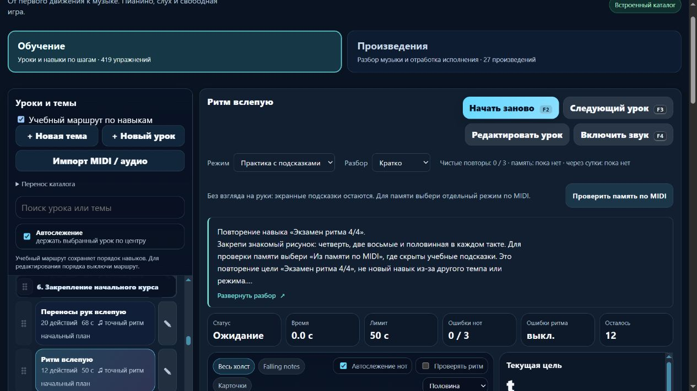

# Пианино: ритмическое закрепление и явный переход к памяти

Партия **2026-11-06-06**, MelodiaJest **23.5.11**. Пересмотрен **один** существующий урок, новых уроков и новых самостоятельных целей — **0**. Практика без взгляда получила понятный статус и отдельный переход к проверке памяти. [Машинные доказательства](piano-curriculum-2026-11-06-06-verification.json).

Пробуждение: 5 ноября, **21:02:34 UTC**; дата отчёта — 6 ноября по Asia/Yekaterinburg. Работа выполнена последовательно в текущем checkout; двадцатиминутный интервал не был сроком завершения.

## Подтверждённый пробел и роль урока

`course10-04`, **«Ритм вслепую»**, повторяет `course04-08`, **«Экзамен ритма 4/4»**: совпадают все высоты, руки, пальцы, начала и длительности. Отличаются 66 и 64 BPM. Режим отображения и разница в две доли метронома не создают самостоятельную педагогическую задачу. Сохранённый вариант теперь явно связан через `sameGoalAs: course04-08`; оба ID и история результатов остаются отдельными.

Прежний совет восстанавливать ориентир «во время паузы» не соответствовал данным: **счётных пауз здесь нет**. Теперь предлагается остановиться, проверить позицию и начать заново. Нет требования насильно продолжать вслепую. Практика без взгляда на руки сохраняет экранные подсказки; самостоятельная память проверяется отдельным MIDI-режимом, который их действительно скрывает. Знакомая последовательность не выдаётся за независимую проверку слуха.

## Ноты, движение и счёт

Сохранены исходные **12 событий**, все пальцы, **66 BPM** и сам объект ритма. Размер — **4/4**, три такта, конец через **12 долей**. Правая рука в позиции C4–G4, левая отдыхает. В каждом такте: четверть, две восьмые и половинная.

| Такт | Высоты | Пальцы правой | Начала внутри такта | Длительности |
| --- | --- | --- | --- | --- |
| 1 | C4–D4–E4–E4 | 1–2–3–3 | 0; 1; 1,5; 2 | 1; 0,5; 0,5; 2 |
| 2 | F4–G4–F4–F4 | 4–5–4–4 | 0; 1; 1,5; 2 | 1; 0,5; 0,5; 2 |
| 3 | E4–D4–C4–C4 | 3–2–1–1 | 0; 1; 1,5; 2 | 1; 0,5; 0,5; 2 |

Счёт: «раз-и, два-и, три-и, четыре-и». Первая нота занимает «раз-и», две восьмые вступают на «два» и «и», последнее **новое** нажатие — на «три». Половинная звучит до следующего «раз». Повтор высоты требует отпускания и нового нажатия, а не продолжения одного звука. Слуховой ориентир — одинаковый пульс всех трёх тактов, две равные восьмые и полное длинное окончание; плечи и кисть без лишнего напряжения.

Подготовка по ID — `course04-08`. Маршрут оставляет закрепление в **p6 после `course10-03`**, перед `detail-p-transfer-01` — **«Правая: перенести трёхнотную фигуру»**. Первое размещение рядом с базовым ритмом в p3 выявило зависимость: существующий перенос следовал за этим ID и оказывался перед более ранними этапами. Аудит обнаружил ошибку `p6 → p5`. Сохранён поздний опорный ID, исправлено указание следующего шага; проверки порядка не ослаблялись. Записи других уроков не изменены.

Полный разбор содержит небольшую цель, медленное чтение одного такта, затем соединение трёх, типичные ошибки, слуховое представление до попытки, самопроверку и возвращение после перерыва. Ориентир — блок около **3–5 минут**. Проба переноса — F4–E4–D4–D4 пальцами 4–3–2–2 с тем же ритмом. Она отдельно описана как проба в новом сочетании, не новый урок и не текущий автоматический зачёт.

Происхождение — **техническая отработка проекта**. Это не фрагмент авторского произведения и не упражнение, утверждённое авторами источников. Исторические сведения и биографии без подтверждения не добавлялись.

## Прочитанные первоисточники

- **Mark Gotham, Chelsey Hamm, Kris Shaffer**, [Open Music Theory: Simple Meter and Time Signatures](https://viva.pressbooks.pub/openmusictheory/chapter/simple-meter-and-time-signatures/), **Time Signatures / Counting in Simple Meter, Examples 9–10**: четвертная доля, равное деление на восьмые и продолжение счёта через длинный звук.
- **The Open University / OpenLearn**, [An introduction to music theory, §3.1 Time values](https://www.open.edu/openlearn/history-the-arts/music/an-introduction-music-theory/content-section-3.1), **Examples 13–14 и пояснения между ними**: соотношения четверти, восьмой и половинной.
- **Bob Duke и Amy Simmons**, [10 Tips for Effective Practice](https://cml.music.utexas.edu/online-resources/intelligent-music-practice/10-tips-for-effective-practice), разделы **How much to try and change at one time**, **How to organize practice time over the week**, а также разделы о представлении звучания и сохранении свободных основ: небольшая цель, закрепление изменений и распределение практики.

Рекомендации Diana Dumlavwalla по свободной кисти переиспользованы из ранее прочитанного источника, **заново в этой партии не читались**. Конкретные высоты, пальцы, 66 BPM, длительность блока, число повторов и MIDI-допуски — решения проекта. Источники их не назначают. В журнале **24 источника**; зафиксированы три свежие проверки разделов и четыре применения к целевому ID с ограничениями.

## Улучшение интерфейса

Чистая `PianoLearningUI.blindPracticeHtml` с типовым контрактом `.d.ts` показывает короткий вежливо объявляемый статус: **«Без взгляда на руки: экранные подсказки остаются»**. Для материала с подготовленным учебным контрактом доступна кнопка **«Проверить память по MIDI»**. Для неподготовленного материала есть объяснение ограничения без кнопки зачёта. В самом режиме памяти статус практики и кнопка отсутствуют.

Новый контроллер использует действующий переход режима: освобождает активные ноты, очищает начатую попытку и переводит фокус на скрытый заголовок. MIDI и звук самостоятельно не подключаются; зачёт от нажатия кнопки не возникает. Оба переключателя «без взгляда» имеют `aria-pressed`, после перерисовки фокус остаётся на использованном переключателе.

Применён проектный `web-design-guidelines` со свежим чтением первичной редакции: понятные названия, клавиатура, видимый фокус, переносы и доступный размер кнопки **44 px**. Проверка браузером выявила стандартный серый вид новой кнопки; она оформлена в существующих цветах и размерах тренажёра. Новых библиотек нет. Краткий материал остаётся пятистрочным, полный текст доступен через Enter/пробел, скрытый вид можно вернуть сохранённым переключателем.

## Проверки и сохранность

Финальный **`npm test`: 316/316**, ошибок **0**, **133,33 с**. Добавлены **8** содержательных тестов. Отдельная проверка маршрута и новой партии — **27/27**. После финального изменения только CSS повторная тяжёлая серия не запускалась: актуальная пересобранная версия проверена в браузере.

Проверены исходные ноты и пальцы, точное совпадение с базовым ритмом, полный последний note-off, повторное нажатие и вторая восьмая. Прежний контракт принимал раннее и позднее окончание на **0,27 доли**; новый `beat-boundary-v1` отвергает их. Настоящий MIDI-путь приложения проверен синтетическими событиями: верное исполнение проходит, пропущенный повтор и опоздавшая восьмая не проходят. Физический инструмент не использовался.

Миграция защищена исходным отпечатком инструкции **`a5f73953`**. Музыкальная версия **`f2d498b9` → `42db5080`** меняется из-за уточнения контракта оценки; ноты и ритм сохранены. Проверены идемпотентность, старые данные, JSON-перенос, пользовательские названия/инструкции/ритм/пальцы/классификация, сохранение старой памяти в истории и отсутствие её наследования новой редакцией. Базовый урок сохранил версию **`de4b5be9`**.

`audit:lessons`, `audit:fingering`, `audit:curriculum`, `audit:piano-coverage` прошли без жёстких ошибок. Начальные **80 уроков / 1036 назначений** — без структурных замечаний. Ранее известные ограничения охвата, независимых голосов и детектора остаются. Автоматическая проверка не доказывает пальцы на инструменте, удобство руки и музыкальное качество; независимой редакции преподавателем нет.

В изолированном браузере **127.0.0.1:4186** проверены переход к подготовке, единственная кнопка основной цели, Enter/пробел, сохранение фокуса, `aria-pressed`, наличие нового перехода при кратком и скрытом разборе. При 11 оставшихся нотах кнопка памяти очищает попытку до 12 и ставит фокус на заголовок. При сохранённом полном разборе память не содержит в DOM учебной карточки, статуса практики, ссылки основной цели, клавиш и октавных меток. Скрытый вид сохраняется после перезагрузки, его переключатель доступен.

На **390 px** клиент/прокрутка — **376/376 px**, превью **112 px** при строке **22,4 px**, пять строк; кнопка помещается по ширине и имеет высоту **44 px**. Мобильное раскрытие пробелом и видимый фокус проверены по DOM и клавиатуре. Настольный снимок просмотрен. Ошибок консоли нет. Собственная вкладка и preview закрыты, ширина восстановлена; браузерные звук и физический MIDI не включались.

Остальные **566 записей** сохранили музыку и инструкции; порядок всех **567** совпал. Хеши `lesson-review-baseline.js`, MIDI-настроек, общего `lesson-development.js`, движков оценки и аппликатуры совпали. Гитарный маршрут не изменён, записей в `guitarjest` нет. `trainer-content.json` отсутствовал и не создавался. Все **18 публичных файлов** совпали с манифестом и текущими исходниками; локальный сервер и личные файлы в сборку не включены.

## Учёт и следующий шаг

**419 учебных записей / 155 MIDI-контрактов / 62 подробных описания / 3 конкретных будущих плана**. Четыре явно связанные записи повторения дают верхнюю границу **415 групп**. Это не подтверждённое число независимых уроков. Открыто также совпадение целей целой ноты; проверка может уменьшить границу. Предварительные **1310 мест** по темам не считаются реализованными планами. Минимум 1000 содержательных уроков пока не достигнут.

Следующая малая партия — **`course10-06`, «Аккорды вслепую»**: пять созвучий, **54 BPM**, двухдольные удержания, вступления **0/3/6/9/12**, конец через **14 долей**. Сверить C–F–G–C правой, C major левой, самостоятельную подготовку каждой руки, роль закрепления относительно `course08-05`, общие окончания и скрытую память. До изменения воспроизвести ошибку и проверить источник. Затем остаётся `course10-08`; всего **две** записи MIDI-маршрута ещё используют прежний относительный допуск. Также открыты ранние зависимости между руками, конечная пауза, удержанные голоса, педаль и типовой музыкальный документ перед React/Next.js.

Последний штатный остаток общей квоты — **62%**, обычное использование разрешено. Действует **`until-exhausted`, резерв/порог 0%**; общий расход не приписывается этой задаче. Локальный запуск без установки зависимостей сохранён. Полная веб-миграция и облачная готовность не объявлены завершёнными. Домен не куплен; покупка, DNS, публикация, commit/push не выполнялись.
