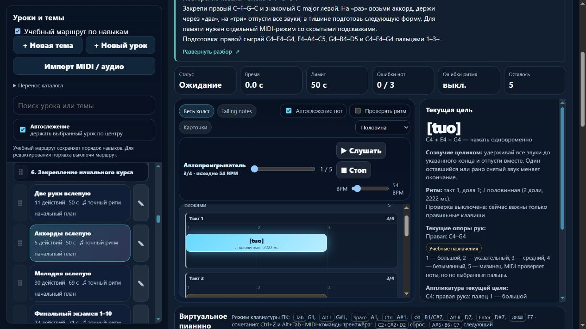

# Пианино: подготовленные аккорды и их общее окончание

Партия **2026-11-06-07**, MelodiaJest **23.5.12**. Пересмотрен **один** существующий урок, новых уроков и новых самостоятельных целей — **0**. У текущего аккорда добавлено короткое объяснение общего отпускания. [Машинные доказательства](piano-curriculum-2026-11-06-07-verification.json).

Пробуждение — 5 ноября, **21:37:05 UTC**; дата отчёта — 6 ноября по Asia/Yekaterinburg. Работа выполнена последовательно в текущем checkout, без ограничения длительности двадцатью минутами.

## Что найдено

`course10-06`, **«Аккорды вслепую»**, соединяет знакомый правый C–F–G–C и C major левой. Правые четыре созвучия уже подготовлены в `course08-05`, левая форма — в `course08-02`. Само название, другой темп и соединение этих готовых компонентов не устанавливают новую самостоятельную цель. Запись сохранена как закрепление через `sameGoalAs: course08-05`, с отдельными требованиями к левой руке и собственной историей результатов.

Подписанный размер **4/4** не объяснял повторяющееся вступление через три доли: две доли звучания и доля тишины. Для понятной задачи переноса размер уточнён как **3/4**, все абсолютные начала, длительности и паузы сохранены.

Воспроизведён существенный пробел проверки: старый контракт принимал и верный пример, и созвучие с одной клавишей, отпущенной на **0,3 доли позже** остальных. Он также принимал последнее общее отпускание на **0,27 доли раньше или позже**. Для этого урока включён существующий контракт **`beat-boundary-v2`**, который ограничивает длительность и проверяет общий конец. Сам движок оценки не изменялся.

## Что играть и зачем

Ноты и все **15 назначений пальцев** сохранены. Темп — **54 BPM**, педаль выключена. На «раз» сыграй весь аккорд, держи через «два», на «три» отпусти все звуки. Внутри фразы третья доля отведена тишине и подготовке новой формы.

| Вступление | Высоты | Рука и пальцы | Начало, доли | Звучит, доли |
| --- | --- | --- | ---: | ---: |
| 1 | C4–E4–G4 | правая 1–3–5 | 0 | 2 |
| 2 | F4–A4–C5 | правая 1–3–5 | 3 | 2 |
| 3 | G4–B4–D5 | правая 1–3–5 | 6 | 2 |
| 4 | C4–E4–G4 | правая 1–3–5 | 9 | 2 |
| 5 | C3–E3–G3 | левая 5–3–1 | 12 | 2 |

Четыре внутренние паузы — по одной доле. Правая освобождается перед последним вступлением; в нижний регистр переходит **левая партия**, а не правая рука. Левая заранее находит свою форму. Нет удержанного баса, независимых голосов или скрытого требования играть с педалью.

Пятое созвучие отпускается на «три» пятого такта, через **14 долей** от начала. Здесь заканчивается текущая MIDI-попытка. Последнюю тишину ученик досчитывает самостоятельно: конечная пауза моделью ещё не наблюдается. Пять вступлений не названы пятью полностью измеренными тактами.

Подготовка по ID: **`course08-05`**, **`course08-02`**, **`detail-p-left-triple-pulse-01`**. Закрепление остаётся в **p6 после `course10-05`**; все требования находятся раньше. Следующее применение — подготовленный урок `course08-06`, **«Разложенные аккорды»**. Ссылки на основную цель и обе левые подготовки доступны в полном разборе, основной переход не дублируется.

Описание объясняет поиск корня/терции/квинты, руки и пальцы, медленный разбор одной смены, счёт, перенос в тишине, слуховой образ цельного созвучия и ошибки раннего снятия/одинокой задержанной ноты. При напряжении или потере ориентира предлагается остановиться и посмотреть на клавиши, без силовой фиксации кисти и обязательной игры совсем вслепую.

Ориентир — блок около **3–5 минут** с возвращением после перерыва. Отдельная проба переноса: правой C–G–F–C, затем знакомый C major левой, с тем же рисунком 2+1. Это проба нового порядка, не текущий MIDI-зачёт и не новая запись. Знакомый образец развивает слуховое представление, но не считается независимым тестом слуха. Практика без взгляда сохраняет экранные подсказки; память проверяется отдельным режимом.

## Источники и происхождение

Происхождение — **техническая отработка проекта**, не фрагмент произведения. В этой партии заново прочитаны:

- **The Open University / OpenLearn**, [§7 Harmony: the triad](https://www.open.edu/openlearn/history-the-arts/music/an-introduction-music-theory/content-section-7), **Example 63 и пояснения**: три звука, корень/терция/квинта, порядок большой и малой терций в мажорном трезвучии. Состав C/F/G сверяется по звучащим высотам.
- **The Open University / OpenLearn**, [§3.1 Time values](https://www.open.edu/openlearn/history-the-arts/music/an-introduction-music-theory/content-section-3.1), **Examples 13–14 и пояснение между ними**: половинная соответствует двум четвертям.
- **Robert Hutchinson**, [Music Theory for the 21st-Century Classroom, §4.4 Meter](https://musictheory.pugetsound.edu/mt21c/meter.html), определение метра и абзац о трёх долях: основание понятного трёхдольного счёта. Выбор конкретного 2+1 для этой последовательности — редакция проекта.
- **Jerry Kovarsky**, [The Basics Of Piano Keyboard Fingering](https://hub.yamaha.com/keyboards/k-how-to/the-basics-of-piano-keyboard-fingering/), **28 ноября 2023**, вступление о планировании, **The Basics**, первый пример позиции и оговорка о вариантах в третьем сценарии: подготовка позиции и нумерация 1–5. Растяжения из более сложных примеров здесь не назначаются.
- **Carl Czerny**, [Dritter Brief](https://www.koelnklavier.de/quellen/czer-brf/brief-03.html), **с. 20–21 по разметке первичной текстовой транскрипции KölnKlavier / Wolfgang Lempfrid**; издание A. Diabelli und Comp. без установленной даты в использованной записи. Черни различает удержание ноты и освобождение клавиш в паузе, предостерегает от слишком раннего и позднего отпускания. Это короткая историческая справка о рекомендации общего приёма, не доказательство авторства или изучения нашего упражнения. Новая сверка со сканом печатной страницы не выполнялась.

Ранее проверенные рекомендации Duke/Simmons по небольшой цели и распределению практики переиспользованы, **заново не читались**. Журнал сохраняет **24 источника**, пять свежих проверок разделов и шесть применений к целевому ID. Ноты, октавы, пальцы 1–3–5 / 5–3–1, 54 BPM, порядок, время блока и числовые допуски принадлежат проекту. Эти пальцы не объявлены универсальными, источники урок не утверждали; знаменитые ученики и неподтверждённые цитаты не добавлялись.

## Улучшение системы

Чистая `PianoLearningUI.chordReleaseHtml` с `.d.ts` показывает короткий текст у текущего аккорда: удерживать все звуки до указанного конца и отпускать вместе. Он появляется только для явного контракта общего окончания **v2** и корректного набора разных MIDI-высот. Для одиночного звука, старого контракта, повреждённых данных, предупреждения об аппликатуре или режима памяти пояснение не выводится. Из произвольного аккорда не делается вывод о будущих независимых удержанных голосах.

Применён проектный `web-design-guidelines` со свежим чтением первичной редакции: короткий текст у действия, перенос по ширине, существующие семантические элементы, клавиатурное раскрытие и видимый фокус. Полный материал сохранён, стандартное превью — пять строк. Настройка скрытого описания не выключает полезную текущую цель в практике; режим памяти полностью убирает учебные подсказки. Новых библиотек, изменений общего гитарного представления и движка оценки нет.

## Проверки и сохранность

Финальный **`npm test`: 324/324**, ошибок **0**, **160,44 с**. Добавлены **8** содержательных тестов. Проверены все высоты, руки, пальцы и абсолютные времена, четырёхкратная внутренняя тишина, последнее полное отпускание, раннее/позднее окончание, несовпавшие снятия, перебор при атаке, лишняя нота в паузе и неверный регистр последнего аккорда. Настоящий MIDI-путь приложения проверен синтетическими событиями; физический инструмент не использовался.

В первой полной серии один тест содержал прежний ожидаемый список группы C–F–G–C из двух записей. Ожидание дополнено конкретным третьим ID `course10-06`; также проверяются обе связи повторения. Проверки не удалялись: обновлённая группа прошла **5/5** тестов, затем повторённая полная серия прошла **324/324**. Остальные аудиты после этой правки только тестового ожидания повторно не запускались.

`audit:lessons`, `audit:fingering`, `audit:curriculum`, `audit:piano-coverage` — без жёстких ошибок. Начальные **80 уроков / 1036 назначений** — без структурных замечаний. Известные ограничения охвата, удержанных голосов и детектора остаются. Автотесты не подтверждают физические пальцы, удобство руки, баланс и художественное качество; независимой редакции преподавателем нет.

Защита миграции — исходный отпечаток инструкции **`cbff92b6`**. Музыкальная версия **`bb277306` → `8554b3ff`**: изменены метр и контракт оценки, абсолютная музыка сохранена. Проверены идемпотентность, старые ритм и инструкции, личные изменения названия/описания/ритма/пальцев/классификации, JSON-перенос и история прежней памяти без наследования зачёта новой редакцией.

В изолированном браузере **127.0.0.1:4187** проверены пятистрочное превью, полный разбор, три именованных подготовки и переход к левой форме с фокусом на заголовке. У текущего аккорда видны подсказка общего конца, 3/4 и исходные 54 BPM. В памяти при сохранённом полном разборе отсутствуют пояснение, карточка, ссылка основной цели, клавиши и октавные подписи. Скрытый вид сохраняется после перезагрузки, переключатель остаётся доступен.

На установившейся ширине **390 px** клиент/прокрутка — **376/376 px**; текст подсказки — **272/272 px**. Превью — **112 px** при строке **22,4 px**, пять строк. Раскрытие и сворачивание пробелом сохраняют фокус. Настольный снимок просмотрен, ошибок консоли нет. Собственные вкладка и preview закрыты, временная ширина восстановлена. Звук и физический MIDI браузером не включались.

Остальные **566 записей** сохранили музыку и инструкции, порядок всех **567** совпал. Хеши `lesson-review-baseline.js`, MIDI-настроек, общего `lesson-development.js`, оценки и аппликатуры совпали; гитарный маршрут не изменён. Записи в `guitarjest` не выполнялись. `trainer-content.json` отсутствовал и не создавался. Все **18 публичных файлов** совпали с манифестом и текущими исходниками; личные данные, Windows endpoint и локальный сервер в выпуск не включены.

## Учёт и продолжение

**419 учебных записей / 155 MIDI-контрактов / 63 подробных описания / 3 конкретных будущих плана**. Пять явно связанных повторений дают верхнюю границу **414 групп**. Это не установленное число независимых целей; совпадение целой ноты и дальнейшая редактура могут его уменьшить. Предварительные **1310 мест** по темам не считаются готовыми уроками или индивидуальными планами. Минимум 1000 содержательных уроков ещё не достигнут.

Следующая малая партия — **`course10-08`, «Финальный экзамен 1–10»**: последняя из доступных 155 записей MIDI-маршрута с прежним относительным допуском. Сверить **23 действия, 64 BPM, 30 долей**, отдельные ноты обеих рук, совместные пары, левое и правое созвучия, мелодическую концовку и подготовку каждого компонента по ID. Экзамен не становится новой самостоятельной целью только из-за объединения изученного. До правки воспроизвести ошибки и прочитать источники; сохранить старую редакцию и результаты.

Далее открыты совпадение целей целой ноты, ранние зависимости между руками и типовой музыкальный документ перед постепенным React/Next.js-переносом. Конечная пауза, независимые удержанные голоса и педаль требуют отдельной модели и тестов.

Последний штатный остаток общей квоты — **62%**, обычное использование разрешено. Политика **`until-exhausted`**, резерв и порог **0%**; общий расход не приписывается этой задаче. Рабочий локальный запуск без установки зависимостей сохранён. Полная веб-миграция и облачный выпуск не объявлены готовыми. Домен не куплен; покупка, DNS, публикация, commit/push не выполнялись.
