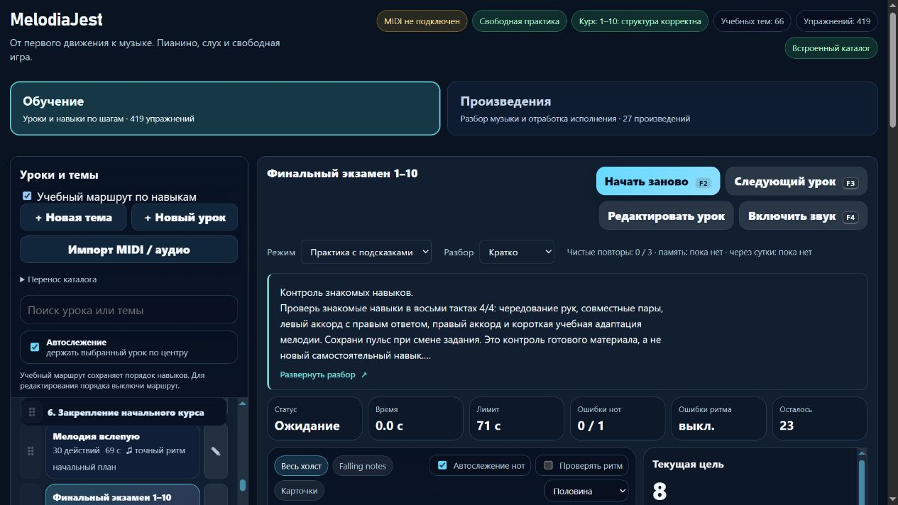

# Пианино: финальный контроль с подготовкой каждого компонента

Партия **2026-11-06-08**, MelodiaJest **23.5.13**. Пересмотрена **одна** существующая запись, новых уроков и новых самостоятельных целей — **0**. Учёт и карточка теперь явно отличают составной контроль от нового навыка. [Машинные доказательства](piano-curriculum-2026-11-06-08-verification.json).

Пробуждение — 5 ноября, **21:58:05 UTC**; дата отчёта — 6 ноября по Asia/Yekaterinburg. Работа выполнена последовательно в текущем checkout; длительность не ограничивалась двадцатью минутами.

## Подтверждённые проблемы

`course10-08`, **«Финальный экзамен 1–10»**, объединял 23 действия разных типов без индивидуальной подготовки по ID. Начало длинной пары приходилось на четвёртую долю, пересекало тактовую черту, а правое трезвучие начиналось на вторую долю после паузы. Такая метрическая задача не объяснялась и не имела отдельной подготовки. Конец наступал через **30 долей**.

Старый контракт принимал задержанное снятие одного звука в совместной паре и правом трезвучии, а также раннее/позднее окончание половинной на **0,27 доли**. Это воспроизведено на прежнем ритме; замена только контракта на существующий **`beat-boundary-v2`** отвергает те же ошибочные примеры. Движок оценки не менялся.

Последние девять нот узнаваемы как начало «Оды к радости». Теперь они имеют точную атрибуцию и явное описание адаптации. Весь составной экзамен не приписан Бетховену.

## Новая учебная редакция

Сохранены **все 30 звучащих высот**, их последовательность, **назначения рук и пальцев**, 23 действия и **64 BPM**. Новая редакция — **восемь тактов 4/4, 32 доли**. Старый ритм и инструкция сохранены в истории. Педаль выключена, независимого удержанного баса нет.

| Такты | Что играть | Длительности и счёт | Подготовка |
| --- | --- | --- | --- |
| 1–2 | C3 левой 5, C4 правой 1, D3 левой 4, D4 правой 2, E3 левой 3, E4 правой 3 | Шесть четвертей, затем две доли тишины | Чередование входит в подготовку `course07-03` через `course07-02` |
| 3 | C3+C4, D3+D4, E3+E4; слева 5–4–3, справа 1–2–3 | 2–1–1, общие нажатия и окончания | `course07-03` |
| 4 | C3–E3–G3 левой 5–3–1; затем C4–D4–E4 правой 1–2–3 | Четыре четвертных действия, левое созвучие отпускается перед ответом | `course08-07` |
| 5 | C4–E4–G4 правой 1–3–5 | Половинная с «раз», затем две доли тишины | `course08-01` |
| 6–8 | E4–E4–F4–G4 / G4–F4–E4 / D4–C4 правой 3–3–4–5 / 5–4–3 / 2–1 | Шесть четвертей и три половинные; последний C заканчивается через 32 доли | Общие пальцевые основы и `course04-04`; отдельная пьеса не обязательна |

Первая совместная пара перенесена с доли **7 на 8**, следующие пары — на **10 и 11**. Правое трезвучие перенесено с **17 на 16**, тишина после него занимает доли **18–20**. Внутренние паузы теперь две, по две доли. Финальные D4 и C4 удлинены до половинных и начинают звучать на **28 и 30**. Ранее уже длинная E4 остаётся половинной на 26. Новая попытка заканчивается последним полным note-off на 32; конечная пауза после него не измеряется.

Явные требования: **`course07-03`**, **`course08-07`**, **`course08-01`**, **`course04-04`**. Все находятся раньше экзамена; сам он остаётся в **p6 после `course10-07`**. Конкретная мелодия или произведение не сделаны обязательной предпосылкой общего навыка. Следующее применение — подготовленный урок **`course08-06`, «Разложенные аккорды»**.

Разбор объясняет движения и счёт каждого блока, повторные нажатия E/G, тишину и общее отпускание, слуховое представление до попытки и типичные ошибки. Предлагается короткий блок около **3–5 минут**: выбрать одну трудную часть, затем связать её с соседней и только после этого играть целиком. После перерыва — повтор; отдельная проба переноса — совместные пары D, E, C с рисунком 2–1–1. Это не новая запись и не текущий MIDI-зачёт. Знакомый мотив не является независимым слуховым тестом.

## Проверенные источники и атрибуция

- **Л. ван Бетховен**, [Ode to Joy, PDF Mutopia](https://www.mutopiaproject.org/ftp/BeethovenLv/ode/ode-a4.pdf), редакция **Peter Chubb, Mutopia-2009/08/05-528**, **с. 1, сопрано: такты 1–2 и первая нота такта 3**. Первые девять высот — B4–B4–C5–D5–D5–C5–B4–A4–G4, все четвертные. [Каталог 528](https://www.mutopiaproject.org/cgibin/piece-info.cgi?id=528) и наборщик заявляют **Public Domain**.
- **Mark Gotham, Chelsey Hamm, Kris Shaffer**, [Open Music Theory: Simple Meter and Time Signatures](https://viva.pressbooks.pub/openmusictheory/chapter/simple-meter-and-time-signatures/), **Time Signatures / Counting in Simple Meter, Examples 9–10 и правила длинных нот/пауз**: четыре четвертных пульса и продолжение счёта во время удержания и тишины.
- **The Open University / OpenLearn**, [§3.1 Time values](https://www.open.edu/openlearn/history-the-arts/music/an-introduction-music-theory/content-section-3.1), **Examples 13–14 и пояснение между ними**: соотношение четверти и половинной.
- **Bob Duke и Amy Simmons**, [Tips for Effective Practice](https://cml.music.utexas.edu/online-resources/intelligent-music-practice/10-tips-for-effective-practice), разделы о выборе посильного материала, небольшой конкретной цели, упрощении трудной задачи и распределении практики: сначала доступные компоненты, затем соединение и возвращение после перерыва.

Применён навык `pdf`: визуально перечитана ранее сохранённая страница той же редакции, сопоставлена с сохранённым LilyPond-текстом. Онлайн-каталог и PDF заново открыты; идентификатор редакции подтверждён. Инструмент веб-чтения не отдал отображаемое изображение, а повторное прямое скачивание `.ly` ограничено сетью окружения, поэтому **новая побайтовая сверка источника не заявляется**. Хеши использованных локальных PDF, PNG и `.ly` записаны в доказательствах.

Учебная концовка транспонирована **вниз на семь полутонов в C major**, девять исходных четвертей превращены в **шесть четвертей и три половинные**, 100 BPM — в учебные 64; остальные три голоса сняты, пальцы назначены проектом. Первые пять тактов — собственная техническая связка проекта. Это **учебный этюд / адаптация**, а не точное исполнение тактов симфонии. Источник каталога — Various, критическое издание не заявляется; дату каталога c. 1800 как историческое свидетельство не используем. Исторические биографии и цитаты не добавлялись. В журнале **24 источника**, четыре применения и повторные проверки разделов обновлены.

## Учёт и интерфейс

`learning.goalCounting: checkpoint-only` хранит роль составного контроля отдельно от нот. Генератор матрицы проверяет наличие известных разных подготовок и запрещает одновременно считать запись контролем и вариантом одной цели. Повторение не может ссылаться на контроль как на самостоятельную основную цель. Контроль исключается из верхней границы один раз, его ID, каталог и прогресс сохраняются.

В матрице версии **5** отдельно перечислены контрольные записи. Эта роль не присваивает зачёт, не сертифицирует перенос и не доказывает новую цель. Другие экзамены автоматически по названию не переклассифицируются.

Чистая `PianoLearningUI.checkpointHtml` с `.d.ts` и компактное превью показывают **«Контроль знакомых навыков»**. Полный разбор содержит четыре именованных подготовки, вид материала, автора, место источника и изменения. При скрытом виде переключатель остаётся доступен; память полностью убирает материалы из DOM. Применены свежие `web-design-guidelines`: понятная роль, короткое описание, клавиатура, видимый фокус и переносы. Новый веб-стек или библиотека не устанавливались.

## Проверки и сохранность

Окончательный **`npm test`: 334/334**, ошибок **0**, **145,98 с**. Добавлены **10** тестов: восемь по экзамену и две проверки учёта контролей. Проверены все высоты и пальцы, новая сетка времени, источник девяти нот, адаптация, обе руки, совместные пары, трезвучия, две паузы, ранние/поздние снятия, пропущенный голос и полный последний note-off. Реальная функция звукового образца сохраняет **1875 мс** каждого из последних трёх звуков при 64 BPM. Настоящий MIDI-путь проверен синтетическими событиями, без физического устройства.

Проверены идемпотентность, защита личных названий/инструкций/ритма/пальцев/классификации, JSON-перенос роли и сохранение старого зачёта только в истории. Исходный отпечаток инструкции — **`30eb2595`**, музыкальная версия — **`3b9f601b` → `c1fcc01b`**. Новая редакция не наследует память прежней.

При проверке найдены два старых ожидания формулы счётчика без вычитания контроля и ошибка записи `/` в новом тесте подписи адаптации. Они исправлены; проверки не удалялись. Целевая серия по учёту прошла **19/19**, весь новый экзаменационный файл после исправления — **8/8**, затем полная серия — **334/334**. После неё изменено только пояснение формулы в генераторе Markdown; матрица повторно сформирована и проверена без ещё одного тяжёлого запуска.

`audit:lessons`, `audit:fingering`, `audit:curriculum`, `audit:piano-coverage` прошли без жёстких ошибок. Начальные **80 уроков / 1036 назначений** — без структурных замечаний. Среди **155** доступных записей MIDI-маршрута теперь нет нот длительностью **от двух долей** без явного `beat-boundary-v1/v2`. Это проверка покрытия метаданных; она не подтверждает методическую правильность всех 419 записей, физические пальцы, комфорт, баланс и художественное качество. Независимой редакции преподавателем нет.

В изолированном браузере **127.0.0.1:4188** проверены пятистрочное описание, раскрытие нажатием по блоку, Enter/пробел, четыре подготовки и переход к совместным парам с фокусом на заголовке. Полный материал показывает подпись адаптации и Public Domain. В памяти при сохранённом полном виде нет карточки, роли контроля, подготовок, клавиш и октавных меток. Скрытый вид сохраняется после перезагрузки, его переключатель доступен.

На **390 px** клиент/прокрутка — **376/376 px** и в полном, и в кратком виде. Превью — **112 px**, строка **22,4 px**, пять строк; раскрытие пробелом сохраняет видимый фокус. Настольный снимок просмотрен, ошибок консоли нет. Собственные вкладка и preview закрыты, ширина восстановлена; звук и физический MIDI не включались.

Остальные **566 записей** сохранили музыку и инструкции; порядок всех **567** совпал. Хеши `lesson-review-baseline.js`, MIDI-настроек, общего `lesson-development.js`, оценки и аппликатуры совпали; гитарный маршрут не изменён. Записей в `guitarjest` нет. `trainer-content.json` отсутствовал и не создавался. Все **18 публичных файлов** совпали с манифестом и исходниками; личные и локальные серверные файлы в выпуск не включены.

## Продолжение

**419 учебных записей / 155 MIDI-контрактов / 64 подробных описания / 3 конкретных будущих плана**. Пять повторений и один составной контроль дают верхнюю границу **413** самостоятельных целей. Подтверждённое число различных целей пока неизвестно. Предварительные **1310 мест** по темам не считаются индивидуально разработанными или готовыми уроками; минимум 1000 ещё не достигнут.

Следующая малая партия — **`course04-03` и `detail-p-rhythm-01`**, подтверждённое совпадение целой ноты: установить основной разбор и роль повторения, сохранить оба ID и историю, проверить ранние зависимости. Затем вернуться к конкретным будущим микроурокам с отдельной целью и индивидуальным планом. Следующий системный этап — типовой музыкальный документ и чистые адаптеры перед постепенным React/Next.js-переносом. Конечная пауза, удержанные голоса и педаль остаются отдельной работой.

Последний штатный остаток общей квоты — **61%**, обычное использование разрешено. Политика **`until-exhausted`**, резерв и порог **0%**; общий расход не приписывается задаче. Рабочий локальный запуск без установки зависимостей сохранён. Полная веб-миграция и облачный выпуск не объявлены готовыми. Домен не куплен; покупка, DNS, публикация, commit/push не выполнялись.
