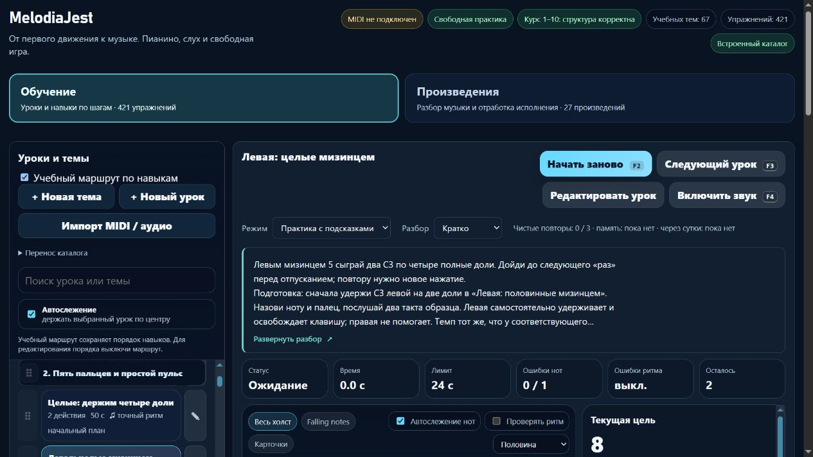

# Пианино: ранние длинные ноты левой руки и честный учёт повторения

Партия **2026-11-06-09**, MelodiaJest **23.5.14**. Добавлены **два** коротких урока левой руки, пересмотрена роль **одного** правого упражнения. Исправлены подписи числа действий в каталоге и диапазоне практики. [Машинные доказательства](piano-curriculum-2026-11-06-09-verification.json).

Пробуждение — 5 ноября, **22:26:06 UTC**; дата отчёта — 6 ноября по Asia/Yekaterinburg. Работа выполнена последовательно в текущем checkout; двадцатиминутный интервал не был сроком завершения.

## Что найдено

`course04-03`, **«Целые: держим четыре доли»**, и `detail-p-rhythm-01`, **«Длинный звук на четыре доли»**, содержат одинаковое музыкальное задание: два C4 правым большим пальцем 1, начала 0/4, длительности 4/4 доли, размер 4/4, **56 BPM**. Различия формулировок и более позднее место не устанавливают вторую самостоятельную цель.

Вторая запись теперь явно связана с основной через **`sameGoalAs: course04-03`**. Она сохраняет своё позднее место после `course04-05`, а подготовка указывает основной разбор. Оба ID и их прогресс остаются отдельными.

Проверка предыдущего каталога выявила конкретный ранний пробел: для C3 левым мизинцем 5 найден поздний трёхдольный пульс с двухдольным звуком и паузой, но нет отдельной ранней цепочки **половинные → целые без счётных пауз**. Правый большой палец и левый мизинец — разные исполнительские задачи. Сравнение ограничено указанным рисунком и данными проекта; глобальная уникальность всего курса не объявлена проверенной.

## Два новых урока

| ID | Что играть | Подготовка | Счёт и результат |
| --- | --- | --- | --- |
| `detail-p-left-half-01` | Четыре C3 левым мизинцем 5 | `course01-02`, «Левая: найди C3 / До» | Начала 0/2/4/6; каждое на две доли, два такта 4/4, конец через 8 долей |
| `detail-p-left-whole-01` | Два C3 тем же левым мизинцем 5 | `detail-p-left-half-01` | Начала 0/4; каждое на четыре полные доли, два такта 4/4, конец через 8 долей |

Оба урока — **56 BPM**, явная левая рука, **`beat-boundary-v1`**, без педали и счётных пауз. Правая отдыхает. Задача — самостоятельно удерживать и освобождать клавишу левым мизинцем, сохранять внутренний пульс и заново нажимать повторённую высоту. Это не упражнения на силовое удержание или неподвижную кисть.

В половинных счёт «раз–два» относится к одному нажатию, «три–четыре» — к следующему. В целых слово «четыре» только начинает последнюю долю: нужно дойти до нового «раз» перед отпусканием. Одно удержание на восемь долей не заменяет два отдельных целых звука. Клавиша освобождается для следующей атаки у границы; дополнительная счётная пауза не вставляется.

Новые записи находятся в **p2**: половинные после `course04-02`, целые после `course04-03`. Первая предполагаемая подготовка `course03-01` оказалась в маршруте позже нового урока. Целевой тест обнаружил это до полного запуска. Предпосылкой выбран более ранний и точный `course01-02`: уже знакомые C3 и левый палец 5, без лишнего требования сначала осваивать пару 5–4. Проверка порядка сохранена и проходит.

Каждая карточка содержит цель, положение руки, медленный разбор, счёт, слуховой ориентир, ошибки и самопроверку. Слышны ровные отдельные длинные звуки, без лишних атак внутри удержания и лишней тишины на повторе. Ориентир — блок около **3–5 минут**, затем возвращение после перерыва. При напряжении предлагается остановиться и проверить удобство.

Отдельная проба переноса выполняется после попытки: без звука найти D3 и сыграть тем же левым мизинцем два D3 по две доли либо один D3 на четыре. Позицию готовят после отпускания C3, без растяжения удержанной руки. Это проба новой опоры, не текущий MIDI-зачёт и не дополнительный урок. После половинных следующий шаг — новые левые целые; после целых — подготовленное смешение четвертей и половинной в `course04-04`.

Обе новые записи обозначены как **технические упражнения проекта**. Они не приписываются композитору, не являются фрагментами произведений и не объявлены утверждёнными авторами источников. Две конкретные спецификации, разработанные и реализованные в этой партии, сохранены отдельно в `implementedSpecifications` журнала планирования. Будущих неисполненных планов по-прежнему **3**, эти два в них не включены.

## Источники

Заново прочитаны:

- **The Open University / OpenLearn**, [§3.1 Time values](https://www.open.edu/openlearn/history-the-arts/music/an-introduction-music-theory/content-section-3.1), **Examples 13–14 и пояснение между ними**: половинная равна двум четвертям, целая — четырём.
- **Mark Gotham, Chelsey Hamm, Kris Shaffer**, [Open Music Theory: Simple Meter and Time Signatures](https://viva.pressbooks.pub/openmusictheory/chapter/simple-meter-and-time-signatures/), **Time Signatures / Counting in Simple Meter, Examples 9–10, правила долгих звуков и пауз**: продолжение счёта внутри удержания в 4/4.
- **Dr. Diana Dumlavwalla**, [Fix It: Tips for Teaching Basic Piano Technique](https://hub.yamaha.com/music-educators/instruments/piano/piano-pedagogy-fix-basic-technique/), **29 ноября 2021**, разделы о напряжении рук, форме кисти и подвижном запястье: свободная рука и отсутствие жёсткой фиксации. Упражнения автора с поддержкой и отпусканием руки здесь не назначаются.

Рекомендации Duke/Simmons по небольшой цели и возвращению после перерыва переиспользованы, **заново не читались**. C3/D3, палец 5, порядок, 56 BPM, число повторов, время блока и машинные допуски заданы проектом. Источники не назначают эти упражнения; MIDI не доказывает реальный палец и качество движения. Исторические сведения без отдельного подтверждения не добавлялись. Журнал сохраняет **24 источника**, три свежие проверки разделов и четыре применения к затронутым ID обновлены.

## Сохранение правого упражнения

У `detail-p-rhythm-01` изменены только объяснение роли и подготовка. Все ноты, ритм, пальцы, темп и музыкальная версия **`e664aca0`** сохранены. Зачёт памяти остаётся действительным для этого же ID и версии, не сбрасывается и не переносится в основной урок.

Миграция защищена отпечатком инструкции **`6a1e1e32`** и исходной редакцией **`early-rhythm-v1`**. Новый `roleReview` хранит прежние объяснения, включая исходный `contentReview`; первый обзор не перезаписывается. Личные названия, инструкции, подготовка, ноты, пальцы и классификация защищены. Повторное применение ничего не меняет. Проба переноса прежнего урока сохранена как самостоятельная практика, без увеличения счётчика.

## Улучшение системы

В реальном каталоге встречалась подпись **«23 действий»**. Чистая `PianoLearningUI.actionCountText` с `.d.ts` использует **`Intl.NumberFormat` и `Intl.PluralRules`**: «1 действие», «2 действия», «11 действий», «23 действия». Тот же форматтер применён к диапазону практики. Повреждённое значение не превращается в вводящий в заблуждение ноль.

Применены свежие `web-design-guidelines`, в частности правила локализации и понятных подписей. Новые карточки используют существующие пятистрочное превью, раскрытие с клавиатуры и именованную подготовку. Правое повторение использует уже проверенный переход к основному разбору; дополнительная декоративная секция не создавалась. Новых библиотек и изменений общего гитарного представления нет.

## Проверки и сохранность

**`npm test`: 342/342**, ошибок **0**, **139,15 с**. Добавлены **8** содержательных тестов: неизменность правого музыкального контракта и зачёта, защита редакций, точные левые ноты/пальцы/время, MIDI-исполнение, маршрут, JSON-перенос, звуковые окончания и русские числовые формы. Целевая серия — **8/8**.

Оба новых задания проходят настоящий MIDI-путь с синтетическими событиями только после полного последнего отпускания через восемь долей. Ранний и поздний конец на **0,27 доли**, а также пропуск повторного нажатия не проходят. Звуковой образец сохраняет последние две или четыре доли. Физический инструмент не использовался.

`audit:lessons`, `audit:fingering`, `audit:curriculum`, `audit:piano-coverage` прошли без жёстких ошибок. Начальные **80 уроков / 1036 назначений** — без структурных замечаний. В **157** доступных записях MIDI-маршрута нет нот от двух долей без явно заданного ограниченного контракта v1/v2. Это покрытие метаданных; оно не подтверждает физические пальцы, удобство руки, независимость всех целей и художественное качество. Проверки преподавателем нет.

В изолированном браузере **127.0.0.1:4189** проверены оба новых урока, C3 и явный палец 5 левой, переход к раннему ориентиру с фокусом на заголовке, ссылка на левые половинные и подсказка счёта целой ноты. У правого повторения есть ровно один именованный переход к основному разбору; он работает и переводит фокус на заголовок. Каталог показывает «4 действия», «2 действия», «23 действия».

Проверены Enter/пробел, краткий и полный виды, сохранение скрытого вида после перезагрузки и доступный переключатель. В памяти при сохранённом полном разборе нет учебной карточки, подготовки, связи цели, подсказки целой ноты, клавиш и октавных меток. На **390 px** клиент/прокрутка — **376/376 px**, превью **112 px** при строке **22,4 px**, пять строк. Фокус видим и сохраняется при раскрытии. Настольный снимок просмотрен; ошибок консоли нет. Собственные вкладка и preview закрыты, ширина восстановлена. Звук и физический MIDI не включались.

Музыка всех прежних **567 записей** сохранена. Инструкции остальных **566** совпали, порядок старых ID не изменился; добавлены только два новых ID. Хеши `lesson-review-baseline.js`, MIDI-настроек, общего `lesson-development.js`, оценки и аппликатуры совпали; гитарный маршрут не изменён. Записи в `guitarjest` не выполнялись. `trainer-content.json` отсутствовал и не создавался. Все **18 публичных файлов** совпали с манифестом и исходниками; личные данные и локальный сервер в сборку не включены.

## Учёт и продолжение

**421 учебная запись / 157 MIDI-контрактов / 66 подробных описаний / 3 конкретных будущих плана**. Разработаны и реализованы две отдельные левые спецификации. Шесть явно связанных повторений и один контроль дают верхнюю границу **414** самостоятельных целей. Эта граница увеличилась на один: две новые задачи добавлены, одно ранее неотмеченное повторение исключено. Полное число разных целей неизвестно, **1310 мест** по темам остаются предварительным бюджетом; минимум 1000 ещё не достигнут.

Следующая малая партия — **`detail-p-release-02` и ранняя левая подготовка**: проверить подтверждённую транзитивную зависимость от правой руки, сохранить нужное знание счёта и отпускания, обеспечить самостоятельный левый маршрут. Новые длительности добавлять в требования только при реальной необходимости, без массового переписывания связей. Следующий системный этап — типовой музыкальный документ и чистые адаптеры перед React/Next.js; конечная пауза, удержанные голоса, педаль и дальнейшие индивидуальные планы остаются отдельной работой.

Последний штатный остаток общей квоты — **60%**, обычное использование разрешено. Политика **`until-exhausted`**, резерв и порог **0%**; общий расход не приписывается задаче. Локальный запуск без установки зависимостей сохранён. Полная веб-миграция и облачная готовность не объявлены завершёнными. Домен не куплен; покупка, DNS, публикация, commit/push не выполнялись.
