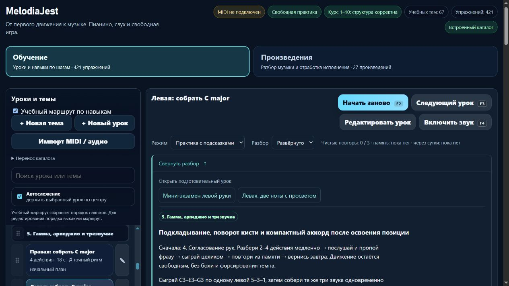

# Пианино: подготовка по действующей руке и общее окончание левого C major

Партия **2026-11-06-10**, MelodiaJest **23.5.15**. Пересмотрены **четыре существующие записи**, новых уроков **0**. Исправлены необходимые подготовки и именованные переходы; для сборки левого C major включён существующий контракт общего окончания. [Машинные доказательства](piano-curriculum-2026-11-06-10-verification.json).

Пробуждение — **5 ноября, 22:52:06 UTC**; дата отчёта — 6 ноября по Asia/Yekaterinburg. Работа выполнена последовательно в текущем checkout. Двадцатиминутный интервал является сигналом продолжения, не сроком завершения партии.

## Подтверждённые проблемы и исправления

У левого одиночного отпускания обязательной подготовкой было правое одиночное; правая пара требовала левое одиночное, левая пара — правую пару. У сборки левого C major подготовкой была правая сборка. Близость записей в каталоге не доказывает необходимую подготовку действующей руки.

| ID и задача | Требуемая подготовка теперь | Ноты и пальцы | Следующий шаг |
| --- | --- | --- | --- |
| `detail-p-release-02`, окончание одного звука слева | `course01-02`, найти C3 левой | Четыре C3, левый мизинец 5 | `detail-p-release-04` |
| `detail-p-release-03`, правая пара с просветом | `detail-p-release-01`, правое одиночное отпускание | C4–D4 три раза, 1–2 | `course02-01` |
| `detail-p-release-04`, левая пара с просветом | `detail-p-release-02`, левое одиночное отпускание | C3–D3 три раза, 5–4 | `course03-01` |
| `detail-p-triads-02`, собрать левое C major | `course03-08`, левая пятипальцевая позиция; `detail-p-release-04`, левая пара | C3 / E3 / G3 / [C3 E3 G3], 5 / 3 / 1 / [5 3 1] | `course08-02`, после отдельной подготовки длительности |

Все четыре записи сохраняют **56 BPM**, высоты, пальцы, исходные события и длительности. У отпусканий остаются **0,65 доли звука / 0,35 доли просвета**, профиль **non-legato**. У сборки — **0,85 доли звука / 0,15 доли между вступлениями**, обычный профиль без специального legato/staccato. Это параметры образца проекта; они не выдаются за полные нотные четверти или правило автора источника.

Обновлены положения рук, начальные шаги и ссылки дальнейшей практики. Соседнюю D4/2 либо D3/4 предлагается сначала молча найти: она вводится в самом уроке пары, без ложного утверждения, что обязательно пройден более поздний пятипальцевый урок. Левая одиночная карточка больше не предполагает, что правая версия уже сыграна. Слуховой ориентир, медленный разбор, ручная проба переноса и возвращение после перерыва сохранены.

**`after` остаётся якорем представления**, а **`requires` описывает необходимую подготовку**. Пользовательский порядок и ID не переписываются. Генератор карты проверил, что указанные подготовки стоят раньше целевых уроков. Левая цепочка теперь явно содержит C3 → одиночное отпускание → пара 5–4; сборка добавляет левую пятипальцевую позицию.

Это локальное исправление связей, не полная независимость всех веток курса. Общий этап **p5** по-прежнему следует за **p4 «Согласование рук»**. У правого одиночного `detail-p-release-01` остаётся старая подготовка `course01-04`. У левых чёрных клавиш `detail-p-black-02` и повторяемого аккорда `course08-02` есть отдельные нерешённые связи. Для `course08-02` нужно предметно проверить замену правой половинной на новую левую `detail-p-left-half-01`; массовое удаление требований не выполнялось.

## Сборка C major и проверка окончания

Карточка левой сборки получила полноценные цель, положение 5–3–1, три шага разбора, самопроверку и происхождение. На первых трёх долях звучит по одной ноте; на «четыре» все три клавиши получают новое общее нажатие. Ранние звуки не удерживаются до аккорда, верхний G3 заново нажимается вместе с C3/E3. После последнего общего отпускания проходит **3,85 доли от начала**; дополнительная конечная тишина не измеряется.

Самостоятельный перенос после попытки — **G3–E3–C3–[C3 E3 G3]**, пальцами **1–3–5–[5 3 1]**, с тем же пульсом. Это отдельная проба за инструментом, не текущая MIDI-последовательность, не самостоятельный новый урок и не независимый тест слуха. Практика рассчитана на короткий блок около **3–5 минут**, с остановками и повтором после перерыва. Неудобный охват требует остановки и проверки руки, а не добавления силы.

До изменения синтетическая проба с запозданием одного из трёх последних отпусканий на **0,18 доли**, около **193 мс**, проходила старый контракт. Тот же пример с **`beat-boundary-v2`** получает одну ошибку общего окончания, при этом ошибок отдельной длительности **0**. Точное исполнение проходит обе версии. Движок оценки не менялся; существующий контракт включён только этому уроку. Проверяются также пропущенный голос, раздельное вступление и раннее/позднее окончание.

Музыкальная версия этого ID меняется **`2b337532` → `d0fdd9a4`**, потому что меняется оцениваемое требование. Прежние результаты остаются в истории, новый контракт требует нового исполнения. Три урока отпускания сохраняют версии **`ae3ba34c`**, **`18aae9a6`**, **`86e2ca4b`** и действующий зачёт.

## Источники и происхождение

Заново прочитаны три первичных текста:

- **Carl Czerny**, [Briefe über den Unterricht auf dem Pianoforte, Dritter Brief](https://www.koelnklavier.de/quellen/czer-brf/brief-03.html), оригинальные маркеры **с. 20–21** в цифровой транскрипции KölnKlavier: удержание ноты, отпускание в паузе, раннее и позднее окончание. Это чтение транскрипции, без нового сравнения скана.
- **Jerry Kovarsky**, Yamaha, [The Basics of Piano Keyboard Fingering](https://hub.yamaha.com/keyboards/k-how-to/the-basics-of-piano-keyboard-fingering/), **28 ноября 2023**, вступление, **The Basics / Scenario One**, варианты **Scenario Three**: нумерация 1–5, предварительный выбор позиции и зависимость пальцев от фразы.
- **The Open University / OpenLearn**, [§7 Harmony: the triad](https://www.open.edu/openlearn/history-the-arts/music/an-introduction-music-theory/content-section-7), **Example 63 и пояснение root/third/fifth**: C–E–G, большая терция 4 полутона и малая 3. Реальные высоты проекта проверены как MIDI **48/52/55**.

Прежние проверки **Diana Dumlavwalla** о свободном запястье и **Duke/Simmons** о небольшой цели и распределении практики переиспользованы, **заново не читались**. В журнале **24 источника**; добавлены пять применений этой партии, три свежие проверки разделов и связанные ID.

Ноты, регистры, 5–3–1, 1–2/5–4, темп, соотношения длительности и машинные допуски выбраны проектом. Источники не утверждают эти упражнения и не предписывают всю последовательность курса. Все четыре — технические упражнения проекта, не заимствованные фрагменты произведений; исторические рассказы об известных учениках не добавлялись. MIDI не доказывает пальцы, физическое удобство, выразительность или независимую редактуру педагогом.

## Сохранность и удобство

Новый **`preparationReview`** применяется только к точным исходным отпечаткам **`b0e3ed3a` / `871feb6b` / `6b5ea549` / `dc3d4ee9`** с ожидаемой предшествующей редакцией. Он сохраняет прежние инструкции, `learning`, исходный ритм и предыдущий отпечаток зачёта. Первые **`contentReview`** у отпусканий остаются целиком, включая историю `early-release-v1/v2`. Личные изменения названия, описания, подготовки, нот, пальцев и классификации защищены; повторная миграция ничего не меняет.

Сравнение всех **569** записей до и после: изменён контракт оценки одного аккордового урока и инструкции четырёх; у **565** записей сохранены и музыка, и инструкции. Новых ID нет; относительный порядок всех старых ID прежний. Все исходные высоты, пальцы и сырые ритмы четырёх исправленных записей сохранены. Неизменны SHA-256 `lesson-review-baseline.js`, MIDI-настроек, общего `lesson-development.js`, `practice-assessment.js` и `fingering.js`. Гитарная часть карты побитно совпадает по хешу; записей в `guitarjest` нет. `trainer-content.json` отсутствовал и не создавался.

Системное улучшение этой партии — подготовка в реальных карточках ведёт к нужным конкретным урокам и возвращает фокус на заголовок. Дополнительная декоративная секция не создавалась. Свежие **`web-design-guidelines`** применены к именованным действиям, клавиатурному раскрытию, скрытому виду и узкому экрану. Существующая чистая подсказка общего окончания автоматически доступна для нового левого контракта; её отсутствие в памяти проверено. Верхнее поле `lastReport` состояния продукта исправлено: оно больше не отстаёт от текущего выпуска.

Изолированный браузерный путь — **127.0.0.1:4190**. Проверены пять именованных переходов к подготовке и фокус, пять строк превью (**112 px / 22,4 px**), Enter/пробел, сохранение «Скрыто» после перезагрузки и доступный возврат. При **390×844** ширина документа и содержимого **376/376 px**. В памяти при выбранном развёрнутом виде нет карточки, нотных клавиш, октав, подготовки и подсказки общего окончания. Ошибок консоли **0**. Настоящие MIDI и звук не включались; временная вкладка и свой сервер закрыты.

Браузер выявил отдельную старую неточность: `rhythmDurationLabel` называет **0,65 доли «восьмой»**, а **0,85 «четвертью»**. Точные числа показаны рядом, но символическая подпись неверна для заданной длительности. Она **не исправлена в этой партии** и записана следующим небольшим системным этапом: чистое тестируемое представление точных длительностей, без изменения музыкальных данных и зачёта.

## Проверки и продолжение

**`npm test`: 350/350**, ошибок **0**, **141,76 с**. Добавлены **8** содержательных тестов; целевая серия с прежними проверками отпускания и матрицы — **20/20**. В первоначальном полном запуске выявлены неверное имя области навыка `chords` вместо существующего `triads` и устаревшее ожидание старой подготовки. Имя исправлено, тест проверяет новую подготовку и сохранение старой в истории. Проверка неизвестных областей сохранена; после исправления полный запуск успешен.

- `audit:lessons`: **421** пианистическая и **456** гитарных записей, итоговая сводка ошибок `{}`.
- `audit:fingering`: **80** начальных уроков, **1036** назначений, ошибок структуры **0**; десять ранее отмеченных неподдерживаемых случаев всего каталога остаются.
- `audit:curriculum`: **569** пианистических / **713** гитарных записей, **157** MIDI-контрактов, жёстких ошибок **0**. Предупреждения о точном ритме, полифонии и охватах остаются в отчёте.
- `audit:piano-coverage`: **421** учебная запись / **157** MIDI-контрактов / **67** подробных описаний и сопоставлений / **3** конкретных будущих плана. **6** явно связанных повторений и **1** контроль дают верхнюю границу **414** целей. Полное число самостоятельных целей не установлено; **1310** мест по темам не являются готовыми уроками. Независимо проверенных педагогом — **0**.
- `build:web`: безопасный локальный выпуск **23.5.15**, **18** разрешённых браузерных файлов; все байты и SHA-256 совпадают с текущими исходниками. Локальные API, общий каталог, Windows-запуск и секреты в сборку не включены.

Точный следующий шаг — **исправление символических подписей нестандартной длительности**, затем отдельная учебная партия по `detail-p-black-02` и `course08-02`. Следующий крупный системный этап — типовой музыкальный документ и чистые адаптеры перед React/Next.js. Конечная пауза, удержанные голоса и педаль требуют отдельных моделей и тестов.

Последний штатный остаток общей квоты — **60%**, обычное использование разрешено. Политика **`until-exhausted`**, резерв и порог **0%**; общий расход не приписывается задаче. Локальный запуск без установки зависимостей сохранён. Полная веб-миграция и облачная готовность не объявлены завершёнными. Домен не куплен; покупка, DNS, публикация, commit/push не выполнялись.
