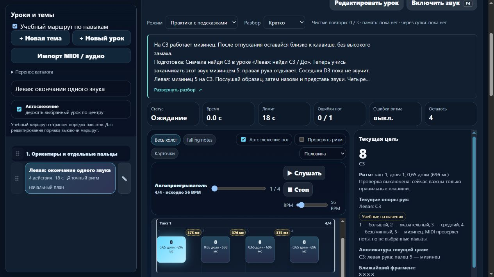

# Пианино: точные подписи длительности и читаемый ритмический холст

Партия **2026-11-06-11**, MelodiaJest **23.5.16**. Завершён **системный этап отображения**: новых и педагогически пересмотренных уроков **0**. [Машинные доказательства](piano-curriculum-2026-11-06-11-verification.json).

Пробуждение — **5 ноября, 23:20:07 UTC**; дата отчёта — 6 ноября по Asia/Yekaterinburg. Этап выполнен последовательно в текущем checkout. Интервал 20 минут не использовался как срок завершения.

## Подтверждённая ошибка

Прежняя `rhythmDurationLabel` выбирала название по широкому диапазону: всё от 0,375 до 0,75 доли называлось восьмой, от 0,75 до 1,25 — четвертью. Поэтому в текущей цели и холсте **0,65 доли** назывались восьмой, **0,85** — четвертью, **0,3** — шестнадцатой. Длительность звука и правильное название нотного значения различались.

Проверены действующие примеры `detail-p-release-02`, `detail-p-triads-02`, `detail-p-staccato-01`. Для сравнения сохранён правильный пример **1,5 доли** из `course09-01`, четверть с точкой. Исходное HTML-воспроизведение ошибки записано до изменения.

## Что изменено

В **`piano-learning-ui.js`** выделена чистая **`rhythmDurationView`**, её типовой контракт находится в **`.d.ts`**. Функция принимает длительность в четвертных единицах — именно так хранятся `durationBeats` в действующей модели, независимо от знаменателя размера.

| Значение | Отображение в текущей цели |
| --- | --- |
| 0,3 | `0,3 доли (321 мс)` в проверенном образце при исходных 56 BPM |
| 0,65 | `0,65 доли (696 мс)` |
| 0,85 | `0,85 доли (911 мс)` |
| 0,5 | Восьмая с числовым пояснением |
| 0,75 | Восьмая с точкой |
| 1,25 | Числовая длительность, без неверного названия четверти с точкой |
| 1,5 | Четверть с точкой |
| 2 / 3 / 4 / 6 | Половинная / половинная с точкой / целая / целая с точкой |

Названия и соответствующие знаки выдаются только для эквивалентных стандартных значений. Допуск ограничен шумом арифметики с плавающей точкой, **не** допуском исполнения. Остальные длительности показываются числами. Форматирование использует `Intl.NumberFormat` и `Intl.PluralRules`: **1 доля / 2 доли / 11 долей**. Если число округлено до шести значащих цифр, ставится **«≈»**: например, `≈0,333333 доли`. Это не попытка восстановить нотную запись, триоль или лигу из одного звучащего интервала. Повреждённое значение не превращается в фиктивную шестнадцатую.

Текущая цель даёт полное название и числовую длительность. Тесная карточка холста использует соответствующий нотный знак для стандартного значения; полное название остаётся в цели и подсказке карточки. У нестандартного значения остаётся числовая подпись. Миллисекунды сохранены. В текущей цели числовое значение не дублируется дважды.

Браузер выявил обрезание строк в коротких событиях. Подпись теперь переносится, карточка имеет необходимую высоту, расстояния между дорожками и паузами согласованы. Нотные координаты по времени, последовательность событий и длительности не изменяются. Реальные импортированные дроби и короткие стандартные значения дополнительно проверены в существующем MIDI-фрагменте библиотеки.

Инвентаризация нашла **311 существующих записей** с числовыми длительностями, **18 309 событий**: в основном проектные 0,85, также 0,65/0,3 и дроби импортированного MIDI. Эти числа описывают отображение каталога. Они **не** увеличивают число уроков, самостоятельных целей или проверенных педагогом материалов. Точность нотной редакции всего корпуса этим не подтверждается.

## Первоисточники и навыки

Заново прочитаны:

- **The Open University / OpenLearn**, [§3.1 Time values](https://www.open.edu/openlearn/history-the-arts/music/an-introduction-music-theory/content-section-3.1), **Examples 13–14 и пояснение отношений длительностей**: последовательное деление пополам; целая равна четырём четвертям, половинная — двум.
- **The Open University / OpenLearn**, [§3.5 Dots and ties](https://www.open.edu/openlearn/history-the-arts/music/an-introduction-music-theory/content-section-3.5), **пояснение перед Example 18 и Examples 18–19**: точка прибавляет половину исходной длительности.

Источники подтверждают отношения значений, не утверждают уроки, числовые допуски проекта или качество исполнения. В журнале **24** источника; добавлены **два применения к системному отображению**, отдельно от реализации/педагогического пересмотра уроков. Учебные инструкции не переписывались. Исторические сведения без отдельного подтверждения не добавлялись.

Через проектный **`find-skills`** повторно проверен подходящий [web-design-guidelines](https://skills.sh/vercel-labs/agent-skills/web-design-guidelines) и его источник Vercel. Прочитаны свежие [Web Interface Guidelines](https://raw.githubusercontent.com/vercel-labs/web-interface-guidelines/main/command.md): локализованные числа, обработка неизвестных значений, читаемость длинного содержимого и клавиатурный доступ. Использован уже установленный навык; новых библиотек, плагинов или веб-зависимостей нет. Это развитие чистого представления перед постепенным переносом оболочки, не завершённая React/Next.js-миграция.

## Сохранность и проверки

**`npm test`: 358/358**, ошибок **0**, финальный запуск **153,29 с**. Добавлены **8** тестов; целевая серия — **8/8**. Проверены стандартные значения и значения с точкой, числовые исключения, повреждённые входы, границы машинной арифметики, действующая текущая цель и холст, сохранение памяти, JSON-редакции, MIDI-путь и длительности звука при разных темпах.

Первоначальный полный запуск с числовыми подписями также прошёл **358/358**. После браузерного обнаружения обрезания коротких MIDI-событий добавлены компактный нотный знак и достаточная высота; финальный полный запуск повторён из-за новых изменений представления. Музыкальные аудиты повторно без необходимости не запускались: последующие изменения относятся только к представлению, неизменность данных подтверждена отдельным сравнением.

- **`audit:lessons`**: **421** пианистическая / **456** гитарных учебных записей, итоговая сводка ошибок `{}`.
- **`audit:fingering`**: **80** начальных уроков и **1036** назначений без ошибок структуры; десять ранее отмеченных неподдерживаемых случаев остаются.
- **`audit:curriculum`**: **569** пианистических / **713** гитарных записей, **157** MIDI-контрактов, жёстких ошибок **0**. Прежние предупреждения о ритме, полифонии и охватах сохранены.
- **`audit:piano-coverage`**: прежние **421** учебная запись / **157** MIDI-контрактов / **67** подробных описаний и сопоставлений / **3** конкретных будущих плана. **6** связанных повторений и **1** контроль дают верхнюю границу **414** целей. Полное число самостоятельных целей неизвестно, независимо отредактированных преподавателем — **0**; **1310 мест** по темам не являются готовыми уроками.

Сравнены все **569** записей до и после: музыка, инструкции, ID и относительный порядок прежние; изменённых музыкальных версий **0**, новых ID **0**. Сохраняется зачёт тех же версий; реальный контроллер MIDI с синтетическими событиями завершает проверенные примеры только после последнего отпускания. Приватная редакция с изменёнными описанием и длительностью **0,625** сохраняется после JSON-переноса и не переписывается встроенной миграцией.

SHA-256 неизменны у исходного `lesson-review-baseline.js`, MIDI-настроек, `lesson-development.js`, `piano-lesson-development.js`, `practice-assessment.js`, `fingering.js` и `curriculum-plan.js`. Гитарная карта прежняя, `guitarjest` не изменялся. `trainer-content.json` отсутствовал и не создавался. Чистый форматтер не меняет ноты, ритм, аппликатуру, воспроизведение, допуски или прогресс.

**`build:web`**: локальный выпуск **23.5.16**, **18** разрешённых браузерных файлов; все байты и SHA-256 совпадают с текущими исходниками. Локальные API, общий JSON-каталог и Windows endpoint не публикуются.

## Браузерный результат и ограничения

Изолированная проверка — **127.0.0.1:4191**. Проверены числовые подписи **0,3 / 0,65 / 0,85**, стандартная половинная, текущая цель и холст. На ширине **390×844** документ **376/376 px**, превью **112/22,4 px = пять строк**. Текст и миллисекунды проверенных коротких карточек помещаются по ширине и высоте.

Дополнительно явно открыт раздел **«Произведения»**, выбран существующий фрагмент **«Подготовка 1 · правая рука и быстрый рисунок»**: все **51** событие на мобильной ширине проверены измерением, обрезаний **0**. Среди них есть дробные длительности с «≈». Библиотека не стала частью учебного маршрута; классификация и ноты не менялись.

В узком окне выбор материала выполнен **Enter после поиска**; автоматизированные клики выбора под изменённой шириной не дали достаточного подтверждения, поэтому полная проверка указателя не заявлена. Доступное раскрытие, фокус, сохранение «Скрыто» после перезагрузки и возврат проверены. В памяти при выбранном развёрнутом виде нет карточки, длительностей, событий, клавиш, октав и подготовок. Ошибок консоли **0**. Настоящие MIDI и звук не включались; вкладка, временный размер и свой сервер убраны.

Отдельно воспроизведена старая неточность миллисекунд после изменения темпа практики: для `detail-p-release-02` при выборе **40 BPM** звук 0,65 доли длится в образце **975 мс**, а текст ещё показывает исходные **696 мс** от 56 BPM. В этой партии изменяется соответствие значения названию ноты, **масштабирование миллисекунд не менялось**. Это отдельный подтверждённый пункт следующего системного исправления, без изменения музыки и звука. Приведённые браузерные примеры выше проверены при исходном темпе.

## Точка продолжения

Музыкальная точка сохранена: последняя учебная партия — **2026-11-06-10**, последняя запись — **`detail-p-triads-02`**. Следующая учебная партия — **`detail-p-black-02` и `course08-02`**: проверить подготовку левых чёрных клавиш и предметно заменить правую половинную новой левой подготовкой там, где нужно двухдольное удержание. Не удалять остальные необходимые знания и не переносить проверенный статус другой редакции.

Следующий небольшой системный шаг — согласовать миллисекунды цели/холста/пауз с выбранным темпом практики, сохранив звук и оценку. Далее — типовой музыкальный документ и чистые адаптеры перед React/Next.js. Конечная пауза, удержанные голоса и педаль требуют отдельных моделей и тестов.

Штатный остаток общей квоты — **59%**, обычное использование разрешено. Политика **`until-exhausted`**, резерв и порог **0%**; общий расход не приписывается задаче. Локальный запуск без установки зависимостей сохранён. Домен ещё не куплен; покупка, DNS, публикация, commit/push не выполнялись.
