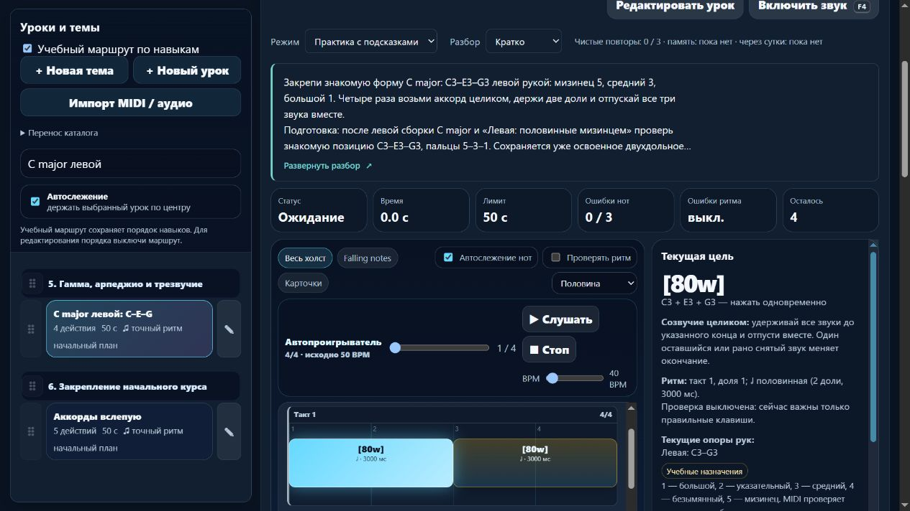

# Пианино: левая подготовка чёрных клавиш и аккорда, время практики

Партия **2026-11-06-12**, MelodiaJest **23.5.17**. Пересмотрены **два существующих урока**, новых **0**. Исправлены подготовки левой руки и отображение миллисекунд при смене BPM. [Машинные доказательства](piano-curriculum-2026-11-06-12-verification.json).

Пробуждение — **5 ноября, 23:46:07 UTC**, дата отчёта — 6 ноября по Asia/Yekaterinburg. Этап завершён последовательно в текущем checkout. Двадцать минут — интервал сигнала продолжения, не срок окончания партии.

## Два учебных исправления

| ID | Прежняя проблема | Проверенный результат |
| --- | --- | --- |
| `detail-p-black-02`, «Левая: группа из двух чёрных» | Требовалась правая пара `detail-p-black-01`; разбор был общим | Подготовка `course03-08` и `detail-p-release-04`, конкретные левое положение, пальцы, счёт, ошибки и перенос |
| `course08-02`, «C major левой: C–E–G» | Удержание готовилось правой половинной `course04-02` | Подготовка левой половинной `detail-p-left-half-01` вместе с `detail-p-triads-02` и `course03-08` |

**Чёрные клавиши.** Сохранены **C♯3–D♯3–C♯3–D♯3**, MIDI **49/51/49/51**, левая **4–2–4–2**, **56 BPM**. Четыре атаки через одну долю, каждое звучание **0,85 доли**, просвет **0,15**, последнее окончание через **3,85 доли**. Профиль остаётся обычным; это параметры образца проекта. Действуют прежние допуски оценки.

Теперь объясняется, как найти C3 и пару чёрных справа, как подготовить 4 у C♯3 и 2 у D♯3, спокойно переместив предплечье после отпускания прежней позиции. Между этими чёрными есть белая D3: она не звучит, интервал между звучащими нотами — **целый тон**. Клавиатура подписывает их C#3/D#3. Предлагается сначала молча найти опоры, затем разобрать переходы в обоих направлениях; запястье остаётся свободным, неудобное положение требует остановки и проверки.

Задача — новая подготовленная левая опора и чередование 4–2, применимое в дальнейших тональностях и мелодиях. Это короткое упражнение, не полная гамма. Слуховой ориентир — шаг вверх, возврат и ещё один шаг вверх. Проба переноса после попытки: **D♯3–C♯3–C♯3–D♯3**, **2–4–4–2**, с новым нажатием повторённой C♯3. Она выполняется отдельно у инструмента и не выдаётся за MIDI-последовательность урока, новую запись или независимый тест слуха.

**Левый C major.** Сохранены четыре созвучия **[C3 E3 G3]**, MIDI **[48 52 55]**, пальцы **5–3–1**, начала **0/2/4/6**, длительности **2/2/2/2 доли**, **50 BPM**, **`beat-boundary-v2`**, два такта 4/4. Новая левая половинная готовит двухдольное удержание, сборка — одновременную форму. Для исходного задания важно заново нажать все три клавиши и закончить их вместе.

Отдельная проба переноса теперь сочетает знакомые удержания с тишиной: **половинный C major → две доли паузы → половинный C major**. Счёт: «раз–два» звук, «три–четыре» отпускание и продолжение пульса, затем новое «раз–два». Длительность звука и пальцы сохраняются. Это самостоятельная проба после попытки, а не текущий MIDI-зачёт.

Оба урока содержат короткий блок около **3–5 минут**, самопроверку и возвращение после перерыва. Материал обозначен техническими упражнениями проекта. Конкретные 4–2 и 5–3–1, регистры, темпы и последовательности выбраны проектом; источники не объявлены авторами или утвердителями уроков.

Сохранены якоря представления **`after`**, ID и пользовательский порядок. **`requires`** теперь указывает действительную подготовку нужной руки; генератор карты проверил её расположение раньше целевых уроков. Общая ступень **p5** по-прежнему следует за **p4**. У правого одиночного отпускания и двух групп трёх чёрных остаются отдельно подтверждённые связи для следующей партии; полная независимость всех веток не объявлена.

## Время выбранного темпа

До исправления `detail-p-release-02` при выбранных **40 BPM** показывал исходные **696 мс** от 56 BPM, хотя 0,65 доли в выбранном темпе занимает **975 мс**. Длительности и паузы брались из исходных миллисекунд. Кроме того, обработчик ползунка обновлял холст, но не область текущей цели.

Чистая **`PianoLearningUI.rhythmTimingView`** с контрактом **`.d.ts`** теперь рассчитывает отображение по явным долям. Исходные миллисекунды используются как масштабируемый запасной путь, когда данных в долях нет. Недоступное время остаётся неизвестным. Музыка, MIDI-допуски и воспроизведение не переписываются.

| Проверенный пример | Звук | Просвет до следующей атаки |
| --- | --- | --- |
| 0,65 / 0,35 доли при 40 BPM | **975 мс** | **525 мс** |
| Тот же пример при 56 BPM | **696 мс** | **375 мс** |
| Тот же пример при 80 BPM | **488 мс** | **263 мс** |
| Половинный C major при 40 BPM | **3000 мс** | Счётной паузы нет |

Обработчик **`changePracticeBpm`** сразу обновляет холст и отдельную область текущей цели, сохраняя фокус ползунка, позицию и события попытки. Геометрия долей и пауз на шкале сохраняется при смене темпа; меняются подписи времени.

Начатый MIDI-челлендж сохраняет уже зафиксированный темп попытки. Если ползунок изменён после её начала, цель и обычный холст показывают прежний темп и пояснение: начать заново и выбрать BPM для другого зачёта. Демонстрационный холст следует темпу проигрывателя. Поведение записи/оценки попытки не менялось. В памяти любые ответы и ритмический холст по-прежнему отсутствуют в DOM, включая изменение BPM.

Длительность здесь описывает музыкальные данные. Существующий минимум **70 мс** в помощнике звукового предпрослушивания сохранён: например, музыкальные 0,3 доли при 400 BPM — 45 мс, а помощник оставляет 70 мс для слышимости. Эта партия не доказывает физическую длительность звука аудиоустройства и не меняет его огибающую.

## Источники и сохранение редакций

Заново прочитаны четыре первичных источника:

- **Jerry Kovarsky**, Yamaha, [The Basics of Piano Keyboard Fingering](https://hub.yamaha.com/keyboards/k-how-to/the-basics-of-piano-keyboard-fingering/), **28 ноября 2023**, вступление, **The Basics / Scenario One**, варианты **Scenario Three**: нумерация 1–5 и предварительный выбор положения, в том числе на чёрных клавишах. Конкретные левые 4–2 автору не приписываются.
- **Dr. Diana Dumlavwalla**, Yamaha, [Fix It: Tips for Teaching Basic Piano Technique](https://hub.yamaha.com/music-educators/instruments/piano/piano-pedagogy-fix-basic-technique/), **29 ноября 2021**, **Tension in Arms / Inconsistent Hand Shape**, особенно пояснение гибкого запястья. Упражнения с поддержкой и отпусканием руки здесь не назначаются; универсальная физическая доступность не заявляется.
- **The Open University / OpenLearn**, [§3.1 Time values](https://www.open.edu/openlearn/history-the-arts/music/an-introduction-music-theory/content-section-3.1), **Examples 13–14 и пояснение отношений длительностей**: половинная равна двум четвертным единицам.
- **The Open University / OpenLearn**, [§7 Harmony: the triad](https://www.open.edu/openlearn/history-the-arts/music/an-introduction-music-theory/content-section-7), **Example 63 и root/third/fifth**: C–E–G, интервалы **4+3 полутона**, проверенные по реальным MIDI-высотам.

Прежние сведения **Duke/Simmons**, превью **Alfred Musical Fingers** и статьи Kovarsky о базовых трезвучиях сохранены как контекст, **заново не читались и не сканировались**. Журнал содержит **24 источника**, семь применений этой партии, четыре свежие проверки и отдельное системное применение отношений длительности. Исторические сведения без подтверждения не добавлялись.

Новая миграция защищена точными исходными отпечатками **`0abba0fc`** и **`d0dfb1a7`** и ожидаемой прежней редакцией. Отдельный **`preparationReview`** сохраняет предыдущие инструкции и отпечаток зачёта. Исходный **`blocked-triad-v1`** не перезаписывается. Личные названия, цели, разбор, подготовка, ноты, пальцы и классификация защищены; повторное применение ничего не меняет.

Музыкальные версии **`50b5c29a`** и **`eab4e917`** прежние, зачёт памяти остаётся действительным для соответствующего ID и версии. Высоты, длительности, пальцы, профиль и темп обоих упражнений сохранены. Сравнение всего каталога: **569 музыкальных версий** прежние, у **567 записей** также прежние инструкции, новых ID нет, относительный порядок всех старых ID сохранён.

Неизменны SHA-256 `lesson-review-baseline.js`, MIDI-настроек, общего `lesson-development.js`, `practice-assessment.js` и `fingering.js`. Гитарная часть карты имеет прежний хеш; `guitarjest` не изменялся. `trainer-content.json` отсутствовал и не создавался. Изменения данных для удержанных голосов и педали не вводились.

## Проверки и локальный выпуск

**`npm test`: 370/370**, ошибок **0**, **162,67 с**. Добавлены **12** содержательных тестов; целевая серия **12/12**. Проверены точные ноты/пальцы/время, подготовки и карта, защита редакций, JSON и сохранение зачёта, настоящий контроллер MIDI с синтетическими событиями, числовое время и паузы, немедленный контроллер ползунка, зафиксированный темп челленджа и скрытие памяти.

Прежний тест карты теперь проверяет принадлежность конкретного урока реальному направлению вместо общего числа подробных записей. Проверка неизвестных направлений сохранена. Проверка переноса трезвучия различает прежний правый длинный звук и новую левую фразу с паузой; музыкальные проверки не удалены.

- **`audit:lessons`**: **421** пианистическая / **456** гитарных учебных записей, итоговая сводка ошибок `{}`.
- **`audit:fingering`**: **80** начальных уроков, **1036** назначений, ошибок структуры **0**. Десять ранее отмеченных неподдерживаемых случаев сохраняются.
- **`audit:curriculum`**: **569** пианистических / **713** гитарных записей, **157** MIDI-контрактов, жёстких ошибок **0**. Предупреждения о ритме, полифонии и охватах остаются.
- **`audit:piano-coverage`**: **421** учебная запись / **157** MIDI-контрактов / **68** подробных описаний и сопоставлений / **3** конкретных будущих плана. **6** повторений и **1** контроль дают верхнюю границу **414** целей; число доказанно самостоятельных целей не установлено. Независимо отредактированных преподавателем — **0**, **1310 мест** по темам не являются готовыми уроками.
- **`build:web`**: локальный выпуск **23.5.17**, **18** разрешённых браузерных файлов, все байты и SHA-256 совпадают с текущими исходниками. Локальные API, общий JSON и Windows-запуск в интернет не выставлялись.

Изолированный браузер **127.0.0.1:4192** проверил обе карточки и именованные левые подготовки с возвратом фокуса. Нативными клавишами ползунка подтверждены **40/80 BPM**, немедленная текущая цель, соответствующие подписи холста и пауз, сохранение фокуса. Половинный аккорд при 40 BPM показывает 3000 мс и прежнюю подсказку общего окончания.

При **390×844** документ **376/376 px**, превью **112/22,4 px = пять строк**; подписи чёрных клавиш при 40 BPM помещаются по ширине и высоте. Enter раскрывает полный материал с фокусом, пробел сворачивает. «Скрыто» сохраняется после перезагрузки, выбор доступен для возврата. При памяти с выбранным развёрнутым видом смена BPM не возвращает карточку, длительности, события, клавиши, октавы и подготовки. Ошибок консоли **0**. Настоящие MIDI и звук в браузере не включались; временная вкладка, размер и свой сервер убраны.

Применён ранее выбранный через **find-skills** навык **web-design-guidelines**, заново прочитаны [актуальные правила Vercel](https://raw.githubusercontent.com/vercel-labs/web-interface-guidelines/main/command.md). Проверялись именованные действия, фокус, немедленная обратная связь, читаемость и скрытие ответов. Чистая типовая функция готовит постепенное выделение представления; новые библиотеки, плагины и обязательная установка зависимостей не вводились. Полная React/Next.js-миграция не объявлена готовой.

## Продолжение

Следующая малая партия: **`detail-p-release-01`, `detail-p-black-03`, `detail-p-black-04`**. У правого одиночного отпускания ещё требуется левая пара; правая группа трёх чёрных требует левую пару, а левая группа трёх — правую. Проверить реальные направления и пальцы, затем выбрать действительную подготовку каждой руки, сохранив нужные ориентиры и счёт. Автоматически удалять все перекрёстные связи нельзя.

Следующий системный этап — типовой музыкальный документ и чистые адаптеры каталога, нот, редакций и прогресса перед React/Next.js; конечная пауза, удержанные голоса и педаль остаются отдельными моделями с тестами.

Штатный остаток общей квоты — **58%**, обычное использование разрешено. Политика **`until-exhausted`**, резерв и порог **0%**; общий расход не приписывается задаче. Домен не куплен; покупка, DNS, публикация, commit/push не выполнялись.
