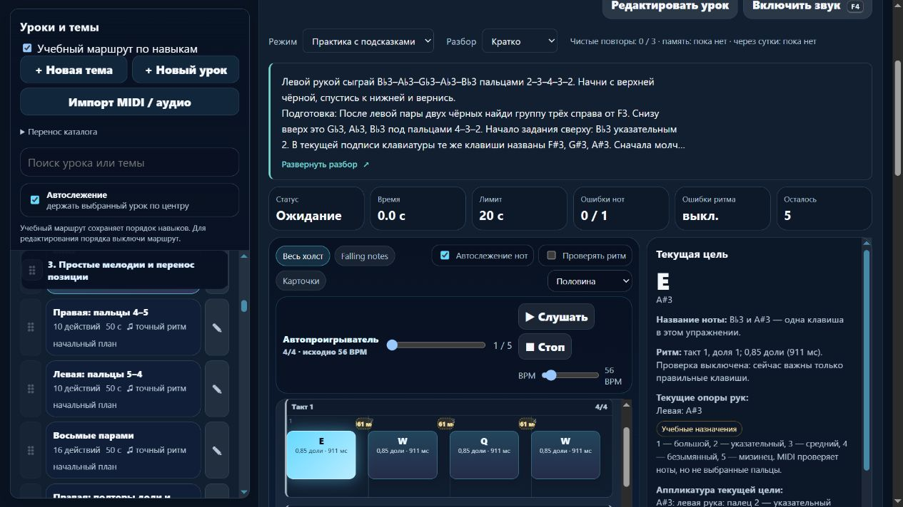

# Партия 6 ноября 2026, 13 — подготовка чёрных клавиш и названия текущей цели

Сигнал: **2026-11-06T00:16:07.991Z**, часовой пояс Asia/Yekaterinburg. Локальный выпуск **23.5.18**. Новых уроков **0**, пересмотренных записей **4**; три прежних урока на чёрных клавишах получили подробное происхождение и разбор. [Машинные доказательства](piano-curriculum-2026-11-06-13-verification.json).

## Что найдено и исправлено

Правое одиночное отпускание требовало левую пару; правая группа трёх чёрных — левую пару чёрных; левая группа трёх — правую. При проверке обнаружена ещё одна смешанная подготовка: правая пара чёрных требовала общий экзамен `course05-08`, содержащий обе руки. Это четыре конкретных случая; прочие перекрёстные связи не удалялись массово.

| Запись | Прежняя подготовка | Подготовка этой редакции | Сохранённая музыка |
| --- | --- | --- | --- |
| `detail-p-release-01` | `course01-04`, левая C3–D3 | `course01-01`, правая C4 | Четыре C4 правым 1, звучание 0,65 и просвет 0,35 доли |
| `detail-p-black-01` | `course05-08`, смешанный экзамен | `course02-08` и `detail-p-release-03`, правая позиция и окончания пары | C♯4–D♯4–C♯4–D♯4 правыми 2–3–2–3 |
| `detail-p-black-03` | `detail-p-black-02`, левая пара | `detail-p-black-01`, правая пара | F♯4–G♯4–A♯4–G♯4–F♯4 правыми 2–3–4–3–2 |
| `detail-p-black-04` | `detail-p-black-03`, правая группа трёх | `detail-p-black-02`, левая пара | B♭3–A♭3–G♭3–A♭3–B♭3 левыми 2–3–4–3–2 |

Во всех четырёх — **56 BPM**. У чёрных клавиш обычный профиль: **0,85 доли звучания / 0,15 до следующего вступления**. Правая группа трёх начинает снизу вверх, левая — сверху вниз, хотя номера идут одинаково. Концы исходных фраз: **3,65 / 3,85 / 4,85 / 4,85 доли**. Конечная тишина отдельно не оценивается. Эти короткие позиционные рисунки не названы полными гаммами.

Разбор объясняет цель, подготовку, свободное перемещение после отпускания, регистр, счёт, пальцы, ошибки и слуховой образец. Для трёх чёрных уроков добавлены отдельные пробы переноса: **D♯4–C♯4–C♯4–D♯4** (3–2–2–3), **G♯4–A♯4–G♯4–F♯4** (3–4–3–2), **A♭3–G♭3–A♭3–B♭3** (3–4–3–2). Они выполняются отдельно у инструмента, не становятся новой текущей MIDI-последовательностью или дополнительными уроками. Предусмотрен короткий блок около 3–5 минут и возврат после перерыва. Известный образец не считается независимым тестом слуха.

`learning.after` и порядок каталога сохранены: это якоря отображения. Фактическая подготовка задаётся `requires`; карта пересобрана. Следующие переносы названы отдельным будущим разбором, без обещания автоматической готовности.

## Небольшое улучшение интерфейса

Воспроизведено расхождение: левая карточка называла **B♭3**, а текущая цель показывала только **A#3**. Чистая `PianoLearningUI.flatNameHtml` с контрактом `.d.ts` при явном профиле `flat-alias-v1` добавляет: **«B♭3 и A#3 — одна клавиша в этом упражнении»**. Для следующих целей это A♭3/G#3 и G♭3/F#3. Высоты **58/56/54**, регистр и пальцы не переписаны.

Функция принимает одну допустимую MIDI-высоту чёрной клавиши. Неизвестный профиль, белая клавиша, созвучие, строка, дробь, NaN или выход за MIDI-диапазон не дают выдуманной подписи. Проверены все пять пар и границы октав. Подсказка подключена только к явному уроку; полноценная нотная орфография остаётся отдельной задачей. В памяти она отсутствует в DOM при «Кратко / Развёрнуто / Скрыто», в том числе после смены BPM.

## Источники и независимые сверки

Свежим чтением проверены четыре первоисточника; конкретные ID, разделы, применение и ограничения добавлены в `docs/piano-curriculum-sources.json`:

- **Jerry Kovarsky**, Yamaha, 28.11.2023: [The Basics of Piano Keyboard Fingering](https://hub.yamaha.com/keyboards/k-how-to/the-basics-of-piano-keyboard-fingering/), вводное планирование, The Basics, Scenario One с положениями на чёрных, альтернативы Scenario Three. Подтверждает нумерацию и подготовку позиции; точные 2–3 / 2–3–4, темп и допуски выбраны проектом. Большие растяжения из статьи не назначались.
- **Dr. Diana Dumlavwalla**, Yamaha, 29.11.2021: [How to Fix Common Technical Problems](https://hub.yamaha.com/music-educators/instruments/piano/piano-pedagogy-fix-basic-technique/), Tension in Arms и Inconsistent Hand Shape, абзац о поддержанной руке и гибком запястье. Не является физической проверкой наших пальцев или медицинской гарантией.
- **Carl Czerny**, [Dritter Brief](https://www.koelnklavier.de/quellen/czer-brf/brief-03.html), первоначальная пагинация **с. 20–21**, цифровая транскрипция KölnKlavier/Wolfgang Lempfrid, издание A. Diabelli без установленной здесь даты. Повторно прочитано различение удержания и тишины, раннего и позднего отпускания; новый скан не сверялся. Сохранён общий исторический контекст правого отпускания. Наши четыре C4, большой палец, 56 BPM и отношение 0,65/0,35 не приписаны Черни.
- **Robert Hutchinson**, University of Puget Sound: [Music Theory for the 21st-Century Classroom, §1.5](https://musictheory.pugetsound.edu/mt21c/EnharmonicNotes.html), абзац сразу после **Figure 1.5.1** перечисляет все пять пар названий чёрных клавиш, в том числе F♯/G♭, G♯/A♭, A♯/B♭. Регистры и MIDI 54/56/58 сверены отдельно. Одинаковая клавиша не делает написания взаимозаменяемыми во всех нотных контекстах.

Ранее проверенный контекст **Duke/Simmons** о небольшой цели и возвращении после перерыва использован повторно; в этой партии не перечитывался. Проектные упражнения не объявляются рекомендованными этими авторами или проверенными преподавателем. Для нового чёрного материала исторические ученики, цитаты и заимствованные пьесы не придумывались.

## Сохранность и проверки

`reviewRightReleaseAndBlackGroups` меняет только точные замороженные инструкции. Предыдущие объяснения хранятся в отдельном `preparationReview`; прежний `early-release-v1` сохранён. Изменённые пользователем заголовок, цель, пальцы, ритм, классификация или подготовка не перезаписываются. Повторная регистрация ничего не меняет.

Музыкальные отпечатки **всех 569** записей совпали; инструкции изменились ровно у четырёх, остальные **565** совпали вместе с музыкой. Исходные `steps`, `rhythm`, руки и пальцы четырёх уроков дополнительно сравнены с замороженным JSON. Версии зачёта **d1eab36d / e2814691 / da3754b5 / ef39f991** сохранены, поэтому прежняя память не инвалидируется. JSON сохраняет историю, личное объяснение и явный профиль бемолей. Порядок, классификация, неизменяемый baseline, MIDI ini, общий lesson-development, оценка, алгоритм пальцев и гитарная карта сохранены. `trainer-content.json` отсутствовал и не создавался; `guitarjest` не изменялся.

- **npm test: 379/379**, ошибок **0**, **174611,1261 мс**. Добавлено **9** содержательных тестов; целевой запуск с прежней проверкой отпусканий **14/14**. Проверялись реальные исполняемые функции, точные данные, транзитивная подготовка, защита редакций, JSON и MIDI-контроллер с корректной фразой, неверной высотой, ранним и поздним последним отпусканием. Подтверждение наступает после последнего NoteOff. Физические пальцы и художественное качество этим не доказаны.
- **audit:lessons**: **421** пианистическая / **456** гитарных учебных записей, сводка ошибок `{}`.
- **audit:fingering**: **80** начальных уроков / **1036** назначений, структурных ошибок **0**.
- **audit:curriculum**: **569** пианистических / **713** гитарных записей, **157** MIDI-контрактов, жёстких ошибок **0**. Прежние предупреждения о полифонии, исходном ритме и охватах остаются.
- **audit:piano-coverage**: **421** учебная запись / **157** MIDI-контрактов / **71** подробное описание с отдельным происхождением и сопоставлением / **3** будущих конкретных плана. Шесть явных повторений и один контроль дают верхнюю границу **414** целей; доказанное число самостоятельных целей ещё не установлено. Преподавательских проверок **0**. **1310 тематических мест** не являются 1000 готовыми уроками.
- **build:web**: **23.5.18**, **18** разрешённых файлов; все байты и SHA-256 совпали с текущими исходниками. `git diff --check` прошёл. Локальный API, общий JSON и Windows launch endpoint не публиковались.

Изолированный браузер **127.0.0.1:4193** проверил четыре карточки, все именованные подготовки и переходы правой/левой руки с фокусом заголовка. При **390×844** ширина **376/376 px**, превью **112 / 22,4 px = пять строк**, бемольная подпись **272/272 px**. Enter раскрывает, пробел сворачивает, фокус сохраняется. «Скрыто» сохраняется после перезагрузки и доступно для возврата. В памяти при выбранном развёрнутом виде после смены до **40 BPM** в DOM нет карточки, бемольного пояснения, длительностей, нотных событий, клавиш, октав и подготовок. Ошибок консоли **0**; настоящий MIDI и звук не включались. Временная вкладка закрыта, размер восстановлен, собственный сервер остановлен.

Применён ранее выбранный через **find-skills** навык **web-design-guidelines**; прочитаны [актуальные правила Vercel](https://raw.githubusercontent.com/vercel-labs/web-interface-guidelines/main/command.md). Применение записано в реестре навыков и направлении дизайна: именованные действия, фокус, пять строк, компактное понятное название и отсутствие ответов в памяти. Новые библиотеки и обязательная переустановка не вводились. Наличие `.d.ts` не объявляется готовой React/Next.js-миграцией.

## Продолжение

Следующий системный этап — **версионированный типовой музыкальный документ и один чистый адаптер с точным обратным преобразованием** до переноса оболочки. Сохранить ID, индивидуальное время нот, редакции, классификацию, порядок, аппликатуру отдельно от высоты, MIDI/звук и версии прогресса; содержательно проверить гитарный контракт без записи в `guitarjest`.

Музыкальная точка сохранена: затем отдельно исследовать **`detail-p-relocate-01/02/04`**, роль `course05-07` и фактические движения. Известный кластер десяти подготовок закрыт, глобальные требования этапов сохранены; все связи всего курса не объявляются проверенными. Удержанные голоса, педаль, конечная пауза и независимая редактура преподавателем остаются отдельными задачами. Минимум **1000** содержательных уроков пока не достигнут.

Штатный остаток общей квоты — **58%**, обычное использование разрешено. Политика **until-exhausted**, резерв/порог **0%**, без точного индивидуального бюджета или аппаратного отсечения. Домен не куплен; регистрация, оплата, DNS, публикация, commit/push не выполнялись.
