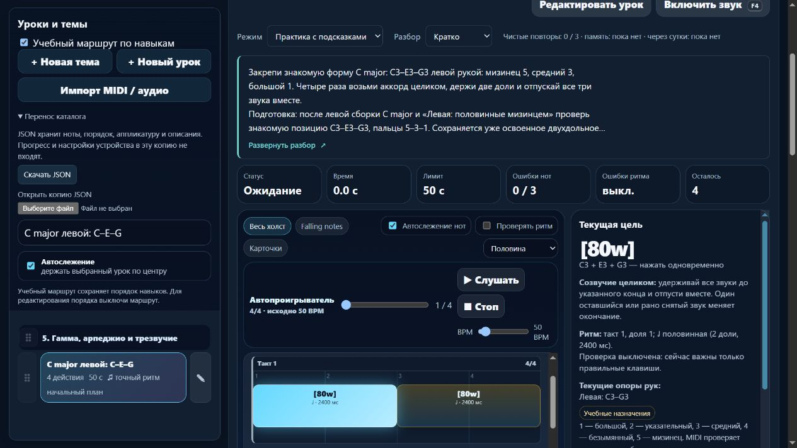

# Партия 6 ноября 2026, 14 — музыкальный документ и обратимый адаптер

Системный этап по сигналу **2026-11-06T00:43:08.388Z**, Asia/Yekaterinburg. Локальный выпуск **23.5.19**. Новых и пересмотренных уроков **0**. Музыкальная точка остаётся в [партии 13](piano-curriculum-2026-11-06-13.md). [Машинные доказательства](piano-curriculum-2026-11-06-14-verification.json), [контракт и границы](../MUSIC_DOCUMENT_V1.md).

## Проверенный результат

Выделены `music-document.js` / `.d.ts` и `piano-catalog-adapter.js` / `.d.ts`. Общий документ хранит отдельные ноты с ID партии, звучащей высотой и собственным интервалом. Время может быть явно неизвестным. Есть проверки версии, уникальности ID, ссылок, MIDI/частоты/непитчевого события и допустимости времени. Квантование, изменение высот и автоматическое исправление рук не выполняются.

Настоящие `KEY_MAP` и `parsePattern` вынесены из `index.html` в чистый модуль и используются приложением. Замороженные до выделения отпечатки `steps` и `display` совпали у **569/569** записей; совпала и вся карта клавиш. Сохранены порядок аккорда, быстрые группы, пробелы, неизвестные символы и прежнее чтение незакрытых скобок. Алгоритмы аппликатуры и зачёта не переписаны.

`project` связывает ноты с отдельно хранящимися явными руками и пальцами; правильность не угадывается по регистру. `restore` проверяет связь представления с архивированной исходной JSON-записью и отклоняет неподдерживаемые изменения, сохраняя источник. Это **проекция для чтения**, без нового музыкального редактора. Полный источник сохраняет классификацию, порядок, инструкции, истории исправлений, пользовательские поля и план. Обычный формат каталога остаётся **v7**.

Команда **`npm run audit:music-document`** проверила:

| Показатель | Результат |
| --- | ---: |
| Записей каталога | 569 |
| Отдельных нот | 39 247 |
| Нот с исходным точным временем | 23 102 |
| Нот с явно неизвестным временем | 16 145 |
| Записей без точного ритма | 141 |
| Явных пианистических назначений | 1 507 |
| Многозвучных действий с прежним общим временем | 3 258 |

У старого аккордового действия одна длительность на группу. Адаптер отмечает `LEGACY_SHARED_CHORD_TIME`, не восстанавливает выдуманные отдельные окончания. Общая модель допускает разные интервалы нот; обратное редактирование старого аккорда отклоняется, пока нет соответствующей исполнительской модели. Неизвестный ритм не выводится из пробелов или скорости набора Virtual Piano. Сохранение явной частоты либо непитчевого события в контракте не означает их исполнения нынешним пианистическим звуком.

## Что уточнила проверка

**Версия каталога и зачёт различаются.** Сериализация не содержит runtime-индексы шагов ритма. У `detail-p-black-04` сырая подпись каталога — `567b2cf1`, действующий зачёт — `ef39f991`; у правого отпускания — `aa8588c5` и `d1eab36d`. Редакция нового документа явно помечена `piano-catalog-v7:` и не используется для выдачи зачёта. Аудит восстановил каталог в изолированном настоящем приложении и подтвердил сохранение **всех 569** runtime-версий. Прежняя память не инвалидируется; архив прогресса этим этапом не вводится.

**Полный проход не нужен в обычном экспорте.** Один локальный замер на JSON **8 050 304 байта** показал около **42,2 мс** записи JSON и ещё **1082,7 мс** проекции с проверкой возврата. Добавление такого прохода к интерактивному импорту/экспорту исключено. В финальном коде тяжёлая проекция вызывается только отдельным аудитом; приложение использует выделенный разборщик. Замер не выдаётся за универсальное ускорение или браузерный показатель.

Соседний портал проверен чтением `libre/package.json`: Next.js, React и TypeScript уже присутствуют. Их сервисы, конфигурация, ключи и зависимости не менялись. Для деклараций использован уже установленный TypeScript **5.8.3** с `--noEmit`; локальному тренажёру установка по-прежнему не нужна. Новый веб-пакет и перенос компонента ещё впереди.

## Источники и навыки

- **Microsoft / TypeScript**, [Modules .d.ts](https://www.typescriptlang.org/docs/handbook/declaration-files/templates/module-d-ts.html), разделы Optional Global Usage и Testing your types: согласование JS-модуля, UMD-глобального имени и декларации. Строго проверен потребитель контракта, включая ожидаемые ошибки для пальца 0, чтения неизвестной длительности, записи в readonly-ноты и исполняемых метаданных.
- **W3C Music Notation Community Group**, MusicXML **4.0**: [duration](https://www.w3.org/2021/06/musicxml40/musicxml-reference/elements/duration/), описание длительности, записи и исполнительских attack/release; [chord](https://www.w3.org/2021/06/musicxml40/musicxml-reference/elements/chord/), абзацы о совпадающей либо более короткой добавочной ноте. Подтверждает необходимость отдельных границ, но не задаёт нашу схему. Импорт MusicXML не реализован.
- Через **find-skills** свежим чтением проверены [каталог skills.sh](https://skills.sh/) и [официальный репозиторий Vercel](https://github.com/vercel-labs/agent-skills). Прочитан проектный `react-best-practices`; применены общие JS-правила `js-set-map-lookups` и `js-early-exit` для ID и ссылок. React и дизайн на этом этапе не переписывались. Установка навыков, библиотек и дополнительных плагинов не выполнялась.

Два технических первоисточника добавлены в журнал с `systemApplications`, без приписывания им проверки уроков. Ранее проверенные музыкальные материалы не пересматривались и не получают новый педагогический статус.

## Проверки и сохранность

- **npm test: 391/391**, ошибок **0**, **158927,6928 мс**. Добавлено **12** содержательных тестов; целевой запуск **17/17**. Проверяются исполняемый разборщик, все текущие JSON-записи, разные окончания голосов, триольные значения без квантования, частота без округления, неверные документы, неизвестное время, явные руки/пальцы, защита редакций и различие версии каталога/зачёта.
- **Строгий TypeScript**: `tsc 5.8.3 --noEmit --strict --target ES2022 --module commonjs --lib ES2022`, без ошибок. Проверяются новые декларации и `tools/type-tests/music-document.ts`; это не типизация всего монолитного приложения.
- **audit:music-document**: все 569 исходных JSON-записей восстановлены точно; после настоящего `applyCatalogSnapshot` все версии зачёта совпали. Сам аудит занял около **3004 мс** при одновременном целевом прогоне; это измерение включает изолированное восстановление, не является показателем скорости интерфейса.
- **audit:lessons**: **421** пианистическая / **456** гитарных учебных записей, сводка ошибок `{}`.
- **audit:fingering**: **80** начальных уроков / **1036** назначений, структурных ошибок **0**.
- **audit:curriculum**: **569** пианистических / **713** гитарных записей, **157** MIDI-контрактов, жёстких ошибок **0**. Старые предупреждения о ритме, полифонии и охватах остаются.
- **audit:piano-coverage**: **421** учебная запись / **157** MIDI-контрактов / **71** подробное описание с сопоставлением / **3** конкретных будущих плана. Преподавательских проверок **0**; шесть повторений и один контроль дают лишь верхнюю границу **414** целей, а **1310** тематических мест не являются готовыми уроками.
- **build:web**: **23.5.19**, **20** разрешённых файлов. Все байты и SHA-256 совпали с текущими исходниками; корень проекта, `server.cjs`, JSON-каталог и Windows endpoint не выставлялись в интернет. `git diff --check` прошёл.

Ноты, инструкции и каталог всех 569 записей сохранены. Совпали защищённые baseline, MIDI ini, общий lesson-development, алгоритмы пальцев и оценки, гитарная карта. `trainer-content.json` отсутствовал и не создавался. Проверки читают реальный гитарный курс и сохраняют его подписи и независимые результаты; записи в `guitarjest` не было.

Изолированный браузер **127.0.0.1:4194** загрузил оба модуля и показал настоящий левый аккорд **C3–E3–G3**, пальцы **5–3–1**, половинную длительность **2400 мс при 50 BPM**. В памяти при выбранном развёрнутом разборе отсутствуют материал, события, клавиши, октавы и подготовки. Ошибок консоли **0**. Настоящие MIDI и звук не включались.

Кнопкой скачан JSON v7: **569 записей / 93 темы / 8 050 304 байта**, с прежней классификацией и профилем бемолей, без прогресса. Файл: `D:\Загрузки\melodiajest-catalog-2026-11-06.json`. Браузерная операция завершилась после длительного ожидания инструмента, файл имеет `savedAt` **2026-11-06T03:36:37.919Z**; это ожидание не считается временем выполнения приложения. После него квота перепроверена. Вкладка закрыта, собственный сервер остановлен; прежний просмотр на 4173 не затрагивался.

Сопоставление выгрузки с другим чистым запуском выявило прежние генерируемые ID тем у **15** записей. После разрешения темы по её названию, порядку и классификации все поля уроков и структура тем совпали. Это различие двух новых инициализаций, а не потеря ID при возврате одной копии: внутри одной исходной копии адаптер сохраняет ID точно. Стабильность начальных тем записана отдельной проверкой перед дальнейшей веб-миграцией; пользовательские ID автоматически не переписывались.

## Следующий шаг и ограничения

Следующая малая музыкальная партия — **`detail-p-relocate-01/02/04`**: прочитать первоисточники, проверить реальные движения, руки, пальцы и роль `course05-07`, затем обоснованно исправить 1–3 записи. Перекрёстные требования не удалять массово. Музыкальный курс, источники и перенос навыков остаются приоритетом.

Затем — один компонент чтения в отдельном необязательном React/Next.js-пакете на новом контракте. Сохраняемые noteId через редактирование, полноценные партии/аранжировки, орфография, темповая карта, педаль, удержанные голоса в пианистическом исполнении и отдельный перенос прогресса требуют следующих этапов. Наличие модели и `.d.ts` не означает готовую миграцию.

Штатная квота после браузерной операции: **55% осталось**, обычное использование разрешено, другие окна не исчерпаны. Политика **until-exhausted**, резерв/порог **0%**, без обещания точного бюджета или аппаратного отсечения. Домен не куплен; покупка, DNS, публикация, commit/push не выполнялись.
