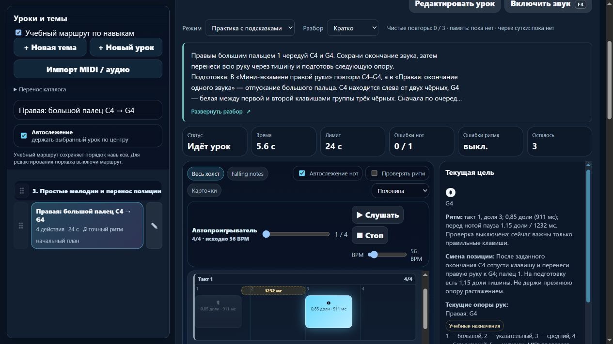

# Партия 6 ноября 2026, 15 — переносы и новая позиция своей руки

Сигнал **2026-11-06T03:48:41.305Z**, Asia/Yekaterinburg. Локальный выпуск **23.5.20**. Новых уроков **0**, пересмотренных записей **4**. [Машинные доказательства](piano-curriculum-2026-11-06-15-verification.json).

## Найдено и исправлено

Правая подготовка большого пальца ссылалась на `course05-07`, то есть более длинный **левый** перенос C→F. Затем левый перенос требовал правый, правая новая позиция — левый, а левая новая позиция — правую. Прочитаны фактические данные четырёх записей и подготовок; неподходящие связи заменены индивидуально, без массового удаления требований.

| Урок | Новая подготовка | Исходные ноты и пальцы |
| --- | --- | --- |
| `detail-p-relocate-01` | `course02-08`, `detail-p-release-01` | C4–G4–C4–G4, правый 1–1–1–1 |
| `detail-p-relocate-02` | `course03-08`, `detail-p-release-02` | C3–F3–C3–F3, левый 5–5–5–5 |
| `detail-p-relocate-03` | `detail-p-relocate-01`, `course02-08` | G4–B4–D5–B4–G4, правая 1–3–5–3–1 |
| `detail-p-relocate-04` | `detail-p-relocate-02`, `course03-08` | F3–A3–C4–A3–F3, левая 5–3–1–3–5 |

Якоря `learning.after`, ID, порядок и общие требования этапов сохранены. Настоящая подготовка находится в `requires`; карта пересобрана и проверена на последовательность и отсутствие циклов. Правый и левый мини-экзамены уже готовят соответствующие белые опоры и форму 1–3–5 / 5–3–1. Группы G–B–D и F–A–C вводятся как разложенные звуки трезвучий в новой позиции, без обязательного одновременного аккорда или полной гаммы.

Подробный разбор теперь объясняет, что играть, зачем, где применяется движение, подготовку, медленный разбор, счёт, ошибки, слуховой образец, самопроверку и следующий шаг. В первых двух уроках сначала заканчивается звук, затем рука переносится через тишину. В последних двух новая позиция готовится **до первого звука**; внутри пятизвучной фразы не нужен новый перенос на каждую терцию. Верхнюю **C4** в левой фразе играет именно левый большой палец.

Во всех четырёх сохранены **56 BPM**, обычный профиль и звучание **0,85 доли**. У двух переносов вступления на **0, 2, 4, 6** долях, тишина перед следующими **1,15 доли**, окончание фразы **6,85**. Счёт — «раз»/«три», с продолжением пульса на «два»/«четыре». У фигур вступления **0, 1, 2, 3, 4**, просвет **0,15**, окончание **4,85**. Конечная тишина отдельно не оценивается. Ни темп, ни интервалы допусков не приписаны авторам источников.

Перенос навыка проверяется отдельно у инструмента: **G4–C4–C4–G4** большим 1; **F3–C3–C3–F3** мизинцем 5; **B4–D5–B4–G4** правой 3–5–3–1; **A3–C4–A3–F3** левой 3–1–3–5. Это новые короткие фразы для применения, без изменения текущей MIDI-последовательности и без увеличения счётчика уроков. Предусмотрены блок около 3–5 минут с остановками и повторение после перерыва. Известный образец не объявляется независимым тестом слуха.

## Удобство затронутого пути

Через существующий `positionCues` и типовой `PianoLearningUI.positionChangeHtml` текущая цель показывает, какую руку, когда и к какой опоре перенести. Например: после заданного окончания C4 отпустить клавишу, перенести правую руку к G4, палец 1; подготовка занимает **1,15 доли тишины**. Внутри фигур подсказка появляется только до первого звука и не требует лишнего перемещения.

HTML, CSS и чистый UI-модуль не менялись. При выключенных пальцах действует прежняя настройка; в памяти подсказка отсутствует независимо от «Кратко / Развёрнуто / Скрыто». Полный материал по-прежнему создаётся при раскрытии.

## Первоисточники

Свежим чтением проверены пять первоисточников; их разделы, применение, ограничения и ID внесены в журнал:

- **Jerry Kovarsky**, Yamaha, 28.11.2023: [The Basics Of Piano Keyboard Fingering](https://hub.yamaha.com/keyboards/k-how-to/the-basics-of-piano-keyboard-fingering/), вводный абзац о предварительном выборе пальцев и положения, The Basics. Это контекст планирования, а не предписание наших переносов одним пальцем.
- **Dr. Diana Dumlavwalla**, Yamaha, 29.11.2021: [Fix It: Tips for Teaching Basic Piano Technique](https://hub.yamaha.com/music-educators/instruments/piano/piano-pedagogy-fix-basic-technique/), Tension in Arms и Inconsistent Hand Shape, поддержанная рука и гибкое запястье. Упражнения с падением руки и медицинские гарантии не назначались.
- **Graham Fitch**: [Precision Measurement in Jumps](https://practisingthepiano.com/precision-measurement-in-jumps/), **Quick Cover**: подготовка, приход к поверхности клавиш, проверка попадания до звука. Использован только этот общий принцип. Требование очень быстрого прыжка, Springboarding и ноты Bruch из статьи не назначены. Дата конкретного поста не взята из карточек соседних публикаций. Наши упражнения не объявляются упражнениями Fitch или адаптацией нот Bruch.
- **Carl Czerny**: [Dritter Brief](https://www.koelnklavier.de/quellen/czer-brf/brief-03.html), первоначальная пагинация **с. 20–21**, цифровая транскрипция KölnKlavier/Wolfgang Lempfrid, издание A. Diabelli без установленной здесь даты: удержание ноты и тишина различаются, клавишу не следует отпускать раньше или позже требуемого конца. Новый скан не сверялся; конкретные значения 0,85/1,15 и 56 BPM выбраны проектом.
- **The Open University / OpenLearn**: [§7 Harmony: the triad](https://www.open.edu/openlearn/history-the-arts/music/an-introduction-music-theory/content-section-7), Example 63 и пояснения root/third/fifth, major third **4** и minor third **3** полутона. Проектные MIDI **67/71/74** и **53/57/60** независимо дают 4+3. Регистр, руку и пальцы источник не определяет.

Контекст **Duke/Simmons** о небольшой цели и возвращении после перерыва переиспользован, в этой партии не перечитывался. Педагогическая и физическая проверка преподавателем не утверждается. Исторические ученики, цитаты и биографические детали не добавлялись.

Применён ранее выбранный через **find-skills** навык **web-design-guidelines**; заново прочитаны [правила Vercel](https://raw.githubusercontent.com/vercel-labs/web-interface-guidelines/main/command.md). Проверены именованная подготовка, фокус, клавиатурное раскрытие, пять строк, перенос текста и отсутствие ответов в памяти. Новые библиотеки и плагины не устанавливались.

## Проверки и сохранность

`reviewRelocationPreparation` изменяет только точные замороженные исходные инструкции. Предыдущие описание, руководство и `learning` сохраняются в `preparationReview`. Изменённые пользователем данные и классификация не заменяются; повторная регистрация ничего не меняет.

Музыкальные отпечатки всех **569** записей совпали. Инструкции изменились ровно у четырёх; **565** остальных совпали вместе с музыкой. Для четырёх дополнительно сравнены все `steps`, `fingeringSpec` и `rhythm` с замороженным JSON. Версии зачёта сохранены: **c75e1dde / e552ccb3 / 335c2316 / 8105ab0e**. Прежняя память не инвалидируется. JSON сохраняет историю и личные правки учебного текста и подсказок.

Совпали **14 защищённых файлов**, включая immutable baseline, MIDI ini, общий lesson-development, алгоритмы аппликатуры и оценки, текущий HTML/CSS/типовой UI, музыкальный документ и его адаптер. Гитарная карта сохранена; `guitarjest` не изменялся. `trainer-content.json` отсутствовал и не создавался.

- **npm test: 399/399**, ошибок **0**, **177308,7645 мс**. Добавлено **8** содержательных тестов; целевой прогон **8/8**. Реальный MIDI-контроллер проверен синтетическими NoteOn/NoteOff: корректная фраза, неверная высота, раннее/позднее отпускание, удержание старой опоры и лишняя нота в тишине. Успех наступает после последнего отпускания. MIDI не доказывает физический палец или качество движения.
- **audit:lessons**: **421** пианистическая / **456** гитарных учебных записей, сводка ошибок `{}`.
- **audit:fingering**: **80** начальных уроков / **1036** назначений, структурных ошибок **0**.
- **audit:curriculum**: **569** пианистических / **713** гитарных записей, **157** MIDI-контрактов, жёстких ошибок **0**. Прежние предупреждения о ритме, охватах и полифонии остаются.
- **audit:music-document**: **569** записей / **39 247** нот, точное обратное преобразование и сохранённые runtime-версии зачёта. **141** запись остаётся без точного времени, **3258** многозвучных действий — с прежним общим временем; отдельные голоса не выдумывались.
- **audit:piano-coverage**: **421** учебная запись / **157** MIDI-контрактов / **75** подробных описаний с происхождением и сопоставлением / **3** конкретных будущих плана. Преподавательских проверок **0**; шесть повторений и один контроль дают лишь верхнюю границу **414** целей. **1310** тематических мест не являются 1000 готовыми уроками.
- **build:web**: **23.5.20**, **20** разрешённых файлов, все байты и SHA-256 совпали с текущими исходниками. `git diff --check` прошёл. Раздача локального API, общего JSON и Windows endpoint в интернет не вводилась.

Браузер **127.0.0.1:4195** проверил четыре карточки и все подготовки. Переход к левому переносу вернул фокус заголовку. Реальный ввод клавиатурой ПК в изолированной практике показал обе следующие опоры и подсказки; в правой фигуре подсказка исчезла после первого G4, а в левой цели C4 сохранился левый палец 1. Такой ввод не считается MIDI-доказательством исполнения.

При **390×844** ширина **376/376 px**, превью **112 / 22,4 px = пять строк**, подсказка **272/272 px**. Enter раскрывает и пробел сворачивает с сохранением фокуса. «Скрыто» переживает перезагрузку, выбор остаётся доступен. В памяти с развёрнутым разбором после изменения до **40 BPM** нет карточки, подсказки позиции, событий, клавиш, октав и подготовок. Ошибок консоли **0**. Настоящие MIDI и звук не включались; временная вкладка закрыта, размер восстановлен и собственный сервер остановлен.

## Продолжение

Следующий небольшой системный этап — **стабильность ID начальных тем**: воспроизвести найденное в предыдущем этапе различие двух чистых запусков у 15 записей, найти инициализаторы и проверить детерминированную начальную идентичность. Сохранённые пользовательские ID, темы, порядок и ссылки не перенумеровывать; проверить загрузку прежнего JSON и обратное преобразование.

После этого вернуться к конкретным новым учебным целям и расширению планов, затем переносить один компонент чтения в отдельный необязательный React/Next.js-пакет. Удержанные голоса, педаль, конечная пауза, независимая редактура и минимум **1000** содержательных уроков остаются незавершёнными задачами. Локальная сборка не означает готовую миграцию или размещение.

Последняя штатная проверка квоты: **54% осталось**, обычное использование разрешено, другие применимые окна не исчерпаны. Политика **until-exhausted**, резерв/порог **0%**, без обещания точного бюджета задачи или аппаратного отсечения. Домен не куплен; регистрация, оплата, DNS, публикация, commit/push не выполнялись.
