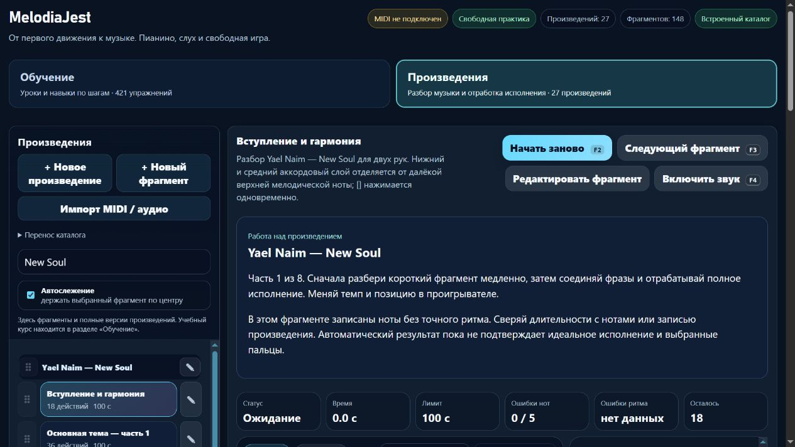

# MelodiaJest — стабильные ID начальных тем, 23.5.21

Дата: **6 ноября 2026**, Asia/Yekaterinburg. Сигнал этой же автоматизации: `2026-11-06T04:15:11.786Z`. Системный этап: **0 новых и 0 заново проверенных уроков**. Музыкальная точка продолжения остаётся в [партии 15](piano-curriculum-2026-11-06-15.md).

## Найденная проблема и исправление

Два действительно чистых запуска создавали разные случайные ID тем **«Композиция из х/ф „Хатико“»** и **Yael Naim — New Soul**. Менялись ссылки у **15 записей**: семь фрагментов первой композиции и восемь второй. Ноты совпадали, но идентичность начального каталога зависела от запуска. Это обнаруженная ранее проблема границы переноса каталога, а не доказанная потеря пользовательских данных.

В исполняемом `index.html` функция `ensureTheme` получила необязательный начальный ID. Только два места создания встроенных тем передают `builtin-theme-hachiko` и `builtin-theme-new-soul`. Найденная существующая тема сохраняет свой ID. Если предложенный ID занят другой темой, новая тема получает первый свободный числовой суффикс; занятую тему не переименовываем и не объединяем с произведением. Обычное создание личной темы сохраняет прежний механизм одноразового ID.

Сохранённый каталог **v7** не перенумеровывается. Исполняемые тесты сохранили прежние непрозрачные ID, личные названия, обратный пользовательский порядок тем, классификацию и описание. Отдельно проверены старый каталог v2 с уже существующими соответствующими темами и конфликт зарезервированного ID с личными группами. Старые тематические ID и личные записи сохраняются; прежние версионные дополнения и перестановки при обновлении v2 продолжают действовать. Утверждение о полном сохранении порядка v2 этим этапом не делается.

## Сохранность и границы изменения

- У всех **569 записей** совпали музыкальные отпечатки и инструкции; исходные поля порядка и относительный порядок сохранены. Новых записей нет. Изменились ровно две **начальные** темы и 15 ссылок на них, перечисленных в машинных доказательствах.
- Два новых чистых экземпляра приложения дали полностью одинаковые массивы тем и записей: **93 темы, 569 записей, 27 произведений**. SHA-256 записей: `5102dacb5d9be0d4884be2976d8a5c8be8148c1bd2e33f35fa457fe368f2d9c0`.
- Контрольные хеши **14 защищённых файлов** совпали, включая неизменяемый baseline, MIDI ini, учебные данные, алгоритмы аппликатуры/зачёта, адаптеры и карточку обучения. Маршрут гитары совпал; в `guitarjest` ничего не записывалось. `trainer-content.json` отсутствовал до этапа и не создавался проверками.
- Реальный путь загрузки и сохранения веб-каталога проверен с ключом прогресса **`music-learning-piano-v1`**, выбранным фрагментом, скрытым описанием и синтетическим объектом выбранного MIDI-входа. Содержимое прогресса и объект входа сохранились; соединение с аппаратурой не открывалось. Ключи хранения и формат каталога не менялись.

Стабильность двух тем не решает сохранение ID отдельных нот при будущей редактуре партитуры. Общий документ по-прежнему является проекцией для чтения; это не готовая миграция редактора или всего приложения на React/Next.js.

## Проверки

| Проверка | Результат |
| --- | --- |
| `npm test` | **405/405**, 0 ошибок; 190459,2673 мс |
| Финальный целевой запуск | **6/6**, 0 ошибок; 20411,2096 мс |
| `audit:lessons` | 421 пианистическая и 456 гитарных записей; сводка ошибок пустая |
| `audit:fingering` | 80 начальных уроков, 1036 назначений; структурных ошибок 0 |
| `audit:curriculum` | 569 пианистических / 713 гитарных записей, 157 MIDI-контрактов; жёстких ошибок 0 |
| `audit:music-document` | 569 записей / 39247 нот; точный возврат JSON и сохранение всех действующих музыкальных версий |
| `audit:piano-coverage` | 421 учебная запись, 157 MIDI-контрактов, 75 структурированных записей, 3 будущих плана |
| `build:web` | **23.5.21**, 20 разрешённых файлов; размеры, хеши и соответствие текущим исходникам проверены |
| `git diff --check` | Без ошибок |

Шесть регрессионных тестов используют настоящий загрузчик каталога: равенство чистых запусков, сохранённый v7, существующие ID в v2, конфликт с личными темами, навигация/прогресс/MIDI-выбор при сохранении и адаптер музыкального документа. После полного запуска усилена только тестовая фикстура прогресса и синтетического MIDI-входа; все шесть тестов запущены повторно. Исполняемый код после полного запуска не менялся. TypeScript-проверка повторно не запускалась: типовые контракты не изменены.

Зелёные проверки не устраняют прежние ограничения. Аудит аппликатуры сохраняет 21 неподдерживаемый случай и 62 случая удержанных голосов; аудит корпуса — в том числе 10 предупреждений об аппликатуре и 4 о пересечении голосов. Эти разные области аудита не складываются в число ошибочных уроков. В документе остаются **141 запись без точного времени**, **3258 действий с общим временем аккорда**, 16145 нот с неизвестным временем. Отдельные отпускания старых голосов не восстановлены. Новая педагогическая или аппаратная проверка не заявляется.

## Браузерная проверка

Собранная веб-версия открыта в двух собственных изолированных адресах: `http://127.0.0.1:4196` и `http://127.0.0.1:4197`. С видимого DOM прочитаны одинаковые начальные ID обеих тем. Пользовательское хранилище основного превью не очищалось.

На первом адресе выбран **«Хатико», фрагмент 2 из 7**; после перезагрузки сохранились произведение, фрагмент и раздел «Произведения». На последнем фрагменте кнопка следующего фрагмента оставила текущую композицию и показала сообщение о конце. На втором адресе отдельно открыт New Soul, **«Вступление и гармония», часть 1 из 8**. Ошибок в консоли не обнаружено. Предупреждение о неизвестном исходном ритме осталось видимым; проверка не превращает эти фрагменты в ритмически проверенные задания.

Снимок просмотрен. Собственные вкладки и два проверочных сервера закрыты; основное локальное превью не затронуто. MIDI-устройство и звук не включались.

## Первичные источники и навыки

- **React documentation team**, [Rendering Lists](https://react.dev/learn/rendering-lists), разделы *Where to get your key*, *Rules of keys*, *Why does React need keys?*, *Pitfall*: идентичность берётся из устойчивых данных; случайные ключи при отрисовке могут пересоздавать элементы. Применено к подготовке каталога перед будущим компонентом. Текущее приложение остаётся обычным JavaScript; источник не задаёт наши строки ID и не запрещает один раз созданные и сохранённые личные ID.
- **WHATWG**, [HTML Living Standard, Web storage](https://html.spec.whatwg.org/multipage/webstorage.html#the-localstorage-attribute), **§12.2.3**: хранилище связано с origin, а доступ может быть ограничен политикой. Это основание для двух изолированных браузерных адресов, а не реализация междоменного переноса или облачного аккаунта.
- Прочитан **find-skills**, выполнен поиск через [skills.sh](https://skills.sh/). Переиспользованы проверенные проектные навыки из первичных репозиториев: **web-design-guidelines** со свежим чтением [правил Vercel](https://raw.githubusercontent.com/vercel-labs/web-interface-guidelines/main/command.md) и правило **client-localstorage-schema** из React best practices. Применение: сохранение существующих ключей/схемы и проверка реальной навигации. Компоненты React и оформление не переписывались. Навыки, библиотеки и плагины не устанавливались.

Две технические записи внесены в журнал источников с `systemApplications`; связанных проверенных уроков у них нет. Музыкальные источники на этом системном этапе не пересматривались. Обновлены матрица, состояние курса, состояние продукта, README, реестр навыков, план веб-версии и границы общего документа.

## Учёт, квота и точное продолжение

Счётчики не увеличены: **421 учебная запись**, **157 MIDI-контрактов**, **75 структурированных записей**, **3 будущих плана**, **0 независимых преподавательских проверок**. После исключения шести явно связанных повторов и одного контрольного блока верхняя граница — **414**, а проверенное число разных педагогических целей остаётся неизвестным. **1310 мест матрицы — ёмкость, а не 1310 подготовленных уроков.** Минимум 1000 содержательных уроков ещё не достигнут.

Штатная квота проверена в начале и перед тяжёлыми частями; итоговое наблюдение `2026-11-06T04:41:11.473Z`: недельное окно Codex 10080 минут, использовано **46%**, остаток **54%**, обычная работа разрешена, spendControl не достигнут, других применимых окон не получено. Действует политика until-exhausted с резервом 0%; это общий показатель аккаунта, не точный расход этой задачи.

Следующий этап — **`terminal-rest-contract-pilot`**, уже существующий будущий план **`detail-p-rhythm-final-rest-01`**. Правая C4 пальцем 1 на долях 0 и 2, по одной доле звучания, тишина между ними и конечная доля до границы 4. Сначала перечитать `ou-rest-values-2026-11-05` / `omt-simple-counting-2026-11-05` и сверить подготовку `detail-p-rhythm-03` / `detail-p-release-01`. Затем определить явный конец упражнения и наблюдение до конца паузы: последнее отпускание на доле 3 не должно выдавать зачёт до доли 4. Проверить лишнюю ноту в паузе, раннее завершение/сброс, память, демонстрацию и звуковой хвост, JSON/версию контракта и сохранность поведения старых уроков. Одну новую запись добавлять только после этих тестов и отдельной сверки цели, подготовки, пальцев и переноса.

После пилота — конкретные планы расширения курса и отдельный необязательный компонент чтения React/Next.js. Домен остаётся не куплен; подготовлен и проверен только локальный выпуск. Покупка, DNS, публикация, перенос на хостинг, изменения сервисов портала, commit и push не выполнялись.

Машинные доказательства: [verification.json](piano-curriculum-2026-11-06-16-verification.json).
