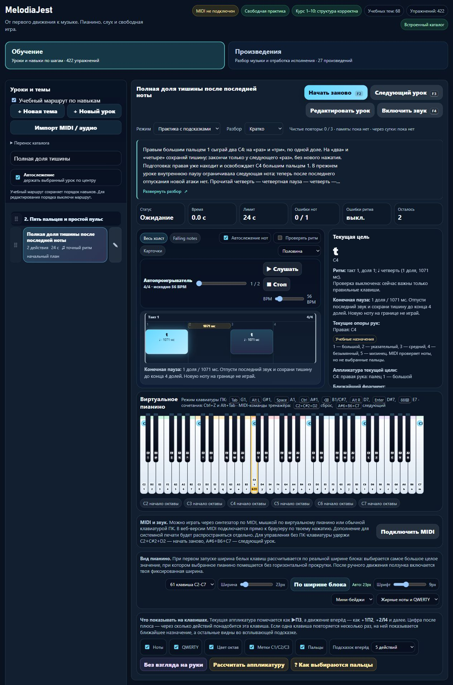

# MelodiaJest — конечная пауза, 23.5.22

**6 ноября 2026**, Asia/Yekaterinburg. Сигнал: `2026-11-06T04:45:12.330Z`. Завершён один музыкально-системный этап: **1 новый урок, 0 исправленных прежних уроков**. Все прежние **569** записей сохраняют музыку, инструкции, порядок и версии зачёта.

## Новый урок

**`detail-p-rhythm-final-rest-01` — «Полная доля тишины после последней ноты».** Техническое упражнение проекта, без заимствованной мелодии или исторической атрибуции.

| Параметр | Проверенное содержание |
| --- | --- |
| Цель | Сохранить пульс на конечной паузе, когда следующей атаки уже нет |
| Подготовка | `detail-p-rhythm-03` — «Пауза — тоже доля»; `detail-p-release-01` — «Правая: окончание одного звука» |
| Рука и пальцы | Только правая; два C4 / MIDI 60, оба большим пальцем 1 |
| Начала / длительности | Начала 0 и 2; звучание по 1 четвертной доле |
| Паузы | Внутренняя `[1,2)`, конечная `[3,4)`; конец у доли 4 |
| Размер и темп | Один такт 4/4, 56 BPM; примерно 1071 мс на долю |
| Происхождение | Специально созданная отработка проекта; источники не утверждали нашу фразу или пальцы |

Счёт: **«раз» — C4, «два» — отпустить, «три» — C4, «четыре» — отпустить; следующее «раз» отмечает только конец**. Третьего нажатия нет. Полная фраза занимает примерно 4,286 с, последнее отпускание приходится примерно на 3,214 с от начала. Лимит одной попытки 24 с не является длительностью учебного блока: разбор с отдыхом и повторениями рассчитан примерно на 3–5 минут.

В полном тексте сохранены подготовка, медленный счёт, ошибки, слуховой образ «до — тишина — до — тишина», самопроверка и повтор после перерыва. Знакомый образец служит представлению ритма, а не независимому тесту слуха. Проба переноса выполняется отдельно: три C4 на «раз, два, три», затем полная доля тишины на «четыре». Она не выдаёт дополнительный урок или автоматический зачёт. Педаль не используется; при напряжении нужно остановиться.

Маршрут ставит урок после `detail-p-rhythm-03`, в p2; следующий указанный шаг — `detail-p-rhythm-04`. Отдельная тестовая фикстура задаёт ноты, времена и пальцы независимо от определения урока. Это сверка данных и контракта, **не внешняя экспертиза преподавателем**.

## Исполнительская модель

До исправления синтетическая запись из двух C4 принималась как чистая сразу после последнего отпускания, хотя до запланированного конца оставалась доля. Причина: модель знала окончания нот, но не отдельный конец наблюдения.

Добавлен opt-in **`learning.ending = {version:1,endBeat:4}`**. Попытка ждёт явной границы, сохраняет события до неё и отклоняет новую ноту в паузе, затянутое или отсутствующее отпускание, недостаточное наблюдение и неверный контракт. Ранний вызов завершения не выдаёт результат. BPM фиксируется при начале попытки; сброс, выбор урока и смена режима отменяют таймер.

Для этого контракта отслеживается замеченный разрыв входа: удаление/смена порта, закрытый вход, потеря статуса локального моста или EventSource error. Доступное состояние повторно проверяется у конца. Возврат входа не восстанавливает пропущенный участок; ошибка неиспользуемого моста не мешает прямому MIDI. Проверки используют синтетические порты и события, не настоящее устройство.

Глобальная версия оценщика остаётся 1; поле ending добавляется в музыкальный отпечаток только при наличии. Отпечаток нового урока — **`e9742d40`**. Старые уроки не получают новый контракт или инвалидированный прогресс. JSON остаётся v7; личная изменённая граница сохраняется и не получает чужой зачёт. Подробнее: [PIANO_ENDING_V1](../PIANO_ENDING_V1.md).

Номинальная пауза — полная доля. Программный допуск отпускания `min(130 мс, 12% доли)` — решение проекта; он не сдвигает конец и не разрешает новую атаку внутри паузы. Проверяются события MIDI и доступные сигналы соединения. Акустическое затухание, CC64/педаль, пальцы и свобода руки не доказаны. Уведомления ОС могут задерживаться, поэтому мгновенное обнаружение любого аппаратного разрыва не обещается.

Демонстрация продолжается до конца паузы, но осциллятор и виртуальные клавиши освобождаются у окончания ноты. Для нового урока убран прежний хвост осциллятора за этой границей; старые уроки сохраняют прежнее поведение. Пауза, остановка, перемотка и сброс отменяют визуальный таймер отпускания.

## Интерфейс и браузер

До окончания паузы текущая цель показывает **«Тишина»**, а не «Готово». В памяти цель и обратная связь нейтральны: подсказок отпускания и конечной паузы нет независимо от «Кратко / Развёрнуто / Скрыто». Feedback получил `role=status` и `aria-live=polite`.

Браузер дополнительно выявил сжатие описаний двух настроек клавиатуры: общий двухколоночный grid оставлял пояснению **0 px** ширины. Один scoped grid-столбец и два класса секций размещают описание над контролами. На проверенном экране ширина пояснения стала **834,72 px**, высота первого блока уменьшилась с **617,98 до 160,53 px**. Это измерение геометрии интерфейса, не быстродействия. При viewport 390 px ширина страницы и содержимого совпала — **376 px**, без горизонтального переполнения страницы.

Изолированная сборка проверена на `127.0.0.1:4198`:

- Enter раскрывает разбор; подготовительные кнопки показывают правильные названия.
- После двух ручных нажатий практика остаётся в ожидании тишины, затем завершается без зачёта исполнения.
- Все три сохранённых вида разбора дают нулевое число карточек и указаний паузы в памяти. После ручной попытки память требует MIDI, число чистых повторов остаётся 0.
- «Скрыто» сохраняется после перезагрузки; доступный выбор возвращает «Кратко».
- Финальная сборка после защиты MIDI загружена повторно; ошибок консоли нет. Настоящий MIDI и звук не включались.

Снимок просмотрен. Собственные вкладки и сервер 4198 закрыты, viewport восстановлен; основное превью 4173 не менялось.

## Источники и навыки

- **Open University / OpenLearn**, [4.1 Values and dots](https://www.open.edu/openlearn/history-the-arts/music/an-introduction-music-theory/content-section-4.1): прочитано правило о длительностях тишины. Отдельная картинка Example 32 вернула 403 в веб-инструменте; рисунок не копировался, ноты из него не выводились.
- **Chelsey Hamm, Kris Shaffer, Mark Gotham**, [Simple Meter and Time Signatures, версия издателя copy](https://viva.pressbooks.pub/openmusictheorycopy/chapter/simple-meter-and-time-signatures/): Time Signatures / Counting, Examples 10–13, счёт четвертей и неартикулированных долей. Исходный URL главы вернул 403; прочитана версия того же издателя с другой нумерацией примеров. Наши C4, пальцы, темп и допуски источнику не приписываются.
- **W3C**, [Web MIDI API](https://www.w3.org/TR/webmidi/), Working Draft 31 October 2026, §§5.3–5.6: доступность портов и connection events; отдельно учтено предупреждение о задержках уведомлений.
- Прочитаны проектные **find-skills** и **web-design-guidelines**; просмотрен [skills.sh](https://skills.sh/), свежие [правила Vercel](https://raw.githubusercontent.com/vercel-labs/web-interface-guidelines/main/command.md) применены к доступной обратной связи и проверке раскладки. Навыки, библиотеки и плагины не устанавливались; React-код в этой партии не вводился.

Два музыкальных источника получили новые применения с ID урока; две технические записи добавлены отдельно от педагогической проверки. Архив исходного будущего плана сохранён при переносе в реализованные спецификации.

## Проверки и сохранность

**Финальный `npm test`: 424/424**, 0 ошибок, **181159,4391 мс**; добавлено 19 тестов. Проверяются независимая фикстура, ожидание границы, лишние ноты, отпускания, сброс/смена урока/режима, BPM, память, демонстрация, реальное расписание Web Audio на имитации, JSON/личные редакции и прерывания входов. Два старых ожидания уточнены: разбор допускает больше трёх непустых шагов, реализованная конечная пауза исключена из будущих планов.

| Проверка | Итог |
| --- | --- |
| `audit:lessons` | 422 пианистические / 456 гитарных записей; сводка ошибок пустая |
| `audit:fingering` | 80 начальных уроков / 1036 назначений; структурных ошибок 0 |
| `audit:curriculum` | 570 пианистических / 713 гитарных записей, 158 MIDI-контрактов; жёстких ошибок 0 |
| `audit:music-document` | 570 записей / 39249 нот; точный возврат JSON и сохранённые runtime-версии |
| `build:web` | 23.5.22, 20 разрешённых файлов; проверены байты, хеши и текущие исходники |
| `git diff --check` | Без ошибок |

Сравнение с замороженной точкой подтвердило неизменность всех прежних нот, инструкций, тематических ссылок и полей порядка. Совпали **13 защищённых файлов**, включая baseline, MIDI ini, алгоритм аппликатуры, общий документ/адаптер и карточку обучения; маршрут гитары совпал. `trainer-content.json` отсутствовал до и после; пользовательское хранилище не заменялось проверками. Декларации типов не менялись; TypeScript повторно не запускался.

Прежние ограничения остались: 141 запись без точного ритма, 3258 действий с общим временем аккорда, 16145 нот с неизвестным временем. Удержанные голоса и педаль не реализованы. Ending сохраняется в `compatibility.entry.learning.ending`, но нотный граф общего документа ещё не описывает конечную паузу отдельной сущностью. Полная миграция React/Next.js и редактора не завершена.

## Учёт и продолжение

Теперь **422 учебные записи / 158 MIDI-контрактов / 76 структурированных записей / 2 будущих плана / 0 независимых преподавательских проверок**. Верхняя граница после шести связанных повторов и одного checkpoint — **415**, проверенное число самостоятельных целей неизвестно. **1310 мест матрицы — ёмкость, не подробный план или реализация 1000 уроков.**

Штатная квота в конце: `2026-11-06T05:36:49.540Z`, окно Codex 10080 минут, использовано **48%**, остаток **52%**, обычная работа разрешена, spendControl не достигнут, других применимых окон не получено. Политика until-exhausted, резерв 0%; показатель общий для аккаунта.

Следующий точный шаг — **`dyad-preparation-and-release-source-review`**, `detail-p-dyads-01..04`: C4–E4 правой 1–3, D4–F4 правой 2–4, C3–E3 левой 5–3, D3–F3 левой 4–2. Подтверждён повод: правая 01 требует левый `course03-08`, левая 03 — правую 02. Нужно перечитать первичные источники, сверить подготовку своей руки и обещание общего отпускания двух звуков. Если сохраняется цель общего окончания, применить существующий opt-in `beat-boundary-v2` только с тестами и архивом прежней редакции прогресса. Эта партия данные терций ещё не исправляла.

Затем — конкретные планы подтверждённых пробелов к минимуму 1000 и отдельный компонент чтения React/Next.js. Домен остаётся не куплен; подготовлен только локальный выпуск. Покупка, DNS, публикация, изменения сервисов портала, запись в `guitarjest`, commit и push не выполнялись.

Машинные доказательства: [verification.json](piano-curriculum-2026-11-06-17-verification.json).
