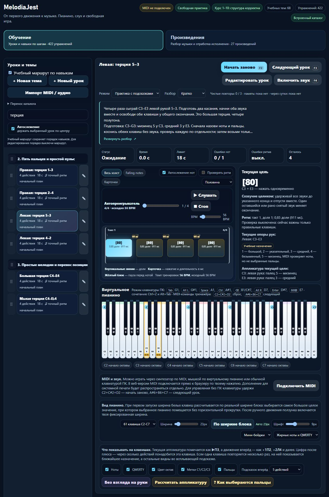

# MelodiaJest 23.5.23 — собственная подготовка руки и общее окончание терции

Сигнал: 6 ноября 2026, 05:44:13 UTC / 10:44:13 Asia/Yekaterinburg. Этап доведён до проверяемого результата без ограничения длительности двадцатью минутами. Текущая папка `pianosjest`; публикации и изменений `guitarjest` нет.

Пересмотрены **четыре существующих микроурока**, новых уроков и планов **0**. Исправлены требования подготовки по рукам, добавлены подробный разбор, слуховой образ, самопроверка и отдельная фраза переноса. Имеющаяся проверка общего отпускания включена только для этих четырёх точных исходных редакций. **432/432 теста** прошли; изолированный браузерный путь проверен.

## Подтверждённая проблема и исправление

Правая `detail-p-dyads-01` требовала левый `course03-08`, а левая `detail-p-dyads-03` — правую пару `detail-p-dyads-02`. Это не подготовка конкретных пальцев нужной руки. Теперь у каждой ветки собственная пятипальцевая позиция и отдельное отпускание, затем следующая пара той же руки. Прежние `after`, ID, темы и пользовательский порядок сохранены: якорь отображения не подменяет педагогическое требование `requires`.

| ID | Одновременные высоты и пальцы | Подготовка `requires` | Отпечаток оценки: прежде → сейчас |
| --- | --- | --- | --- |
| `detail-p-dyads-01` | C4–E4, правая 1–3 | `course02-08`, `detail-p-release-01` | `e6811dd5` → `568dc659` |
| `detail-p-dyads-02` | D4–F4, правая 2–4 | `detail-p-dyads-01`, `course02-08` | `5211bd5d` → `ef031761` |
| `detail-p-dyads-03` | C3–E3, левая 5–3 | `course03-08`, `detail-p-release-02` | `eb7b9aba` → `608e878c` |
| `detail-p-dyads-04` | D3–F3, левая 4–2 | `detail-p-dyads-03`, `course03-08` | `2cbdd76a` → `8a2c62bc` |

C–E — большая терция, четыре полутона; D–F — малая, три. Это двузвуки, не трезвучия и не полные гаммы. Подготовка — собственная позиция C4–G4 справа / C3–G3 слева, отдельное нахождение обоих звуков и один спокойный совместный вход. Свободные пальцы и запястье не фиксируются силой.

Исходная музыка сохранена: четыре одинаковые пары, вступления на долях **0, 1, 2, 3**, звучание **0,85 доли**, промежутки **0,15**, **56 BPM**. Это около **911 мс** звука и **161 мс** просвета; последнее окончание — **3,85 доли** от начала. Не названы полными четвертями. Конечная тишина отдельно не оценивается, контракт `ending` не добавлялся.

До изменения воспроизведён пропуск проверки: последнее отпускание двух звуков с разницей **300 мс**, симметрично ±150 мс от общей границы, принималось старым профилем. Существующий `beat-boundary-v2` отклоняет такой случай. Сам `practice-assessment.js` не изменён, глобальная версия остаётся **1**. Допуск разброса вступления/общего отпускания **120 мс** — настройка проекта. Проверены 119/121 мс, 300 мс, перебор вместо совместного входа, недостающий тон, слишком короткое и длинное удержание. MIDI-события не определяют фактические пальцы и художественное качество.

## Методика и источники

Все четыре материала честно обозначены как **технические упражнения проекта**, без заимствованного нотного фрагмента и без утверждения авторства Черни. Конкретные пальцы — выбор проекта для подготовленной позиции, а не единственная допустимая аппликатура из источника.

- [Open University / OpenLearn, §6.4 Intervals](https://www.open.edu/openlearn/history-the-arts/music/an-introduction-music-theory/content-section-6.4): прочитан текст вокруг Examples 60–61 — отличие одновременного гармонического интервала от мелодического, терция C–E и три полутона малой терции. Наши регистры и расстояния независимо сверены по MIDI 60/64, 62/65, 48/52, 50/53. Иллюстрация и аудио не объявлены просмотренными.
- [Jerry Kovarsky / Yamaha, The Basics of Piano/Keyboard Fingering](https://hub.yamaha.com/keyboards/k-how-to/the-basics-of-piano-keyboard-fingering/): перечитаны The Basics и Scenario One: Everything Fits Under Your Fingers — номера пальцев 1–5 и планирование позиции по фразе. Источник не предписывает именно наши четыре пары.
- [Diana Dumlavwalla / Yamaha, Piano Pedagogy: Fix Basic Technique](https://hub.yamaha.com/music-educators/instruments/piano/piano-pedagogy-fix-basic-technique/): перечитаны положения о поддержанной руке, напряжении и гибком запястье. Это общие рекомендации, не физическая проверка всех размеров руки.
- [Карл Черни, письмо 3, с. 20–21](https://www.koelnklavier.de/quellen/czer-brf/brief-03.html): перечитано различие удержания ноты и паузы, раннего/позднего отпускания. Историческая рекомендация не приписывает Черни наш рисунок, темп, 0,85 доли или MIDI-допуски.
- [Duke / Simmons, 10 Tips for Effective Practice](https://cml.music.utexas.edu/online-resources/intelligent-music-practice/10-tips-for-effective-practice): повторно применена ранее проверенная опора на небольшую цель; в этой партии источник заново не читался. Это явно отмечено в журнале.

Попытка просмотра официального PDF Alfred не дала читаемого изображения: screenshot вернул cache miss. Поэтому Alfred **не включён** в свежие доказательства этих аппликатур. Прочитанное письмо 2 Черни не использовано как основание для фиксированных двузвуков. Новых биографических историй и вымышленных рекомендаций нет. В журнале по-прежнему **31 источник**, добавлены пять применений к четырём ID: четыре свежих чтения и одно повторное применение.

Блок занятий — около **3–5 минут** с остановками и отдыхом. После исходной четвёрки предлагается **другая фраза**: та же пара на «раз» и «три», без новой атаки на «два», затем общее отпускание и остановка. Эта проба находится вне текущего зачёта и не увеличивает число уроков. Возврат после перерыва и из памяти на следующий день описаны отдельно; известный образец не объявлен независимым тестом слуха.

## Полезное изменение системы и браузер

Уточнённые данные включают действующую подсказку **«Созвучие целиком»** у текущей цели четырёх терций. Именованные переходы показывают подготовку нужной руки. Новый код представления, CSS или переписывание общей оценки для этого не потребовались.

Применены проектные `find-skills` и `web-design-guidelines`: просмотрен skills.sh, перечитаны [первичные правила Vercel](https://raw.githubusercontent.com/vercel-labs/web-interface-guidelines/main/command.md). Ничего дополнительно не установлено. React/Next.js-код в этом этапе не вводился.

В изолированной сборке **`http://127.0.0.1:4199`** проверены все четыре карточки: реальные высоты, руки, пальцы, правильные подготовительные действия и подсказка окончания. Enter раскрывает полный текст; пробел сворачивает. Раскрытый вид сохраняется после перезагрузки. Компактное превью — **112 px / 22,4 px = 5 строк**. «Скрыто» сохраняется, селектор остаётся доступным для возврата.

Во всех трёх настройках разбора память содержит нейтральную цель: материала, подготовки, подсказки отпускания и клавиш с нотными подсказками **нет в DOM**. Подготовительный «Мини-экзамен левой руки» открывается Enter с переносом фокуса на его заголовок. Ошибок консоли нет. Аппаратный MIDI и звук не включались. Вкладка и принадлежащий этому этапу сервер закрыты; стандартный порт 4173 не менялся.

## Сохранность и проверки

Миграция `dyad-preparation-release-v1` работает только при совпадении замороженного исходного отпечатка и отсутствии пользовательской редакции. Архивирует полный прежний текст/guide/learning и прежний отпечаток оценки; повторный запуск ничего не меняет. Изменённые название, текст, подготовка, источник, ноты, пальцы или классификация защищены проверкой исходника.

Прежний прогресс не удаляется: первая попытка новой редакции сохраняет старый статус памяти в истории и начинает новый зачёт с одного чистого повтора. Прежняя память не наследуется. Другие записи прогресса остаются прежними. JSON-перенос сохраняет личный разбор, классификацию, относительный пользовательский порядок и архив редакции. Нормализация порядковых чисел при импорте не означает изменения относительного порядка.

- **432/432**: `npm test`; добавлены восемь содержательных тестов в `tests/piano-dyads.test.cjs`. Независимые ожидаемые ноты/пальцы/время, чистая оценка, настоящий исполняемый маршрут NoteOn/NoteOff, защита редакций, архив прогресса, JSON-перенос и скрытие подсказок. После браузерной корректуры одного падежа выполнена повторная целевая проверка восьми тестов; музыкальный контракт не менялся.
- `audit:lessons`: 422 пианистические / 456 гитарных учебных записей, итоговых замечаний инспектора нет. `audit:fingering`: структурных ошибок нет, начальные **80 уроков / 1036 назначений**. Это не проверка преподавателем.
- `audit:curriculum`: жёстких ошибок нет; **570 / 94** пианистических записей/тем, **713** гитарных записей, **158** MIDI-контрактов. Существующие предупреждения о неподдержанных/непроверенных случаях сохранены.
- `audit:music-document`: **39 249 нот**, 23 104 с известным временем / 16 145 без точного времени, 1509 явных пианистических назначений. Точный JSON-возврат и музыкальные версии сохраняются. Предупреждения **141** `EXACT_TIME_UNAVAILABLE` / **3258** `LEGACY_SHARED_CHORD_TIME`; индивидуальные окончания старых аккордов не восстановлены.
- `audit:piano-coverage`: **422** реализованные учебные записи / **158** MIDI-контрактов / **80** структурированных и сопоставленных записей / **2** будущих плана / **0** проверок преподавателем. Шесть повторов одной цели и один составной контроль дают лишь верхнюю границу **415** групп; подтверждённое число разных целей ещё не установлено. **1310 мест** — ёмкость карты, а не 1000 подробных планов.
- Сравнение с замороженным checkpoint: музыка, пальцы и время всех **570** записей, темы, ID и порядок прежние. Инструкции и отпечатки оценки изменились **только у четырёх ID**; остальные **566** отпечатков прежние. Все **15** защищённых файлов, включая baseline, evaluator, UI, `index.html`, настройки MIDI и совместимые модули, байтово прежние. Гитарный маршрут прежний; `trainer-content.json` отсутствовал и не создавался.
- `build:web`: **20** разрешённых браузерных файлов, проверены SHA-256, длина и соответствие текущим исходникам. Серверные/native/личные файлы отсутствуют. Проверки публичных маршрутов входят в полный тестовый запуск; локальный сервер не выставлялся в интернет.

Начальная целевая проверка выявила три ошибки тестового стенда: JSON-копирование `undefined`, попытка «изменить» уже имеющийся палец 2 и ожидание сохранения разреженных номеров вместо относительного порядка. Ожидания уточнены по исполняемому коду; музыкальные ограничения ради зелёного теста не ослаблены.

## Ограничения и точное продолжение

Физическое удобство, реальная аппликатура и музыкальное качество требуют проверки у инструмента/педагогом. Контроль событий MIDI и ссылки на авторов её не заменяют. Удержанные голоса и педаль в этой партии не расширялись. Полная миграция в React/Next.js не завершена. Домен ещё не куплен; регистрация, оплата, DNS, публикация, хостинг, SSO, секреты и сервисы портала не менялись. Commit/push не выполнялись.

Следующий этап: сопоставить `detail-p-hearing-*` и `course10-*` с направлением `ear-transfer`, прочитать первоисточники и выделить **1–4** недостающие цели чтения/слухового переноса с конкретной подготовкой, нотами, ритмом, руками/пальцами и новой фразой проверки. Проверить отсутствие дублей среди 422 записей; план считать отдельно от реализации. Затем продолжить необязательный компонент чтения React/Next.js по фактической архитектуре портала.

Квота перед завершением: штатное окно Codex **10080 минут**, расход **49%**, остаток **51%**, ordinary usage разрешён, spend control не достигнут, других применимых окон нет. Действует `until-exhausted` с резервом **0%**. Это общий остаток аккаунта, не индивидуальный бюджет задачи. [Машиночитаемые доказательства](piano-curriculum-2026-11-06-18-verification.json).
