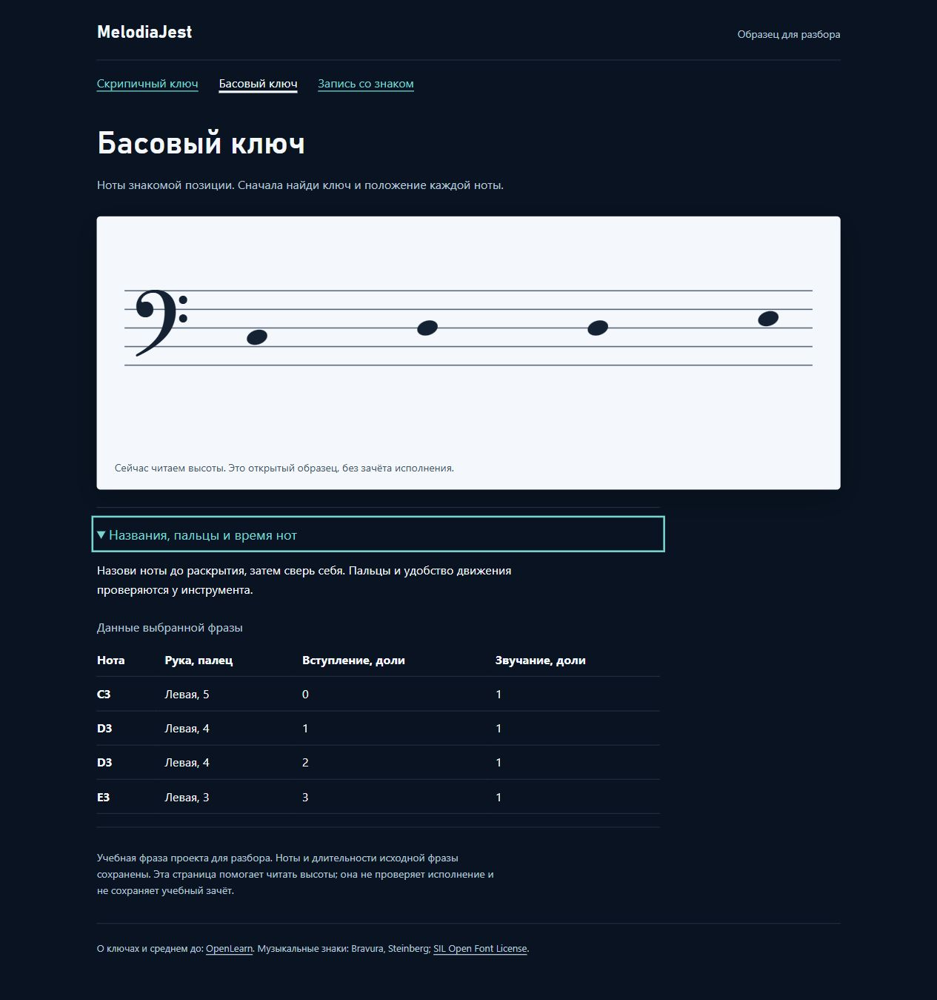

# MelodiaJest — чистое нотное представление и отдельный TypeScript/React-компонент

Сигнал: 6 ноября 2026, 06:43:14 UTC / 11:43:14 Asia/Yekaterinburg. Завершён системный этап, без ограничения длительности двадцатью минутами. **Новых уроков, пересмотров действующих уроков и новых планов — 0.** Основной локальный релиз остаётся **23.5.23**. Отдельный компонент **0.1.0** собран и проверен: **448/448 основных тестов + 4/4 проверки веб-пакета**, строгий TypeScript и настоящий браузер.

## Проверяемый результат

`piano-staff-view.js/.d.ts` — чистая проекция `music-document v1` и отдельного явного написания. Нота связывается с ID, редакцией и выбранной партией. MIDI не превращается автоматически в имя/энгармоническое написание; ключ не назначает руку. На входном документе ничего не меняется.

| Ключ | Подготовленные высоты | Координата от нижней линейки вверх | Добавочная линейка |
| --- | --- | --- | --- |
| Скрипичный | C4, D4, E4 | −2, −1, 0 | C4 на −2 |
| Басовый | C3, D3, E3 | 3, 4, 5 | Нет |

Результат сохраняет ID каждой ноты/партии, звучащую высоту, начало и длительность. Рука/палец приходят отдельными назначениями той же редакции; устаревшие назначения не показываются. В двух открытых примерах реальные данные адаптера дают C4–D4–D4–E4 правой **1–2–2–3** и C3–D3–D3–E3 левой **5–4–4–3**; начала **0/1/2/3**, длительности по **1 доле**, **56 BPM**. Это демонстрации будущих планов, не новые зарегистрированные уроки и не исполнительский зачёт.

Начальная область — до **8 нот**, только эти натуральные высоты в указанных ключах. Неподдержанные знаки/регистры, неверное написание, другая редакция/партия, частотная/ударная высота, неизвестное время, аккорды и удержанные голоса дают явное ограничение. Если одна нота не отображается корректно, **вся фраза не рисуется**, а не превращается в укороченную мелодию. Исходные данные остаются прежними.

## Реальный отдельный веб-пакет

`web-reader/src/StaffReader.tsx` скомпилирован строгим TypeScript и отрисован настоящим `react-dom/server.renderToStaticMarkup`. Компонент получает компактные данные выбранной фразы, без архива всего каталога, состояния, эффектов или измерений DOM. Ключи React и атрибуты нот сохраняют исходные note ID. Уникальный `idPrefix` для доступных описаний задаётся вызывающей стороной.

`dist/reader` содержит **6 публичных файлов + манифест**: три страницы, CSS, локальный Bravura и полный OFL. **Клиентских скриптов 0**, гидратации, хранения прогресса и API нет. Текущая нотная строка показывает высоты; полная ритмическая гравировка не заявлена. Имена, пальцы и исходное время открываются нативным `details`.

Команды и ограничения — [web-reader/README](../../web-reader/README.md). В текущей среде использованы только для чтения уже установленные библиотеки соседнего портала: React/React DOM **19.3.0**, TypeScript **5.8.3**, типы React **19.1.8** / React DOM **19.1.3**. Не запускались конфигурация/сборка/БД/службы портала, установки не выполнялись. Пакет умеет работать со своими локальными зависимостями; чистая установка из registry в этой партии не проверялась.

Фактический `../libre/package.json` подтверждает Next.js **15.5.27** и React/TypeScript. Компонент подготовлен как отдельное представление с явными входами, но **Next.js-маршрут и полная миграция оболочки ещё не собраны**. Основной запуск без зависимостей и все 20 файлов `dist/web` прежние.

## Дизайн, доступность и браузер

Применены `find-skills`, `frontend-design`, `web-design-guidelines`, `react-best-practices`. Прочитаны правила статического JSX, небольших данных на границе компонента и прямых импортов. Существующая палитра пюпитра сохранена; главный объект — контрастный светлый нотный лист. Нет декоративной статистики и вступительной анимации. Ключи рисуются локальным музыкальным шрифтом, а не случайным системным символом.

Изолированный просмотр **127.0.0.1:4200** проверен настоящим браузером:

- Скрипичный ключ, C4 с добавочной линейкой, D4 под нижней и E4 на нижней; басовый ключ, C3 во втором промежутке, D3 на средней и E3 в третьем промежутке. Исходные ID/время подтверждены в DOM.
- Enter раскрывает таблицу, пробел сворачивает; переход к басовому примеру работает с клавиатуры. Видимый фокус и SVG title/description присутствуют. Таблица показывает правую 1–2–2–3 и левую 5–4–4–3.
- На viewport **390 px** страница и содержимое имеют одинаковую ширину **376 px**, таблица и SVG помещаются; бокового переполнения страницы нет.
- Пример с C♯ не удаляет первую ноту ради трёх оставшихся: показано ограничение, нотных головок **0**, исходный MIDI **61** сохранён.
- Bravura загружен локально, ошибок консоли нет; звук и аппаратный MIDI не включались. Вкладка закрыта, временная ширина сброшена, принадлежащий этапу сервер остановлен. Основной порт 4173 не менялся.

Первое открытие локального адреса задержалось из-за тайм-аута автоматической проверки доступа. Один разрешённый повтор успешно открыл тот же адрес; обхода проверки и дополнительного запроса разрешения не было. Позже после перехода дождались свежего DOM перед раскрытием. Это не объявлено ошибкой приложения или измерением его быстродействия.

## Первичные источники и лицензия

- [OpenLearn §2.2–2.4](https://www.open.edu/openlearn/history-the-arts/music/an-introduction-music-theory/content-section-2.2): ранее проверенные опоры G4/F3 и среднее C применены повторно.
- [Robert Hutchinson, §1.2 Notation](https://musictheory.pugetsound.edu/mt21c/Notation.html), [§1.3 Octave Registers](https://musictheory.pugetsound.edu/mt21c/OctaveRegisters.html): прочитан текст о пяти линейках, ключах, именах и C4. Запрос SVG источника вернул cache miss; просмотр этой иллюстрации не заявлен. Снимок выше — собственный рендер проекта; ожидаемые шесть координат заданы независимо в тесте.
- [React: renderToStaticMarkup](https://react.dev/reference/react-dom/server/renderToStaticMarkup): статическая серверная отрисовка без интерактивного React-дерева. Нативные ссылки и раскрытие работают без гидратации.
- [SMuFL: Clefs](https://smufl.formats.music/latest/tables/clefs.html): gClef **U+E050**, fClef **U+E062**. [Bravura / Steinberg](https://github.com/steinbergmedia/bravura) — официальный шрифт с [SIL OFL 1.1](https://github.com/steinbergmedia/bravura/blob/master/redist/OFL.txt), включён без изменений. **323 416 байт**, SHA-256 `e68df66446e3ffa6f474ce9eb2949e938102406f12d8f40ad8754398c50f55d4`; исходный Git blob `4c6502f6f8eec2fb4f8c385a304fc757c60c31af`. Метаданные — `web-reader/assets/SOURCES.json`.

Сетевой запрос шрифта через shell был запрещён средой; файл и лицензия получены штатным GitHub-коннектором. Шрифт не является установленной библиотекой или плагином. В журнал добавлены четыре источника, всего **40**, с системными применениями и пустыми `lessonIds`. Авторы не утверждали уроки или весь курс; новых исторических атрибуций нет.

## Проверки и сохранность

**448/448**, `npm test`; восемь новых тестов — `tests/piano-staff-view.test.cjs`. Независимые ноты/координаты, замороженные входы, копии результата, связь редакции/партии, неверное написание, частоты/ударные, неизвестное время, голоса, повреждения и реальные проекторы каталога. После полного запуска область ограничена восемью нотами для короткой читаемой строки; финальная целевая проверка **8/8** повторена с границей девятой ноты.

Отдельно строгая TSX-сборка и **4/4** проверки `web-reader/tests`: реальные SSR-атрибуты/пальцы, неподдержанный знак, разрешённый состав/хеши/лицензия и HTTP-маршруты. GET/HEAD доступны только экспортированным файлам; POST, `/api/content`, Windows launch, MIDI bridge, исходники, личный JSON и traversal отклоняются. В начальной сборке замечено предупреждение React о составном `<title>`; исправлено строковым значением, окончательная сборка без предупреждения.

С замороженным checkpoint совпадают все **570** записей: музыка, инструкции, ID, темы, порядок и музыкальные отпечатки. Экспорт сравнен без изменяемого `savedAt`. Прежние **24 защищённых файла**, включая baseline, настройки MIDI, исполняемый код, объявления модели и root package.json, байтово совпадают. Все файлы основной `dist/web` и весь backlog прежние. Гитарный маршрут прежний; `trainer-content.json` не создавался. Baseline не пересоздавался, пользовательские настройки/прогресс не перезаписывались.

`audit:piano-coverage` обновляет матрицу: **422** реализованные учебные записи / **158** MIDI-контрактов / **80** структурированных записей / **6** будущих планов / **0** проверок преподавателем. Шесть повторов и один составной контроль оставляют верхнюю границу **415** групп, не подтверждённое число самостоятельных целей. **1310 мест** — ёмкость карты, а не 1000 подробных планов. Тяжёлые музыкальные аудиты повторно не запускались: действующий музыкальный код и весь каталог прежние, новый вид не загружен основным приложением.

## Ограничения и продолжение

Четыре плана первой пробы всё ещё остаются планами. Сейчас открыт знакомый пример с доступным текстовым описанием, без измерения чтения, слуха, пальцев или художественного качества. Ограничение восьмью нотами/шестью высотами, отсутствие полифонии, знаков и ритмической гравировки явные. Курсор музыкальной работы остаётся `detail-p-dyads-04`, последняя музыкальная партия **18**, последняя плановая **19**.

Следом — чистый контракт первой нотной пробы, история показанных элементов и отдельный прогресс. Опубликованные примеры исключать из неизвестного банка; подсказки, повтор и исчерпание неизвестного материала оставляют практику. После тестов подключить это к React-представлению и проверить настоящий локальный Next.js-маршрут отдельного пакета. Не продвигать планы в готовые уроки до проверки протокола и сохранения результатов.

Домен ещё не куплен; оплаты, регистрации, DNS, публикации, хостинга, изменений SSO/секретов/служб портала, `guitarjest`, commit или push не было. Квота перед сохранением: Codex **10080 минут**, расход **50%**, остаток **50%**, ordinary usage разрешён, spend control не достигнут, других окон нет. Действует `until-exhausted`, резерв **0%**; это общий остаток аккаунта. [Машиночитаемые доказательства](piano-curriculum-2026-11-06-20-verification.json).
