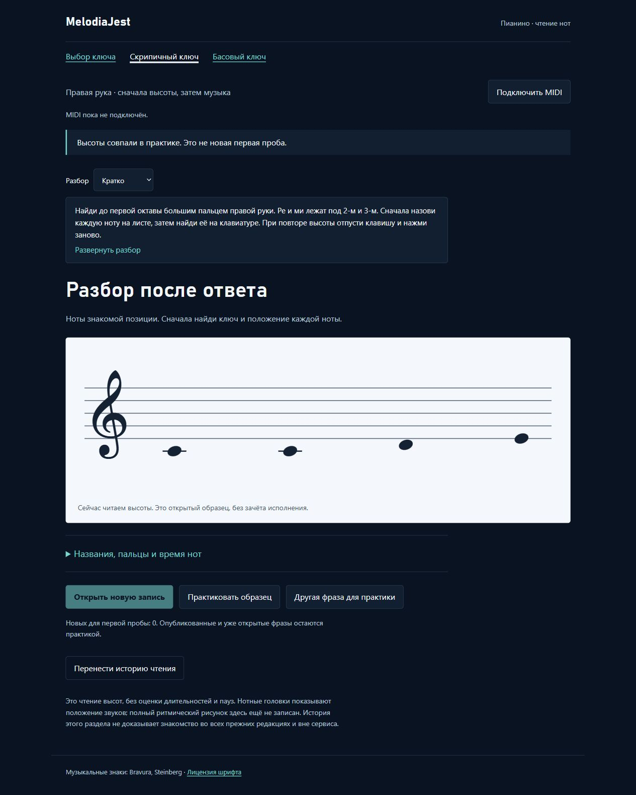

# MelodiaJest — три пальца и проверка опубликованного банка чтения

Сигнал: 6 ноября 2026, 09:16:46 UTC / 14:16:46 Asia/Yekaterinburg. Завершён последовательный этап без ограничения двадцатью минутами. Локальный релиз **23.5.24**, отдельный Next.js-пакет **0.1.1**. **Новых уроков 0; пересмотрено действующих 2; уточнено будущих планов 2; новых планов 0.**

## Проверенный результат

Банк чтения ошибочно считал новыми восемь рисунков: раньше исключались только примеры двух планов. Воспроизводящий тест на реальной спецификации получал опубликованный C4–D4–E4–E4 вместо отсутствия новой записи. Проверка всех 570 встроенных записей обнаружила **все 12 шаблонов, 395 точных вхождений**. Восемь ранее допустимых кандидатов имеют 237 вхождений. Теперь новых первых проб **0 в каждом ключе**, первая кнопка отключена с объяснением, а знакомые фразы доступны в практике. «Другая фраза для практики» меняет рисунок и работает через Enter/пробел.

`tools/piano-reading-catalog-audit.cjs` использует исполняемый парсер каталога. Сравнивает точные непрерывные одноголосные последовательности высот в исходном регистре, включая упражнения и произведения. Не выделяет верхний голос аккорда. Темп, ритм, название и рука не делают опубликованную последовательность новой. Это консервативное правило проекта; знакомство с частными редакциями и музыкой вне сервиса неизвестно. Полные совпадения: [JSON-аудит](../piano-reading-catalog-audit.json); команда `npm run audit:reading-bank`.

Политика банка v2 требует полного согласованного аудита. Клиент получает только количества совпадений, ключи элементов и хеш корпуса; весь исходный каталог в новый пакет не попадает. Схема журнала/ключ хранения v1 сохранены. Старые результаты v1 остаются без переписывания: исправление политики не сертифицирует их задним числом. При нулевом пуле новый показ не записывается. Шаблоны не добавлялись ради обхода исключений или количества уроков. Тесты положительной первой пробы используют отдельный синтетический каталог в другом регистре; реальная спецификация проверяется отдельными тестами и остаётся с нулём.

## Два действующих урока

| ID | Задача и подготовка | Проверенные данные |
| --- | --- | --- |
| `course02-02` | Добавить средний палец правой руки и вернуться через соседний; `course02-01`, `detail-p-release-01` | C4–D4–E4–D4–C4 дважды, 1–2–3–2–1, 60 BPM |
| `course03-02` | То же движение левой руки с её собственными номерами; `course03-01`, `detail-p-release-02` | C3–D3–E3–D3–C3 дважды, 5–4–3–4–5, 58 BPM |

Каждая нота занимает одну долю. Вступления **0,1,2,3,4; 6,7,8,9,10**, тишина **5–6**, окончание **11**. Размер 4/4 сохранён; пятёрка нот пересекает тактовую черту и не называется пятидольным тактом. Конечная пауза отдельно не оценивается. На стыке два до требуют отпускания и нового нажатия. Короткий слуховой образец — известный подъём к ми и возврат. Перенос «ми–ре–до–ре–ми» обозначен знакомой отдельной практикой, а не независимым слуховым/нотным тестом или новым уроком.

Добавлены подготовка, свободное движение без силового удержания кисти, медленный разбор, типичные ошибки, самопроверка, блок около 3–5 минут, возвращение после перерыва и на следующий день. Происхождение — техническое упражнение проекта без выдуманной исторической атрибуции. Оба урока связаны с подготовками в маршруте; пользовательский порядок каталога прежний. Миграция применяется только к совпавшему отпечатку исходного объяснения, архивирует его, не затрагивает личные редакции. Версии MIDI-зачёта **b623c94b / 70befb4e** сохранены.

## Два будущих плана

`detail-p-read-treble-01` / `detail-p-read-bass-01` теперь опираются на соответствующий трёхпальцевый урок вместо лишнего полного пятипальцевого прохода. Для повторных D/E отдельно требуется участок **0–4** из `course02-06` / `course03-06`: C–D–D–E–E, пальцы **1–2–2–3–3** / **5–4–4–3–3**. Чистый валидатор проверяет ID, реальную длину источника, границы фрагмента, цель и явную обязательность до оценки. Исполняемый допуск по завершению фрагмента ещё не реализован.

Цели, руки, пальцы, четыре четвертных звука примера, позиции C/D/E на стане и повторные атаки сверены независимо с ожидаемыми последовательностями в тестах. Координаты по-прежнему −2/−1/0 в скрипичном ключе и 3/4/5 в басовом. Опубликованный перенос C–C–D–E остаётся практикой; для новой отсроченной пробы нужен другой подготовленный неопубликованный материал. Оба плана сохраняют `assessmentStatus: not-implemented`, не зарегистрированы в курсе и не получают статус преподавательской проверки.

## Источники и навыки

Свежие первичные чтения: Jerry Kovarsky, Yamaha, [The Basics of Piano Keyboard Fingering](https://hub.yamaha.com/keyboards/k-how-to/the-basics-of-piano-keyboard-fingering/), 28 ноября 2023, нумерация и Scenario One о подготовленной позиции; Bob Duke / Amy Simmons, [Tips for Effective Practice](https://cml.music.utexas.edu/online-resources/intelligent-music-practice/10-tips-for-effective-practice), разделы об одной небольшой цели, упрощении фрагмента и распределённой практике. Они не предписывают наши конкретные фразы, 3–5 минут, темпы или MIDI-допуски.

[RCM Sight Reading](https://www.rcmusic.com/learning/digital-learning/rcm-online-ear-training-rcm-online-sight-reading/sight-reading) различает подготовленные упражнения и независимую практику; [ABRSM Piano 2025–2026](https://www.abrsm.org/sites/default/files/2024-06/Piano%202025%20%26%202026%20Prac%20syllabus%2020240524_access.pdf), печатная стр. 15 / PDF-страница 16, описывает неизвестный экзаменационный пример. Это основание разделять знакомое упражнение и новую пробу, не авторское утверждение нашего банка. Координаты ключей опираются на ранее проверенное определение [OpenLearn 2.2 Clefs](https://www.open.edu/openlearn/history-the-arts/music/an-introduction-music-theory/content-section-2.2); новые нотные изображения в этой партии не проверялись.

find-skills использован через skills.sh с проверенными первичными репозиториями; применены проектные frontend-design, web-design-guidelines и React-практики versioned storage / минимальной сериализации. Сохранены нотный лист и палитра. [Vercel Web Interface Guidelines](https://raw.githubusercontent.com/vercel-labs/web-interface-guidelines/main/command.md) применены к доступному объяснению пустого банка, нативным кнопкам и клавиатуре. Журнал источников содержит применения к конкретным ID и ограничения, реестр навыков обновлён. Навыки, плагины и зависимости не устанавливались.

## Проверки и сохранность

- **501/501** основной тест; после последней языковой правки дополнительно **5/5** целевых тестов уроков. Изменение маршрута проверено повторным полным запуском.
- `audit:lessons`: итоговые сводки противоречий пусты. `audit:fingering`: структурных ошибок нет, начальный аудит успешен; прежние 83 неподдержанных действия / удержанных голоса и 10 помеченных уроков остаются ограничениями модели. `audit:curriculum`: жёстких ошибок нет. `audit:piano-coverage`: **82** записи с подробным происхождением/направлением.
- `npm run build:web`; отдельный нотный компонент **6/6**; фактическая Next.js-сборка 15.5.27 / React 19.3.0 / TypeScript 5.8.3 и **4/4** проверки статического экспорта/HTTP. Использован установленный toolchain портала только для чтения. Сборка Next на Windows потребовала штатно разрешённого чтения метаданных родительского пути; установки или изменения соседнего проекта нет.
- Сравнение всех **570** записей: меняются только description/guide/learning двух уроков; остальные **568** полностью совпадают. Высоты, времена, пальцы, классификация, ID, пользовательский порядок и все **570 версий зачёта** прежние. Из 50 контрольных файлов 40 не изменены, 10 ожидаемых изменений перечислены в preservation JSON. Гитарный маршрут прежний; содержательные гитарные тесты общего набора прошли без записи в `guitarjest`. `trainer-content.json` на хосте отсутствовал и не создавался; исходный baseline не пересоздавался.
- Изолированные браузерные адреса 4205 / 4204: краткое описание, Enter/пробел, скрытый вид после перезагрузки и доступное восстановление; в памяти полный/краткий блоки отсутствуют в DOM даже при выбранном развёрнутом виде. В левой подготовке видны оба именованных перехода. В Next оба ключа показывают 0 новых, разные фразы остаются практикой; завершённый ответ — `practice-only`, в экспорте после перезагрузки сохранены две попытки. При 390 px clientWidth/scrollWidth **376/376**, ошибок консоли нет. Браузерное первое открытие неизвестного элемента в этой партии недоступно по обоснованной причине: весь реальный банк опубликован; защитный путь продолжает проверяться модульными тестами. Физическое MIDI, нативный blur/visibility и преподавательская экспертиза не подтверждены.

Машинные доказательства: [verification JSON](piano-curriculum-2026-11-06-23-verification.json), `tmp/piano-batch-47-*`, [мобильный снимок](../qa/piano-2026-11-06-23-reading-mobile.png). Временные вкладки/серверы закрыты, viewport сброшен, обычный preview 4173 не затронут.

## Продолжение

Реализовано **422** учебные записи, **158** текущих MIDI-контрактов, **82** подробных описания/сопоставления, **6** будущих планов; независимых преподавательских проверок **0**. После шести явных повторений и составного контроля **415** — только верхняя граница групп целей. Подтверждённое количество самостоятельных целей ещё не установлено. 1310 мест матрицы — бюджет тем, не 1000 готовых планов.

Следующий точный шаг: выделить и протестировать чистый контракт допуска по ID подготовки, границам фрагмента и музыкальной версии; определить явный перенос прежнего прогресса без его перезаписи. После этого подготовить банк действительно неопубликованных фраз с прежними подготовленными движениями, проверкой всего каталога и раздельным учётом показов. До готового допуска/банка планы не продвигать. Полный перенос каталога, редакций, звука и прогресса в Next.js ещё не завершён. Домен, DNS, хостинг, публикация, портал и секреты не менялись; commit/push не выполнялись. Политика квоты — until-exhausted, резерв 0%; финальные штатные показатели сохранены в verification JSON, это общий лимит аккаунта.
