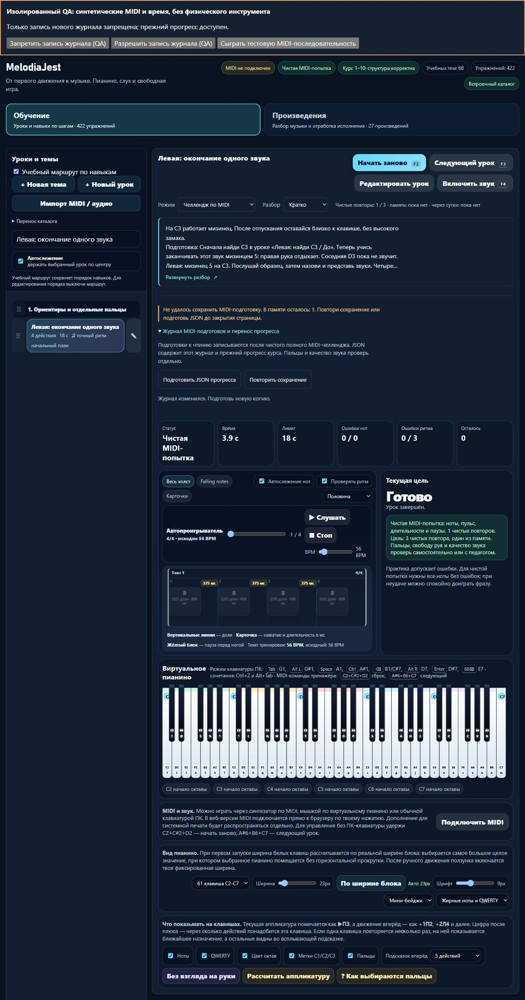

# MelodiaJest — запись полных MIDI-подготовок и восстановление сохранения

Сигнал: 6 ноября 2026, 11:05:48 UTC / 16:05:48 Asia/Yekaterinburg. Локальный релиз **23.5.25**. **Новых/пересмотренных уроков и новых планов — 0.** Завершён системный этап: контракт предыдущей партии подключён к реальному пути завершения попытки, отдельному хранилищу, ошибкам, повтору записи и JSON-экспорту. Рабочие версии reader **0.1.0**, Next **0.1.1** пересобраны с текущей базой; полная миграция не объявляется готовой.

## Рабочий путь

После последнего отпускания чистой полной попытки `completeLesson` передаёт в отдельный модуль фиксированный снимок MIDI-событий, режима, помощи, ошибок, темпа и границы наблюдения. Записываются четыре непосредственные полные подготовки двух планов чтения: `course02-02`, `course03-02`, `detail-p-release-01`, `detail-p-release-02`. Практика, экранный ввод, незавершённая/подсказанная попытка и фрагмент не создают такую запись. Предыдущий оценщик и его музыкальные отпечатки не менялись; данные повторно проверяются им же.

Новый ключ **`music-preparation-piano-v1`** отделён от прежнего прогресса. Вкладки согласуют добавление через Web Lock: свежее чтение → проверка → запись → обратное чтение. Старые редакции, дополнительные поля и конфликтующие/повреждённые данные не заменяются пустым журналом. Повтор той же записи не создаёт дубликат. При пределе 512 записей или 2 000 000 символов старые данные не обрезаются.

При ошибке сохранения неизменяемый снимок остаётся в памяти страницы, видимы предупреждение, «Повторить сохранение» и «Подготовить JSON прогресса». JSON включает прочитанный журнал, восстанавливаемые записи текущей сессии и точную сырую строку старого прогресса. Недоступное чтение явно даёт неполную копию. Новый модуль не заменяет старый ключ; обычный старый зачёт продолжает обновлять его своим прежним путём. Неподтверждённые записи нужно экспортировать до закрытия страницы. Обработчик закрытия запрашивает предупреждение; реальная нативная модальная защита не проверена.

Журнал свёрнут по умолчанию, ошибки раскрывают восстановление. Экспорт создаётся только явным действием; при изменении журнала прежний снимок убирается. Этот недочёт обнаружен в браузерном тесте и исправлен регрессией: после повтора записи нельзя скопировать устаревший JSON, пропускающий новые события. В памяти и во время активного челленджа JSON отсутствует в DOM, кнопки переноса недоступны. Сохраняемые «Кратко / Развёрнуто / Скрыто» и пятистрочный учебный блок продолжают работать отдельно.

## Проверки

- **531/531** основных тестов в финальном полном запуске; **35** первоначальных целевых, затем **15/15** финальных проверок захвата/сохранения. Последнее расширение только регрессионного теста добавляет проверку полного журнала: 512 старых записей сохраняются, новая попадает в экспорт восстановления. Исполняемый код после финального полного запуска не менялся.
- Реальный путь `handleNoteOn / handleNoteOff → completeLesson`: обе руки, отпускания и трёхпальцевые уроки, завершение только после последнего NoteOff, отдельный журнал, прежние оценки/частные записи, режим памяти. Проверены отказ записи, неподтверждённое обратное чтение, повтор без дубля, конфликт ID, повреждённые/будущие форматы, две сотрудничающие вкладки под очередью lock и точный экспорт старого JSON. Это синтетические события, не физическое MIDI.
- Строгий **TypeScript 5.8.3** проверяет декларации новых модулей и совместимость с настоящими типами DOM Storage / LockManager. Установок зависимостей нет. Запуск и тесты корня по-прежнему не требуют npm-зависимостей.
- `npm run build:web`; **6/6** проверок нотного пакета; фактическая сборка Next.js **15.5.27 / React 19.3.0 / TypeScript 5.8.3** и **4/4** проверки экспорта/HTTP. На Windows сборка Next использовала штатно разрешённое чтение метаданных родительского пути; зависимости портала только читались, чужие `.env`, хуки и сервисы не затрагивались.
- Все **570** нормализованных записей и **570** версий зачёта совпадают с началом. Из 52 контрольных файлов изменены только `index.html`, `piano-learning-ui.css`, `package.json`; остальные 49 совпадают, включая оценщик, ноты, аппликатуру, baseline, MIDI/звук и гитарный маршрут. Новые файлы — store/capture и их `.d.ts`; тестовый загрузчик и allowlist сборки обновлены. В `guitarjest` ничего не записывалось. `trainer-content.json` отсутствовал и не создавался.
- Манифесты проверены по байтам/хешам: **23** браузерных ресурса основного пакета, **6** reader, **30** Next, плюс собственные манифесты. Все шесть прежних файлов reader неизменны; у его манифеста только новая базовая версия. Старый локальный `server.cjs` отдельно отдал три новых скрипта точно; контентный API и Windows-endpoint не вызывались. В публичной сборке по-прежнему только разрешённые браузерные файлы.

Музыкальные `audit:lessons / audit:fingering / audit:curriculum` повторно не запускались: музыкальные данные, алгоритм оценки и маршрут сохранены побайтно, их доказательства партии 23 применимы. `audit:piano-coverage` и `audit:preparations` проверяют текущие контракты. Наличие записей не продвигает будущие планы автоматически.

## Браузерный результат

Обычная сборка проверена на изолированном адресе **4206**. На отдельном стенде **4207** работали настоящие модули и обработчики приложения; видимые QA-кнопки подавали **синтетические MIDI и время**, все ключи хранилища имели отдельный тестовый префикс. Стенд находится только в `tmp`, не входит в релиз.

Проверены отказ записи после чистой попытки справа и слева, экспорт несохранённых событий, повтор с тем же ID без дублирования, точная сохранность частной записи/архива старого прогресса, две записи после перезагрузки и обновление JSON после изменения журнала. В памяти при сохранённом развёрнутом разборе: экспортных полей **0**, полного/краткого разбора **0**, кнопка экспорта отключена. Нативные Enter и пробел работают. При **390 px** clientWidth/scrollWidth **376/376**, textarea помещается в 318,4 px. Ошибок консоли нет. Тестовые вкладки/серверы закрыты, viewport сброшен, обычный preview 4173 не затронут.

Дополнительно: [мобильный экспорт](../qa/piano-2026-11-06-25-journal-mobile.png), [verification JSON](piano-curriculum-2026-11-06-25-verification.json), журналы и экспортные снимки `tmp/piano-batch-49-*`.

## Источники, навыки и продолжение

Свежие первичные чтения: [W3C Web Locks](https://www.w3.org/TR/web-locks/), введение и request, согласование ресурса между контекстами origin; [WHATWG Web Storage](https://html.spec.whatwg.org/multipage/webstorage.html), 12.2.3, доступность/ошибки хранения; [W3C Web MIDI](https://www.w3.org/TR/webmidi/), 5.5, байты сообщений и временные метки. Эти документы не подтверждают физическое исполнение, пальцы и художественное качество. Программные пределы/допуски заданы проектом. Журнал источников обновлён с конкретными ID подготовок и ограничениями.

find-skills использован через skills.sh и проверенные первичные навыки. Применены frontend-design, web-design-guidelines и рекомендации по версиям/минимальности хранилища: один ненавязчивый свёрнутый блок, доступные нативные действия, предупреждение сохранения, явная полнота экспорта, фокус и 390 px. Сохранена палитра/типографика пюпитра, декоративные счётчики/анимации не добавлялись. Навыки, плагины и библиотеки не устанавливались; React-оболочка основного тренажёра на этом этапе не переносилась.

Курс: **422** учебные записи, **158** действующих MIDI-контрактов, **82** подробных описания/сопоставления, **6** будущих планов, независимых преподавательских проверок **0**. В банке чтения 0 новых первых проб. Оценка нужного фрагмента, импорт новой копии на другой адрес, экранный допуск и неопубликованный банк ещё не подключены; полная веб-миграция не завершена.

Следующий точный шаг — подготовить отдельную оценку участка 0–4 без зачёта родительского упражнения, явно решив темп 56 BPM будущего чтения против 62/60 BPM источников. Затем проверить импорт пакета с сохранением редакций/архивов и отказом замены отличающегося местного журнала; только после этого подключать допуск чтения. Физическое MIDI, нативное прерывание/диалог закрытия и преподавательская экспертиза остаются отдельными статусами. Домен, DNS, хостинг, публикация, портал и секреты не менялись; commit/push не выполнялись. Квота until-exhausted, резерв 0%; штатное наблюдение общей квоты записано в verification JSON.
