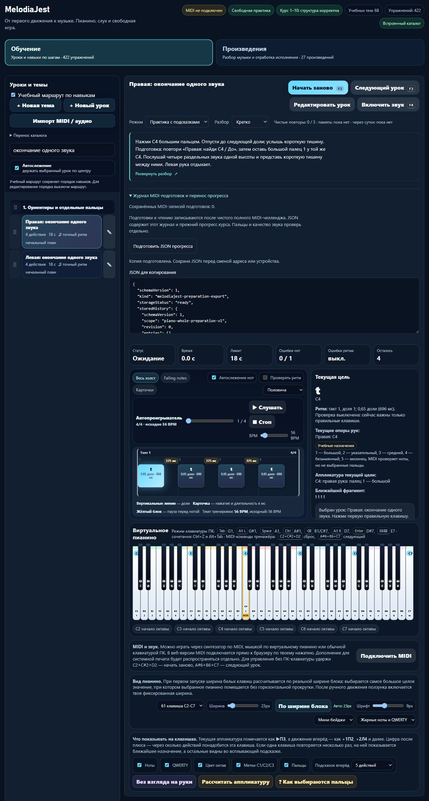

# MelodiaJest — явная версия короткой подготовки, 6 ноября 2026, партия 26

Локальный релиз **23.5.26** фиксирует две подготовки C–D–D–E–E как отдельные фрагменты 0–4 с учебной целью **56 BPM** и собственным ключом оценки. Проверены чистый контракт и отдельный журнал хранения. Захват фрагмента из тренажёра, кнопка выбора и совместный экспорт ещё не подключены. Это системный этап: **0 новых уроков**, 0 новых планов, уточнены подготовки двух существующих будущих планов.

## Музыкальное решение

| Будущий план | Источник и исходный BPM | Включительные индексы | Высоты MIDI | Пальцы | Цель |
| --- | --- | --- | --- | --- | --- |
| `detail-p-read-treble-01` | `course02-06`, 62 BPM | 0–4 | 60, 62, 62, 64, 64: C4–D4–D4–E4–E4 | правая 1–2–2–3–3 | отдельные повторные атаки D/E, 56 BPM |
| `detail-p-read-bass-01` | `course03-06`, 60 BPM | 0–4 | 48, 50, 50, 52, 52: C3–D3–D3–E3–E3 | левая 5–4–4–3–3 | те же повторы своей рукой, 56 BPM |

Пять исходных четвертей начинаются на долях 0, 1, 2, 3, 4; последняя должна быть отпущена. Педаль не используется. Первая нота задаёт начало относительного времени; задержка реакции не считается доказательством ритма. На повторных D и E нужны новое нажатие и отпускание, а не удержанный звук. Фрагмент сохраняет исходные высоты, длительности, руку и пальцы. Все 16 действий родительских упражнений и их темпы остались прежними.

Происхождение — техническая учебная адаптация проекта `three-note-repeat-preparation-v1`, не фрагмент авторского произведения и не упражнение, утверждённое издателем. Выбрано 56 BPM, чтобы отделить небольшую подготовку от полного пятипальцевого задания и согласовать её с примером будущего чтения. Это проектное решение, не требование первоисточника. План сохраняет подготовку своей руки, отдельное отпускание и будущий независимый перенос; знакомые пять звуков не засчитываются за чтение или слух нового материала. Новых самостоятельных целей ради темпа не добавлено.

## Исполняемый код

`piano-preparation.js/.d.ts` компилирует явную адаптацию с версией, ID, происхождением и исходным BPM. Ключ связывает её с родительской MIDI-редакцией, диапазоном и целевым темпом. Неизвестная версия, необъяснённое изменение, неверный темп и адаптация целого требования отклоняются. Текстовое пояснение не создаёт другую музыку. Прежние нативные фрагменты 62/60 остаются читаемой историей, их события не становятся доказательством новой версии автоматически.

Ключи всех **четырёх полных подготовок** и их профили совпадают с сохранённым снимком до изменения. `PracticeAssessment` не переписывался: применён настоящий оценщик. Три чистые попытки с одной из памяти меняют только состояние фрагмента; оба целых требования остаются ожидающими собственных событий. Возврат через сутки — отдельная отметка. Полное упражнение не подменяет фрагмент и наоборот.

`PianoPreparationStore.fragments` имеет собственные ключ `music-preparation-fragments-piano-v1`, Web Lock `melodiajest:piano-preparation-fragments-v1` и область `piano-fragment-preparation-v1`. Старый `Store.create` сохраняет прежний ключ и принимает только `whole`; новый принимает только `fragment`. Общая реализация транзакции сохраняет блокировку, свежий снимок, повторную оценку событий, write/readback и отказ при конфликте или переполнении. Никакой автоматической миграции и чтения другого журнала нет. Дополнительные поля и архивные редакции сохраняются. Неизвестный `now` теперь блокирует также чтение пустого журнала.

Плановый валидатор требует явную адаптацию там, где она объявлена моделью; её BPM должен совпадать с целью плана. `audit:preparations` показывает 2 контракта / 6 требований, отдельную область фрагментов, `captureUiConnected: false` и два `pending` на пустой истории. Схема контракта остаётся v1 с необязательным добавлением: четыре прежних целых требования не инвалидированы. Числа и ограничения приложения не приписаны музыкальным авторам.

## Проверка и сохранность

- `npm test`: **547/547**, 0 ошибок, 195132 мс. Добавлены 15 проверок фрагментов/разделения хранения и одна проверка планового требования адаптации. Первоначальный целевой прогон до добавления последней проверки: 54/54; итоговый полный прогон включает все изменения кода.
- Строгий TypeScript с настоящими DOM `Storage`/`LockManager`: exit 0. Типы не позволяют передать журнал фрагментов нынешнему производителю целых попыток или принять его за историю полного урока.
- `audit:lessons`: после исправлений противоречий нет. `audit:fingering`: структурных отказов нет, начальные 80 уроков / 1036 назначений проходят; остаются **83 неподдержанных действия** и **10 отмеченных уроков**. `audit:curriculum`: `hardErrors: []`. Аудиты не являются педагогической сертификацией всего корпуса.
- `audit:preparations` и аудит покрытия выполнены по настоящим данным. Готовых учебных записей **422**, произведений/фрагментов **148**, MIDI-контрактов маршрута **158**, структурированных/сопоставленных **82**, будущих планов **6**, независимая преподавательская проверка **0**. Верхняя оценка 415 групп после известных повторов не является проверенным числом уникальных целей; бюджет матрицы 1310 не является 1000 описанных уроков.
- `build:web`: 23 разрешённых ресурса. Необязательный React-reader: 6/6; Next.js: 4/4 и production build. Версии пакетов 0.1.0/0.1.1; базовый релиз 23.5.26. Установка зависимостей не выполнялась, использован уже установленный инструментарий портала только для чтения. ESLint этой конфигурацией отключён; успешная сборка не объявляется lint-проверкой.
- Все хеши трёх манифестов сверены. Шесть ресурсов reader побайтово прежние, обновлён его манифест. 17 общих Next runtime chunks прежние; HTML/RSC и два пути манифестов пересобраны с новым build ID. Это не полная миграция музыкального приложения.
- Снимок до/после: **все 570 встроенных записей и 570 MIDI-редакций совпадают**. Из 56 защищённых файлов 51 прежний; намеренно изменены только `package.json`, `piano-preparation.js/.d.ts`, `piano-preparation-store.js/.d.ts`. Старые capture, оценщик, аппликатура, аудио и baseline не менялись. Гитарный маршрут совпадает; записи в `guitarjest` нет. `trainer-content.json` отсутствовал и не создавался.
- Настоящий локальный `server.cjs` без зависимостей проверен через временный loopback-порт: три модуля отдаются точно; запросов content API и native endpoint не было. Сервер закрыт.

Изолированный браузерный origin `127.0.0.1:4208`: прежний полный журнал открывается Enter и экспортирует корректный v1 JSON с `scope: piano-whole-preparation-v1`. При «Развёрнуто» → «Из памяти» JSON отсутствует в DOM, кнопка недоступна, ноты/учебный разбор скрыты. Ошибок консоли нет. Это регрессия прежнего пути после общего refactor, **не проверка нового экрана фрагмента или физического MIDI**. Вкладка и собственный сервер закрыты; обычный 4173 не менялся. CSS/макет не изменялись, измерений ускорения нет.

## Первичные источники и навыки

Повторно прочитаны [Bob Duke / Amy Simmons, Tips for Effective Practice](https://cml.music.utexas.edu/online-resources/intelligent-music-practice/10-tips-for-effective-practice), разделы о небольшой цели, минимальном упрощении и распределении занятий; [Jerry Kovarsky / Yamaha, 28.11.2023](https://hub.yamaha.com/keyboards/k-how-to/the-basics-of-piano-keyboard-fingering/), The Basics и Scenario One. Они поддерживают выбранное направление работы и нумерацию пальцев, но не публикуют наш рисунок, темп, зачёт или длительность освоения. Новые исторические утверждения не добавлены.

Прочитаны [WHATWG Web Storage, 12.1/12.2.3](https://html.spec.whatwg.org/multipage/webstorage.html) и [W3C Web Locks, Introduction/LockManager.request](https://www.w3.org/TR/web-locks/). В журнал источников добавлены применения и повторные проверки четырёх существующих записей; новых ID источников нет. Через `find-skills` проверен [skills.sh](https://skills.sh/), переиспользовано первичное правило Vercel `client-localstorage-schema`: отдельные версии, ограниченный снимок и обработка ошибок. Пример удаления старого ключа не применялся. React-экран и дизайн не менялись, новых навыков/плагинов/библиотек не установлено.

## Ограничения и точное продолжение

Фрагментный API ещё не вызывается тренажёром; новый ключ сам при загрузке не создаётся. Нынешний JSON интерфейса включает только полный журнал и прежний сырой прогресс. **Он ещё не переносит фрагменты.** До включения их захвата нужен совместный экспорт с доступными несохранёнными данными, повтором того же ID и защитой памяти. Затем — явный проверенный импорт с сохранением всех архивов и отказом замены отличающейся местной истории. Прежний результат полного упражнения не должен изменяться от пятинотной попытки.

Следующий этап: явный выбор подготовки 0–4/56 BPM, фиксация диапазона/редакции/помощи до попытки, завершение после последнего отпускания и запись только в `Store.fragments`; одновременно подключить её к восстановлению и JSON обоих журналов. Потом импорт и допуск чтения с действительно неопубликованным подготовленным банком. Сейчас в банке **0 новых первых проб**; шесть будущих уроков не продвинуты в готовые. Проверка настоящего MIDI, нативного прерывания и преподавателя остаётся отдельной.

Публикации, покупки домена, DNS, изменений портала, commit/push не было. Проверка обычной квоты выполнялась в начале и перед тяжёлыми частями; последняя запись — в приложенном JSON. Это общий показатель аккаунта, не индивидуальный бюджет и не аппаратное отсечение.

Доказательства: [машинная сводка](piano-curriculum-2026-11-06-26-verification.json), [контракт](../PIANO_PREPARATION_CONTRACT.md), `tmp/piano-batch-50-before.json`, `tmp/piano-batch-50-preservation.json`, `tmp/piano-batch-50-tests.log`, `tmp/piano-batch-50-types.log`, `tmp/piano-batch-50-{lessons,fingering,curriculum,preparations,reader,next,build-web}.log`, `tmp/piano-batch-50-browser.json`, `tmp/piano-batch-50-local-server.json`. Снимок прежних контрактов для совместимости: `tests/fixtures/piano-preparation-before-adaptation-v1.json`; исходный lesson-review baseline не пересоздавался.
