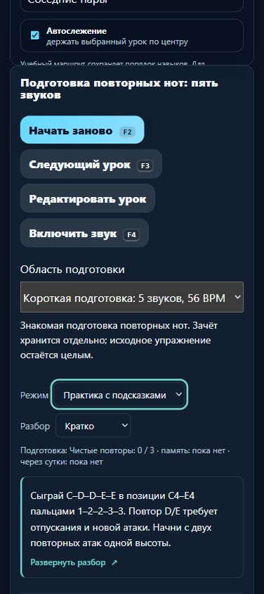

# MelodiaJest — отдельная попытка короткой подготовки, 6 ноября 2026, партия 27

В локальном релизе **23.5.27** короткие подготовки обеих рук подключены к настоящему тренажёру. У «Соседних пар» появился выбор полного упражнения или первых пяти звуков на 56 BPM. Челлендж и память заканчиваются после последнего отпускания; результат фрагмента записывается отдельно. JSON включает оба журнала и исходную строку прежнего прогресса. **Новых уроков и планов — 0**: это системная интеграция двух ранее проверенных подготовок.

## Что можно проверить в приложении

Открыть «Соседние пары» (`course02-06`) или «Соседние пары левой» (`course03-06`), выбрать «Короткая подготовка: 5 звуков, 56 BPM». Ноты, карточки, подсказки и проигрыватель ограничены C–D–D–E–E. Правая: C4–D4–D4–E4–E4, пальцы 1–2–2–3–3; левая: C3–D3–D3–E3–E3, 5–4–4–3–3. Сохранены исходные четверти и целевой профиль `three-note-repeat-preparation-v1` из партии 26. Исходные темпы 62/60 BPM и все 16 действий родителей не переписаны.

Выбор заблокирован после начала попытки. Первая нота фиксирует область, редакцию, режим и BPM. Неудачный, ручной, подсказанный или прерванный ответ не записывается. Переключение выбранного MIDI-входа во время фрагмента прерывает зачёт. Идентификация двух музыкальных редакций явная: переименование/личная заметка допустимы, изменённая музыка требует новой проверки; для неё видимо ограничение короткой подготовки. Новые профили не угадываются по названию или регистру.

`piano-preparation-fragment.js/.d.ts` хранит проверенный выбор и полный разбор: зачем повторять D/E, необходимые уроки своей руки, медленный разбор, счёт, слуховой образ, отпускания и типичные ошибки, самопроверку и возврат после перерыва. Происхождение — техническая адаптация проекта. Превью использует существующий ленивый компонент; полный текст строится при раскрытии. Краткий/развёрнутый/скрытый вид сохраняется, скрытый блок возвращается доступным селектором. В памяти отсутствуют разбор, выбор с ответами, нотный холст, клавиатурные подсказки и JSON независимо от этой настройки.

## Запись, восстановление и перенос

Производитель `piano-preparation-capture` использует общий механизм для двух явно разделённых областей. Полные подготовки продолжают работать с `music-preparation-piano-v1`; фрагменты используют `music-preparation-fragments-piano-v1`. Каждый сохраняется через существующую свою Web Lock и write/readback. Вновь оцениваются фактические on/off-события, сохраняется независимый снимок. В процессе записи повтор/F2 не меняет отправленную попытку. Неподтверждённая запись остаётся доступна в памяти; только подтверждённый журнал даёт счётчик подготовок.

Фрагментная ветка `completeLesson` возвращает результат до вызова старого `PracticeAssessment.record` для полного урока. Ни успешная, ни неудачная пятинотная попытка не переписывает `music-learning-piano-v1`, его личные поля или архивы. Пять нот не превращаются в зачёт 16 действий. Включённое сохранение подготовки не означает готовность чтения с листа.

Кнопка «Подготовить JSON прогресса» теперь даёт **схему 2** `melodiajest-preparation-export`: `journals.whole`, `journals.fragments`, `legacy`, `completeCopy`. У каждого журнала есть распознанная история, исходный raw JSON, доступность и `recoveryEntries`. Непрочитанный/повреждённый журнал не заменяется пустой успешной историей. `completeCopy` означает доступный снимок обоих журналов и старой строки; восстановительная запись может ещё не быть сохранена в localStorage. Старый программный API экспорта v1 сохранён, импорта пока нет.

Исправлен подтверждённый случай: если сохранённый ID совпадает с ID другой несохранённой попытки, фильтрация только по ID скрывала бы её из recovery. Теперь сравнивается полное содержимое, экспорт сохраняет обе конфликтующие записи. Свежесть локальной копии сверяется по поколениям обоих снимков: изменение между чтениями требует новой копии; последующее изменение убирает прежний JSON. Есть регрессия фактического обработчика и конфликта ID.

Два ключа читаются последовательно, общей атомарной транзакции с прежним прогрессом нет. Несохранённые данные другой вкладки не входят в копию этой страницы. При исчерпании 512 записей в отдельном журнале архив не обрезается. Сохранение/экспорт не удостоверяют устройство, исполнителя, пальцы или художественное качество. Нативное предупреждение закрытия страницы запрашивается для pending обоих производителей; системный диалог в этой партии не подтверждался.

## Проверка

- `npm test`: **560/560**, 0 ошибок, 212987 мс. Добавлены 13 содержательных интеграционных проверок фрагментов. Финальный целевой прогон — **13/13**, после усиления уже существующей проверки экспорта каталога при активной пятинотной области. Исполняемый код приложения после полного прогона не менялся; дополнен аудит соответствия профилей.
- Строгий TypeScript с реальными DOM `Storage`/`LockManager`: exit 0. Фрагментный производитель требует явные partial scope и requirement; типы журналов не взаимозаменяемы. Проверены замороженные данные, тип нового пакета v2 и совместимость старого производителя.
- `audit:lessons`: после исправлений противоречий нет. `audit:fingering`: структурных отказов нет, начальные 80 уроков / 1036 назначений проходят; остаются **83 неподдержанных действия** и **10 отмеченных уроков**. `audit:curriculum`: `hardErrors: []`. Эти результаты не являются экспертизой педагогом.
- `audit:preparations`: 2 плана / 6 требований, оба пустых состояния `pending`. Проверяется совпадение публичных профилей с реальными плановыми требованиями; подключение фрагмента и схема экспорта v2 отражены явно. Все **6 требований и их ключи** совпадают с партией 26.
- Каталог и версии: **570/570 записей и 570/570 MIDI-редакций прежние**. Экспорт при активном фрагменте также сохраняет весь каталог. Из 56 защищённых файлов 51 прежний; намеренно изменены `index.html`, `piano-learning-ui.css`, `package.json`, `piano-preparation-capture.js/.d.ts`. Новые — модуль fragment и его типы. Изменены соответствующие загрузчик тестов, allowlist и аудит; оценщик, аппликатура, музыка, аудио и `lesson-review-baseline.js` не переписывались. Гитарный маршрут совпадает, `guitarjest` не изменялся. `trainer-content.json` отсутствовал и не создавался.
- Веб-сборка: **24 разрешённых ресурса**. Необязательный reader — 6/6, Next — 4/4 и production build; их пакеты остаются 0.1.0/0.1.1 с базовым релизом 23.5.27. Все манифесты и хеши сверены. Шесть ресурсов reader и 17 Next runtime chunks прежние; generated HTML/RSC и build ID пересобраны. Использован уже установленный инструментарий портала, без установки зависимостей и записи в другой проект. ESLint конфигурацией Next отключён; сборка не объявляется lint-проверкой.
- Локальный запуск без зависимостей проверен настоящим `server.cjs` на временном loopback-порту: 4 модуля отдаются точно; content API и native endpoint не вызывались. Сервер закрыт. Корень проекта не является публичным выпуском.

Матрица: **422 учебные записи**, **148 фрагментов произведений**, **158 MIDI-контрактов маршрута**, **82 структурированные/сопоставленные записи**, **6 будущих планов**, **0 независимых преподавательских проверок**. Известные повторения и контрольная запись учитываются отдельно; 415 — верхняя оценка групп после этих исключений, не подтверждённый счёт уникальных целей. Бюджет матрицы 1310 не является 1000 готовых индивидуальных планов. Новые системные попытки и варианты BPM эти числа не увеличили.

## Браузерные доказательства

Обычная сборка проверена на `127.0.0.1:4209`, синтетический стенд — на `127.0.0.1:4210` с собственным префиксом `melodiajest-qa51:`. Стенд явно обозначает MIDI/время как синтетические и использует настоящие модули и обработчики; в публичной сборке его нет. Реальные MIDI-разрешения и устройство не открывались.

Запрет записи фрагмента оставил один pending, видимую ошибку и восстановительные события в v2 JSON. Повтор записал тот же ID один раз; устаревший JSON исчез. После двух челленджей и памяти правая подготовка показывала 3/3 и память, родитель — 0/3, 16 нот, 62 BPM. Левая имела свой отдельный результат. После reload сохранены 4 уникальных попытки, 0 recovery, полный журнал пуст, прежняя строка с личной записью/архивом побайтово совпадает. Отсроченная память не отмечена.

Enter раскрывает новый разбор, пробел сворачивает; скрытый вид переживает reload. В памяти при сохранённом «Развёрнуто» — 0 учебных карточек, 0 scope-select, 0 JSON, 0 `data-score-step`. На ширине 390 px документ client/scroll **376/376**, селектор **318,4 × 44 px**, краткий текст около четырёх строк. Обе консоли без ошибок. Собственные вкладки и порты 4209/4210 закрыты, размер браузера возвращён; обычный 4173 не менялся.

Изображения: [ошибка и восстановительная копия](../qa/piano-2026-11-06-27-recovery.png), [обычный экран](../qa/piano-2026-11-06-27-fragment.png), мобильный экран выше. JSON до/после — `tmp/piano-batch-51-pending-export.json`, `tmp/piano-batch-51-saved-export.json`; сводка — `tmp/piano-batch-51-browser.json`.

## Источники, навыки и продолжение

Прочитаны [Duke / Simmons](https://cml.music.utexas.edu/online-resources/intelligent-music-practice/10-tips-for-effective-practice), разделы о небольшой цели, слуховом образе и минимальном упрощении; [WHATWG Web Storage, 12.1/12.2.3](https://html.spec.whatwg.org/multipage/webstorage.html); [Web MIDI, Abstract](https://www.w3.org/TR/webmidi/). MIDI предоставляет сообщения и не описывает художественный смысл исполнения. Темп, три повтора, сутки, форматы и программные допуски — решения проекта, не требования этих источников. Исторических атрибуций не добавлено.

`find-skills` использован через [skills.sh](https://skills.sh/); переиспользованы проверенные первичные `frontend-design` и [web-design-guidelines Vercel](https://raw.githubusercontent.com/vercel-labs/web-interface-guidelines/main/command.md). Сохранён пюпитр и существующая типографика; один нативный выбор рядом с практикой, доступные подписи/фокус/ошибки, минимум 44 px и ленивый разбор. Новых навыков, плагинов или библиотек нет. Нового React-экрана или измеренного ускорения этот этап не заявляет. В журнал источников добавлены применения четырёх существующих записей, число ID остаётся прежним.

**Следующий шаг:** безопасный импорт v2 с обоими журналами, raw прежнего прогресса и recovery; старый v1 поддержать явно. Сначала проверить весь пакет без записи: версии, границы, события, архивы, конфликты ID и отличающиеся местные данные. Перед сохранением предусмотреть конкретную проверяемую стратегию частичного сбоя между ключами; отличающуюся историю не заменять молча. После импорта — допуск чтения и действительно неопубликованный посильный банк. Сейчас банк имеет **0 новых первых проб**, шесть будущих планов не внедрены. Проверка настоящего MIDI, нативного прерывания/диалога закрытия и преподавателя остаётся отдельной.

Домен не покупался, DNS/портал/хостинг/секреты не менялись; публикации, commit/push не было. Штатная квота проверялась в начале и перед тяжёлыми частями, резерв 0%; последняя запись приложена к машинной сводке. Это показатель общего аккаунта, не индивидуальный бюджет и не аппаратное отсечение.

Доказательства: [машинная сводка](piano-curriculum-2026-11-06-27-verification.json), [контракт](../PIANO_PREPARATION_CONTRACT.md); `tmp/piano-batch-51-before.json`, `tmp/piano-batch-51-preservation.json`, `tmp/piano-batch-51-tests.log`, `tmp/piano-batch-51-fragment-final.log`, `tmp/piano-batch-51-types.log`, `tmp/piano-batch-51-{lessons,fingering,curriculum,preparations-final,coverage,reader,next,build-web}.log`, `tmp/piano-batch-51-local-server.json`.
